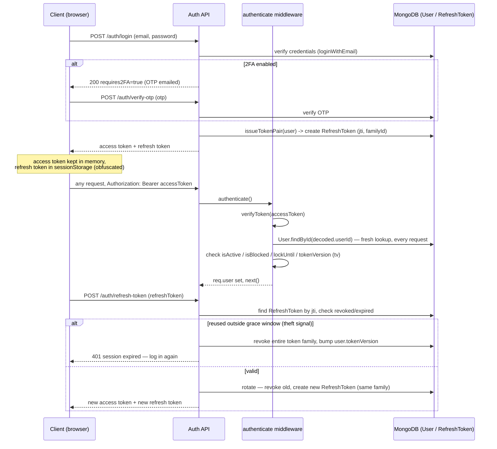
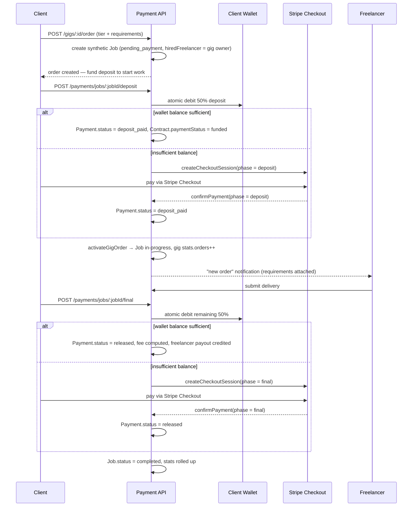
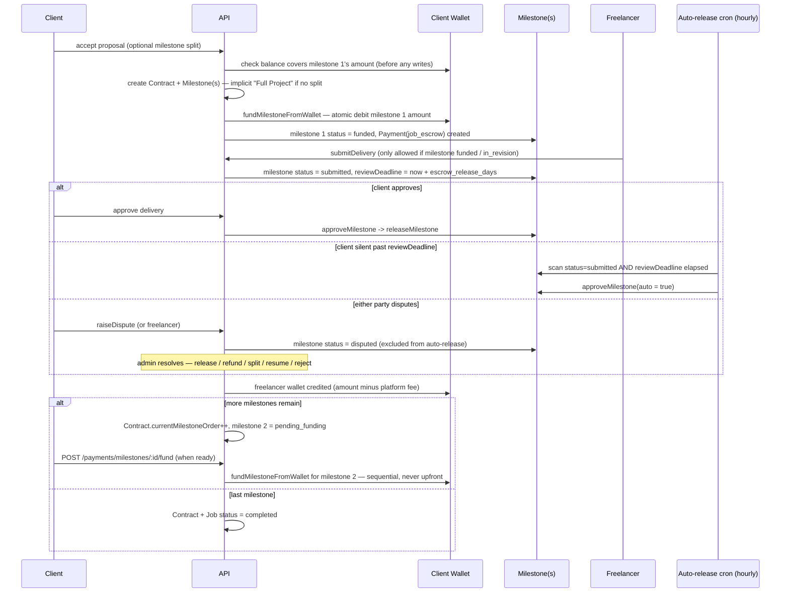
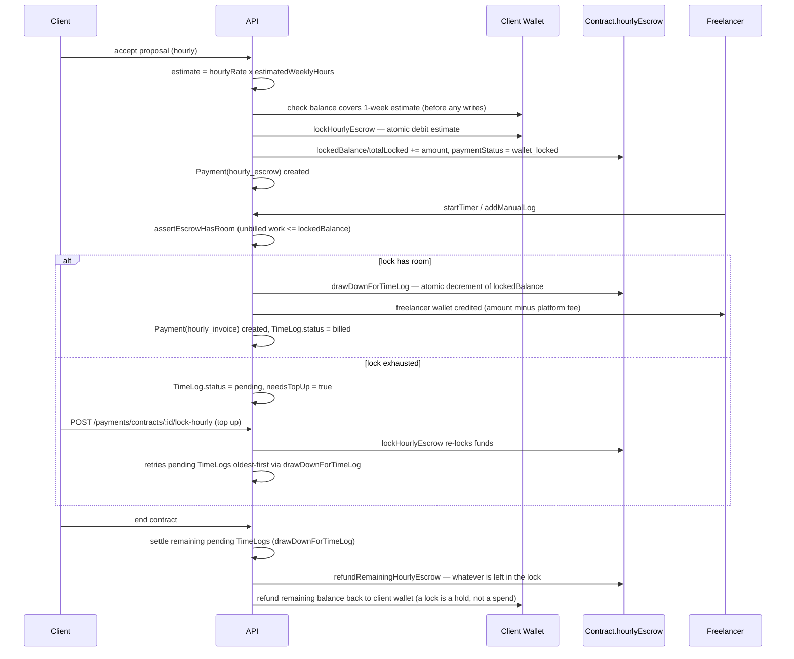

# SkillKart — Backend API

Express + MongoDB REST API powering the SkillKart marketplace: authentication, RBAC, jobs, gigs, proposals, contracts, escrow payments, messaging, reviews, disputes, an admin panel, and AI-assisted tooling.

> Part of the [SkillKart monorepo](../README.md). For full-stack setup, start there.

## Features

- **Authentication** — email/password + OTP, JWT access & refresh tokens, optional Supabase social OAuth.
- **RBAC** — role-based access control (guest, freelancer, client, admin roles) with an encrypted SuperAdmin.
- **Marketplace** — jobs, gigs, proposals, and a strict contract lifecycle (proposal → contract → delivery → review) modelled as state machines.
- **Payments** — fixed-price jobs lock 100% escrow from the client's wallet at hire (optionally split into sequential milestones, 7-day auto-release, per-milestone disputes); hourly contracts lock a one-week estimate from the client's wallet at hire and bill automatically per logged hour (see [Escrow & Milestone Payments](#escrow--milestone-payments) below). Gig orders are the only flow still on the original Stripe-backed deposit/final split, with a simulated/dummy mode for local development. Wallet balances, payouts, and withdrawals throughout. No wallet balance is required to post/publish a job — the balance is only checked when a proposal is accepted.
- **Messaging** — conversation-based in-app messaging tied to contracts.
- **Reviews & disputes** — two-way reviews and an admin-mediated dispute workflow.
- **Skill verification** — skill taxonomy, matching, and test attempts.
- **Admin panel API** — isolated auth and endpoints under an admin prefix.
- **AI services** — Buddy assistant, cost estimation, skill matching, and CV analysis via a provider router with automatic fallback across **Gemini, DeepSeek, Qwen, Groq, Claude, and Ollama** (local). Gemini and DeepSeek implement the full method set; Qwen/Groq/Claude cover the core 6 (CV parsing, skill tests, validation, industry recommendation) and the router falls through per-method for the rest. The chain order is env-driven by numbered priorities (`AI_PRIORITY_<NAME>`, 0 = first; `-1` disables a provider). When all providers fail it returns a clean `503` ("AI temporarily out of service") rather than a 500 — the app never crashes on an AI outage.
- **Hardening** — Helmet, rate limiting, request validation, sanitization, structured logging (Winston), Swagger API docs, and an `unhandledRejection` guard that keeps operational errors from taking down the server.

## Prerequisites

- Node.js ≥ 22.3.0, npm ≥ 9 (see `engines` in `package.json`)
- A MongoDB connection string (local or Atlas)

## Setup

```bash
npm install
cp .env.example .env      # then edit — at minimum set MONGODB_URI, JWT_SECRET, JWT_REFRESH_SECRET
npm run setup:superadmin  # optional: create the SuperAdmin account
npm run dev
```

Once running:

- API base → `http://localhost:5000/api/v1`
- Health check → `http://localhost:5000/health`
- Swagger docs → `http://localhost:5000/api/v1/docs`

See [`.env.example`](.env.example) for the full, documented list of environment variables.

## Project Structure

```
src/
├── config/         Application configuration (env, DB, integrations)
├── controllers/    HTTP request handlers
├── middleware/     Auth, RBAC, validation, error handling, rate limiting
├── models/         Mongoose schemas — the source of truth
├── routes/         API route definitions (mounted under /api/v1)
├── services/       Business logic (payments, AI, skill matching, ...)
├── validators/     express-validator request schemas
├── webhooks/       Stripe / external webhook handlers
├── utils/          Shared helpers
├── scripts/        Operational scripts (see below)
├── app.js          Express app assembly
└── server.js       HTTP server bootstrap
```

## Authentication & RBAC

JWT access + refresh tokens (`src/utils/jwt.js`, `src/middleware/auth.middleware.js`).
`authenticate` re-fetches the user from Mongo on **every** request (never trusts the JWT
payload alone) and checks `isActive`, `isBlocked`, lock state, and `tokenVersion` (`tv` in
the token) — bumping `tokenVersion` invalidates every previously-issued token, which is how
"log out all devices" and password-change work. Refresh tokens are tracked server-side in
a `RefreshToken` collection (`jti` + `familyId`) so they can be revoked, and rotate on every
use: reusing an already-rotated refresh token outside a short grace window is treated as a
theft signal, which kills the whole token family and bumps `tokenVersion`.

Roles: `superadmin` (bypasses all role checks — a special `userId === 'superadmin'` token
short-circuits `authenticate` to a synthetic user with no DB lookup), `admin`,
`contenteditor`, `freelancer`, `client`, `publicviewer`. Role → permission/resource maps
live in `src/middleware/rbac.middleware.js`. The **admin panel** has fully separate auth
(separate `admin_token` cookie, separate `ADMIN_JWT_SECRET`, separate middleware) — see
`src/middleware/adminAuth.middleware.js`, never mixed with marketplace JWTs.



## Scripts

| Script | Description |
|--------|-------------|
| `npm run dev` | Start the API with nodemon (auto-reload) |
| `npm start` | Start the API (nodemon) |
| `npm run setup:superadmin` | Create/rotate the encrypted SuperAdmin credentials |
| `npm run seed:demo` | Seed a full, realistic, interconnected demo dataset |
| `npm run seed:demo:small` | Seed a small dataset for a quick smoke run |
| `npm run migrate:hourly-escrow` | One-time backfill: locks wallet escrow for hourly contracts created before the wallet-lock system existed (`scripts/migrateHourlyEscrow.js`). Idempotent — dry-run by default, add `-- --apply` to write. |
| `npm run migrate:skill-verification` | One-time backfill: re-evaluates already-tested skills against the current verification threshold and flips `isVerified` where it now qualifies (`scripts/backfillSkillVerification.js`). Idempotent — dry-run by default, add `-- --apply` to write. |
| `npm run lint` | Lint `src/` with ESLint |
| `npm run format` | Format `src/` with Prettier |

### Demo data

`scripts/seedDemoData.js` populates the existing models with a coherent marketplace — users (realistic Pakistani names), jobs, gigs (covering every category), proposals, contracts, **milestones** (real `Milestone` documents for fixed-price contracts, each with a correctly-linked per-milestone `Payment`), payments (including a real wallet-lock `Payment` for hourly contracts), deliveries, messages, reviews, testimonials, disputes (contract-level for hourly, milestone-level for fixed-price — matching the real dispute model), notifications — spread across the last ~12 months, with full referential integrity (no orphaned records). Gig orders are still seeded as listings only — there's no order/purchase lifecycle in the seeder yet, so the legacy 50/50 Stripe deposit/final flow isn't exercised by demo data.

```bash
npm run seed:demo            # full dataset (clears marketplace collections first)
npm run seed:demo -- --keep  # append instead of clearing
npm run seed:demo:small      # smaller dataset
```

Demo logins (including the **admin dashboard** at `/admin-panel/login`) are documented in the [root README](../README.md#seeding-demo-data). The admin credentials come from `ADMIN_EMAIL` in `.env` — change them for any real deployment.

## Email

Transactional email (OTP, security alerts, contact form) runs on a pluggable
provider architecture. The active transport is chosen with **one variable**:

```bash
EMAIL_PROVIDER=smtp    # or: gmail
```

Controllers and services never know which provider is active — they call
`email.service.js` and the factory resolves the transport.

| Provider | Value | Auth | Use when |
|----------|-------|------|----------|
| SMTP (Nodemailer) | `smtp` | Host + app password | Default. Simplest; works everywhere. |
| Gmail API | `gmail` | OAuth refresh token | Better deliverability/quota visibility than Gmail SMTP. |

### How it fits together

```
EMAIL_PROVIDER → registry → factory → provider.send() → SMTP | Gmail API
                                ↑
                     email.service.js  (stable public API)
```

```
src/services/email/
├── providers/
│   ├── provider.interface.js   Base class: send / verify / capabilities / defaults
│   ├── smtp.provider.js        Nodemailer transport
│   ├── gmail.provider.js       Gmail REST API + MIME builder
│   ├── registry.js             Declares available providers  ← add new ones here
│   └── factory.js              Selects provider, falls back to SMTP
├── templates/                  Provider-agnostic { subject, html } renderers
├── email.retry.js              Exponential backoff + error classification
└── email.metrics.js            In-process counters (sent/failed/retries/duration)
```

**Adding a provider** (SES, Brevo, Mailgun, …): create `providers/<name>.provider.js`
extending `EmailProvider`, add one line to `registry.js`. No other file changes.

### Settings

| Variable | Default | Purpose |
|----------|---------|---------|
| `EMAIL_PROVIDER` | `smtp` | `smtp` \| `gmail`. An unknown value fails at startup. |
| `EMAIL_ENABLED` | `true` | `false` skips all sends (still logged as `queued`). |
| `EMAIL_SANDBOX` | `false` | Redirects **all** mail to `EMAIL_SANDBOX_RECIPIENT`. |
| `EMAIL_SANDBOX_RECIPIENT` | — | Required when sandbox is on. |

SMTP uses `SMTP_HOST` / `SMTP_PORT` / `SMTP_SECURE` / `SMTP_USER` / `SMTP_PASSWORD` /
`SMTP_FROM_EMAIL` / `SMTP_FROM_NAME`. The older `EMAIL_HOST` / `EMAIL_PORT` /
`EMAIL_SECURE` / `EMAIL_USER` / `EMAIL_PASSWORD` / `EMAIL_FROM` names still work as
fallbacks, so existing deployments need no changes. Port `465` requires
`SMTP_SECURE=true`; port `587` requires `SMTP_SECURE=false`.

### Gmail API setup

> **This is not Supabase's Google sign-in.** Supabase Google OAuth authenticates
> *users*. This authorises **one dedicated platform mailbox** to send transactional
> mail on the app's behalf — a separate concern with separate credentials. The app
> performs no OAuth flow at runtime: it exchanges a long-lived refresh token for
> access tokens, and `googleapis` handles that internally.

1. **Google Cloud Console** → create (or pick) a project.
2. **APIs & Services → Library** → enable **Gmail API**.
3. **APIs & Services → OAuth consent screen**
   - User type: **External**, publishing status: **Testing**.
   - Add the platform Gmail account under **Test users**.
   - Add scope `https://www.googleapis.com/auth/gmail.send`.
   - Staying in *Testing* avoids Google's restricted-scope security assessment.
     Refresh tokens for test users expire after **7 days** — for a long-lived
     production sender, either complete verification or use SMTP.
4. **Credentials → Create credentials → OAuth client ID**
   - Type: **Web application**.
   - Authorised redirect URI: `https://developers.google.com/oauthplayground`
     (this is Google's OAuth Playground callback, used only for the one-time
     token generation in step 5 below — not contacted by the app itself).
5. Generate the refresh token with [Google's OAuth 2.0 Playground](https://developers.google.com/oauthplayground/):
   - Click the **gear icon** (top right) → check **Use your own OAuth credentials**
     → paste `GOOGLE_CLIENT_ID` / `GOOGLE_CLIENT_SECRET`.
   - In the scopes box on the left, paste `https://www.googleapis.com/auth/gmail.send`
     → **Authorize APIs**.
   - Sign in **as the platform account**, approve.
   - Click **Exchange authorization code for tokens** (step 2 in the Playground).
   - Copy the **Refresh token** field → that's `GOOGLE_REFRESH_TOKEN`. `GOOGLE_EMAIL`
     is the platform account address you just signed in as. Paste both into `.env`.
   - If the Playground doesn't return a refresh token (only an access token), an
     existing grant is being reused — revoke it at
     [myaccount.google.com/permissions](https://myaccount.google.com/permissions)
     and repeat the authorize step.
6. Set `EMAIL_PROVIDER=gmail` and restart. Startup should log:

   ```
   📧 Initializing Email Provider...
   ✅ Email Provider: Gmail API
   ```

**Scope:** only `gmail.send` is requested — the provider sends and never reads the
mailbox. That's why `verify()` proves the credentials by refreshing the access token
rather than calling a Gmail read endpoint (which would need a broader scope).

**Quota:** ~500 recipients/day for consumer Gmail, ~2,000/day for Workspace.

### Deploying Gmail to Railway

The refresh token is **not** machine-bound — generate it once locally and copy the
same value into Railway. `GOOGLE_REDIRECT_URI` is only used during the one-time
consent; production never contacts it, so it isn't needed as a Railway variable.

Set on Railway: `EMAIL_PROVIDER=gmail`, `GOOGLE_CLIENT_ID`, `GOOGLE_CLIENT_SECRET`,
`GOOGLE_REFRESH_TOKEN`, `GOOGLE_EMAIL`.

> ⚠️ **7-day expiry while the consent screen is in Testing.** Google expires refresh
> tokens after a week for unpublished apps, so Gmail sending stops ~7 days after each
> authorization until you repeat the OAuth Playground steps above and redeploy. The app falls
> back to SMTP automatically — but **Railway blocks outbound SMTP ports (465/587)**,
> so on Railway there is nothing to fall back to. For anything long-running there,
> either publish the consent screen (requires Google's restricted-scope review) or
> use an API-key provider (SendGrid/Brevo/Mailgun — one new file in `providers/`).
> Regenerating the **client secret** also invalidates existing refresh tokens.

### Behaviour

- **Startup verification** — the provider is health-checked at boot, so bad config
  surfaces immediately instead of on the first OTP.
- **Fallback** — if `EMAIL_PROVIDER=gmail` but the OAuth vars are missing or fail
  verification, the app logs a warning and runs on SMTP rather than refusing to boot.
- **Retry** — transient failures (network, timeout, `429`, `5xx`, SMTP `4yz`) retry
  with exponential backoff + jitter. Permanent ones (`invalid_grant`, bad auth,
  invalid recipient, malformed request, SMTP `5yz`) fail immediately — retrying a
  revoked token just burns quota.
- **Logging** — every attempt is written to `EmailLog` (`provider`, `template`,
  `status`, `durationMs`, `attempts`) and surfaced in **Admin → Monitoring → Email**,
  filterable by `status` and `provider`.

### Troubleshooting

| Symptom | Cause / fix |
|---------|-------------|
| `Email Provider: SMTP` when you set `gmail` | Fallback kicked in — the log line names the missing vars or the OAuth error. |
| `invalid_grant: Token has been expired or revoked` | Refresh token dead. Common cause: consent screen in *Testing* (7-day expiry). Regenerate via the OAuth Playground steps above. |
| Playground shows no refresh token, only an access token | Account already granted access. Revoke at [myaccount.google.com/permissions](https://myaccount.google.com/permissions), re-authorize. |
| `redirect_uri_mismatch` (in the Playground) | The OAuth client doesn't have `https://developers.google.com/oauthplayground` registered as an authorised redirect URI — add it. |
| `Gmail API has not been used in project … before or it is disabled` | Step 2 skipped — enable the Gmail API. |
| `403 Request had insufficient authentication scopes` | Something asked Gmail for more than `gmail.send` grants. The provider only ever sends — it never reads the mailbox, so `verify()` checks the token by refreshing it, not by calling a Gmail read endpoint. If you add a call like `users.getProfile`, it will fail with this. |
| SMTP `EAUTH` / `Username and Password not accepted` | Gmail needs an **app password** (2FA required), not the account password. |
| SMTP connects locally, times out on Railway | Some hosts block outbound `465`/`587`. Switch to `EMAIL_PROVIDER=gmail` (HTTPS). |
| OTP emails never arrive | Check **Admin → Monitoring → Email** for the row: `failed` shows the provider error; no row at all means the send was never attempted. |

## Push Notifications

Firebase Cloud Messaging (FCM) push for the [Capacitor mobile app](../Front-end/README.md#mobile-app-android--capacitor) — every event that already creates an in-app notification (new proposal, message, payment released, dispute, etc.) also fires a push, from the same single choke point.

### How it fits together

```
notification.service.js's notify() → Notification.create() (in-app, unchanged)
                                    → push.service.js's sendToUser() (fire-and-forget)
```

`push.service.js` fails **open** when unconfigured — every call is a no-op, same
pattern as reCAPTCHA/email/AI providers above. Event helpers (`onProposalReceived`,
`onNewMessage`, ...) never call push directly and never check whether it's
configured; they all go through `notify()`, so adding a new notification type
automatically gets push for free.

### Setup

1. **Firebase Console** ([console.firebase.google.com](https://console.firebase.google.com/)) → create a project.
2. **Add an Android app** — package name must be exactly `com.skillkart.app`. Download
   `google-services.json` and place it at `Front-end/android/app/google-services.json`
   (client-side; `Front-end/android/app/build.gradle` already conditionally applies
   the Google Services Gradle plugin only if this file exists, so it's safe to be
   absent — push is simply inert until it's added).
3. **Project settings → Service accounts → Generate new private key** — downloads a
   second JSON file (the **backend's** credential, unrelated to the Android config
   above). Supply it via **either**:
   - `FIREBASE_SERVICE_ACCOUNT_PATH` — a file path (default
     `./secure/firebase-service-account.json`, already gitignored). Simplest for
     local dev: just drop the downloaded file there.
   - `FIREBASE_SERVICE_ACCOUNT_JSON` — the whole file's contents pasted as one env
     var. Use this on Railway/hosts with no persistent disk to upload a file to.
     Takes priority over the path if both are set.
4. Restart. No explicit "enabled" flag — `isConfigured()` just checks whether either
   credential source resolves to valid JSON.

### Client side

`Front-end/src/hooks/usePushNotifications.js` requests permission, registers with
FCM, and `POST /auth/push-token`s the resulting device token once the user is
authenticated (mobile only — no-ops on web). Tapping a push deep-links into the
app using the same `link` field the in-app notification center uses. The token is
removed (`POST /auth/push-token/remove`) when the hook unmounts (e.g. on logout).

### Behaviour

- **Fails open** — unconfigured, a bad service account file/JSON, or a send error
  all degrade to "in-app notification only," never to a broken request.
- **Multi-device** — `User.pushTokens` is an array; the same account logged into
  several devices gets pushed on all of them.
- **Self-pruning** — tokens FCM reports as unregistered/invalid are removed from
  the user doc automatically, so a reinstalled or uninstalled app doesn't retry
  forever.

### Troubleshooting

| Symptom | Cause / fix |
|---------|-------------|
| Push never arrives, no errors logged | Nothing configured yet — this is the default no-op state. Check `isConfigured()`'s two env vars. |
| `FIREBASE_SERVICE_ACCOUNT_JSON is not valid JSON` | The pasted value is truncated or has extra escaping. Paste the raw file contents verbatim. |
| Android build fails with a Google Services error | `google-services.json` is present but malformed, or its package name doesn't match `com.skillkart.app`. |
| Push works locally, not on Railway | Railway needs `FIREBASE_SERVICE_ACCOUNT_JSON` (the file path won't resolve there — no persistent disk). |
| Token registered but device never receives pushes | Check the device actually granted notification permission (`PushNotifications.requestPermissions()` in `usePushNotifications.js`) — Android 13+ requires this explicitly. |

## Redis

`REDIS_HOST` / `REDIS_PORT` / `REDIS_PASSWORD` / `REDIS_DB` (see `.env.example`) connect an `ioredis` client at boot (`src/config/redis.js`, `connectRedis()`/`getRedisClient()`, called from `server.js`). It's **optional and currently inert**: nothing in the codebase reads or writes through it today (no session store, no cache, no rate-limit backing) — it's infrastructure wired ahead of need for future caching. Connection failure is caught and logged as a warning ("Continuing without Redis") rather than blocking startup, and the client is cleanly closed on graceful shutdown. Leave the vars unset/default for local dev; there is nothing to configure unless you're adding a feature that needs it.

## Escrow & Milestone Payments

Fixed-price **custom jobs** lock escrow from the client's **wallet balance** — no Stripe
redirect, no webhook wait. Hourly contracts also lock escrow from the client's wallet
(a separate wallet-lock model, replacing the old Stripe deposit flow for hourly — see
[Hourly wallet-lock escrow](#hourly-wallet-lock-escrow) below). **Gig orders** are the only
remaining flow on the original Stripe Checkout deposit/final split
(`payment.controller.js`'s `startDeposit`/`startFinal`; it now explicitly rejects hourly
contracts).

There is **no wallet-balance check at job posting or publishing**, for either job type —
`job.controller.js`'s `createJob`/`updateJob` let a client post with a $0 wallet so the job
is visible and can collect proposals. The wallet is only enforced when a proposal is
**accepted**.

### Gig orders — legacy Stripe 50/50 deposit/final

Ordering a gig creates a synthetic `Job` document under the hood (`gig.controller.js`'s
`createGigOrder`), so it rides the same `payment.controller.js` endpoints (`startDeposit`,
`startFinal`, `confirmPayment`) that fixed-price jobs used before wallet-native milestone
escrow existed. Each phase first tries an atomic wallet debit; only if the wallet can't
cover it does it fall back to a real Stripe Checkout session (or the simulated flow under
`STRIPE_DUMMY=true`).

- **Requirements are mandatory.** `POST /gigs/:id/order` takes
  `requirements: { description (30–5000 chars), referenceLinks?: string[] (≤5, http/https) }`
  (`validators/gigOrder.validator.js`), stored on `Job.requirements`. `Job.description`
  stays the gig's own text. Requirements and delivery are only returned to the two parties
  and admins by the public `GET /jobs/:id`.
- **Unpaid orders don't count yet.** The Job starts in `status: 'pending_payment'`. It only
  becomes `in-progress` once the deposit lands (`services/gigOrder.service.js`'s
  `activateGigOrder`, called from the wallet path, `confirmPayment` and the Stripe webhook).
  That's also when `gig.stats.orders` is incremented and the freelancer is notified. Unpaid
  orders are hidden from the freelancer's My Work.
- **Re-ordering the same package while unpaid resumes that order** (latest requirements win)
  instead of creating a duplicate.
- **Clients can cancel an unpaid order** with `POST /gigs/orders/:jobId/cancel`. This sets
  `cancelled` + `cancelledBeforePayment` and expires any open Stripe session. If a checkout
  still completes afterwards, `activateGigOrder` revives the order, so a charge is never lost.
- **Cleanup:** the hourly cron cancels unpaid orders older than 7 days.
- **Delivered means `delivery.submittedAt` is set.** Older gig orders carry an empty
  `delivery: { links: [] }` stub, which is truthy. Never check `job.delivery` alone.

### Custom offers (in chat)

A freelancer can send a client they're already chatting with a **custom offer**
(`POST /offers`, `controllers/customOffer.controller.js`): title, scope, price, delivery
days, revisions, optionally linked to one of their gigs. It's stored as a `CustomOffer` and
posted into the conversation as a `Message` with `type: 'custom_offer'`; `getMessages`
populates it (plus its order's status) so the chat card stays live.

- **Accept** (`POST /offers/:id/accept`, client only; optional notes as `requirements`): an
  atomic claim, so a double-click can't create two orders. It creates a gig-order Job
  (`source: 'gig'`, `customOfferId`, no `gigTier`) in `pending_payment` at the offer's price,
  which then goes through the same deposit → deliver → final flow as a package order.
- **Decline / withdraw:** `POST /offers/:id/decline` (client) and `/withdraw` (freelancer).
- **Limits:** offers expire after 7 days. There can be at most 5 open offers per chat.
  Offers containing an email or phone number are rejected (`utils/contactInfo.js`, the
  same detector the chat uses).



### How it works (fixed-price milestones)

```
Proposal accepted → wallet checked for milestone 1's amount (before any writes)
                  → 100% of milestone 1 debited from client wallet
                  → Milestone(s) + Contract + Payment created
                  → Freelancer may submit ONLY once the current milestone is `funded`
                  → Client approves → escrow releases → next milestone unlocks for funding
                                     (or contract/job complete, if that was the last one)
                  → Client silent 7+ days after submission → auto-release (cron, hourly)
                  → Either party can dispute the CURRENT milestone → admin resolves
```

- **One milestone by default** — accepting a proposal without a `milestones` array creates a single implicit "Full Project" milestone covering the whole price. Splitting into several (e.g. "UI/UX — Rs. 30,000", "Backend — Rs. 40,000") is opt-in at accept time; amounts must sum exactly to the proposal price.
- **Sequential, not all-upfront** — only milestone 1 auto-funds. Milestone 2+ is funded on demand via `POST /payments/milestones/:id/fund` once the client is ready, so capital isn't parked for work that hasn't started.
- **No Mongo transactions** — none exist anywhere in this codebase. Correctness in `acceptProposal` comes from strict ordering: validate the wallet **before** creating any `Contract`/`Milestone`/`Payment` records, then debit as part of the same accept, so a failed/insufficient-balance request leaves nothing half-created.



### Hourly wallet-lock escrow

```
Proposal accepted → wallet checked for one week's estimate (hourlyRate × estimatedWeeklyHours)
                  → that amount locked from client wallet → Contract created, paymentStatus 'wallet_locked'
                  → freelancer logs time (timer or manual) → gated by assertEscrowHasRoom
                                     (unbilled work can't exceed the locked balance)
                  → each logged chunk draws down the lock straight to the freelancer's
                    wallet (net platform fee) — no separate client-approval step
                  → lock exhausted → new logs wait `pending` (needsTopUp) until the client
                    tops up via POST /payments/contracts/:id/lock-hourly (retries pending
                    logs oldest-first)
                  → contract ends → remaining pending logs settled, then whatever's left
                    in the lock is refunded to the client (a lock is a hold, not a spend)
```

Hourly disputes stay **contract-level** (`contract.dispute`), unlike fixed-price's per-milestone disputes — branch on `contract.type` when reading dispute state.



### Models

| Model | Role |
|-------|------|
| `Milestone` | Top-level collection (not embedded in `Contract`) — `order`, `amount`, `status` (`pending_funding → funded → submitted → approved/in_revision/disputed → released/refunded/cancelled`), `reviewDeadline`, own `dispute` sub-document. `cancelled` is set when a dispute is resolved as "client never funded this milestone" — the contract ends and no money ever moved for it. Top-level so the auto-release cron and admin dispute list can query across all milestones cheaply. |
| `Payment` | One row **per milestone** for fixed-price jobs (`milestoneId` set, `type: 'job_escrow'`); one row per lock/top-up (`type: 'hourly_escrow'`) and per drawn-down chunk (`type: 'hourly_invoice'`) for hourly; Gig orders use `type: 'job_escrow'` via the legacy deposit/final split. A contract can have several `Payment` rows — never assume one `Payment` per `Contract`. |
| `Contract` | `milestoneMode` (bool) + `currentMilestoneOrder` (int) for fixed-price; `hourlyEscrow` (`lockedBalance`, `totalLocked`, `totalDrawn`) + `paymentStatus` for hourly. |

### Disputes are per-milestone, not per-contract (fixed-price only)

For fixed-price jobs, `raiseDispute` targets the **current milestone** — `contract.dispute` stays untouched; the milestone gets its own `dispute` sub-document instead. Hourly contracts still use `contract.dispute` directly (see above). Any code reading a fixed-price contract's dispute state must branch on `contract.type` and read the milestone's dispute for `'fixed'` — this was a real bug fixed in `getMyProjects`/`getMyContracts` and is easy to reintroduce in a new endpoint.

Admin resolution (`adminPanel/disputes.controller.js`) offers the same 5 actions for both paths — release to freelancer, refund client, split by percentage, resume, or reject — but a fixed-price resolution only ever settles the **one** disputed milestone and returns the contract to `active` (or completes it, if that was the last milestone). It never itself ends the whole contract; admins use the separate, pre-existing `forceComplete`/`cancelContract` tools for that.

### Auto-release

`cron.service.js` runs hourly, scanning `Milestone.find({status:'submitted', reviewDeadline:{$lte: now}})` and releasing each via the same `approveMilestone()` used by the manual approve path (`services/milestone.service.js` — the single place that moves milestone escrow money, shared by both call sites so release logic never drifts). The window is `SystemSettings.escrow_release_days` (admin-configurable, default **7**). A milestone under an active dispute is excluded (only `submitted` status is scanned; `disputed` is a separate status).

### Settings

| Variable / Setting | Default | Purpose |
|---------------------|---------|---------|
| `SystemSettings.escrow_release_days` (DB-configurable, not an env var) | `7` | Days after work submission before an unreviewed milestone auto-releases. |

## SEO — sitemap & robots

The SPA is served from Vercel, but the content crawlers should index (jobs, gigs,
freelancer profiles, categories) lives in Mongo here. So the sitemap is generated
by the API and the frontend's `robots.txt` points crawlers at it — a new job is
discoverable without a frontend redeploy.

| Route | Purpose |
|-------|---------|
| `GET /sitemap.xml` | Live sitemap. Static pages + open jobs + active gigs + public freelancers + categories. Cached 1h; `?refresh=true` forces a rebuild. |
| `GET /robots.txt` | For the **API host** — `Disallow: /` (the API must never be indexed) plus a `Sitemap:` pointer. The *site's* robots.txt is `Front-end/public/robots.txt`. |

Both are mounted at the host root, not under `/api/v1`: crawlers only ever look
at `/sitemap.xml` and `/robots.txt`.

URLs are built from **`PUBLIC_SITE_URL`**, not `FRONTEND_URL`. The latter is a CSV
of allowed CORS origins whose first entry is an arbitrary allowed domain — using it
would advertise the wrong canonical host to Google.

```bash
PUBLIC_SITE_URL=https://skillkart-fuuast.vercel.app
```

Only public content is listed. Auth flows, dashboards, the admin panel and
transactional pages are excluded here *and* disallowed in the frontend robots.txt.
Each collection is queried independently — one failing source degrades that
section rather than emptying the sitemap. Implementation: `src/services/sitemap.service.js`.

## Google reCAPTCHA v3

Score-based bot mitigation on abuse-prone endpoints. v3 is invisible (no
checkbox) — it scores each session 0.0 (bot) → 1.0 (human) and we pick a threshold.

**Protected routes** — each with a distinct action name:

| Route | Action |
|-------|--------|
| `POST /api/v1/auth/login` | `login` |
| `POST /api/v1/auth/register/user` | `register` |
| `POST /api/v1/public/contact` | `contact` |
| `POST /api/v1/public/newsletter` | `newsletter` |

The client sends a token in the `x-recaptcha-token` header (added automatically by
the frontend's axios interceptor — see `Front-end/src/utils/recaptcha.js`). Tokens
are **single-use and expire in ~2 minutes**, so one is minted per submit.

### Settings

| Variable | Default | Purpose |
|----------|---------|---------|
| `RECAPTCHA_SECRET_KEY` | — | Server-side secret. **Blank = verification disabled.** |
| `RECAPTCHA_MIN_SCORE` | `0.5` | Below this the request is rejected. Raise to be stricter. |
| `RECAPTCHA_TIMEOUT_MS` | `5000` | Google verification timeout. |

The public site key goes in `Front-end/.env` as `VITE_RECAPTCHA_SITE_KEY`. Get both
at [google.com/recaptcha/admin](https://www.google.com/recaptcha/admin) — choose
**reCAPTCHA v3** and add your domains (include `localhost` for dev).

### Fail-open by design

Verification is skipped — the request proceeds — when the secret is unset **or**
Google is unreachable. A captcha outage or a missing key must never lock every user
out of login. The trade-off is deliberate: without keys you get no bot protection,
so set them in production. `req.recaptcha.score` is exposed to handlers that want to
add friction (e.g. force OTP on a low score) without hard-blocking.

Both sides degrade the same way: no site key → no script loads, no token sent, and
the server skips verification.

### Action mismatch

Google returns `success: true` for a valid token minted for a *different* action, so
the middleware checks `action` explicitly — otherwise a token from the public
contact form could be replayed against login.

## API Documentation

Interactive Swagger docs are served at `/api/v1/docs` while the server is running.

## Notes

- Never commit `.env`. Only `.env.example` is tracked; `secure/` and logs are gitignored.
- For local development you can run entirely without Stripe or Supabase by setting `STRIPE_DUMMY=true` and leaving the Supabase keys blank.
