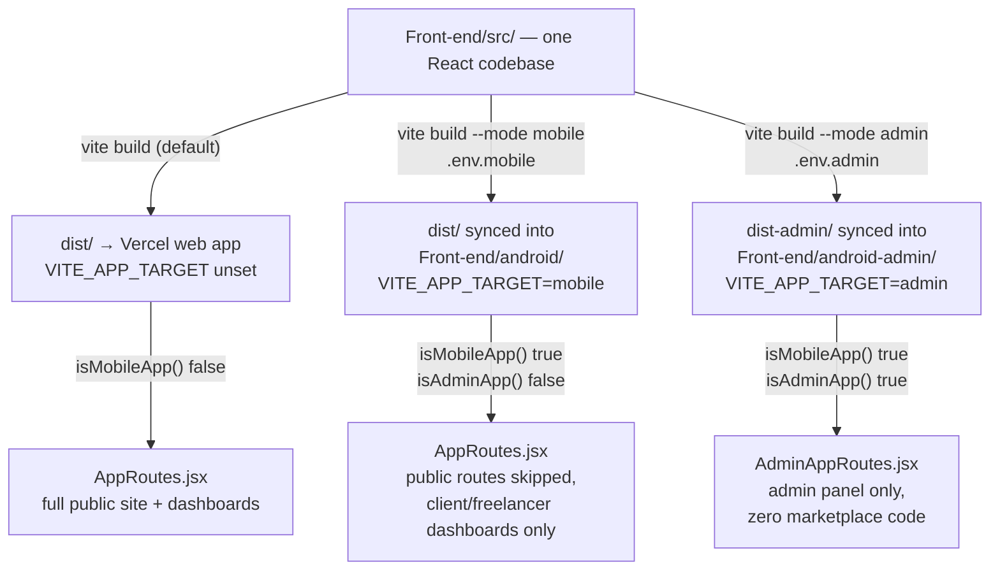

# SkillKart — Frontend

The SkillKart single-page app: a React 19 + Vite client for the marketplace, covering public browsing, freelancer and client dashboards, the contract lifecycle, messaging, and the admin panel.

> Part of the [SkillKart monorepo](../README.md). For full-stack setup, start there.

## Tech Stack

- **React 19** with **Vite 7** (HMR, fast builds)
- **React Router 7** for routing
- **React Hook Form** for forms
- **Axios** for the API layer
- **Framer Motion** & **GSAP** for animation
- **Chart.js** (`react-chartjs-2`) for dashboards
- **Tailwind v4** + custom CSS
- **lucide-react** for icons; toast notifications via a small dependency-free `utils/safeToast.js` (react-toastify@9 is unreliable under React 19)
- **react-select** & **react-select-country-list** for searchable/country dropdowns
- **react-easy-crop** for in-browser image cropping (avatar/portfolio uploads)
- **clsx** for conditional className composition
- **@mediapipe/tasks-vision** (Google MediaPipe Face Landmarker) for webcam-based face-presence proctoring during freelancer skill tests — see [`src/pages/freelancer/useProctoring.js`](src/pages/freelancer/useProctoring.js) and [Skill-test face proctoring](#skill-test-face-proctoring): it watches the live camera feed while a skill test is in progress and aborts the attempt if no face is in view for 3 seconds (no other movement is checked, and a device with no camera at all is let through; `useAntiCheat.js`'s tab-switch/full-screen detection is a separate strike counter)

## Prerequisites

- Node.js ≥ 22.3.0, npm ≥ 9 — same minimum as the [Backend](../Backend/README.md#prerequisites) (see its `engines` field); the two are normally run together via the root `npm start`
- The [backend API](../Backend/README.md) running (default `http://localhost:5000/api/v1`)

## Setup

```bash
npm install
cp .env.example .env    # set VITE_API_URL to your backend, e.g. http://localhost:5000/api/v1
npm run dev
```

The dev server runs at **http://localhost:3001**.

## Environment Variables

See [`.env.example`](.env.example):

| Variable | Purpose |
|----------|---------|
| `VITE_API_URL` | Backend API base URL (e.g. `http://localhost:5000/api/v1`) |
| `VITE_SUPABASE_URL`, `VITE_SUPABASE_ANON_KEY` | Optional Supabase client for social OAuth |
| `VITE_RECAPTCHA_SITE_KEY` | Optional reCAPTCHA v3 **public** site key. Blank = disabled |
| `VITE_ENVIRONMENT` | Set to `production` to force console silence in a dev-mode build |
| `VITE_APP_TARGET` | Build target. Unset = default web build. `mobile` = client/freelancer native Android app. `admin` = separate admin-panel native Android app. See [Mobile App](#mobile-app-android--capacitor) below |
| `VITE_PUSH_NOTIFICATIONS_ENABLED` | `true` to enable native push registration (mobile/admin builds only, no-op on web). Leave unset until the relevant `google-services.json` actually exists — see the Push notifications note below; enabling it too early is a native crash, not a caught error |

> Vite only exposes variables prefixed with `VITE_` to the client. Everything here
> ships in the bundle and is publicly readable — never put a secret in a `VITE_` var.
> (The reCAPTCHA *site* key is designed to be public; its *secret* lives in the backend.)

> **`.env.prod`** (if present locally) is a manual reference file — e.g. production
> values copied aside before a Vercel deploy — not an auto-loaded Vite mode file.
> Vite only loads `.env.<mode>` for a mode actually passed via `--mode`, and no
> script here uses `--mode prod` (only `--mode mobile` and `--mode admin` exist,
> loading `.env.mobile` and `.env.admin` respectively).

## Project Structure

```
src/
├── pages/          Route pages, grouped by audience:
│   ├── public/         landing, browse, categories, public profiles, AI tools
│   ├── client/         client dashboard & workflows
│   ├── freelancer/     freelancer dashboard & workflows
│   ├── admin/          admin views
│   ├── adminPanel/     isolated admin panel
│   └── common/         shared authenticated pages
├── Components/     Reusable UI components
├── layouts/        Route layouts (shells, sidebars)
├── context/        React Context providers (auth, ...)
├── api/            Axios API clients
├── hooks/          Custom React hooks
├── routes/         Route configuration & guards
├── styles/         Global styles
├── constants/      App constants
├── utils/          Helpers
├── App.jsx         Root component
└── main.jsx        Entry point
```

## Scripts

| Script | Description |
|--------|-------------|
| `npm run dev` | Start the Vite dev server (port 3001) |
| `npm run build` | Production build → `dist/` |
| `npm run preview` | Preview the production build locally |
| `npm run lint` | Lint the source with ESLint |

There's no formal frontend test suite. `playwright` is a devDependency available for
ad hoc manual E2E/QA scripting (`npx playwright ...`) — it isn't wired into any npm
script or CI step; it's a tool to reach for when you need to drive a real browser to
verify a flow, not a suite that runs automatically.

## SEO & PWA assets

Static files in [`public/`](public/) are copied to `dist/` verbatim and served from
the site root:

| File | Purpose |
|------|---------|
| `robots.txt` | Crawl rules. Blocks auth flows, dashboards, `/admin-panel/`, transactional pages. Points crawlers at the **backend's** `/sitemap.xml` (see below) |
| `site.webmanifest` | PWA manifest — installable app, shortcuts, theme colour |
| `favicon.svg`, `favicon-16/32/48.png` | Browser tab icons |
| `apple-touch-icon.png` | iOS home screen (180×180) |
| `icon-192/512.png`, `icon-maskable-192/512.png` | PWA icons; maskable variants are full-bleed so Android can crop to any shape |
| `og-image.png` | 1200×630 social share card |

The marks are the same SVG the Navbar renders, in the brand palette
(`--color-accent` on `--color-primary`).

**The sitemap is not a file here** — public content (jobs, gigs, profiles) lives in
Mongo, so it's generated live by the API (see
[Backend README → SEO](../Backend/README.md#seo--sitemap--robots)). [`vercel.json`](vercel.json)
proxies `/sitemap.xml` to the backend so the canonical URL is still same-origin with
the pages it lists, which is simpler for crawlers than a cross-domain pointer.

> **Rewrite order matters.** The `/sitemap.xml` proxy must stay *above* the SPA
> catch-all `/(.*)` in `vercel.json` — first match wins, so reversing them sends the
> sitemap to `index.html`. The proxy destination hardcodes the backend host; update
> it if that changes. Locally the proxy doesn't apply, so use the backend directly:
> `http://localhost:5000/sitemap.xml`.

`index.html` carries the Open Graph / Twitter card tags. **`og:image`, `og:url` and
`canonical` must stay absolute URLs** — crawlers don't resolve relative paths, and a
relative `og:image` silently produces no preview card. They're also what stops
Vercel's auto-generated `*.vercel.app` domain from being indexed as a duplicate.
Per-page `<title>` is set at runtime by each page (`document.title`); the tag in
`index.html` is only the fallback.

## reCAPTCHA v3

Invisible bot mitigation. [`src/utils/recaptcha.js`](src/utils/recaptcha.js) mints a
token per protected action; [`src/api/client.js`](src/api/client.js) attaches it as
`x-recaptcha-token` via the request interceptor, so **call sites need no changes** —
add a path to `RECAPTCHA_ACTIONS` there and it's covered.

The script is loaded **lazily on first use**, not in `index.html`: it's ~300KB of
third-party JS plus a persistent badge, and most visitors never submit a protected
form. With no `VITE_RECAPTCHA_SITE_KEY` set, nothing loads at all.

`getRecaptchaToken()` resolves to `null` rather than throwing when reCAPTCHA is
unconfigured or blocked (ad blockers, offline). The backend fails open to match, so
a captcha problem can't lock users out. Action names must match the server's
`verifyRecaptcha(action)` exactly or the token is rejected as a replay.

> The v3 badge must stay visible unless you disclose reCAPTCHA in your UI text —
> Google's terms. `hideRecaptchaBadge()` exists for when that disclosure is added.

## Mobile App (Android / Capacitor)

The same React codebase ships as **two separate native Android apps** via
[Capacitor](https://capacitorjs.com/) — no separate codebase or rewrite for either
one: the client/freelancer app (`android/`, this section's original focus) and a
standalone **admin panel** app (`android-admin/`, see below) for admins who need
marketplace moderation on the go. Both set `androidScheme: "https"` in their own
Capacitor config, so each WebView's requests present a fixed origin of
`https://localhost` (not a real host — nothing is ever served there; it's purely a
CORS identity) — the two apps share that identical origin string despite being
distinct native projects with different `appId`s (`com.skillkart.app` vs.
`com.skillkart.admin`).



`isMobileApp()` / `isAdminApp()` (both in
[`src/utils/platform.js`](src/utils/platform.js)) are what gate the branches on the
right — see **`isMobileApp()` vs `isAdminApp()`** further down for exactly what each
one controls.

The rest of this subsection covers the client/freelancer build (`android/`); the
admin app's separate build is documented right after in **Admin native app**.

### Building it

```bash
npm run build:mobile   # vite build --mode mobile — loads .env.mobile instead of .env
npm run cap:sync       # build:mobile, then `npx cap sync` copies dist/ into android/
npm run cap:android    # cap:sync, then opens the project in Android Studio
```

`.env.mobile` needs real, live values — this build talks to your **deployed** backend,
not localhost:

| Variable | Notes |
|----------|-------|
| `VITE_APP_TARGET=mobile` | Tells `AppRoutes.jsx` this is the native build (see below) |
| `VITE_API_URL` | The **production** backend URL (e.g. Railway), not `localhost:5000` |
| `VITE_SUPABASE_URL` / `VITE_SUPABASE_ANON_KEY` | Same as `.env.prod` |
| `VITE_RECAPTCHA_SITE_KEY` | **Deliberately left unset** — see reCAPTCHA note below |

Building the actual `.apk`, once `cap:sync` has run:

```bash
cd android
JAVA_HOME="<path to a JDK Gradle 8.x supports>" ./gradlew.bat assembleDebug
# → android/app/build/outputs/apk/debug/app-debug.apk
```

> ⚠️ **JDK version gotcha.** Android Studio's bundled JDK (`Android Studio/jbr`) can
> silently auto-update itself past what the project's pinned Gradle version
> supports — a JDK 25 JBR broke a Gradle 8.14.3 build outright
> (`Unsupported class file major version 69`) mid-project with no code changes
> involved. If Gradle suddenly can't even evaluate `settings.gradle`, check
> `java -version` for whatever `JAVA_HOME` points at first. A cached older JBR
> under `~/.jdks/` (left behind by a previous Android Studio/IntelliJ version) is
> often a quick fix — point `JAVA_HOME` at that instead of the current bundled one.

### Admin native app

The admin panel also ships as a **separate** native Android app — its own Capacitor
project, its own `appId`, its own signing identity — kept fully independent of the
client/freelancer app above so building/signing/installing one can never touch the
other.

| Piece | Purpose |
|---|---|
| [`capacitor.admin.config.json`](capacitor.admin.config.json) | `webDir: dist-admin`, `android.path: android-admin`, `appId: com.skillkart.admin`, appName `SkillKart Admin` |
| `android-admin/` | The standalone native Android project — its own Gradle project and keystore, entirely separate from `android/` |
| `.env.admin` | Real, deployed values — analogous to `.env.mobile` above; this build talks to the **production** backend |
| `.env.admintest` | A local QA scratch env pointing at `http://localhost:5000/api/v1`, for exercising the admin app against a local backend before cutting a real build. Vite's `--mode admin` only ever loads `.env.admin` (there's no `--mode admintest` script), so using this file means temporarily copying/renaming it over `.env.admin` for a local test build, then restoring the real one before building for real |

```bash
npm run build:admin      # vite build --mode admin — loads .env.admin, outputs dist-admin/
npm run cap:admin:add    # first time only: adds the android-admin/ native project
npm run cap:admin        # build:admin, then syncs dist-admin/ into android-admin/
npm run cap:admin:open   # opens android-admin/ in Android Studio
```

Capacitor's CLI has no `--config` flag — it always reads a hardcoded
`capacitor.config.json` at the project root, so there's no built-in way to point
`cap add`/`cap sync`/`cap open` at a second native folder. Every `cap:admin:*` script
actually runs through [`scripts/cap-admin.cjs`](scripts/cap-admin.cjs), which works
around that: it backs up the real `capacitor.config.json`, copies
`capacitor.admin.config.json` over it, runs the real `npx cap <command>`, then
restores the original file from a `try`/`finally` — so even an interrupted run
(Ctrl-C, crash) can't leave the client/freelancer app's config permanently
overwritten by the admin one.

`vite.config.js` builds the `admin` mode to `dist-admin/` instead of `dist/`
(`outDir: mode === 'admin' ? 'dist-admin' : 'dist'`), so `build:admin` can never
clobber the regular web/mobile build output — both can exist on disk at once.

At runtime, whenever `isAdminApp()` is true, `src/App.jsx` renders a **completely
separate route tree**, [`src/routes/AdminAppRoutes.jsx`](src/routes/AdminAppRoutes.jsx),
instead of `AppRoutes.jsx`. `AdminAppRoutes.jsx` deliberately imports **zero**
client/freelancer/public code — only the admin-panel pages, `AdminAuthProvider`, and
`AdminProtectedRoute` — so the admin app's bundle can never pull in marketplace UI it
has no use for, and vice versa.

Everything else on this page that's gated on `isMobileApp()` (status bar, hardware
back button, offline gate, native CSS, push notifications, the `https://localhost`
CORS origin, the reCAPTCHA no-op) applies equally to this admin build — see the next
section for exactly why.

### `isMobileApp()` vs `isAdminApp()`

Two separate checks in `src/utils/platform.js`, doing two separate jobs:

- **`isMobileApp()`** is true when `VITE_APP_TARGET` is **either** `mobile` **or**
  `admin` — **or** `Capacitor.isNativePlatform()` (a runtime fallback, harmless on
  web). It answers "am I running inside *some* native Android WebView, as opposed
  to a browser tab?" and gates everything in this doc that's about that fact alone:
  status bar styling, the hardware back button, the offline network gate, the boot
  screen, and the `native-app.css` fixes further down. Both native builds need all
  of that, so both trigger it identically.
- **`isAdminApp()`** is true only when `VITE_APP_TARGET=admin`. It answers "which
  app is this, specifically?" and is the **only** thing that decides which route
  tree renders — `App.jsx` renders `AdminAppRoutes.jsx` when true, `AppRoutes.jsx`
  otherwise. This is the one place the two native builds actually diverge in
  behavior; everything else they share.

Inside the client/freelancer build's `AppRoutes.jsx`, `isMobileApp()` is also used to
skip registering every public-marketing route entirely — there's no landing page, no
`/browse-projects`, no public profiles, just the auth flow plus the client/freelancer
dashboards. Those excluded pages (`About`, `BrowseProjects`, `JobDetails`,
`GigDetail`, the AI Tools pages, the Skills pages, both public profile pages, all
four legal pages) are `React.lazy()`-loaded — their code (and assets, including a
large hero image on `About`) is fetched only when a **web** visitor actually
navigates there, never bundled into what the mobile app parses at startup. The admin
build never registers any part of `AppRoutes.jsx` at all — it renders
`AdminAppRoutes.jsx` exclusively (see **Admin native app** above).

Two links that point at now-excluded routes (client onboarding's "Service Agreement"
checkbox, and the client dashboard's "Cost Estimator" link in Post Project) detect
`isMobileApp()` and open the live website in an external browser tab instead of
404ing against a route that was never registered.

### CORS

Both native apps' fixed origin (`https://localhost` — see the intro above) must be
in the backend's `CORS_ORIGIN` env var, or every request from either one gets
blocked. Because the client/freelancer app and the admin app happen to share that
exact origin string, one `CORS_ORIGIN` entry covers both — there's no separate admin
origin to add. This is a real origin string someone could also send from a raw
script — it isn't unique to genuine app traffic — so it's not a security boundary on
its own; normal auth + rate limiting still apply.

### reCAPTCHA

`VITE_RECAPTCHA_SITE_KEY` is deliberately **unset** in `.env.mobile`
(`src/utils/recaptcha.js` no-ops entirely with no site key — no script load, no
console errors). Google's reCAPTCHA v3 script is a browser-page product and is
unreliable inside an embedded WebView; rather than fight that, the backend's
`verifyRecaptcha` middleware exempts requests whose `Origin` is `https://localhost`
outright (`Backend/src/middleware/recaptcha.middleware.js`) — the mobile app was
otherwise hard-failing every login/register with `RECAPTCHA_FAILED` once a real
`RECAPTCHA_SECRET_KEY` was configured in production. Rate limiting + account lockout
remain the actual anti-abuse gate for this origin. `.env.admin` also leaves the key
unset, but for a simpler reason: the admin app only ever calls the isolated
`/admin-panel/*` auth endpoints, which don't run `verifyRecaptcha` at all (admin
login has its own rate limiting/lockout instead) — so there's no gate to exempt
there in the first place, just no reason to load the script.

### External links

A plain `<a target="_blank">` or `window.open()` inside a Capacitor WebView has no
tab to open — it just navigates the app itself away, with no browser chrome and no
way back. `src/utils/externalLink.js`'s `openExternal(url)` opens a **Chrome Custom
Tab** instead (`@capacitor/browser`) on mobile, and falls back to normal
`window.open` on web. Used for message/document attachments, portfolio and
certificate links, and profile website links.

### Hardware back button

Unhandled, Android's back button either pops WebView history or exits the process
outright — the latter happens the instant there's no history to pop, e.g. right
after login lands on a dashboard with a fresh history stack.
`src/hooks/useAndroidBackButton.js` wires `@capacitor/app`'s `backButton` event to
React Router's `navigate(-1)` instead, and minimizes the app (rather than exiting)
on root screens (`/login`, the two dashboards, admin-panel dashboard) where there's
nowhere sensible to navigate back to.

### Status bar & app chrome

`App.jsx` styles the status bar to the brand navy with light icons
(`@capacitor/status-bar`) — left at its default, icons meant for a light background
are nearly invisible against the app's dark screens. The app icon and splash screen
are generated from `Front-end/assets/{icon,icon-foreground,splash}.png` via:

```bash
npx @capacitor/assets generate --android \
  --iconBackgroundColor "#042E4C" --iconBackgroundColorDark "#042E4C" \
  --splashBackgroundColor "#042E4C" --splashBackgroundColorDark "#042E4C"
```

Re-run this (then `cap:sync` and rebuild) whenever the brand mark changes — it
overwrites every density bucket under `android/app/src/main/res/`.

### Offline detection

`src/Components/common/NetworkGate/NetworkGate.jsx` shows a dedicated "No Internet
Connection" screen (mobile only) via `@capacitor/network`. It both listens for the
native `networkStatusChange` event **and** polls `Network.getStatus()` every 5
seconds as a backstop — the native event doesn't fire reliably on every Android OEM
skin (aggressive battery optimization can suspend it), so relying on it alone can
miss going offline.

`Network.getStatus()` itself isn't fully trustworthy either — confirmed on at least
one Android emulator image, it reported `connected: false` continuously while the
emulator's actual network (verified with a raw `ping`) was fine, which flipped the
whole app between itself and the offline screen every ~5s (visually: bad flickering).
The gate now requires 3 **consecutive** offline readings before it actually shows
(`OFFLINE_CONFIRM_THRESHOLD`) — any single online reading clears it immediately, so
recovery is still instant but a lone bad reading can't take over the screen.

### Native-only styling

`src/styles/native-app.css` applies only under `html.is-native-app` (the class
`main.jsx` adds when `isMobileApp()` is true) and:
- Disables `backdrop-filter` everywhere — a severe, well-documented jank source on
  Android's WebView, and this app uses it in ~40 files (every modal, dropdown, and
  sidebar).
- Hides the desktop-style scrollbar — a persistent visible scrollbar reads as
  distinctly non-native on a touchscreen; touch scrolling itself is unaffected.

`android/app/src/main/AndroidManifest.xml`'s `MainActivity` also sets
`android:windowSoftInputMode="adjustResize"` — without it, the on-screen keyboard is
unreliable on modern Android WebViews (fails to open, or fights the layout instead
of resizing it).

### Push notifications

See [Backend README → Push Notifications](../Backend/README.md#push-notifications)
for the full setup (Firebase project, service account credential,
`google-services.json`). Client-side registration is
`src/hooks/usePushNotifications.js`.

> ⚠️ **Gated behind `VITE_PUSH_NOTIFICATIONS_ENABLED=true`, and deliberately not
> just try/catch.** Calling `PushNotifications.register()` before
> `android/app/google-services.json` exists throws a native
> `FirebaseApp is not initialized` exception on a background thread —
> Capacitor's bridge doesn't convert it into a rejected promise there, so it's
> an **uncaught crash that takes the whole app down**, invisible to a JS
> try/catch. Leave the env var unset (default) until `google-services.json` is
> actually in place and you've resynced/rebuilt since adding it. Since
> `usePushNotifications.js` is gated on `isMobileApp()` (true for both native
> builds), the exact same crash risk applies to the admin app — its own
> `android-admin/app/google-services.json` must exist before enabling the env
> var for an `.env.admin` build.

### Skill-test levels

The skill-test rules screen asks which level to take — **Easy (5 questions),
Intermediate (10) or Expert (15)** — and "Start Test" stays disabled until one is
picked. The choice is sent as `?level=` on `GET /skill-tests/generate`, decides
the question count and difficulty server-side, and is kept if an attempt is
cancelled (the restart reuses it) or retaken. The level picked is also the rank
earned: score at least 25% and the skill is verified and marked Beginner (Easy),
Intermediate or Expert accordingly — the result screen says "Easy / Intermediate /
Expert Level Verified!", or "Not Verified Yet" below 25%. `TEST_LEVELS` in
`src/pages/freelancer/SkillTest.jsx` only drives the cards and the time estimate;
the server's counts (`Backend/src/utils/skillTestDifficulty.js`) are the truth —
see [`Backend/README.md`](../Backend/README.md#skill-test-levels).

### Skill-test face proctoring

Camera proctoring during the skill test uses **Google MediaPipe Face
Landmarker** (`@mediapipe/tasks-vision`). It replaced `face-api.js`, which never
ran reliably in Android's WebView.

**The one camera rule is face presence.** If no face is in the camera for
**3 seconds in a row** — the candidate left, covered the camera, the picture is
blank, or they turned fully away — the attempt is **cancelled immediately** (no
strikes, no warning) and restarts from question 1 with new questions. Head
turns, eye direction, movement, distance from the camera and extra people are
deliberately **not** checked; the detector runs with one face and the
eye / head-angle outputs switched off. Tab switches are a separate system (below).

| File | Role |
|---|---|
| `src/pages/freelancer/proctoring/strictness.js` | The strictness value (0–1) → on/off, the 3 s hold, and the tab/window strike limit |
| `src/pages/freelancer/proctoring/analyzeFrame.js` | One frame → `faceMissing` (pure, testable) |
| `src/pages/freelancer/proctoring/faceEngine.js` | Lazy-loads MediaPipe; CPU on the native app, GPU→CPU fallback on web |
| `src/pages/freelancer/useProctoring.js` | Camera + detection loop; cancels the test after 3 s with no face |
| `src/pages/freelancer/proctoring/ProctorPanel.jsx` | Live status + "test cancels in Ns" countdown during the test, face-check chip on the rules screen |
| `src/pages/freelancer/useAntiCheat.js` | Tab switch / window blur / leaving full-screen |

**One knob: `SKILL_TEST_PROCTOR_STRICTNESS` in `Backend/.env`** (0–1, default
0.5; blank/invalid → 0.5). The page fetches it from
`GET /skill-tests/proctoring-config` when the test opens, so changing it
needs only a backend restart — no web or APK rebuild. It now does two things:

| | 0 | 0.2 easy | 0.5 medium | 0.7 strict | 1 very strict |
|---|---|---|---|---|---|
| Camera check | off (no camera needed) | on — 3 s | on — 3 s | on — 3 s | on — 3 s |
| Tab / window: cancelled on the | never | 5th | 3rd | 3rd | 2nd |

Values in between interpolate smoothly for the tab/window limit. The strictness
used and the tab/window strike total are saved on the `SkillTestAttempt`
(`proctoring`). A face-missing cancel discards the attempt, so nothing camera-related
is stored for it.

**Camera lifecycle is sequence-guarded** (`useProctoring.js`): a `getUserMedia` that
resolves after the camera was stopped or restarted is discarded and its tracks
stopped (so leaving the page mid-prompt never leaves the camera on); a stale
stream's late `ended` event is ignored — only the *current* stream ending counts
as camera loss; the "no video is coming through" error clears itself when frames
resume; and if a camera error blocks "Restart Test" on the cancelled screen, a
**Retry Camera** button re-checks the camera there.

**A device with no camera at all can still take the test** — `getUserMedia`
rejecting with `NotFoundError` marks the device as camera-less, the rules screen
says camera proctoring is skipped (with a "Check Again" button in case one is
plugged in), and only the tab/window guard applies. A denied permission, a busy
or broken camera is *not* treated that way — those still block "Start Test", or
declining the prompt would be a way around proctoring.

**Assets are same-origin, never a CDN** (the APK must work offline).
`vite.config.js`'s `mediapipeAssets` plugin serves them in dev and copies them
into the build (not `--mode admin`): the WebAssembly runtime from
`node_modules/@mediapipe/tasks-vision/wasm` (SIMD + no-SIMD builds) and the
model from `vendor/mediapipe/face_landmarker.task` (committed, 3.8 MB).

> ⚠️ **Android WebView quirks this handles:**
> - The native app starts MediaPipe on the **CPU** delegate. A WebView can
>   usually create a GPU context and then fail real inference silently —
>   exactly how the old face-api.js proctoring stayed "on" but never
>   detected anything on Android.
> - `getUserMedia` asks for `facingMode: 'user'` — some WebViews otherwise
>   open the back camera.
> - The WebView can **freeze the camera feed for 3–4 s** (measured on the
>   emulator, real camera and test feed alike). Frames are tracked with
>   `requestVideoFrameCallback`: while the feed is frozen the 3 s countdown
>   pauses; a freeze longer than 10 s during the test counts as a missing
>   face, so covering/freezing the camera can't dodge proctoring.
> - "Start Test" stays disabled until the camera is streaming **and** a frame
>   has actually been analysed, so a device where detection can't run finds
>   out on the rules screen, never silently mid-test.
>
> Failures log through `error` from `src/utils/logger.js` (survives
> production builds) — check `chrome://inspect` / `adb logcat` if
> proctoring ever looks inert. MediaPipe itself prints one harmless
> `INFO: Created TensorFlow Lite XNNPACK delegate for CPU.` as a console error.

### Photo upload: camera / device picker

Every image-upload site (profile avatar/cover, company logo, portfolio/project
images, gig banner/gallery, job images, chat/job attachments) uses
[`src/Components/common/ImageSourcePicker/ImageSourcePicker.jsx`](src/Components/common/ImageSourcePicker/ImageSourcePicker.jsx)
instead of a raw `<input type="file">`. It's a drop-in replacement — same
`ref.current.click()` API an existing trigger button/div already calls, so no
other code at a call site has to change. On `isMobileApp()` it shows a small
"Take Photo / Choose from Device" chooser (built on the shared `Modal` +
`Button` components) before opening anything; on web `.click()` just opens the
device file picker directly, identical to before this existed.

> ⚠️ **Take Photo uses the real `@capacitor/camera` plugin, not the HTML
> `capture` attribute.** The common alternative — a hidden
> `<input type="file" accept="image/*" capture="environment">`, relying on the
> WebView's own file-chooser interception (`BridgeWebChromeClient`) to launch
> the camera — depends on that interception working, which is unreliable
> enough across OEM Android WebView builds that it doesn't even work in the
> MediCore-AI project this feature was modeled on. `Camera.getPhoto({ source:
> CameraSource.Camera })` talks to the native camera intent directly through
> Capacitor's own plugin bridge instead. The result (`photo.webPath`) is
> `fetch()`ed into a real `Blob`/`File` and handed to the caller's existing
> `onChange` handler via a synthesized `{ target: { files, value } }` event —
> every handler written for a plain `<input onChange>` keeps working
> unmodified. **Choose from Device stays a plain hidden `<input type="file">`**
> — that path was never unreliable, and it's the only way to also support
> non-image accept types (chat/job attachments allow PDFs/DOCs too, which the
> Camera plugin can never produce). Resume/CV upload and the job "documents"
> input intentionally keep a plain `<input>` with no picker at all — they
> don't accept any image type, so a camera photo could never satisfy them.
>
> Requires `android.permission.CAMERA` (already declared for face-proctoring's
> `getUserMedia`, above) and a `FileProvider` + matching
> `res/xml/file_paths.xml` — both already present in `AndroidManifest.xml`,
> though `file_paths.xml` originally used `<external-path>`
> (`Environment.getExternalStorageDirectory()`, shared public storage) copied
> from the same MediCore-AI reference, which does **not** cover where
> `@capacitor/camera` actually writes
> (`getExternalFilesDir(Pictures)`/`getCacheDir()`, both app-private — no
> extra storage permission needed). Left unfixed, the very first real capture
> would have thrown `IllegalArgumentException: Failed to find configured
> root...` — it's now `<external-files-path path="Pictures">` +
> `<cache-path path=".">`, matching the plugin's Android source exactly. The
> plugin's own bundled manifest fragment adds the required API 30+
> `<queries>` block (`IMAGE_CAPTURE`/`GET_CONTENT`/`PICK`) automatically via
> Gradle manifest merging — nothing to add by hand for that part. Run
> `npm run cap:sync` after ever bumping `@capacitor/camera` so the native
> Gradle project picks up plugin changes.

### File downloads / exports (native)

A raw `window.open(url, '_blank')` or `<a download>` + `.click()` — fine on
web — does nothing useful inside the native app's WebView: there's no tabs
concept and no Downloads UI to catch a download navigation. Two different
fixes depending on where the file comes from:

- **Server-generated file at a URL** (the admin panel's CSV/report exports in
  [`AdminPages.jsx`](src/pages/adminPanel/AdminPages.jsx)/[`UsersPage.jsx`](src/pages/adminPanel/UsersPage.jsx))
  — use `openExternal(url)` from [`src/utils/externalLink.js`](src/utils/externalLink.js),
  same as any other external link. On native it opens a Chrome Custom Tab,
  which — unlike the embedded WebView — is backed by real system Chrome and
  so has a working Download Manager; on web it's an unchanged `window.open`.
- **Client-generated file** (built from data already on screen — a CSV or
  text export assembled in JS, not fetched from a URL) — use `downloadFile(blob,
  filename)` from [`src/utils/downloadFile.js`](src/utils/downloadFile.js)
  instead. `openExternal`/`Browser.open()` can't reach a `blob:` URL at all —
  it only exists in the WebView's own JS memory, invisible to the separate
  Custom Tab process. `downloadFile` writes the blob to the app's private
  cache via `@capacitor/filesystem` (`Directory.Cache` — no storage
  permission needed, unlike public storage) then opens the native share sheet
  via `@capacitor/share` so the user can actually save or send it (Files,
  Drive, email, ...). Falls back to a plain browser download on web, or on
  native if the native save/share itself fails or is cancelled (harmless
  either way — nothing visible happens in the WebView regardless). Used by
  the admin panel's client-side exports (conversation transcripts in
  `AdminDetailPages.jsx`, the top-freelancers CSV in `AdminPages.jsx`).

Both plugins' Android manifest requirements were already satisfied by the
existing `FileProvider` + `res/xml/file_paths.xml` (see the camera picker
entry above) — `Directory.Cache` writes need no extra permission, and
`@capacitor/share`'s `FileProvider.getUriForFile()` call uses the same
`${applicationId}.fileprovider` authority already declared. This applies to
**both** native builds — the marketplace app (`android/`) and the separate
admin app (`android-admin/`, see `isAdminApp()` below) — since `isMobileApp()`
is true for both and they share this same `Front-end/` codebase; run
`npm run cap:sync` **and** `npm run cap:admin:sync` after adding a plugin so
both native Gradle projects pick it up.

## Notes

- **Toasts** — use `showSafeToast` / `safeToast` from [`src/utils/safeToast.js`](src/utils/safeToast.js). It renders a plain DOM node and can't crash the tree the way `react-toastify@9` does under React 19.
- **Console output** — use `log` / `warn` / `error` from [`src/utils/logger.js`](src/utils/logger.js), never bare `console.*`. Production builds compile `log`/`warn`/`info`/`debug` to a no-op (gated on Vite's `import.meta.env.DEV`, with `VITE_ENVIRONMENT=production` as an explicit override); `error` always survives so real failures stay diagnosable.
- **404** — unknown routes redirect to `/404` ([`src/pages/public/NotFound/`](src/pages/public/NotFound/)), passing the attempted path in history state so the page can show what was requested.
- **AI failures** — any AI request failure (a `503`, a timeout, or a network error on `/ai/*`) is caught centrally in [`src/api/client.js`](src/api/client.js) and surfaces a single "AI is temporarily out of service" toast. Individual AI features (Buddy, Cost Estimator, CV parsing) also degrade gracefully in-place — they never crash the page. **AI Matchmaking is not actually an AI-provider call** — it's a deterministic, code-driven scoring engine (`Backend/src/services/matchmaking.service.js`) — so its API calls pass `{ suppressErrorToast: true }` and [`AiMatchmaking.jsx`](src/pages/public/AiMatchmaking/AiMatchmaking.jsx) shows its own accurate inline error instead of the generic "AI is out of service" copy.
