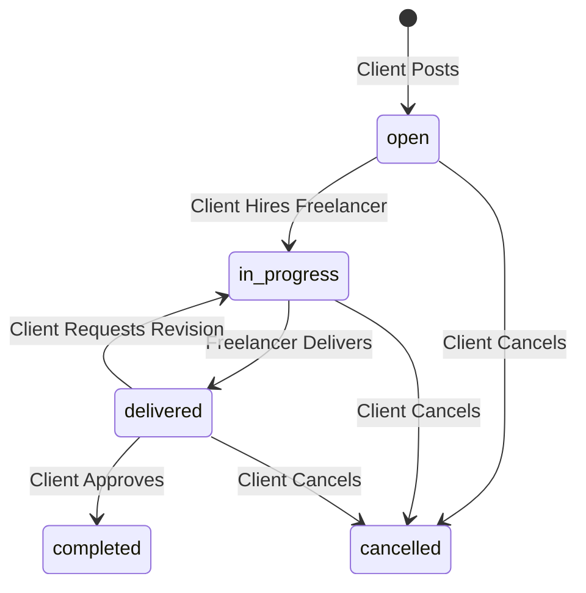
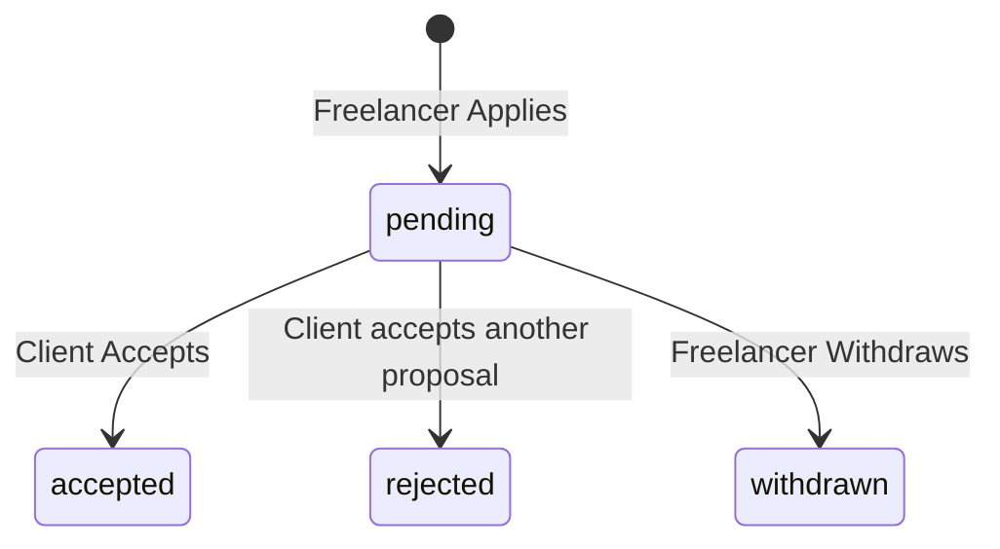
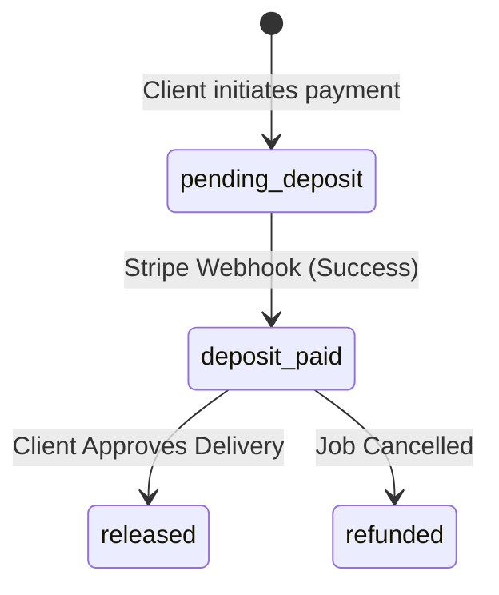
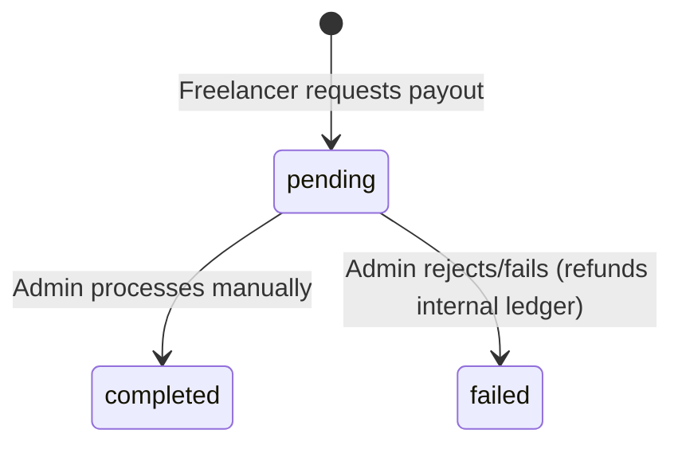

# SkillKart Project Guide

This document is a comprehensive guide to the SkillKart platform. It is designed for business owners, project managers, QA engineers, designers, and developers to understand the entire platform without needing to read the source code.

---

## 1. Project Overview

**What SkillKart is:**  
SkillKart is a dual-sided micro-freelancing marketplace built on the MERN stack (MongoDB, Express, React, Node.js). It serves as a digital bridge between individuals or businesses needing tasks completed (Clients) and skilled professionals offering their services (Freelancers).

**What problem it solves:**  
Finding reliable freelance talent and ensuring secure payments is traditionally fraught with risk. SkillKart solves this by providing a unified platform where jobs are posted, proposals are vetted, and funds are securely held in Escrow until both parties are satisfied with the delivered work.

**Target users:**  
- **Freelancers:** Independent professionals looking for gig work, long-term projects, or a platform to showcase their portfolios.
- **Clients:** Startups, SMEs, and individuals needing specialized talent on-demand without the overhead of full-time hiring.

**Business model:**  
SkillKart operates on a commission-based business model. A platform fee (currently configured as a percentage `FEE_RATE`) is deducted from the final payout when Escrow is released to the freelancer.

**Main objectives of the platform:**  
1. Provide a frictionless onboarding experience for both user types.
2. Ensure absolute financial security through Stripe-backed Escrow.
3. Foster transparent communication through in-app messaging and rigorous state-machine lifecycles.

---

## 2. User Types

The platform strictly segregates user permissions via Role-Based Access Control (RBAC).

**Guest:**
- **Can:** Browse public freelancer profiles, view public job postings, use the search functionality, and initiate the registration process.
- **Cannot:** Apply to jobs, post jobs, message users, or view private contract details.

**Freelancer:**
- **Can:** Create a professional profile, upload a CV and portfolio, browse open jobs, submit proposals (with custom rates/cover letters), message clients they are contracted with, deliver work, withdraw funds from their digital wallet, and leave reviews.
- **Cannot:** Post jobs, view other freelancers' private proposals, or arbitrarily message clients they have no active relationship with.

**Client:**
- **Can:** Create a company profile, post jobs, review incoming proposals, hire freelancers, fund Escrow via Stripe, request revisions on delivered work, approve work to release payments, and leave reviews.
- **Cannot:** Submit proposals, view other clients' private jobs, or withdraw funds (clients receive refunds, but not standard payouts).

---

## 3. Complete Business Flow

The platform operates on a linear, logical flow from discovery to payout:

1. **Guest** visits the platform.
2. **Registration:** User signs up and selects their role (Client or Freelancer).
3. **Email Verification:** A 6-digit OTP is sent via email. User inputs the OTP to verify their identity.
4. **Onboarding:** User completes mandatory profile setup (skills, company details, etc.).
5. **Searching:** Client searches for talent, or Freelancer searches for open jobs.
6. **Applying:** Freelancer submits a Proposal to an open job.
7. **Hiring:** Client reviews proposals and accepts one. The job becomes `in-progress`.
8. **Payments (Escrow):** Client pays the initial deposit via Stripe Checkout. Funds are securely held.
9. **Messaging:** Both parties communicate via the in-app chat to finalize requirements.
10. **Delivery:** Freelancer submits the final work (links/files).
11. **Approval:** Client reviews and approves the delivery. Escrow is released to the freelancer's wallet.
12. **Reviews:** Both parties submit a 1-5 star rating and written review.

---

## 4. Freelancer Journey

**Chronological Flow:**
1. **Registration:** Enters basic details and selects 'freelancer' role. Backend creates a base `User` record.
2. **Verification:** Inputs emailed OTP. Backend flags `isEmailVerified = true`.
3. **Onboarding:** Completes profile data. Backend creates a `FreelancerProfile` linked to the `User`.
4. **Creating Profile / Portfolio:** Adds skills, bio, and hourly rate.
5. **Uploading CV:** Uploads PDF. Backend processes it via Cloudinary and stores the URL.
6. **Browsing Jobs:** Views jobs with `status = 'open'`.
7. **Applying:** Submits a cover letter and rate. Backend creates a `Proposal` with `status = 'pending'`.
8. **Messaging:** If hired, the freelancer can chat with the client. Backend queries the `Message` collection.
9. **Working:** Waits for the `onDepositFunded` notification.
10. **Delivering:** Submits work. Backend updates `Job` status to `delivered` and attaches delivery payload.
11. **Receiving Payment:** Client approves. Backend increments `FreelancerProfile.walletBalance`.
12. **Withdrawal Requests:** Requests payout. Backend creates a `Withdrawal` request and deducts from `walletBalance`.
13. **Reviews:** Leaves a review for the client.

---

## 5. Client Journey

**Chronological Flow:**
1. **Registration:** Enters details, selects 'client' role.
2. **Company Profile:** Completes onboarding. Backend creates `ClientProfile`.
3. **Posting Jobs:** Fills out job form. Backend creates `Job` with `status = 'open'`.
4. **Editing Jobs:** Can edit jobs only if they are still `open`.
5. **Reviewing Proposals:** Views applications. Backend strictly enforces IDOR (clients can only view proposals for their own jobs).
6. **Hiring:** Clicks accept on a proposal. Backend updates `Proposal` to `accepted`, sets `Job.hiredFreelancer`, and marks all other proposals as `rejected`.
7. **Escrow Funding:** Clicks "Pay Deposit". Backend generates a Stripe Session. Upon successful payment, Stripe fires a webhook to update `Payment.status = deposit_paid`.
8. **Messaging:** Chats with the hired freelancer.
9. **Reviewing Work:** Receives `delivered` status notification.
10. **Approving Work:** Clicks approve. Backend triggers `payment.controller.js` to release funds from Escrow into the freelancer's wallet and marks `Job` as `completed`.
11. **Payment Release:** Funds physically move via internal ledger math.
12. **Leaving Reviews:** Submits feedback.

---

## 6. Marketplace Lifecycle

### Jobs

### Proposals

### Escrow / Payments

### Withdrawals

---

## 7. Payment System

SkillKart does not rely on direct peer-to-peer transfers. It utilizes an Escrow model.

- **Wallet:** An internal database ledger (`walletBalance`). It represents funds currently held by the platform on behalf of the user.
- **Stripe Checkout:** The external payment gateway. Used exclusively by clients to bring real fiat currency into the platform.
- **Escrow:** When a client pays a deposit via Stripe, the `Payment` document acts as Escrow. The funds sit in SkillKart's master Stripe account.
- **Deposits:** Client pays → Stripe Webhook catches event → Updates DB `Payment` status.
- **Releases:** Client approves work → Backend calculates platform fee → Net amount is added to the Freelancer's `walletBalance`.
- **Refunds:** If a job is cancelled, the `Payment` is marked `refunded`, and the funds are added back to the Client's `walletBalance` (or refunded via Stripe if integrated).
- **Withdrawals:** Freelancer requests payout. The internal `walletBalance` is immediately deducted to prevent double-spending, and a `Withdrawal` record is queued for Admin processing.

---

## 8. Notification System

| Trigger | Recipient | Purpose |
| :--- | :--- | :--- |
| **Proposal Submitted** | Client | Alert client of new applicant. |
| **Proposal Accepted** | Freelancer | Alert freelancer they were hired. |
| **Proposal Rejected** | Freelancer | Notify freelancer they were not selected. |
| **Gig Ordered** | Freelancer | Alert freelancer of a pre-packaged purchase. |
| **Escrow Funded** | Freelancer | Signal that it is safe to begin working. |
| **Work Delivered** | Client | Prompt client to review submitted files. |
| **Revision Requested** | Freelancer | Alert freelancer that client wants changes. |
| **Payment Released** | Freelancer | Notify freelancer that funds hit their wallet. |
| **Project Completed** | Client & Freelancer | Mark the end of the contract lifecycle. |
| **Job Cancelled** | Freelancer | Alert freelancer that the contract was terminated. |
| **Escrow Refunded** | Client | Confirm funds returned to client wallet. |
| **Review Submitted** | Recipient | Alert user of new profile feedback. |
| **New Message** | Recipient | Alert user of chat activity. |
| **Withdrawal Requested** | Freelancer | Confirm payout request was received. |
| **Withdrawal Completed** | Freelancer | Confirm payout hit their bank/external account. |

---

## 9. Folder Structure

- **`Frontend/`**: Contains the React.js application.
  - `src/pages/`: Page-level components organized by persona (`client`, `freelancer`, `public`).
  - `src/components/`: Reusable UI elements (buttons, modals, headers).
  - `src/utils/`: Helper functions (API interceptors, file uploaders).
- **`Backend/`**: Contains the Express.js API.
  - `src/controllers/`: The brains of the operation. Contains all business logic and database queries.
  - `src/models/`: Mongoose schemas defining the structure of the database.
  - `src/routes/`: Express routers mapping URLs to controllers.
  - `src/middleware/`: Request interceptors (Auth checking, Rate Limiting, File Upload constraints).
  - `src/services/`: Reusable backend logic (Stripe, Email/SMTP, Notifications).
  - `src/utils/`: Standardized error handlers and API response formatters.

---

## 10. Database Models

- **User:** The base identity. Stores email, hashed password, role, and 2FA settings.
- **ClientProfile / FreelancerProfile:** Extensions of the User model. Stores specific onboarding data (skills, company size, wallet balance). Linked 1:1 to User.
- **Job:** The core marketplace entity. Tracks title, budget, status, and the `hiredFreelancer`.
- **Proposal:** A freelancer's bid on a Job. Linked to `Job` and `User`.
- **Payment:** The Escrow record. Tracks deposit amounts, final amounts, and Stripe Session IDs. Linked to `Job`.
- **Message:** Chat records. Linked to `sender` and `receiver`.
- **Review:** Feedback records. Linked to `jobId`, `reviewer`, and `reviewee`.
- **Withdrawal:** Payout request logs. Linked to `User`.

---

## 11. APIs

Major API Groups:
- **Auth API (`/api/v1/auth`):** Handles registration, login, OTP verification, password resets, and token refreshing.
- **Jobs API (`/api/v1/jobs`):** CRUD operations for postings. Handles state transitions (deliver, approve, cancel).
- **Proposals API (`/api/v1/proposals`):** Submission and review of bids.
- **Payments API (`/api/v1/payments`):** Stripe Checkout generation, wallet deposits, and withdrawal requests.
- **Messages API (`/api/v1/messages`):** Real-time chat endpoints.
- **Webhooks (`/webhooks`):** Unprotected endpoints utilized exclusively by Stripe/Supabase to asynchronously update backend state.

---

## 12. Security

SkillKart employs enterprise-grade security protocols:
- **Authentication:** Stateless JSON Web Tokens (JWT) with short-lived access tokens and long-lived refresh tokens.
- **Authorization & RBAC:** Custom middleware (`requireRole`) ensures clients cannot hit freelancer endpoints, and vice versa.
- **IDOR Protection:** Strict ownership checks at the database query level prevent users from scraping data they don't own (e.g. `query.clientId = req.user._id`).
- **Uploads:** Raw `multer` memory buffers are disabled. A centralized `upload.middleware.js` enforces a 10MB limit and RegEx MIME whitelisting to prevent XSS via `.html` or `.svg` payloads.
- **Payments:** Idempotency checks. The database strictly tracks `processedSessions` to prevent replay attacks where a user submits the same Stripe receipt multiple times to artificially inflate their wallet.
- **Webhooks:** Stripe signatures are cryptographically verified using `express.raw` bodies.
- **Rate Limiting:** Auth endpoints are aggressively throttled (5 requests per 15 minutes) to prevent brute-force and credential stuffing.

---

## 13. Current MVP Scope

**What IS implemented:**
- Full E2E Job and Escrow lifecycles.
- Secure Stripe Checkout integration.
- Protected File Uploads via Cloudinary.
- Strict Rate Limiting and Payload Security.
- Robust OTP Email Verification.

**What intentionally does NOT exist yet:**
- **No Admin Panel UI:** Moderation, KYC approvals, and Withdrawals must be handled via DB manipulation by developers.
- **Manual Withdrawals:** Payouts are not automated via Stripe Connect.
- **Manual Dispute Handling:** Clients cannot programmatically freeze a contract if work is poor; they must contact support.
- **Polling-based Messaging:** Chat relies on REST requests rather than true WebSockets (Socket.io).

---

## 14. Future Roadmap

**Phase 2:**
1. Build the Admin Dashboard UI (KYC, User Moderation, Analytics).
2. Upgrade Messaging to Socket.io for true real-time chat.
3. Automate Withdrawals via Stripe Connect.

**Phase 3:**
1. Implement formal Dispute Resolution UI state machines.
2. Add Multi-Milestone Contracts (currently 1:1 Job-to-Contract).
3. Migrate MongoDB standard search to MongoDB Atlas Search (Lucene) for scalability.

**Enterprise / Nice-to-Have:**
1. Mobile Application (React Native).
2. AI-Assisted Job Post Generation.
3. Automated Garbage Collection for orphaned Cloudinary files.

---

## 15. Development Notes

**Architectural Decisions & Trade-offs:**
- **MongoDB vs SQL:** MongoDB was chosen for flexibility in handling unstructured Profile data (Skills arrays, nested locations). Trade-off: Financial ledgers (wallet balances) lack native SQL ACID guarantees across multiple collections, requiring careful manual two-phase commit logic in controllers.
- **Stateless JWTs:** Chosen over server-side sessions to allow easy scaling and future mobile app integration. Trade-off: Harder to instantly invalidate a user without building a token blacklist.
- **Webhooks over Synchronous Processing:** Payment finalization relies heavily on Stripe Webhooks rather than trusting the user's browser to redirect successfully. This guarantees financial integrity even if the user closes their browser during payment processing.

---

## 16. Launch Checklist

Before deploying SkillKart to Production, the following must be verified:

- [ ] **SMTP Verified:** Ensure Gmail App Passwords (or SendGrid) are active. If SMTP fails, OTPs fail, and registration freezes.
- [ ] **Stripe Configured:** Swap from test keys to live keys. Update the `WEBHOOK_SECRET`.
- [ ] **Cloudinary Configured:** Verify upload limits and storage capacity.
- [ ] **Environment Variables:** Ensure all `.env` files contain production secrets (e.g., `NODE_ENV=production`).
- [ ] **Domain & SSL:** Ensure CORS origins (`FRONTEND_URL`) match the exact live HTTPS domain.
- [ ] **Database Backups:** Configure daily automated snapshots in MongoDB Atlas.
- [ ] **Admin SOPs:** Since there is no Admin UI, developers must have Standard Operating Procedures (SOPs) ready for manual DB refund/withdrawal execution.
- [ ] **Monitoring & Logging:** Hook up external error tracking (e.g., Sentry) to catch unhandled exceptions.
