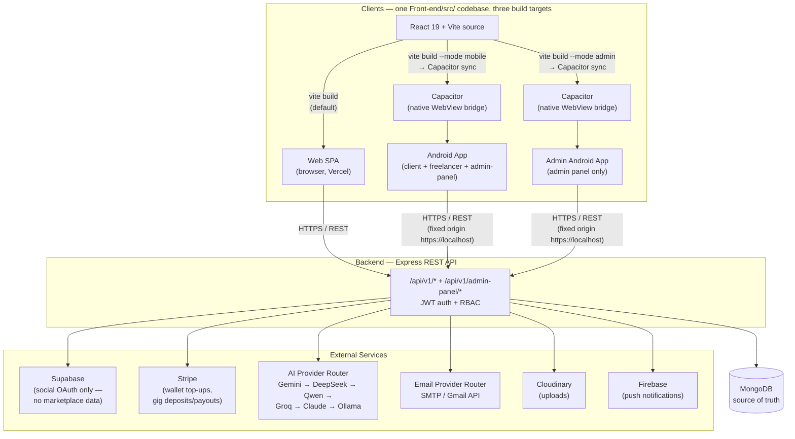
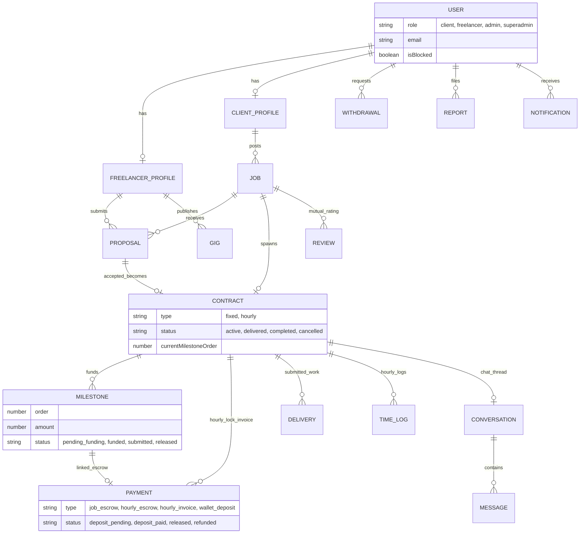
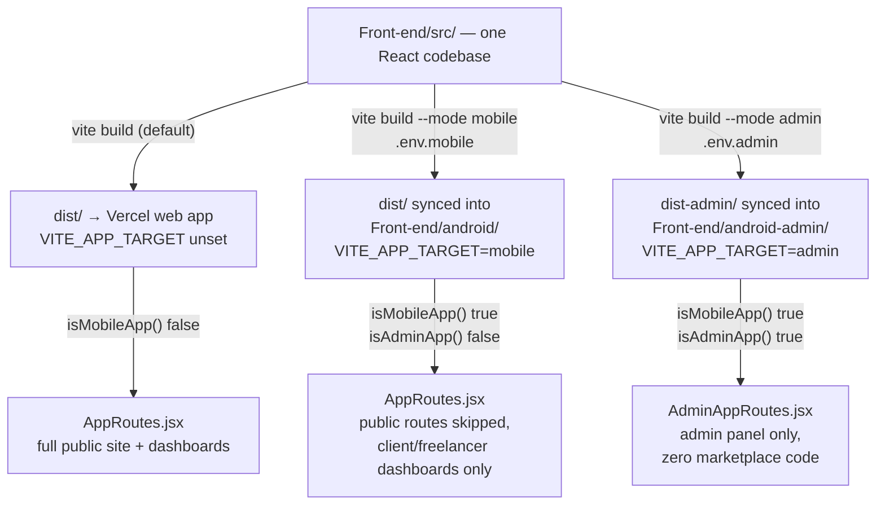
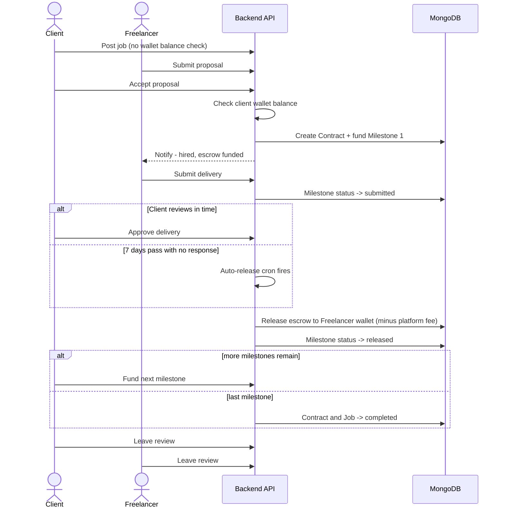

<!--
  SkillKart — Final Year Project Report
  This document is written in Markdown and is intended to be exported to Word/PDF.
  Replace all [bracketed placeholders] and insert screenshots/diagrams at the
  marked positions before submission.
-->

<div align="center">

# SkillKart
## An AI-Powered Freelance Marketplace Platform

**Final Year Project Report**

Bachelor of Science in Computer Science (BSCS)

<br>

**Submitted to**

*[University Name]*
*[Department of Computer Science]*

<br>

**Project Supervisor**

*[Supervisor Name]*

<br>

**Submitted by**

| Name | Registration No. |
|------|------------------|
| *[Student 1 Name]* | *[Reg. No.]* |
| *[Student 2 Name]* | *[Reg. No.]* |
| *[Student 3 Name]* | *[Reg. No.]* |

<br>

**Session:** *[e.g. 2022 – 2026]*

**Submission Date:** *[Month, Year]*

</div>

<div style="page-break-after: always;"></div>

---

## Certificate of Approval

This is to certify that the project titled **"SkillKart — An AI-Powered Freelance Marketplace Platform"** has been carried out by the group members listed above under the supervision of *[Supervisor Name]*, in partial fulfilment of the requirements for the degree of **Bachelor of Science in Computer Science** at *[University Name]*.

The project has been examined and is approved for submission.

<br><br>

| | |
|---|---|
| _______________________ | _______________________ |
| **Project Supervisor** | **Head of Department** |
| *[Name]* | *[Name]* |

<br>

| | |
|---|---|
| _______________________ | _______________________ |
| **Internal Examiner** | **External Examiner** |

<div style="page-break-after: always;"></div>

---

## Table of Contents

1. [Abstract](#1-abstract)
2. [Acknowledgements](#2-acknowledgements)
3. [Introduction](#3-introduction)
4. [Problem Statement](#4-problem-statement)
5. [Objectives](#5-objectives)
6. [Scope](#6-scope)
7. [Literature Review](#7-literature-review)
8. [Proposed Solution](#8-proposed-solution)
9. [System Architecture](#9-system-architecture)
10. [Database Design](#10-database-design)
11. [Technologies Used](#11-technologies-used)
12. [Features](#12-features)
13. [AI Features](#13-ai-features)
14. [Admin Panel](#14-admin-panel)
15. [Security](#15-security)
16. [Workflow](#16-workflow)
17. [Testing](#17-testing)
18. [Results](#18-results)
19. [Challenges Faced](#19-challenges-faced)
20. [Future Enhancements](#20-future-enhancements)
21. [Conclusion](#21-conclusion)
22. [References](#22-references)
23. [Appendix](#23-appendix)

<div style="page-break-after: always;"></div>

---

## 1. Abstract

The freelance economy has become a significant part of the global digital workforce, particularly for students and recent graduates seeking flexible, skill-based income. However, existing freelance platforms present recurring challenges: freelancer discovery is inefficient, intelligent assistance is minimal, payment security is a persistent concern, and identity/skill verification is weak. These barriers are especially acute for newcomers who lack the experience to write competitive proposals, price their work correctly, and build initial trust.

**SkillKart** is an AI-powered, dual-sided freelance marketplace built to address these problems in a single, coherent platform. It combines the two dominant freelancing models — pre-packaged **Gigs** (Fiverr-style) and custom **Jobs with Proposals** (Upwork-style) — and augments them with an integrated artificial-intelligence layer, a secure escrow-based payment system, multi-factor verification, and a comprehensive administrative panel — delivered both as a responsive web application and as two native Android apps built from the same codebase via Capacitor.

The system is implemented on the **MERN stack** (MongoDB, Express.js, React.js, Node.js). The frontend is a React 19 single-page application built with Vite; the backend is a layered Express REST API backed by MongoDB through Mongoose, comprising 40 data models and 25 route modules (316 endpoints). AI capabilities — including a conversational assistant, cost estimation, proposal drafting, skill validation, and CV analysis — are delivered through a resilient provider router that automatically fails over across Gemini, DeepSeek, Qwen, Groq, Claude, and a local Ollama model, ensuring the platform never crashes during an AI outage; freelancer matchmaking is handled separately by a deterministic, rules-based scoring engine that does not call any LLM provider. Payments are handled through a wallet-native escrow system (per-milestone escrow for fixed-price work, balance-lock escrow for hourly work, plus a Stripe-backed flow for gig orders), with Stripe also handling wallet top-ups and freelancer payouts, and security is enforced through JWT authentication with role-based access control, OTP-based two-factor authentication, password hashing, rate limiting, input sanitization, and audit logging.

The completed system delivers the full engagement lifecycle — from registration and verification, through job posting and proposals, to escrow-secured contracts, delivery, reviews, and dispute resolution — under the supervision of a dedicated 17-module admin panel. All project objectives were achieved and demonstrated on realistic, seeded data. This report documents the motivation, design, implementation, testing, and results of the SkillKart project.

**Keywords:** Freelance Marketplace, MERN Stack, Artificial Intelligence, Escrow Payments, Role-Based Access Control, Web Application, MongoDB, React.

<div style="page-break-after: always;"></div>

---

## 2. Acknowledgements

We would like to express our sincere gratitude to our project supervisor, *[Supervisor Name]*, whose guidance, feedback, and encouragement were invaluable throughout the development of SkillKart. Their insights helped us refine both our technical decisions and our understanding of building a production-quality software system.

We are thankful to the *[Department of Computer Science, University Name]* for providing the academic environment, resources, and structured evaluation that shaped this project.

We also thank the developers and maintainers of the open-source technologies on which SkillKart is built — including React, Node.js, Express, MongoDB, and the many supporting libraries — as well as the providers of the AI services integrated into the platform.

Finally, we thank our families and peers for their continuous support and patience during the many months of design, development, and testing.

*[Student 1], [Student 2], [Student 3]*

<div style="page-break-after: always;"></div>

---

## 3. Introduction

### 3.1 Overview

**SkillKart** is a web-based, AI-powered freelance marketplace that connects **clients** who need work completed with **freelancers** who offer their skills and services. Unlike a simple job board, SkillKart manages the *entire* engagement lifecycle: discovery, negotiation, contracting, secure payment, delivery, feedback, and dispute resolution — with artificial intelligence assisting users at each stage and a comprehensive administrative layer overseeing the platform.

The platform intentionally unifies the two most successful freelancing paradigms:

- **Gigs** — freelancers publish pre-packaged service offerings with tiered pricing (Basic / Standard / Premium), which clients can purchase directly. This is the Fiverr model.
- **Jobs & Proposals** — clients post custom job requirements, and freelancers submit competitive proposals. This is the Upwork model.

By supporting both, SkillKart accommodates a wide range of work — from quick, standardized tasks to large, custom engagements.

### 3.2 Purpose

The purpose of SkillKart is to lower the barriers that make freelancing difficult, particularly for students and new entrants, while raising the level of trust and security for all participants. Specifically, the platform aims to:

1. **Simplify discovery** — helping clients find suitable talent and freelancers find relevant work through structured categories, search, and AI-driven matchmaking.
2. **Provide intelligent assistance** — using AI to help freelancers write proposals, price their work, validate their skills, and improve their profiles.
3. **Guarantee payment security** — holding funds in escrow so freelancers are assured of payment and clients are assured of delivery.
4. **Establish trust** — through multi-step verification (email OTP, AI-generated skill tests, and identity checks) and a transparent review system.
5. **Enable oversight** — giving administrators the tools to moderate content, manage disputes, monitor the system, and analyze platform activity.

### 3.3 Report Structure

This report is organized as follows. Sections 4–6 define the problem, objectives, and scope. Section 7 reviews existing platforms. Section 8 presents the proposed solution, followed by detailed treatment of the system architecture (Section 9), database design (Section 10), and technologies (Section 11). Sections 12–15 describe the platform's features, AI capabilities, admin panel, and security. Section 16 walks through complete workflows. Sections 17–19 cover testing, results, and challenges, and Sections 20–21 discuss future work and conclusions. References and an appendix follow.

<div style="page-break-after: always;"></div>

---

## 4. Problem Statement

Freelance marketplaces have matured over the past decade, yet several structural problems persist — problems that disproportionately affect new freelancers and small clients. SkillKart is designed directly against the following challenges:

### 4.1 Freelancer Discovery

On large platforms, quality talent is often buried beneath thousands of profiles. Search and categorization are frequently keyword-based and shallow, making it hard for clients to find the right person and for capable-but-new freelancers to be seen. Without intelligent matching, discovery is inefficient for both sides.

### 4.2 Lack of AI Assistance

New freelancers face a steep learning curve. Writing a compelling proposal, pricing a project competitively, and presenting skills professionally are non-trivial tasks that existing platforms largely leave to the user. There is little built-in, intelligent guidance to help a newcomer succeed.

### 4.3 Payment Workflow and Trust

Payment is the single biggest source of anxiety in freelancing. Freelancers fear completing work and not being paid; clients fear paying and receiving poor or no work. A robust escrow mechanism — where funds are held securely until both parties are satisfied — is essential, but it must be implemented correctly and transparently, with a clear resolution path when things go wrong.

### 4.4 User and Skill Verification

Trust depends on verification. Fake profiles, exaggerated skills, and unverified identities erode confidence in a marketplace. Many platforms offer only basic verification, and rigorous skill testing is often paid or absent. A trustworthy platform needs layered verification of email, skills, and identity.

### 4.5 Contract and Dispute Management

A freelance engagement is a contract with a defined lifecycle — start, delivery, revision, completion — and occasionally disputes. When this lifecycle is not modeled explicitly, engagements become ambiguous and conflicts are hard to resolve fairly. Comprehensive contract tracking and a structured, administrator-mediated dispute process are necessary but frequently underdeveloped.

### 4.6 Summary

In short, existing solutions leave gaps in **discovery, assistance, payment trust, verification, and lifecycle management**. SkillKart addresses all five within one integrated, AI-augmented, admin-supervised platform.

<div style="page-break-after: always;"></div>

---

## 5. Objectives

The objectives of the SkillKart project are as follows:

1. **Build a complete dual-sided marketplace** supporting both Gigs (packaged services) and Jobs with Proposals (custom engagements), with full freelancer and client experiences.

2. **Integrate artificial intelligence** to assist users — including a conversational assistant, AI-based cost estimation, AI proposal drafting, AI skill validation and test generation, AI CV analysis, and AI freelancer matchmaking.

3. **Implement a secure escrow payment system** — a wallet-native escrow (per-milestone for fixed-price work, balance-lock for hourly work) plus a Stripe-backed flow for gig orders, with Stripe also handling wallet top-ups and payouts — including wallets, deposits, escrow release, platform-fee calculation, and withdrawals.

4. **Provide multi-factor verification** to establish trust — email/OTP verification, AI-generated skill tests, and an admin-managed identity/profile verification checklist.

5. **Develop a comprehensive administrative panel** with isolated authentication for moderating users, jobs, gigs, contracts, payments, disputes, and for monitoring and analytics.

6. **Enforce strong security** throughout — JWT authentication with role-based access control, password hashing, OTP, rate limiting, input validation and sanitization, and audit logging.

7. **Model the complete contract lifecycle** explicitly — as a state machine — so that engagements are unambiguous, auditable, and safe.

8. **Ensure resilience and reliability**, particularly for third-party services (AI, payments), so that failures degrade gracefully rather than crashing the application.

9. **Deliver native mobile access** — package the same web codebase as native Android applications via Capacitor (a client/freelancer/admin-panel app and a separate, standalone admin-only app), with platform-level integration (push notifications, offline detection, native back-button navigation) rather than a bare web wrapper.

<div style="page-break-after: always;"></div>

---

## 6. Scope

### 6.1 In Scope

The following capabilities are fully within the scope of this project and are implemented:

- **User management:** registration, login, OTP-based two-factor authentication, role-based onboarding, and profile management for freelancers and clients.
- **Marketplace:** job posting, gig publishing (with tiered pricing), proposals, and search/browsing by category and skill.
- **Engagement lifecycle:** contract creation, milestone/delivery submission, revisions, time tracking (for hourly work), completion, and cancellation.
- **Payments:** escrow deposits, escrow release, platform-fee handling, wallet balances, and withdrawals.
- **Communication & feedback:** in-app messaging tied to contracts, notifications, and a two-way review/rating system.
- **Dispute resolution:** raising, tracking, and administrator resolution of disputes.
- **AI tools:** assistant, cost estimator, proposal drafting, skill validation/tests, CV analysis, and matchmaking.
- **Administration:** a dedicated admin panel with moderation, monitoring, audit logs, and analytics.
- **Security:** authentication, authorization, verification, and platform hardening as listed in the objectives.

### 6.2 User Roles

The platform defines the following roles: **PublicViewer (Guest)**, **Freelancer**, **Client**, **Admin**, and **SuperAdmin** (with an additional content-editor role reserved for CMS tasks).

### 6.3 Out of Scope (Current Phase)

The following are intentionally deferred to future phases and documented in Section 20:

- **Real-time WebSocket chat and video calls** (messaging currently uses efficient polling).
- **Embedding/vector-based semantic search** (the current matchmaking uses deterministic, rules-based scoring rather than embeddings or LLM prompts).
- **Full internationalization (i18n)** / multi-language support.

<div style="page-break-after: always;"></div>

---

## 7. Literature Review

To position SkillKart, we studied the three most prominent freelance marketplaces and identified where our platform differs.

### 7.1 Fiverr

Fiverr popularized the **Gig** model, in which freelancers publish fixed, packaged service offerings that buyers purchase directly. Its strengths are simplicity and speed of transaction. Its limitations include relatively high service fees, a heavy dependence on freelancer marketing/SEO for visibility, and minimal intelligent assistance for sellers who are new to the platform.

### 7.2 Upwork

Upwork is built around the **Job + Proposal** model, where clients post projects and freelancers bid. It supports hourly and fixed contracts, time tracking, and escrow. Its strengths are contract flexibility and a mature payment system. Its limitations include a complex bidding process that disadvantages newcomers, connect-based (often paid) bidding, and limited built-in guidance for writing competitive proposals.

### 7.3 Freelancer.com

Freelancer.com supports both models and a wide range of project types with a contest/bidding system. It is broad but is often criticized for a crowded, competitive bidding environment and inconsistent quality control and verification.

### 7.4 Comparative Analysis

| Aspect | Fiverr | Upwork | Freelancer.com | **SkillKart** |
|--------|--------|--------|----------------|---------------|
| Marketplace model | Gigs | Jobs/Proposals | Both | **Both (Gigs + Jobs)** |
| Built-in AI assistance | Limited | Limited | Minimal | **Integrated (assistant, proposals, pricing, matching, CV analysis)** |
| Skill verification | Basic | Tests (often paid) | Basic | **AI-generated skill tests + identity verification** |
| Escrow payments | Yes | Yes | Yes | **Yes + wallet + admin oversight** |
| Dispute resolution | Yes | Yes | Yes | **Structured, admin-mediated, audit-logged** |
| Target focus | General | General | General | **Student/graduate-friendly, low-friction onboarding** |

### 7.5 How SkillKart Differs

SkillKart's differentiation is not a single feature but an *integration philosophy*: AI assistance is woven through onboarding, discovery, bidding, and pricing rather than bolted on; verification is layered and partly AI-driven; and the payment, contract, and dispute systems are unified and supervised by a purpose-built admin panel with full audit logging. The result is a platform explicitly designed to lower the barrier for new freelancers while maintaining trust for clients.

<div style="page-break-after: always;"></div>

---

## 8. Proposed Solution

SkillKart is proposed as a single, integrated web platform that resolves the problems identified in Section 4 through four pillars:

### 8.1 A Unified Dual-Model Marketplace

By supporting both **Gigs** and **Jobs/Proposals**, SkillKart serves the full spectrum of freelance work. A freelancer can both publish standardized services and bid on custom projects; a client can both buy a ready-made service and post a bespoke requirement.

### 8.2 An Integrated AI Layer

AI is used to actively reduce friction:
- The **Buddy assistant** answers platform and freelancing questions conversationally.
- **AI proposal drafting** helps freelancers respond to jobs competitively.
- The **AI cost estimator** helps price projects using market context.
- **AI skill validation and test generation** verify capabilities objectively.
- **AI CV analysis** parses a resume, scores it, and auto-fills the profile.
- **Matchmaking** ranks freelancers for a given project brief. Unlike the AI features above, this is a deterministic, rules-based scoring engine (skill overlap, rate fit, rating, verification, experience, availability) — it does not call an LLM provider.

Crucially, the AI subsystem is engineered for **resilience** (Section 13), so it enhances the experience without becoming a point of failure.

### 8.3 Secure Escrow Payments

Fixed-price engagements lock **100% of the agreed price** in escrow the moment a proposal is accepted — debited from the client's platform wallet, never left as an unfunded promise. Large projects can be split into several sequential **milestones** (any number, as long as the amounts add up to the agreed price), each funded only when the client is ready to start that phase (not all upfront), so capital isn't locked for work that hasn't begun. If a client goes silent after a freelancer submits work, the escrow **auto-releases after a configurable window** (default 7 days) rather than leaving the freelancer unpaid indefinitely. Posting a project carries no wallet-balance gate — a client can publish with any balance, including zero, so it is visible to freelancers and can collect proposals; the wallet is checked, and funds locked, only once a proposal is accepted, the earliest point real money needs to be committed. On release, the platform fee (a default 0.5% of the milestone amount) is deducted and the remainder credited to the freelancer's wallet, from which they can withdraw; the platform operates in PKR (Pakistani Rupee). This protects both parties and provides a clear basis for dispute resolution.

### 8.4 Trust, Verification, and Oversight

Trust is built through layered verification (email/OTP, skill tests, identity), a transparent two-way review system, and a structured dispute process. All of this is overseen by a comprehensive **admin panel** with monitoring, analytics, and complete audit logging, ensuring accountability across the platform.

<div style="page-break-after: always;"></div>

---

## 9. System Architecture

### 9.1 Architectural Overview

SkillKart follows a **decoupled client–server architecture**. A React single-page application (SPA) communicates with a stateless Express REST API over HTTPS, using JSON. MongoDB is the single source of truth for all persistent data. External integrations — payments (Stripe), AI (a multi-provider router), optional social login (Supabase, social OAuth only), transactional email (a provider router over SMTP/Gmail), file/image uploads (Cloudinary), and push notifications (Firebase) — are isolated behind dedicated service modules so that the core application is never tightly coupled to any single third-party vendor.

```
   ┌────────────────────────┐        HTTPS / REST (JSON)        ┌────────────────────────┐
   │   React 19 SPA (Vite)  │  ──────────────────────────────► │   Express REST API      │
   │   Frontend (port 3001) │   /api/v1/*                       │   Backend (port 5000)   │
   │                        │  ◄──────────────────────────────  │                         │
   └────────────────────────┘                                   └──────────┬─────────────┘
                                                                            │
                                   ┌────────────────────────────────────────┼───────────────────────────┐
                                   │                       │                │                            │
                            ┌──────▼──────┐        ┌────────▼───────┐  ┌─────▼──────┐            ┌────────▼────────┐
                            │   MongoDB   │        │     Stripe      │  │  AI Router │            │    Supabase     │
                            │ (Mongoose,  │        │  (escrow /      │  │ (Gemini →  │            │  (optional      │
                            │  40 models) │        │   payouts)      │  │ DeepSeek → │            │  social OAuth)  │
                            │             │        │                 │  │ Qwen →     │            │                 │
                            └─────────────┘        └─────────────────┘  │ Groq →     │            └─────────────────┘
                                                                        │ Claude →   │
                                                                        │ Ollama)    │
                                                                        └────────────┘
```

The diagram below (reproduced from the project's root `README.md`) shows the full picture: the three client build targets that compile from the single `Front-end/src/` codebase, the Express API they all talk to, MongoDB as the sole system of record, and the external services isolated behind their own service modules.



### 9.2 React Frontend

The frontend is a **React 19** SPA built with **Vite 7** and routed by **React Router 7** (`BrowserRouter`). It is organized by audience — `public/`, `client/`, `freelancer/`, `admin/`, and an isolated `adminPanel/` — across roughly 129 components and pages.

Application state is managed with **React Context** providers (authentication, client, freelancer, and notifications) combined with local component state. All server communication passes through a single **Axios client** with a central interceptor that transparently handles JWT attachment, access-token refresh, error surfacing, and in-flight request de-duplication. **Role-based route guards** (`ProtectedRoute`) ensure each user only reaches routes appropriate to their role, redirecting unauthorized access.

### 9.3 Express Backend

The backend is a **Node.js + Express 4** application with a strict layered structure:

```
Request → Route → Middleware (auth, RBAC, validation, rate-limit, sanitization)
        → Controller (thin: validate + delegate)
        → Service (business logic)
        → Model (Mongoose)  → MongoDB
```

It comprises **25 route modules** (exposing 316 endpoints), **34 controllers** (25 marketplace + 9 admin-panel), **49 service files** (26 core service modules plus the AI-router and email subsystems), and **40 Mongoose models**. Controllers remain thin and delegate business logic to services (for example, `stripe.service`, `matchmaking.service`, `skillMatching.service`, `notification.service`, and `email.service`). Cross-cutting concerns — structured logging (Winston), API documentation (Swagger), and scheduled tasks (node-cron for billing and cleanup) — are handled at the application level. The server binds to `0.0.0.0` and reads its port from the environment, making it deployment-ready.

### 9.4 MongoDB Database

**MongoDB**, accessed through **Mongoose**, stores all persistent data across 40 collections. Relationships are modeled using ObjectId references, and referential integrity is maintained at the application layer. Collections are indexed for common query patterns, and large listing endpoints use server-side pagination.

### 9.5 Authentication Subsystem

Authentication is JWT-based, with a short-lived access token held in memory and a refresh token persisted in obfuscated client storage, enabling seamless session restoration on reload. OTP-based two-factor authentication protects logins, and optional Supabase OAuth supports social login. The admin panel has a **completely isolated** authentication flow so that the marketplace JWT can never grant administrative access.

### 9.6 Admin Panel Subsystem

The admin panel is served under an isolated route namespace (`/admin-panel/*`) with its own authentication provider, protected routes, and scoped styling. It provides 17 management modules and is architecturally separated from the public application to prevent any leakage of privilege.

### 9.7 AI Integration Subsystem

AI features are delivered through a **provider router** that presents a uniform interface to the rest of the application while, internally, attempting a prioritized chain of providers (Gemini → DeepSeek → Qwen → Groq → Claude → Ollama). Gemini and DeepSeek implement the full method set (CV parsing, skill tests, Buddy chat, cost estimation, proposal drafting, taxonomy suggestions); Qwen, Groq, and Claude cover the core extraction/classification methods. The order is configurable via environment variables, and the subsystem is designed to fail gracefully (Section 13).

<div style="page-break-after: always;"></div>

---

## 10. Database Design

### 10.1 Overview

SkillKart's data layer consists of **40 MongoDB collections** managed through Mongoose schemas. The design is reference-based (normalized where it aids integrity, denormalized where it aids read performance), with enums enforcing valid states and indexes supporting frequent queries. Below, the major collections are described, followed by their relationships.

### 10.2 Major Collections / Models

**Identity & Profiles**

- **User** — the core identity: email, hashed password, `role` (`superadmin` | `admin` | `contenteditor` | `freelancer` | `client` | `publicviewer`), authentication provider, and verification flags.
- **RefreshToken** — the server-side store backing refresh-token rotation, extending Section 9.5's client-side description: each issued refresh token is persisted here so a reuse of an already-rotated token (a strong signal of a stolen token) can be detected and the affected session family revoked, rather than trusting the JWT's claims alone.
- **FreelancerProfile** — freelancer-specific data: title, skills (with proficiency and verification), rating, completed-project count, total earnings, **wallet balance**, Stripe onboarding status, verification details, and onboarding progress.
- **ClientProfile** — client-specific data: company type (`Individual` | `Startup` | `SME` | `Enterprise`), budget range, wallet balance, total spent, projects posted, and verification status.

**Marketplace**

- **Job** — a client's custom requirement: title, description, budget (`fixed`/`hourly`), experience level, skills, category, `source` (`project` | `gig`), and `status` (`draft` | `open` | `pending_payment` | `in-progress` | `completed` | `cancelled` | `expired` | `closed`). A `source: 'gig'` Job is created automatically when a client orders a Gig (sitting in `pending_payment` until the deposit lands, then moving to `in-progress`), reusing the same escrow → delivery → completion → stats lifecycle instead of a parallel one; only `source: 'project'` Jobs (a client's own posted requirement, matched via Proposals) go on to spawn a **Contract**.
- **Gig** — a freelancer's packaged service: title, descriptions, category, tiered `pricing` (basic/standard/premium), media, `status` (`draft`/`active`/`paused`), and aggregate stats (views, orders, rating). Ordering a Gig does not create a separate "order" entity — it creates a Job (see above) linked back to the Gig and chosen pricing tier.
- **Proposal** — a freelancer's bid on a job: cover letter, price, estimated delivery, and `status` (`pending` | `accepted` | `rejected` | `withdrawn`).
- **CustomOffer** — a freelancer's bespoke offer sent inside a chat (`status`: `pending` | `accepted` | `declined` | `withdrawn` | `expired`). Offers expire after 7 days, and a freelancer can have at most 5 open offers per conversation. When the client accepts, it becomes the same kind of gig-order Job described above.

**Engagement Lifecycle**

- **Contract** — the lifecycle engine, created when a proposal is accepted. It records the parties, `type` (`fixed`/`hourly`), pricing, deadline, an embedded time-tracking timer, `milestoneMode` and `currentMilestoneOrder` (fixed-price only), a `status` state machine (`active` → `paused` → `in_revision` → `delivered` → `completed` / `pending_cancellation` / `under_review` / `cancelled`), and an embedded **dispute** sub-document — used directly for hourly contracts; fixed-price contracts instead record the dispute on the specific **Milestone** in question, since a single contract can hold several independently-disputed milestones.
- **Milestone** — (fixed-price contracts) one funded phase of a project: `order`, `title`, `amount`, a `status` state machine (`pending_funding` → `funded` → `submitted` → `approved`/`in_revision`/`disputed` → `released`/`refunded`), a `reviewDeadline` used by the auto-release scheduler, and its own embedded **dispute** sub-document. A contract with one implicit milestone behaves like a simple lock-then-release; a contract split into several milestones funds and releases each one sequentially.
- **ContractHistory** — an append-only log of significant contract events (for auditability).
- **Delivery** — a submitted deliverable with versioning and a `status` (`pending_review` | `accepted` | `revision_requested`), linked to the specific milestone it was submitted against (fixed-price) or to the contract directly (hourly).
- **TimeLog** — time entries for hourly contracts (timer or manual), with an approval status.

**Payments & Wallet**

- **Payment** — an escrow or wallet transaction: `type` (`job_escrow` | `wallet_deposit` | `hourly_escrow` | `hourly_invoice`), a `milestoneId` link (one Payment per milestone, for fixed-price contracts), amounts (total, deposit, final), **platform fee** (`feeRate`, default 0.5%), **freelancer payout**, and a single shared `status` enum (`deposit_pending` → `deposit_paid` → `released` / `refunded`) reused by every payment type — milestone and hourly wallet-lock payments do not introduce a separate "locked" status; locking funds is simply recorded as `deposit_paid`, and releasing them moves the same row to `released`.
- **Withdrawal** — a freelancer cash-out: amount, `method` (`bank_transfer` | `paypal` | `stripe`), and `status` (`pending` | `processing` | `completed` | `failed` | `cancelled`).
- *(Wallet balances are maintained as fields on the freelancer/client profiles, updated transactionally by payment/withdrawal operations.)*

**Communication & Feedback**

- **Conversation** & **Message** — in-app messaging tied to contracts; a conversation groups participants, and messages record sender, content, attachments, and read state.
- **Notification** — user-facing notifications (proposal received, message, review, etc.).
- **Review** — a two-way rating: reviewer, reviewee, rating (1–5), comment, and `type` (`client_to_freelancer` | `freelancer_to_client`), with a uniqueness constraint per job/reviewer.
- **Testimonial** — approved freelancer success stories shown publicly.

**Verification & Taxonomy**

- **SkillNode** & **SkillRelationship** — the skill/category taxonomy graph used for browsing and matching.
- **TaxonomyProposal** — AI-suggested skill/category taxonomy entries (raised when a user enters a skill the graph doesn't recognize) queued for admin review before being merged into `SkillNode`/`SkillRelationship`.
- **SkillTestAttempt** — records of AI-generated skill tests and their outcomes.
- **OTP** & **OnboardingProgress** / **ClientOnboardingDraft** — verification and onboarding state.
- **FileUpload** — tracks Cloudinary-backed uploads (avatars, CVs, portfolio items, delivery/message attachments), linking each stored asset back to its owning user and record.

**Administration & Operations**

- **Report** — user/content reports with category, priority, and resolution status.
- **AdminUser**, **AdminSession**, **AdminAuditLog** — the isolated admin identity and an immutable audit trail of sensitive actions.
- **PlatformSettings** / **SystemSettings** — configurable platform parameters (fees, weights, feature flags).
- **ApiLog**, **ErrorLog**, **EmailLog** — operational logging for monitoring.
- **CMSContent**, **NewsletterSubscriber**, **ContactMessage** — content and communication records.

### 10.3 Key Relationships

```
User ──1:1──► FreelancerProfile / ClientProfile
Client (User) ──1:N──► Job ──1:N──► Proposal
Proposal (accepted) ──1:1──► Contract
Contract (fixed-price) ──1:N──► Milestone ──1:1──► Payment ──► updates Wallet balances ──► Withdrawal
Contract (hourly) ──1:N──► Payment ──► updates Wallet balances ──► Withdrawal
Contract ──1:N──► Delivery, TimeLog, ContractHistory
Contract ──1:1──► Conversation ──1:N──► Message
Job ──1:N──► Review
Contract ──(embedded, hourly)──► Dispute ──► Report ──► AdminAuditLog
Milestone ──(embedded, fixed-price)──► Dispute ──► Report ──► AdminAuditLog
Freelancer ──1:N──► Gig
SkillNode ──N:N──► SkillRelationship (taxonomy graph)
```

The **Contract** is the central hub: an accepted proposal creates a contract, which then drives payment, deliveries, messaging, reviews, and — when necessary — disputes. This design keeps the engagement lifecycle unified and traceable.



Note: `Contract.status` has no literal `disputed` value — a contract or milestone in dispute keeps its normal status while the dispute itself lives in an embedded `dispute` sub-document (on the `Contract` for hourly work, on the specific `Milestone` for fixed-price work), consistent with the relationships shown in Section 10.3.

<div style="page-break-after: always;"></div>

---

## 11. Technologies Used

This section explains each major technology and the rationale for its selection.

### 11.1 Frontend

- **React 19** — a component-based UI library chosen for its ecosystem, performance, and suitability for building a complex, stateful SPA.
- **Vite 7** — the build tool and dev server, chosen for extremely fast hot-module replacement and optimized production builds.
- **React Router 7** — declarative client-side routing, including nested routes and route guards.
- **React Hook Form** — performant, minimal-re-render form management with validation.
- **Axios** — the HTTP client, wrapped in a custom module with interceptors for auth, error handling, and request de-duplication.
- **Framer Motion & GSAP** — animation libraries used for polished transitions and interactive UI.
- **Chart.js (react-chartjs-2)** — data visualization for dashboards and analytics.
- **Tailwind CSS v4 + custom CSS** — utility-first styling combined with hand-authored component CSS.
- **lucide-react** — a consistent, modern icon set.

### 11.2 Backend

- **Node.js (≥22.3)** — the JavaScript runtime, enabling a unified language across the stack.
- **Express 4** — a minimal, flexible web framework used to build the layered REST API.
- **Mongoose 8** — an ODM for MongoDB that adds schema definitions, validation, hooks, and relationship modeling.

### 11.3 Database

- **MongoDB (Atlas)** — a document database chosen for its flexible schema, scalability, and natural fit for the varied, evolving data of a marketplace.

### 11.4 Authentication & Security

- **JSON Web Tokens (JWT)** — stateless access/refresh tokens.
- **bcrypt** — one-way password hashing.
- **OTP (one-time passwords)** — email-delivered two-factor authentication.
- **Supabase** *(optional)* — social OAuth provider. Note that Supabase owns *user* authentication only; it is deliberately decoupled from the platform's outbound email (see §11.5).
- **Google reCAPTCHA v3** — invisible, score-based bot mitigation on login, registration, and the public contact/newsletter forms. Unlike v1/v2 it presents no challenge to the user; it returns a 0.0–1.0 confidence score which the server compares against a configurable threshold (default 0.5).
- **Helmet, express-rate-limit, express-validator, express-mongo-sanitize** — HTTP-header hardening, abuse prevention, input validation, and NoSQL-injection sanitization.

### 11.5 Email Delivery

Transactional email (OTP codes, security alerts, contact-form relays) is sent through a **pluggable provider architecture**, selected at runtime by a single `EMAIL_PROVIDER` environment variable:

- **Google Gmail API** (`googleapis`) — the primary provider in deployment. Sends over HTTPS using OAuth2 credentials belonging to a dedicated platform mailbox, authenticated by a long-lived refresh token. The application performs no OAuth authorization flow at runtime; it exchanges the stored refresh token for short-lived access tokens.
- **SMTP** (`nodemailer`) — the default provider for local development, and the automatic fallback when Gmail credentials are absent or fail verification at startup.

Two engineering constraints drove this design:

1. **Cloud hosts commonly block outbound SMTP ports** (465/587). The deployment target, Railway, is one of them — so an HTTPS-based transport is a functional requirement in production, not a preference.
2. **Gmail's `gmail.send` scope cannot be satisfied by the existing Supabase Google sign-in.** Supabase authenticates *end users*; `gmail.send` would send mail *as the signed-in user*. Transactional mail originates from a platform address and is delivered to recipients who may never have used Google sign-in, with no user session in scope at send time. The two concerns are therefore kept fully separate: authentication is an external dependency the email layer never touches.

### 11.6 Discoverability (SEO & PWA)

- **Dynamic XML sitemap** — generated server-side from live database content (open jobs, active gigs, public freelancer profiles, skill categories) rather than a static file, so newly published content becomes crawlable without a redeploy.
- **robots.txt** — restricts crawlers to public marketing and marketplace pages; authentication flows, dashboards, the admin panel, and transactional pages are excluded.
- **Web App Manifest** — declares the platform as an installable Progressive Web App with brand theming, maskable icons, and application shortcuts.
- **Open Graph & Twitter Card metadata** — controls link-preview rendering when pages are shared on social platforms and messaging apps.

### 11.7 Payments

- **Stripe** — payment processing for escrow and payouts, integrated behind a service layer with a **dummy/simulated mode** (`STRIPE_DUMMY`) that allows the full payment flow to be demonstrated without live transactions.

### 11.8 Artificial Intelligence

- **AI Provider Router** — an in-house abstraction over multiple providers: **Google Gemini**, **DeepSeek**, **Alibaba Qwen**, **Groq**, **Anthropic Claude**, and **Ollama** (local). Each provider is wrapped in a common interface; the router selects and fails over according to configurable priorities.

### 11.9 File Storage & Media

- **Cloudinary** — hosted media storage and delivery for all uploaded assets (freelancer avatars, CVs, portfolio images, gig media, message/delivery attachments). The backend uploads through a thin service wrapper (tracked via the `FileUpload` model, Section 10.2) rather than the request handlers touching the Cloudinary SDK directly.

### 11.10 Push Notifications

- **Firebase Cloud Messaging (FCM)** — delivers push notifications to the native Android apps (client/freelancer/admin and the standalone admin app), hooked into the platform's single `notification.service.js` choke point alongside in-app and email notifications, and designed to fail open if push delivery is unavailable.

### 11.11 Tooling & Operations

- **ESLint & Prettier** — linting and formatting for code quality and consistency.
- **Nodemon** — automatic restart during development.
- **Swagger (OpenAPI)** — interactive API documentation served at `/api/v1/docs`.
- **Winston** — structured application logging.
- **node-cron** — scheduled jobs (e.g., weekly billing, cleanup).
- **Redis (ioredis)** — wired up at server boot for future caching; it is not yet used to cache any live read path, an intentionally honest scope limitation rather than an oversight.

<div style="page-break-after: always;"></div>

---

## 12. Features

This section describes the platform's modules in detail.

### 12.1 Authentication & Onboarding
Email/password registration and login with **bcrypt** hashing and **OTP** two-factor authentication. After registering, a user selects a role (freelancer or client) and completes a **guided, multi-step onboarding** — profile details, skills, portfolio, education, and (for freelancers) an optional AI-assisted CV upload and skill tests.

### 12.2 User Profiles
Rich profiles for both roles. **Freelancer profiles** include title, bio, skills (with proficiency and verification badges), portfolio, education, experience, languages, ratings, completed projects, and earnings. **Client profiles** include company details, budget range, and hiring history. Public profile pages present this information to visitors.

### 12.3 Freelancer Dashboard
A personalized workspace showing profile completion, active and completed contracts, proposals, earnings, wallet balance, skill-verification status, and quick actions (create a gig, browse jobs, take a skill test).

### 12.4 Client Dashboard
A workspace showing posted jobs, received proposals, active contracts, spending, and quick actions (post a job, browse freelancers, review proposals).

### 12.5 Jobs
Clients post detailed jobs specifying budget (fixed or hourly), experience level, required skills, and category. Jobs move through a defined status lifecycle and can be browsed and searched publicly.

### 12.6 Gigs
Freelancers publish packaged services with **three pricing tiers** (Basic / Standard / Premium), descriptions, media, and FAQs. Gigs display aggregate statistics (views, orders, rating) and can be paused or drafted.

### 12.7 Proposals
Freelancers submit proposals to jobs — including a cover letter (optionally **AI-drafted**), price, and estimated delivery. Clients review and accept or reject proposals; acceptance creates a contract. Rejection is not always terminal: a client can reject **with resubmission allowed** (`canResubmit`), which lets the freelancer revise the same proposal and resubmit it back into `pending` — gated by the same skill-verification check required to apply in the first place, so an expired or never-earned verification can't be sidestepped by resubmitting instead of applying fresh.

### 12.8 Contracts
The contract is the engagement's backbone, modeling the full lifecycle as a **state machine**. It tracks type (fixed/hourly), agreed price and deadline, deliveries, revisions, time logs, completion, and cancellation. Hourly contracts carry a single embedded dispute record; fixed-price contracts instead track disputes per **milestone** (Section 12.10a), since a project split into several phases can have any one of them independently disputed while the rest continue normally.

### 12.9 Wallet
Each freelancer and client has a **wallet** balance maintained on their profile. Escrow debits/credits and withdrawals all move through this internal ledger. Withdrawals are not all handled the same way: a `stripe`-method withdrawal is fully automated — a real Stripe Connect payout is issued immediately, with no admin step, and its status goes straight to `processing`/`completed` — while `bank_transfer` and `paypal` withdrawals are queued for manual admin approval (Section 14.2); neither of those two manual methods is currently exposed in the freelancer UI. Administrators can freeze wallets when necessary. Posting a job carries **no wallet-balance gate** — a client can publish a job with any balance, including zero, so it is visible to freelancers and can collect proposals; the wallet is checked only once the client goes to **accept** a proposal (Sections 12.10a–12.10b), which is the earliest point real money needs to be committed.

### 12.10 Payments & Escrow
Gig orders follow the original **deposit-then-release** model, split **50/50**: the client funds a 50% deposit on request (`deposit_pending` → `deposit_paid`), held until the client approves delivery, then pays the remaining 50% and the full escrow is released (**platform fee** deducted, **freelancer payout** credited) or refunded. Custom-job contracts instead use one of two newer, wallet-native escrow models depending on contract type — **milestone escrow** for fixed-price jobs (12.10a) and **wallet-lock escrow** for hourly jobs (12.10b), both described next. Stripe processes real transactions for wallet top-ups, with a simulated mode (`STRIPE_DUMMY`) for demonstration.

### 12.10a Milestone-Based Escrow (Fixed-Price Jobs)
When a client accepts a proposal for a fixed-price job, **100% of the first milestone's price is locked in escrow immediately** — debited from the client's wallet as part of accepting, so the money is never a promise (the acceptance itself is rejected up front if the wallet cannot cover it). For larger engagements, the client can split the price into any number of sequential **milestones** at accept-time (the amounts must sum to the agreed price) (e.g. "UI/UX — Rs. 30,000", "Backend — Rs. 40,000"); only the first milestone is funded upfront, and each subsequent milestone is funded by the client only once the previous one is approved and released — capital is never locked for work that hasn't started yet.

The freelancer can only submit work once the current milestone shows **funded**, guaranteeing "escrow funded, safe to work" is a real, checked guarantee rather than a UI promise. On the client's approval, the milestone's escrow releases (fee deducted, payout credited) and — if it was the last milestone — the whole contract and job complete; otherwise the contract advances to the next milestone, which the client then funds when ready.

To prevent a client from strategically going silent after receiving work, a scheduled job scans for milestones the client hasn't reviewed within a configurable window (default **7 days**) and **auto-releases** them to the freelancer, notifying both parties. A milestone under an active dispute is excluded from this auto-release.

### 12.10b Wallet-Lock Escrow (Hourly Jobs)
Hourly contracts use a separate escrow model, since there is no fixed total price to lock upfront. When a client accepts an hourly proposal, one **week's estimated cost** (hourly rate × the freelancer's estimated weekly hours) is locked from the client's wallet immediately as part of accepting — again rejected up front if the wallet cannot cover it. This replaced an earlier deposit-based approach for hourly work.

Billing is then automatic and incremental rather than requiring a separate client approval per hour: as the freelancer logs time (via timer or manual entry), each logged amount is drawn down directly from the locked balance into the freelancer's wallet (fee deducted, payout credited), as long as the lock has room. If the freelancer's unbilled work would exceed the remaining lock, further time logging is blocked and any log already made is held **pending** until the client tops up the lock, at which point the pending logs are billed in order. When the contract ends, any unused portion of the lock is refunded back to the client's wallet, since a lock is a hold rather than a spend.

### 12.11 Messaging
In-app messaging is tied to contracts. Participants exchange messages and attachments in a conversation, with read tracking and message notifications.

### 12.12 Notifications
Users receive notifications for key events — new proposals, messages, reviews, contract updates — surfaced through a notification center.

### 12.13 Reviews & Ratings
On completion, both parties can leave a **two-way review** (1–5 stars plus a comment). Reviews aggregate into profile ratings and can be moderated (hidden) by administrators when they violate policy.

### 12.14 Search & Categories
A structured **taxonomy** of categories and skills powers browsing and search across freelancers, gigs, and jobs. The category system is dynamic and reflects real marketplace activity.

### 12.14a Skill Graph & Taxonomy Curation
Underneath the taxonomy sits a proper **skill graph**. `SkillNode` documents are typed vertices — `industry`, `category`, `profession`, `skill`, `technology`, `tool`, or `concept` — each carrying aliases and synonyms for fuzzy resolution, a relevance `weight`, and a hierarchical `canonicalParent`, with `active`/`deprecated`/`merged` status so a node can be retired or folded into another without breaking existing references. `SkillRelationship` documents are typed edges between nodes, letting the graph express relationships beyond a flat parent-child tree. New nodes and edges are never written straight into the live graph — they first pass through a **`TaxonomyProposal`** approval queue, sourced from four triggers (`gig_creation`, `job_posting`, `profile_update`, `periodic_analysis`) and carrying an `aiReasoning` explanation, sitting `pending_review` until an administrator approves or rejects it.

This queue is reviewed through `/admin/taxonomy` (`TaxonomyAdmin.jsx`) — a separate, **non-isolated** legacy content-editor surface that authenticates with the ordinary marketplace JWT and RBAC (`admin`/`superadmin`/`contenteditor` roles), distinct from the isolated `/admin-panel/*` system described in Section 14.

### 12.14b Content Management (CMS)
A separate, fully-built **versioned content management system** exists on the backend: `CMSContent` pages support create/update/publish/unpublish/scheduled-publish/version-restore/export operations with a full `modificationHistory`, gated by dedicated `cms:*` permissions tied to the `contenteditor` role — the same non-isolated marketplace-RBAC surface as the taxonomy tool above, not the isolated admin panel. As of this writing the API has **no frontend consumer**: there is no editor UI to author pages, and no public page renders CMS content. It is documented here honestly as backend-only infrastructure, built ahead of the UI that would consume it, rather than as a shipped content feature.

### 12.15 Disputes
When an engagement goes wrong, either party can raise a **dispute**, providing a reason and details. For hourly contracts the dispute is raised on the contract as a whole; for fixed-price contracts it is scoped to the **specific milestone** currently under review (delivered or in revision) — locking only that milestone rather than freezing an entire multi-phase project over one disputed phase. Disputes are tracked with a status and routed to administrators, who resolve them — release the escrow to the freelancer, refund the client, split it by percentage, resume/reject the dispute, or (fixed-price only, when the disputed milestone was never funded and so has no escrow to release/refund/split) **cancel the contract outright** — with recorded resolution notes; a resolved milestone dispute lets the contract continue normally into its next milestone (or completes the contract if it was the last one).

### 12.16 Admin Panel
A comprehensive, isolated administrative interface (detailed in Section 14) for moderating and monitoring every aspect of the platform.

### 12.17 Analytics
Dashboards visualize platform activity — users, jobs, gigs, contracts, revenue, and disputes — supporting data-informed administration.

### 12.18 Settings
Users manage account settings, notification preferences, and security options (e.g., toggling two-factor authentication); administrators manage platform-wide settings such as fees and feature flags.

### 12.19 Transactional Email
The platform sends OTP verification codes, login and password-change security alerts, and relays for the public **contact form** and **newsletter signup** — each submission is captured to its own collection (`ContactMessage`/`NewsletterSubscriber`) and emailed to the admin inbox, though neither currently has a dedicated browsing or moderation view in the admin panel. Delivery runs through a provider abstraction (Gmail API in deployment, SMTP locally — see §11.5), with automatic retry on transient failures, and every send attempt recorded to an `EmailLog` collection surfaced in the admin panel's monitoring view.

### 12.20 Discoverability
Public marketplace content is exposed to search engines through a database-driven XML sitemap and a crawl policy that excludes all authenticated and transactional routes. The platform is installable as a Progressive Web App, and shared links render branded preview cards on social and messaging platforms.

### 12.21 Mobile Application
A native Android application wraps the same React codebase using Capacitor rather than a separate rewrite — the client, freelancer, and admin-panel experiences are identical to the web app, while public marketing pages are excluded from the mobile bundle and lazy-loaded on web to keep both lean. Platform-specific integration covers the Android hardware back button, status bar theming, offline detection with a dedicated "no connection" screen, a branded app icon and splash screen, external links opening in an in-app browser tab rather than navigating the app away, and push notifications via Firebase Cloud Messaging tied into the same notification events (proposals, messages, payments, disputes) that drive the web in-app notification center.

SkillKart in fact ships **two** independent native builds from this one codebase. Alongside the client/freelancer app above, a second, fully separate Android app packages the admin panel on its own — its own Capacitor project, its own `appId` and signing key — for administrators who need moderation access on the go without installing the full marketplace app. It renders only the admin-panel route tree and shares no client/freelancer/public code with the main app, while inheriting every platform integration described above (offline detection, push notifications, native back-button handling, and so on).

**Figure 12.21 — One codebase, three build targets.** A single `VITE_APP_TARGET` environment flag decides which of the three ships from the exact same `Front-end/src/` source: the public web app, the client/freelancer/admin-panel native app, or the standalone admin-only native app. `isMobileApp()`/`isAdminApp()` (both derived from that same flag) then decide which route tree actually renders inside the app.



**Representative screens from the native Android build** *(captured from the running app; the full set of 25 screens is in `docs/screenshots/mobile/`)*:

<table>
<tr>
<td width="25%" align="center"><br><sub><i>Login — email/password + social login</i></sub></td>
<td width="25%" align="center"><br><sub><i>Client dashboard — active projects, spend, quick actions</i></sub></td>
<td width="25%" align="center"><br><sub><i>Job detail — brief + received proposals</i></sub></td>
<td width="25%" align="center"><br><sub><i>Native navigation drawer</i></sub></td>
</tr>
</table>

<div style="page-break-after: always;"></div>

---

## 13. AI Features

Artificial intelligence is a first-class part of SkillKart, integrated across onboarding, discovery, bidding, and pricing.

### 13.1 AI Suggestions and Assistance

- **Buddy AI Assistant** — a conversational assistant that answers questions about finding work, hiring, pricing, and writing proposals. Guests receive a limited number of free messages; logged-in users have expanded access.
- **AI Proposal Drafting** — given a job, the system generates a tailored proposal cover letter to help freelancers respond competitively.
- **AI Cost Estimator** — from a project brief (type, skills, complexity, timeline), the system estimates a market-appropriate budget range with a rationale.
- **AI Brief Suggestion / Auto-fill** — infers category, skills, and budget from a free-text description to speed up job posting.
- **AI Skill Validation** — validates and normalizes user-entered skills (e.g., "reactjs" → "React.js"), rejecting non-professional inputs and suggesting related skills.
- **AI Skill Test Generation & Evaluation** — auto-generates verification tests for a freelancer's skills and scores the answers, powering the skill-verification badge.
- **AI CV Analysis** — parses an uploaded CV, extracts structured data (title, bio, skills, education, experience), scores it, classifies it, and auto-fills the freelancer's profile.
- **Matchmaking** — ranks freelancers for a given project brief using a deterministic, rules-based scoring engine (skill overlap, rate fit, rating, verification, experience); unlike the features above, it does not call any LLM provider.
- **AI Industry Recommendation** — suggests suitable industries for a client based on their business profile.
- **Skill-Test Proctoring** — while a timed skill test is in progress, a webcam guard built on Google's MediaPipe Face Landmarker (478 facial landmarks plus eye-direction scores, running entirely client-side) flags a missing face, a second face, head turns, eyes looking away, and body movement, alongside a separate anti-cheat guard that detects tab-switching, window blur, leaving full-screen, and best-effort blocks on copy/cut, dev-tools and the context menu. Every threshold for both guards is derived from one backend setting, `SKILL_TEST_PROCTOR_STRICTNESS` (0–1, where 0 turns proctoring off and the default is 0.5); the candidate sees each counted violation live, and the attempt is aborted after repeated violations. Like Matchmaking, this is not backed by any AI provider call — the face-landmark model runs locally in the browser (on the CPU in the Android app), not through the provider router.

### 13.2 Prompt Processing

Each AI capability is implemented as a method on a provider that constructs a task-specific prompt, requests a **structured JSON** response, and parses it defensively (handling code-fenced or partially malformed output). This keeps AI outputs machine-usable and predictable.

### 13.3 Provider Architecture and Token/Usage Handling

AI calls are routed through a **provider router** that presents a single interface to the application. Internally, it maintains a **prioritized fallback chain** — by default **Gemini → DeepSeek → Qwen → Groq → Claude → Ollama (local)** — and tries each provider in order until one succeeds. The order is fully **configurable via environment variables** using numbered priorities (`AI_PRIORITY_<PROVIDER>`, where `0` is tried first and `-1` disables a provider). This design directly addresses the reality that free-tier AI services are **rate-limited and unreliable**: when one provider exhausts its quota (token/usage limits) or is unavailable, the router automatically falls back to the next, with a local Ollama model as the final, quota-free safety net.

### 13.4 Resilience

The AI subsystem is engineered so that **AI failures never crash the application**. If every provider in the chain fails, the API returns a clean `503 Service Unavailable` with a recognizable message, and the frontend surfaces a single, consistent **"AI is temporarily out of service"** notice while every AI-dependent feature degrades gracefully in place (e.g., forms remain usable for manual entry). This was validated by forcing complete provider outages and confirming the server stayed up and the UI remained functional.

### 13.5 Future AI Expansion

The provider abstraction makes it straightforward to add new providers or models. Planned expansions include **embedding/vector-based semantic matching** for deeper freelancer–job matching, AI-assisted dispute summarization, and richer profile-improvement suggestions.

<div style="page-break-after: always;"></div>

---

## 14. Admin Panel

### 14.1 Design Rationale

The admin panel is deliberately built as a **separate, isolated application** within the frontend, served under `/admin-panel/*` with its own authentication provider, protected routes, and scoped styling. This isolation is a security decision: the marketplace user's JWT can never grant administrative access, and admin UI/logic can never leak into the public application. Regular administrators are DB-backed: dedicated `AdminUser`/`AdminSession` records model their identity and login sessions. The **SuperAdmin is deliberately not one of them** — a single bootstrap account whose credentials are encrypted (AES-256) and stored in a local file **outside the database**, so the platform's highest-privilege login can still authenticate even during a database outage or breach.

This isolation covers the admin panel proper; it does not extend to two older, narrower admin-capable surfaces — skill-taxonomy curation and the CMS (Sections 12.14a–12.14b) — which predate the panel and were intentionally left outside its isolation boundary, authenticating instead through ordinary marketplace JWT and RBAC (`admin`/`superadmin`/`contenteditor` roles).

### 14.2 Modules

The panel provides the following management modules:

- **Dashboard** — a high-level overview of platform health and key metrics.
- **User Management** — view, search, filter (all/freelancers/clients), verify, and block/unblock users (a single `isBlocked` toggle, not two separate "suspend" and "block" actions).
- **Job Management** — monitor and moderate posted jobs. Gig orders are also Jobs (`source: 'gig'`), so they appear here and under Contracts; there is no separate gig-listing moderation page.
- **Contract Management** — inspect contracts and their lifecycle state, edit contract details, pause/resume/cancel a contract, **force-complete** a contract (settles or refunds any outstanding escrow and finalizes the linked job), **reassign** it to a different freelancer, and attach admin notes to its history.
- **Payment Management** — review escrow deposits, releases, and refunds.
- **Wallets** — inspect, freeze/unfreeze, and manually **adjust** a user's wallet balance (an atomic credit/debit, audit-logged at critical severity) for corrections outside the normal escrow flow.
- **Withdrawals** — review and process freelancer withdrawal requests; in practice only `bank_transfer`/`paypal` withdrawals reach this manual queue, since `stripe` withdrawals are automated end-to-end (Section 12.9) and never need admin action.
- **Transactions** — a unified view of financial activity (payments + withdrawals).
- **Reviews** — moderate reviews (e.g., hide policy-violating content).
- **Chats** — oversight of conversations for dispute investigation, plus the ability to message a user directly or reply into an existing conversation as SkillKart Support.
- **Notification Broadcast** — send a platform-wide announcement to every user, delivered through the same notification pipeline as ordinary events.
- **Reports** — handle user/content reports with priority and resolution tracking.
- **Disputes** — investigate and resolve contract disputes (release / refund / split / cancel contract).
- **Monitoring** — system health, error logs, and API logs.
- **Audit Logs** — an immutable record of every sensitive administrative action.
- **Session Management** *(API only)* — the backend exposes an admin's login session history and a force-logout endpoint for a specific session; there is no admin-panel page for it yet.
- **Global Search** — a single search bar across users, jobs, contracts, payments, withdrawals, reports, and reviews.
- **Analytics** — visual analytics across users, jobs, revenue, and disputes.
- **Settings** — platform-wide configuration (fees, weights, feature flags).

### 14.3 Accountability

Every sensitive administrative action (e.g., suspending a user, releasing a payment, resolving a dispute) is written to the **AdminAuditLog** with the actor, action, resource, and severity. This provides full accountability and traceability — essential for a platform that handles money and moderation.

<table>
<tr>
<td width="50%" align="center"><br><sub><i>The isolated admin panel login screen (credentials step).</i></sub></td>
<td width="50%" align="center"><br><sub><i>After credentials are accepted, the admin panel requires a one-time code emailed to the admin address (2FA) before granting access.</i></sub></td>
</tr>
</table>

The deeper admin modules (dashboard, user management, etc.) are not pictured here: they sit behind exactly the isolated, emailed-2FA login shown above, which cannot be stepped through by an automated screenshot capture without the reviewer's own inbox — a direct, practical demonstration that the admin panel's authentication isolation works as designed.

<div style="page-break-after: always;"></div>

---

## 15. Security

Security in SkillKart is layered across transport, authentication, authorization, input handling, abuse prevention, and accountability.

### 15.1 Authentication
- **Password hashing** with **bcrypt** (via a Mongoose pre-save hook), so plaintext passwords are never stored.
- **JWT** access and refresh tokens; the access token is short-lived and held in memory, while the refresh token is persisted in obfuscated storage and used to mint fresh access tokens on reload.
- **OTP-based two-factor authentication** for logins, delivered by email.
- Optional **Supabase OAuth** for social login.

### 15.2 Authorization (RBAC)
- **Role-based access control** with six distinct roles — `superadmin`, `admin`, `contenteditor`, `freelancer`, `client`, `publicviewer` — rather than a simple guest/user/admin split; `contenteditor` and `publicviewer` exist specifically to gate the CMS module (Section 12.14b) at different permission levels (author/publish vs. read-only public content). Every protected route is guarded by role middleware on the backend, and by route guards on the frontend.
- **Strict role separation** between the marketplace and the admin panel, with the admin panel using an entirely separate authentication flow and an **encrypted SuperAdmin** credential store.
- **A narrower, legacy exception:** two admin-capable features — skill-taxonomy curation and the CMS (Sections 12.14a–12.14b) — intentionally sit outside the admin panel's isolation, authenticating instead through this same ordinary marketplace RBAC (`admin`/`superadmin`/`contenteditor`). This predates the panel and is a known, bounded-scope exception rather than an oversight in the panel's isolation.

### 15.3 Input Validation & Injection Protection
- **express-validator** enforces request schemas.
- **express-mongo-sanitize** removes operators that could enable NoSQL injection.

### 15.4 Transport & Headers
- **Helmet** sets secure HTTP headers.
- A **CORS allow-list** restricts which origins may call the API.
- **Compression** and **cookie-parser** support secure, efficient transport.

### 15.5 Abuse Prevention
- **Rate limiting** is applied globally and more strictly on authentication endpoints, mitigating brute-force and abuse.
- **Google reCAPTCHA v3** guards login, registration, and the public contact and newsletter forms. Each protected endpoint declares a distinct *action* name, and the server validates that the submitted token was minted for that same action — without this check a token obtained from a public form could be replayed against the login endpoint, since Google reports such a token as otherwise valid.
- **Defence in depth:** reCAPTCHA sits alongside rate limiting rather than replacing it. Rate limiting bounds request volume; reCAPTCHA scores request *legitimacy*. Each covers the other's blind spot — a low-volume scripted attack, and a high-volume human one respectively.
- **Fail-open policy:** if reCAPTCHA is unconfigured or Google is unreachable, verification is skipped and the request proceeds. This is a deliberate availability-over-security trade-off at a single, bounded point: an outage at a third-party bot-detection service must not render the platform's own login inoperable. The residual risk is loss of bot mitigation during such an outage, which rate limiting continues to bound.

### 15.6 Accountability & Monitoring
- **Audit logs** record sensitive admin actions.
- **API, error, and email logs** support monitoring and incident investigation.

### 15.7 Resilience as Security
- The application is hardened against third-party failures: AI outages return a controlled `503` rather than crashing, and an `unhandledRejection` guard prevents recoverable operational errors from taking down the server.

<div style="page-break-after: always;"></div>

---

## 16. Workflow

This section describes the platform's complete workflows.

### 16.1 Registration & Onboarding
A visitor registers with email and password. The password is hashed, and an OTP is sent for verification. After verifying, the user selects a role (freelancer or client) and completes a guided, multi-step onboarding to build their profile.

### 16.2 Login
On login, credentials are verified; if two-factor authentication is enabled, an OTP is sent and must be entered. On success, JWT tokens are issued, the user is directed to their role-specific dashboard, and the session is restored automatically on subsequent reloads.

### 16.3 Job Posting
A client posts a job specifying budget, experience level, skills, and category (optionally using AI auto-fill to infer these from a description). The job becomes publicly visible and open to proposals.

### 16.4 Proposal
A freelancer discovers a job (via browsing, search, or the matchmaking engine) and submits a proposal — cover letter (optionally AI-drafted), price, and estimated delivery. The client is notified.

### 16.5 Contract Creation
The client reviews proposals and accepts one. Acceptance creates a **contract** linking the job, proposal, client, and freelancer, and initializes its lifecycle state.

### 16.6 Payment & Escrow
Acceptance itself locks the client's money, before any work begins: for a fixed-price contract, the first milestone's amount is debited from the client's wallet; for an hourly contract, one week's estimated cost is locked instead. (Gig orders, which have no proposal/acceptance step, instead fund a deposit on request.) In every case the funds are held securely by the platform and are not yet available to the freelancer.

### 16.7 Delivery & Completion
The freelancer performs the work. For a fixed-price milestone, this means submitting a deliverable (with revisions as needed) for the client to approve. For an hourly contract, it means logging time, which is billed out of the locked escrow as it is logged rather than at one final approval. When the last milestone is approved (or the hourly contract is ended), the contract moves to `completed`.

### 16.8 Escrow Release
Each milestone (or each logged hour, for hourly work) is **released** individually as it is approved/billed: the **platform fee** is deducted, and the **freelancer payout** is credited to the freelancer's wallet, from which they can request a **withdrawal**. Any hourly lock left unused when the contract ends is refunded back to the client's wallet.

### 16.9 Review
Both parties leave a two-way review. Ratings aggregate into their profiles, informing future discovery and trust.

### 16.10 Dispute
If either party is dissatisfied, they can raise a **dispute**, providing a reason and details. The scope of that dispute depends on contract type, mirroring Section 12.15: for a fixed-price contract it is scoped to the **specific milestone** currently under review, so the rest of a multi-milestone project keeps moving rather than freezing outright; for an hourly contract, which has no discrete milestone to target, the dispute is instead raised on the **contract as a whole**. Either way, the matter is escalated to administrators.

### 16.11 Admin Moderation
An administrator investigates the dispute (including messages and deliveries) and resolves it — releasing escrow to the freelancer, refunding the client, or splitting — recording resolution notes. Every such action is written to the audit log.

The sequence diagram below traces the fixed-price path described above (16.1–16.11) end to end — the platform's primary and most complex flow — from job posting through escrow lock, delivery, release, and review.



<div style="page-break-after: always;"></div>

---

## 17. Testing

### 17.1 Approach
Given the breadth of the system and the criticality of its financial and authorization logic, testing focused on **functional correctness, data integrity, resilience, and usability** across all roles.

### 17.2 Manual & Exploratory Testing
Every major flow was exercised manually across each user role — registration/onboarding, job posting, gigs, proposals, contract lifecycle, escrow payment, messaging, reviews, disputes, and every admin module — verifying both happy paths and edge cases (e.g., role mismatches, invalid inputs, and unauthorized access attempts).

### 17.3 Integration Testing
The end-to-end **contract → escrow → delivery → release → payout** chain was tested as an integrated flow to confirm that state transitions, fee calculations, and wallet updates are consistent and correct.

### 17.4 Test Data (Demo Seeder)
A production-grade **demo seeder** was developed to populate a realistic, fully-interconnected dataset — approximately **200 users, 320 jobs, 220 gigs, 230 contracts, thousands of messages, and hundreds of reviews and testimonials** — spread across a simulated year of activity. This enabled testing at realistic scale and provided reproducible data for demonstrations. A **referential-integrity verification** step confirmed there were **no orphaned records** across the dataset.

### 17.5 Resilience Testing
The AI subsystem was tested by **forcing complete provider outages** (invalid keys, unreachable endpoints) and confirming that the API returned a controlled `503`, the frontend displayed the "AI out of service" notice, dependent features degraded gracefully, and **the server never crashed**. Similar failure-mode testing covered authorization (role-based redirects) and third-party payment simulation.

### 17.6 UI & Responsiveness Testing
The interface was verified across desktop and mobile viewports using **browser automation** to capture and inspect real rendered screens, and multiple responsiveness and layout issues were identified and fixed. This is an ongoing practice rather than a single pass — the same technique continued to surface and fix issues throughout development, including a mobile viewport-height/auth-layout bug and an animated-background WebView jank issue found this same week.

### 17.7 Bug Fixing
Numerous defects have been found and resolved throughout testing — including a modal-overlay CSS containment bug (fixed with React Portals), a stale-authentication race after role changes, a toast-library incompatibility with React 19, and several responsiveness issues. Each is documented in Section 19.

### 17.8 Performance Testing
Listing endpoints were verified with paginated, indexed queries; bulk operations (e.g., the seeder) were confirmed to use efficient batch inserts; and the production frontend build was verified to be code-split and minified.

<div style="page-break-after: always;"></div>

---

## 18. Results

### 18.1 Achievement of Objectives

All project objectives (Section 5) were achieved and demonstrated on the running system:

| # | Objective | Status |
|---|-----------|--------|
| 1 | Dual-sided marketplace (Gigs + Jobs) | ✅ Achieved |
| 2 | Integrated AI features | ✅ Achieved (assistant, cost estimator, proposal drafting, brief auto-fill, skill validation/tests, CV analysis, industry recommendation; plus separate, non-LLM matchmaking and skill-test proctoring) |
| 3 | Secure escrow payments + wallets + withdrawals | ✅ Achieved |
| 4 | Multi-factor verification (OTP, skill tests, admin-managed identity checklist) | ✅ Achieved |
| 5 | Comprehensive admin panel | ✅ Achieved (17 modules, isolated auth) |
| 6 | Strong security (JWT/RBAC, hashing, rate limiting, audit logs) | ✅ Achieved |
| 7 | Explicit contract lifecycle state machine | ✅ Achieved |
| 8 | Resilience / graceful degradation | ✅ Achieved (AI failover, controlled 503, no crashes) |
| 9 | Native mobile access (Android) | ✅ Achieved (two Capacitor-based apps: client/freelancer/admin-panel + standalone admin) |

### 18.2 System Statistics

| Metric | Value (approximate) |
|--------|---------------------|
| Total source files | ~391 (.js/.jsx only; ~471 counting all file types) |
| Backend source files | 192 (`Backend/src`, all `.js`) |
| Frontend source files | 199 (.js/.jsx; ~279 counting all file types) |
| Lines of code (backend) | ~35,900 |
| Lines of code (frontend) | ~50,400 (.js/.jsx), plus ~30,900 lines of CSS across 75 stylesheets |
| Data models (collections) | 40 |
| API route modules | 25 (24 under `/api/v1/*` plus the isolated `/api/v1/admin-panel`) |
| API endpoints | 316 (admin panel: 93) |
| Controllers | 34 (25 marketplace + 9 admin-panel) |
| Service files | 49 (26 core modules + AI router + email subsystem) |
| AI providers integrated | 6 (Gemini, DeepSeek, Qwen, Groq, Claude, Ollama) |
| LLM-backed AI capabilities | 14 (plus non-LLM matchmaking and proctoring) |
| Admin panel modules | 17 |
| Native Android app builds | 2 (client/freelancer/admin-panel + standalone admin) |

### 18.3 Outcome

The result is a **complete, working, production-oriented** freelance marketplace — not a prototype. It delivers the full engagement lifecycle with AI assistance, secure payments, layered verification, and comprehensive administration, and it demonstrates sound software-engineering practices throughout: a layered architecture, explicit state machines, resilient third-party integration, and defense-in-depth security.

<table>
<tr>
<td width="33%" align="center"><br><sub><i>The SkillKart marketing landing page for logged-out visitors.</i></sub></td>
<td width="33%" align="center"><br><sub><i>The client's home dashboard overview after logging in.</i></sub></td>
<td width="33%" align="center"><br><sub><i>The freelancer's home dashboard overview after logging in.</i></sub></td>
</tr>
<tr>
<td width="33%" align="center"><br><sub><i>The client's jobs list, filtered to in-progress projects — shows escrow milestone status inline per contract.</i></sub></td>
<td width="33%" align="center"><br><sub><i>The isolated admin panel login screen (credentials step) — see Section 14 for why deeper admin screens aren't captured here.</i></sub></td>
</tr>
</table>

<div style="page-break-after: always;"></div>

---

## 19. Challenges Faced

Several substantive technical challenges were encountered and solved during development.

### 19.1 Unreliable Free-Tier AI Providers
**Challenge:** Free-tier AI APIs are heavily rate-limited and intermittently unavailable, which would make AI features unreliable and could crash dependent flows.
**Solution:** We built a **multi-provider router** with a prioritized, environment-configurable fallback chain (Gemini → DeepSeek → Qwen → Groq → Claude → Ollama), including a quota-free **local** model as the final safety net, and made every AI failure return a controlled `503` with graceful UI degradation.

### 19.2 Correct Escrow and Contract State
**Challenge:** Money movement and engagement state must be exactly correct and auditable.
**Solution:** We modeled the **Contract** and **Payment** entities as explicit **state machines** with enumerated statuses and transactional wallet updates, and recorded significant events in an append-only history and audit log.

### 19.3 Stale Authentication After Role Change
**Challenge:** When a new user selected a role and continued, they were sometimes redirected to an "unauthorized" page. The cause was an authentication-state throttle that returned a stale role, so route guards evaluated the old role.
**Solution:** We made the explicit "refresh authentication" call **force** a fresh fetch (bypassing the throttle), so the updated role is available before navigation and guards evaluate correctly.

### 19.4 Modal Overlay Trapped by a CSS Transform
**Challenge:** A pop-up (CV insights) rendered with visible strips on the sides of the screen. The cause was a CSS rule: a `position: fixed` element inside a `transform`ed ancestor is positioned relative to that ancestor, not the viewport.
**Solution:** We rendered the modal through a **React Portal** to `document.body`, so it escapes the transformed container and correctly covers the full viewport.

### 19.5 Toast Library Incompatible with React 19
**Challenge:** The chosen toast-notification library crashed the component tree under React 19 ("Element type is invalid"), which meant that surfacing errors (including the AI-outage notice) could take down the page.
**Solution:** We implemented a small, **dependency-free toast utility** that renders a plain DOM node directly, guaranteeing it can never crash React while still providing consistent, styled notifications.

### 19.6 Realistic, Interconnected Test Data
**Challenge:** Meaningful testing and demonstration required large volumes of coherent, interrelated data.
**Solution:** We built a **production-grade seeder** that generates a fully interconnected dataset with referential integrity, using batch inserts for performance and covering every category so the platform looks and behaves like a mature marketplace.

Test-data generation is not a one-off script written once and forgotten — it has to keep pace with the domain model it simulates. When escrow moved from a single per-contract payment to the current **per-milestone** design, the seeder itself needed a substantial rewrite: it now creates real `Milestone` documents linked to their own `Payment` rows (rather than one payment per contract), and it places disputes correctly per the current model — on the relevant milestone's own `dispute` sub-document for fixed-price contracts, but on the contract itself for hourly ones. Left unmaintained, the demo data would have silently drifted from the real schema and started demonstrating a payment model the platform no longer uses.

### 19.7 Email Delivery Blocked by the Hosting Platform
**Challenge:** Registration is gated behind an emailed OTP, so email is not an auxiliary feature — if it fails, nobody can create an account. Our SMTP implementation worked flawlessly in local development and then silently failed once deployed. The cause was environmental rather than logical: cloud platforms (including Railway, our host) commonly **block outbound SMTP ports (465/587)** to prevent their infrastructure being used for spam. No amount of debugging the application code would have surfaced this.
**Solution:** We refactored email behind a **provider abstraction** selected by a single environment variable, and implemented the **Gmail API** as an HTTPS-based transport that is unaffected by SMTP port blocking. Rather than simply swapping one hard-coded provider for another, the registry-and-factory design means adding a future provider requires one new file and one registry entry, with no change to any controller. SMTP is retained as the local-development default and as an automatic fallback.

A subtle correctness issue emerged here. It is tempting to assume that because the platform already integrates Google sign-in (via Supabase), it therefore has Google credentials capable of sending email. It does not, and the distinction is instructive: **Supabase's OAuth authenticates end users, whereas sending mail requires authorisation over a mailbox the platform itself owns.** Transactional mail is sent *as the platform*, frequently to recipients who have never used Google sign-in, and at moments when no user session exists at all (a password-reset OTP being the clearest example). We therefore kept the two concerns fully decoupled: the email layer consumes credentials for a dedicated platform mailbox and never touches user authentication state.

### 19.8 Cross-Site Cookies Between Separately Hosted Apps
**Challenge:** The admin panel authenticated correctly on a local machine but, once deployed, looped endlessly: after a successful OTP verification the dashboard immediately redirected back to the login screen, reporting a missing token. The session cookie was being issued and accepted by the browser, yet never returned on the following request.
**Solution:** The frontend (Vercel) and API (Railway) are served from **different domains**, making every API call cross-site. The cookie's `SameSite=Strict` attribute — correct on a single-origin deployment — instructs the browser to withhold it on precisely those requests. Locally both apps run on `localhost`, which is same-site, so the defect was invisible in development. The fix required `SameSite=None` together with `Secure` (browsers reject the former without the latter), and additionally `trust proxy` on Express: the platform terminates TLS at its proxy and forwards plain HTTP, so the application otherwise believes the connection is insecure and declines to mark the cookie `Secure`.

The wider lesson is that **a locally-passing test is not evidence of correctness for behaviour that only manifests across origins.** We also gated the fix on the *request protocol* rather than `NODE_ENV`, since tying security behaviour to an environment label breaks the moment the deployed environment is not labelled exactly as expected.

<div style="page-break-after: always;"></div>

---

## 20. Future Enhancements

While SkillKart is feature-complete for its intended scope, several enhancements are planned:

- **iOS Mobile Application** — the existing Capacitor mobile app (§12.21) currently targets Android only; the same codebase can be packaged for iOS with comparatively little additional work.
- **Real-Time Communication** — WebSocket-based real-time chat and WebRTC video calls, replacing the current efficient polling.
- **Deeper AI Matching** — embedding/vector-based semantic search for more accurate freelancer–job matching.
- **Real-Time Collaboration** — shared workspaces and collaborative document tools within contracts.
- **Advanced Analytics** — richer, configurable analytics and reporting for both administrators and users.
- **Multi-Language Support (i18n)** — localization to broaden accessibility.
- **Expanded RBAC** — additional administrative roles (e.g., finance admin, content editor, support agent) with fine-grained permissions, which the current architecture already anticipates.
- **AI Expansion** — AI-assisted dispute summarization, automated profile-improvement coaching, and fraud detection.

<div style="page-break-after: always;"></div>

---

## 21. Conclusion

SkillKart set out to build more than a job board: a **secure, intelligent, and trustworthy** freelance marketplace that lowers the barrier for new freelancers while protecting all participants. The completed platform achieves this. It unifies the two dominant freelancing models — Gigs and Jobs/Proposals — and augments them with an integrated AI layer, a wallet-native escrow payment system (per-milestone for fixed-price work, balance-lock for hourly work, plus a Stripe-backed flow for gig orders), layered verification, a two-way review system, structured dispute resolution, and a comprehensive, isolated admin panel — delivered not only as a web application but also as two native Android apps built from the same codebase.

Technically, the project demonstrates sound engineering across the stack: a decoupled client–server architecture, a strictly layered backend, an explicit contract/payment state machine, a resilient multi-provider AI subsystem that degrades gracefully rather than failing, and defense-in-depth security with authentication, authorization, validation, rate limiting, and audit logging. The system was tested at realistic scale using a production-grade seeder with verified referential integrity, and each of the project's objectives was achieved and demonstrated.

Beyond the deliverable, the project was a substantial learning experience in building a real, production-oriented application: designing data models and state machines, integrating and hardening third-party services, diagnosing subtle bugs (CSS containing blocks, framework version incompatibilities, authentication race conditions), and engineering for failure. SkillKart stands as a complete, submission-ready Final Year Project that reflects both breadth of features and depth of engineering.

<div style="page-break-after: always;"></div>

---

## 22. References

*[Format per your department's required citation style. IEEE-style placeholders are provided below.]*

[1] MongoDB, Inc., "MongoDB Documentation," MongoDB. [Online]. Available: https://www.mongodb.com/docs/

[2] OpenJS Foundation, "Node.js Documentation," Node.js. [Online]. Available: https://nodejs.org/en/docs/

[3] OpenJS Foundation, "Express — Node.js Web Application Framework." [Online]. Available: https://expressjs.com/

[4] Meta Open Source, "React Documentation." [Online]. Available: https://react.dev/

[5] "Vite — Next Generation Frontend Tooling." [Online]. Available: https://vitejs.dev/

[6] Automattic, "Mongoose ODM Documentation." [Online]. Available: https://mongoosejs.com/

[7] Stripe, Inc., "Stripe API Reference." [Online]. Available: https://stripe.com/docs/api

[8] Google, "Gemini API Documentation." [Online]. Available: https://ai.google.dev/

[9] "JSON Web Tokens — jwt.io." [Online]. Available: https://jwt.io/

[10] M. Robbins et al., "OWASP Top Ten Web Application Security Risks," OWASP Foundation. [Online]. Available: https://owasp.org/www-project-top-ten/

[11] Fiverr International Ltd., "Fiverr." [Online]. Available: https://www.fiverr.com/

[12] Upwork Global Inc., "Upwork." [Online]. Available: https://www.upwork.com/

[13] Freelancer Technology Pty Ltd., "Freelancer.com." [Online]. Available: https://www.freelancer.com/

[14] DeepSeek, "DeepSeek API Documentation." [Online]. Available: https://api-docs.deepseek.com/

*[Add any additional papers, articles, or documentation you consulted, formatted in the required style.]*

<div style="page-break-after: always;"></div>

---

## 23. Appendix

### Appendix A — API Summary

The backend exposes a versioned REST API under `/api/v1`. The main route groups are:

| Route group | Purpose |
|-------------|---------|
| `/auth` | Registration, login, OTP, token refresh, role change |
| `/users` | User account operations |
| `/freelancers` | Freelancer profile, CV parsing, public search |
| `/clients` | Client profile, AI industry recommendation |
| `/jobs` | Job posting and management |
| `/gigs` | Gig creation and management |
| `/proposals` | Proposal submission and management |
| `/contracts` | Contract lifecycle |
| `/deliveries` | Delivery submission and review |
| `/time-tracking` | Time logs for hourly contracts |
| `/payments` | Escrow operations — fund milestone 2+ (`POST /payments/milestones/:milestoneId/fund`), top up hourly wallet-lock escrow (`POST /payments/contracts/:contractId/lock-hourly`), Stripe Connect payouts, and wallet deposit/withdraw |
| `/messages` | In-app messaging |
| `/notifications` | Notifications |
| `/skills`, `/skill-tests` | Skill taxonomy, validation, and tests |
| `/matchmaking` | Freelancer matching (deterministic scoring engine, not LLM-based) |
| `/ai` | Public AI tools (buddy, cost estimate, brief, validate) |
| `/testimonials` | Freelancer testimonials |
| `/offers` | Custom offers sent in chat (create, accept, decline, withdraw) |
| `/reviews` | Reviews (create, read, update, delete) |
| `/public` | Public stats, categories, top freelancers |
| `/cms` | Content management |
| `/admin`, `/admin-panel`, `/superadmin` | Administrative operations |

Interactive documentation is served via **Swagger** at `/api/v1/docs`.

### Appendix B — Folder Structure

```
Skill-Kart----Micro-Freelance-Platform/
├── Apk/                     Pre-built, signed release APKs (main app + admin app)
├── Backend/
│   ├── scripts/             Demo data seeder, SuperAdmin setup, one-off migrations
│   └── src/
│       ├── config/          Application configuration
│       ├── controllers/     HTTP request handlers (34, incl. 9 in adminPanel/)
│       ├── middleware/      Auth, RBAC, validation, rate-limit, errors (10)
│       ├── models/          Mongoose schemas (40)
│       ├── routes/          API route definitions (25)
│       ├── services/        Business logic — payments, escrow, AI, matching, ... (49 files)
│       │   └── ai/          Provider router + Gemini/DeepSeek/Qwen/Groq/Claude/Ollama
│       ├── utils/           Shared helpers (logger, constants, apiError, ...)
│       ├── validators/      Request validation schemas
│       ├── webhooks/        Stripe / Supabase webhooks
│       ├── scripts/         seedSkillGraph.js (taxonomy graph seed)
│       ├── app.js           Express app assembly
│       └── server.js        HTTP bootstrap
├── Front-end/
│   ├── android/             Native Android project (Capacitor) — client/freelancer/admin-panel app
│   ├── android-admin/       Separate native Android project (Capacitor) — standalone admin-only app
│   ├── assets/, assets-admin/   Source icon/splash images for each native build
│   ├── public/              Static assets served as-is (favicons, robots.txt)
│   ├── scripts/             cap-admin.cjs — drives the admin app's Capacitor CLI workaround
│   └── src/
│       ├── pages/           public, client, freelancer, admin, adminPanel
│       ├── Components/      Reusable UI components
│       ├── context/         Auth, Client, Freelancer, Notification providers
│       ├── api/             Axios API clients
│       ├── layouts/         Route layouts / shells
│       ├── routes/          Route config + guards (AppRoutes.jsx, AdminAppRoutes.jsx)
│       ├── hooks/           Custom hooks (auth, push notifications, back button, ...)
│       ├── utils/           Helpers (safeToast, logger, platform detection, ...)
│       ├── constants/       Shared constant values
│       └── data/            Static reference data (languages, misc mock constants)
└── docs/                    Project documentation, incl. docs/screenshots/ (web + mobile UI captures)
```

### Appendix C — Environment Variables (without secrets)

The backend is configured entirely via environment variables. The main groups are listed below (secret **values** are never committed; only `.env.example` is tracked):

- **Core:** `NODE_ENV`, `PORT`, `API_VERSION`
- **Database:** `MONGODB_URI`
- **Redis (optional caching):** `REDIS_HOST`, `REDIS_PORT`, `REDIS_PASSWORD`, `REDIS_DB` (no `REDIS_URL` — connection is built from discrete host/port/password/db vars)
- **Auth:** `JWT_SECRET`, `JWT_REFRESH_SECRET`, `JWT_EXPIRE`, `JWT_REFRESH_EXPIRE`, `SESSION_SECRET`, `ENCRYPTION_KEY`
- **CORS / URLs:** `CORS_ORIGIN`, `FRONTEND_URL`, `CLIENT_URL`
- **Email/OTP:** `EMAIL_PROVIDER` (`smtp` | `gmail`), `EMAIL_ENABLED`, `EMAIL_SANDBOX`, `EMAIL_SANDBOX_RECIPIENT`; SMTP transport — `SMTP_HOST`, `SMTP_PORT`, `SMTP_SECURE`, `SMTP_USER`, `SMTP_PASSWORD`, `SMTP_FROM_EMAIL`, `SMTP_FROM_NAME`; Gmail-API transport — `GOOGLE_CLIENT_ID`, `GOOGLE_CLIENT_SECRET`, `GOOGLE_REFRESH_TOKEN`, `GOOGLE_REDIRECT_URI`, `GOOGLE_EMAIL`; `OTP_EXPIRY_MINUTES`, `OTP_LENGTH`
- **Payments:** `STRIPE_SECRET_KEY`, `STRIPE_WEBHOOK_SECRET`, `STRIPE_DUMMY`
- **AI:** `GEMINI_API_KEY`, `DEEPSEEK_API_KEY`, `DEEPSEEK_BASE_URL`, `QWEN_API_KEY`, `QWEN_BASE_URL`, `QWEN_MODEL`, `GROQ_API_KEY`, `ANTHROPIC_API_KEY`, `AI_PRIORITY_*` (per-provider fallback order)
- **Admin panel (isolated auth):** `ADMIN_JWT_SECRET`, `ADMIN_EMAIL`, `ADMIN_PASSWORD_HASH`, `ADMIN_SESSION_TIMEOUT`, `ADMIN_OTP_EXPIRY`, `ADMIN_MAX_OTP_ATTEMPTS`, `ADMIN_PANEL_URL`
- **Push notifications:** `FIREBASE_SERVICE_ACCOUNT_PATH` / `FIREBASE_SERVICE_ACCOUNT_JSON`
- **reCAPTCHA v3:** `RECAPTCHA_SECRET_KEY`, `RECAPTCHA_MIN_SCORE`, `RECAPTCHA_TIMEOUT_MS`
- **SEO / sitemap:** `PUBLIC_SITE_URL`
- **Optional:** `SUPABASE_URL`, `SUPABASE_ANON_KEY`, `SUPABASE_SERVICE_ROLE_KEY`, `CLOUDINARY_CLOUD_NAME`, `CLOUDINARY_API_KEY`, `CLOUDINARY_API_SECRET`

The frontend uses `VITE_API_URL` and optional `VITE_SUPABASE_*`.

### Appendix D — Major Screens

<table>
<tr>
<td width="33%" align="center"><br><sub><i>Home / Landing page.</i></sub></td>
<td width="33%" align="center"><br><sub><i>Browse Freelancers / Browse Projects.</i></sub></td>
<td width="33%" align="center"><br><sub><i>Freelancer Dashboard.</i></sub></td>
</tr>
<tr>
<td width="33%" align="center"><br><sub><i>Client Dashboard.</i></sub></td>
<td width="33%" align="center"><br><sub><i>Job posting form (with AI auto-fill).</i></sub></td>
<td width="33%" align="center"><br><sub><i>Gig detail (tiered pricing).</i></sub></td>
</tr>
<tr>
<td width="33%" align="center"><br><sub><i>Contract detail (escrow status).</i></sub></td>
<td width="33%" align="center"><br><sub><i>Messaging.</i></sub></td>
<td width="33%" align="center"><br><sub><i>Buddy AI assistant.</i></sub></td>
</tr>
<tr>
<td width="33%" align="center"><br><sub><i>Cost Estimator.</i></sub></td>
<td width="33%" align="center"><br><sub><i>Admin Dashboard — the isolated, emailed-2FA login shown here (see Section 14) is the reason a deeper management module isn't pictured.</i></sub></td>
<td width="33%" align="center"><br><sub><i>Live, interactive API documentation (Swagger UI) at /api/v1/docs.</i></sub></td>
</tr>
</table>

Since native Android access (Objective 9) is a headline achievement of the project and not just a repackaged web view, the same major flows were also captured directly from the installed Android app:

<table>
<tr>
<td width="33%" align="center"><br><sub><i>Login screen on the native Android app.</i></sub></td>
<td width="33%" align="center"><br><sub><i>Client dashboard on the native Android app.</i></sub></td>
<td width="33%" align="center"><br><sub><i>Freelancer dashboard on the native Android app.</i></sub></td>
</tr>
</table>

### Appendix E — Database Collections

The 40 collections are: `User`, `FreelancerProfile`, `ClientProfile`, `Job`, `Gig`, `Proposal`, `CustomOffer`, `Contract`, `Milestone`, `ContractHistory`, `Delivery`, `TimeLog`, `Payment`, `Withdrawal`, `Conversation`, `Message`, `Notification`, `Review`, `Testimonial`, `SkillNode`, `SkillRelationship`, `SkillTestAttempt`, `TaxonomyProposal`, `OTP`, `RefreshToken`, `OnboardingProgress`, `ClientOnboardingDraft`, `Report`, `AdminUser`, `AdminSession`, `AdminAuditLog`, `PlatformSettings`, `SystemSettings`, `ApiLog`, `ErrorLog`, `EmailLog`, `FileUpload`, `CMSContent`, `NewsletterSubscriber`, `ContactMessage`.

### Appendix F — Project Statistics

| Metric | Value |
|--------|-------|
| Total source files | ~391 (.js/.jsx only; ~471 counting all file types) |
| Total lines of code | ~86,300 (.js/.jsx; ~117,200 including CSS) |
| Data models | 40 |
| API route modules | 25 |
| API endpoints | 316 |
| Controllers | 34 |
| Service files | 49 |
| AI providers | 6 |
| Admin modules | 17 |
| User roles | 6 (superadmin, admin, contenteditor, freelancer, client, publicviewer) |

---

<div align="center">

*End of Report*

**SkillKart — An AI-Powered Freelance Marketplace Platform**

</div>
