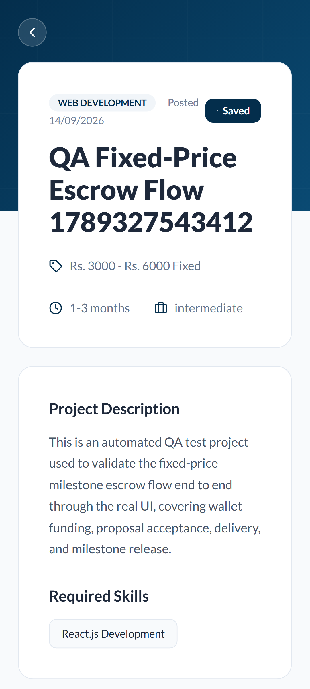
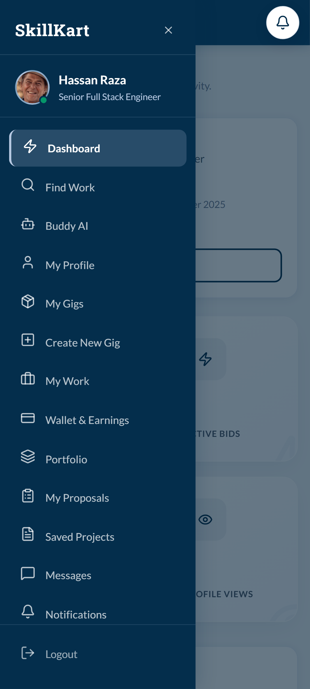

# SkillKart — Final Year Project Defense Presentation

**An AI-Powered Freelance Marketplace Platform**

> **Slide-by-slide outline for the FYP defense.** Target duration: **20–25 minutes**.
> Group of **3 students**. Each slide lists its content, key discussion points, the assigned presenter, and screenshot placeholders where relevant.

---

## Presenter Assignment Summary

| Presenter | Sections | Est. Time |
|-----------|----------|-----------|
| **Student 1** | Title, Introduction, Motivation, Problem Statement, Objectives, Scope, Existing System Analysis, Proposed System | ~7 min |
| **Student 2** | System Architecture, Frontend & Backend Architecture, Database Design, Technologies, Authentication & Security, AI Integration, Major Features/Modules, Mobile Application | ~10 min |
| **Student 3** | Marketplace Workflow, User Roles, Live Demo, Admin Panel, Testing, Results, Performance, Challenges, Future Work, Conclusion, Q&A | ~8 min |

> **Tip for slide design:** keep on-slide text to 4–6 bullet points. The detailed prose below is *speaker notes*, not slide text. Use the "Screenshot" placeholders to insert real captures from the running app.

---

## SLIDE 1 — Title Slide
**Presenter: Student 1**

**Content (on slide):**
- **SkillKart** — An AI-Powered Freelance Marketplace Platform
- Bachelor of Science in Computer Science (BSCS) — Final Year Project
- Group Members: *[Student 1], [Student 2], [Student 3]*
- Supervisor: *[Supervisor Name]*
- *[University Name] — [Department] — [Session]*

**Speaker notes:** Good [morning/afternoon], respected panel. We are presenting **SkillKart**, an AI-powered freelance marketplace we built end-to-end on the MERN stack. Over the next ~22 minutes we'll take you through the problem, our solution, the architecture, a live demo, and our results.

*[Screenshot: SkillKart landing page / logo]*

---

## SLIDE 2 — Presentation Agenda
**Presenter: Student 1**

**Content:**
- Introduction & Motivation
- Problem Statement & Objectives
- Existing Systems vs. Our Solution
- System & Database Architecture
- Technologies & AI Integration
- Live Demonstration
- Testing, Results & Future Work

**Key discussion points:** Set expectations — three of us will present, split by problem/solution, architecture/tech, and demo/results.

---

## SLIDE 3 — Project Introduction
**Presenter: Student 1**

**Content:**
- SkillKart is a **dual-sided digital marketplace** connecting **clients** who need work with **freelancers** who deliver it.
- Supports **two models**: custom **Jobs + Proposals** (Upwork-style) and pre-packaged **Gigs** (Fiverr-style).
- Adds an **AI layer**, a secure **escrow payment** flow, and a full-featured **admin panel**.
- Built on the **MERN stack** (MongoDB, Express, React, Node.js).

**Speaker notes:** SkillKart is not just a job board. It manages the *entire* engagement lifecycle — from discovery, to proposal, to a contract held in escrow, to delivery, review, and dispute resolution — with AI assisting at each step and administrators overseeing the whole platform.

*[Screenshot: home page with hero + categories]*

---

## SLIDE 4 — Motivation
**Presenter: Student 1**

**Content:**
- Freelancing is a fast-growing part of the digital economy, especially for students and graduates.
- Existing platforms have **high fees**, **weak discovery**, and **little intelligent assistance**.
- New freelancers struggle to write proposals, price work, and get discovered.
- We wanted to build a platform that is **secure, intelligent, and beginner-friendly**.

**Key discussion points:** Our motivation was personal — as students entering the freelance market, we saw first-hand how hard onboarding and discovery are. AI can meaningfully lower that barrier.

---

## SLIDE 5 — Problem Statement
**Presenter: Student 1**

**Content:**
- **Freelancer discovery** is difficult — good talent is buried; taxonomy/search is weak.
- **No intelligent assistance** — users write proposals, price projects, and validate skills manually.
- **Payment risk** — freelancers fear non-payment; clients fear paying for poor work.
- **Weak verification** — fake profiles and unverified skills reduce trust.
- **Fragmented management** — contracts, disputes, and moderation are scattered or absent.

**Speaker notes:** These are five concrete pain points we designed directly against. Each maps to a feature we'll show: AI matchmaking (discovery), the Buddy assistant + AI tools (assistance), escrow (payment risk), skill tests + identity verification (trust), and a unified contract + dispute + admin system (management).

---

## SLIDE 6 — Objectives
**Presenter: Student 1**

**Content:**
1. Build a full-featured, dual-sided freelance marketplace (Jobs & Gigs).
2. Integrate **AI** for proposal drafting, cost estimation, skill validation, and matchmaking.
3. Implement a **secure escrow payment** workflow with wallets and withdrawals.
4. Provide **multi-factor verification** — OTP, skill tests, and an admin-managed identity checklist.
5. Deliver a comprehensive **admin panel** for moderation and analytics.
6. Enforce **strong security** (JWT + RBAC, hashing, rate limiting, audit logs).

**Key discussion points:** Each objective is measurable and, as we'll show in Results, each was achieved and demonstrated in the live system.

---

## SLIDE 7 — Project Scope
**Presenter: Student 1**

**Content:**
- **In scope:** registration/onboarding, profiles, jobs, gigs, proposals, contracts, escrow payments, wallets, withdrawals, messaging, reviews, disputes, AI tools, admin panel, analytics.
- **User roles:** Guest, Freelancer, Client, Admin, SuperAdmin.
- **Out of scope (this phase):** live video calls, real-time WebSocket chat (we use efficient polling), an iOS build (Android ships this phase).

**Speaker notes:** We deliberately scoped a *complete web platform* rather than a thin prototype. What's out of scope is documented as future work, not gaps in the core lifecycle.

---

## SLIDE 8 — Existing System Analysis
**Presenter: Student 1**

**Content — comparison table:**

| Aspect | Fiverr | Upwork | Freelancer.com | **SkillKart** |
|--------|--------|--------|----------------|---------------|
| Model | Gigs | Jobs/Proposals | Both | **Both** |
| AI assistance | Limited | Limited | Minimal | **Built-in (Buddy, proposals, pricing, matching)** |
| Skill verification | Basic | Tests (paid) | Basic | **AI skill tests + admin-managed identity checklist** |
| Fees | ~20% | ~10% + | ~10% | **Configurable, transparent** |
| Escrow | Yes | Yes | Yes | **Yes + wallet + admin oversight** |

**Speaker notes:** The incumbents are mature but generic. Our differentiator is the *integrated AI layer* and *transparent, admin-supervised* payment and verification — designed for the student/graduate segment.

---

## SLIDE 9 — Proposed System
**Presenter: Student 1**

**Content:**
- A unified platform combining the best of Fiverr (Gigs) and Upwork (Jobs).
- **AI-first**: an assistant + AI tools reduce friction for new freelancers.
- **Trust-first**: escrow, multi-step verification, reviews, and dispute resolution.
- **Admin-supervised**: a dedicated, isolated admin panel for full oversight.

**Key discussion points:** Hand off to Student 2 — "Now [Student 2] will explain how we engineered this."

*[Screenshot: side-by-side of Browse Freelancers and Browse Projects pages]*

---

## SLIDE 10 — System Architecture (Overview)
**Presenter: Student 2**

**Content — architecture diagram:**
```
   React 19 SPA (Vite)  ──HTTPS/REST──►  Express API (/api/v1)
   localhost:3001                         localhost:5000
        │                                       │
   JWT in memory + refresh          ┌───────────┼───────────┐
   (obfuscated storage)             │           │           │
                                 MongoDB   Wallet Escrow   AI Router
                              (source of  (milestones +  (Gemini→DeepSeek→
                                truth)     hourly-lock;   Qwen→Groq→Claude→
                                            Stripe for        Ollama)
                                           top-ups/payouts/       │
                                            gig orders)   Supabase (optional OAuth)
```

**Speaker notes:** SkillKart is a **decoupled** system: a React single-page app talks to a stateless Express REST API over `/api/v1`. MongoDB is the single source of truth. Escrow is primarily **wallet-native** — per-milestone locks for fixed-price work and a balance-lock for hourly work — with Stripe used for wallet top-ups, freelancer payouts, and the separate Gig-order deposit flow. These integrations, plus an AI provider chain and optional Supabase OAuth, are isolated behind service modules, so the core is never coupled to any one vendor.

*[Screenshot/diagram: architecture diagram]*

---

## SLIDE 11 — Frontend Architecture
**Presenter: Student 2**

**Content:**
- **React 19 + Vite 7** SPA; routing via **React Router 7** (`BrowserRouter`).
- State via **React Context** (Auth, Client, Freelancer, Notifications) + local state.
- Axios API layer with a **central interceptor** (token refresh, error toasts, request de-dup).
- **Role-based route guards** (`ProtectedRoute`) redirect by role.
- UI: custom CSS + Tailwind v4, **Framer Motion / GSAP** animation, **Chart.js** dashboards, **lucide-react** icons.

**Key discussion points:** ~128 components/pages organized by audience: `public/`, `client/`, `freelancer/`, `admin/`, `adminPanel/`. The Axios interceptor is a good example of centralized concerns — one place handles auth refresh, error surfacing, and duplicate-request suppression.

*[Screenshot: freelancer dashboard]*

---

## SLIDE 12 — Backend Architecture
**Presenter: Student 2**

**Content:**
- **Express 4** with a layered structure: **routes → middleware → controllers → services → models**.
- **23 route modules**, **23 controllers**, **20+ service modules**, **38 Mongoose models**.
- **Middleware chain**: authentication, RBAC, request validation, rate limiting, sanitization, error handling.
- Cross-cutting: structured logging (Winston), Swagger API docs, scheduled cron jobs (billing, cleanup).

**Speaker notes:** The backend is strictly layered. Controllers stay thin — they validate and delegate. Business logic lives in services (`stripe.service`, `matchmaking.service`, `skillMatching.service`, `notification.service`, etc.), which keeps it testable and reusable. Around 28,000 lines of backend code.

*[Screenshot: Swagger UI at /api/v1/docs]*

---

## SLIDE 13 — Database Design (Overview)
**Presenter: Student 2**

**Content:**
- **MongoDB** with **Mongoose** — 38 collections, referenced relationships (ObjectId refs), indexed for query performance.
- Core entities and their links:
```
User ──1:1── FreelancerProfile / ClientProfile
Client ──1:N── Job ──1:N── Proposal ──(accepted)──► Contract
Contract ──1:N── Payment (one per milestone / hourly lock+invoice) ──► Wallet balances + Withdrawal
Contract ──1:N── Delivery, Message (via Conversation), TimeLog
Contract ──1:N── Review, Dispute
User/Contract ──► Report ──► AdminAuditLog
```

**Key discussion points:** Everything is interconnected — a job owns proposals; the accepted proposal spawns a contract; the contract drives payment, deliveries, chat, reviews, and (if needed) disputes. Referential integrity is enforced in the application layer.

*[Screenshot/diagram: ER-style relationship diagram]*

---

## SLIDE 14 — Database Design (Key Collections)
**Presenter: Student 2**

**Content:**
- **User** — identity, role (superadmin/admin/freelancer/client/publicviewer), auth provider, verification flags.
- **Contract** — the lifecycle engine: `status` state machine (active → delivered → completed / cancelled / disputed), timer, `milestoneMode` (fixed-price), dispute sub-document (hourly).
- **Milestone** — (fixed-price) one funded phase: `order`, `amount`, `status` (pending_funding → funded → submitted → released), own dispute sub-document.
- **Payment** — escrow: `type` (job_escrow / wallet_deposit / hourly_escrow / hourly_invoice), `milestoneId` link, `status` (deposit_pending → deposit_paid → released / refunded), platform fee + payout split.
- **Gig / Job / Proposal / Review / Withdrawal / Testimonial** — marketplace records.
- **Admin-side:** AdminAuditLog, Report, PlatformSettings, ApiLog, ErrorLog.

**Speaker notes:** The **Contract**, **Milestone**, and **Payment** models are the heart of the system — all modeled as explicit state machines with enums, which is what makes the escrow flow safe and auditable even when a fixed-price project is split into several independently-funded phases.

---

## SLIDE 15 — Technologies Used
**Presenter: Student 2**

**Content — technology stack:**

| Layer | Technologies |
|-------|--------------|
| Frontend | React 19, Vite 7, React Router 7, React Hook Form, Framer Motion, GSAP, Chart.js, Tailwind v4, Axios |
| Backend | Node.js, Express 4, Mongoose 8 |
| Database | MongoDB (Atlas) |
| Auth | JWT (access + refresh), bcrypt, OTP; optional Supabase OAuth |
| Payments | Stripe (with a dummy/simulated mode for development) |
| AI | Provider router — Gemini, DeepSeek, Qwen, Groq, Claude, Ollama |
| Email | Provider abstraction — **Google Gmail API** (production) / SMTP via Nodemailer (local) |
| Security | Helmet, express-rate-limit, express-validator, express-mongo-sanitize, **Google reCAPTCHA v3** |
| SEO / PWA | Dynamic XML sitemap, robots.txt, Web App Manifest, Open Graph cards |
| Tooling | ESLint, Prettier, Nodemon, Swagger, Winston |

**Key discussion points:** Every choice was deliberate — Vite for fast builds, Mongoose for schema discipline over MongoDB's flexibility, Stripe for payments with a dummy mode so we can demo without live money.

**Likely question — "Why the Gmail API instead of just SMTP?"** Two reasons. First, practical: our host (Railway) blocks outbound SMTP ports, so SMTP simply cannot deliver in production. Second, architectural: rather than hard-code either one, email sits behind a **provider registry** — `EMAIL_PROVIDER` selects the transport, and adding a future provider (SES, SendGrid) means one new file plus one registry line, with zero changes to controllers or business logic. SMTP remains the automatic fallback.

**Likely question — "Doesn't Supabase already give you Google access?"** No, and this is a common misconception worth stating precisely: Supabase's Google OAuth authenticates *end users*. Sending mail via the Gmail API requires the `gmail.send` scope on a mailbox we own, sending *as the platform* — to recipients who may never have used Google sign-in, at moments when no user session exists at all (e.g. a password-reset OTP). They are different concerns with different credentials, and we deliberately kept the email layer decoupled from authentication entirely.

---

## SLIDE 16 — Authentication & Session Model
**Presenter: Student 2**

**Content:**
- **Email + password** with **bcrypt** hashing (pre-save hook).
- **OTP-based 2FA** for login (email delivery).
- **JWT**: short-lived access token (kept in memory) + refresh token (obfuscated storage) → auto-refresh on reload.
- Optional **Supabase social OAuth** (Google, etc.).
- **RBAC**: 5+ roles; every route guarded by role middleware; a separate, **encrypted SuperAdmin** credential store.

**Speaker notes:** We separated the access token (in memory, short-lived) from the refresh token (persisted, obfuscated) — a defense-in-depth pattern. The admin panel uses a *completely isolated* auth flow so the marketplace JWT never grants admin access.

*[Screenshot: login + OTP screens]*

---

## SLIDE 17 — Security Features
**Presenter: Student 2**

**Content:**
- **Password hashing** (bcrypt) + **OTP** verification.
- **JWT + RBAC** with strict role separation (marketplace vs. admin).
- **Rate limiting** (global + stricter on auth endpoints).
- **Google reCAPTCHA v3** — invisible, score-based bot mitigation on login, registration, and public forms.
- **Input validation** (express-validator) + **NoSQL-injection sanitization** (express-mongo-sanitize).
- **Helmet** security headers, **CORS** allow-list.
- **Audit logs** for every sensitive admin action; error & API logging.

**Key discussion points:** Security is layered end-to-end: transport (CORS/Helmet), authentication (JWT/OTP), authorization (RBAC), input (validation/sanitization), abuse (rate limiting + reCAPTCHA), and accountability (audit logs).

**Speaker notes — reCAPTCHA v3 specifics, if asked:**
- **Why v3, not v2?** v3 is invisible: no checkbox, no image grid. It returns a **0.0–1.0 score** instead of a pass/fail, which we compare against a configurable threshold (0.5). We chose it because friction at signup directly costs conversions on a student-facing marketplace.
- **Why keep rate limiting too?** They defend different axes: rate limiting bounds request *volume*, reCAPTCHA scores request *legitimacy*. A slow, patient bot defeats rate limiting alone; a determined human defeats reCAPTCHA alone. Layering covers both.
- **Replay protection:** each endpoint declares a distinct *action* name. Google reports a token minted for a *different* action as otherwise valid, so we verify the action explicitly — without that check, a token harvested from the public contact form could be replayed against login.
- **Deliberate trade-off (good defense answer):** verification **fails open** — if Google is unreachable or keys are unset, the request proceeds. We consciously chose availability over security at this one bounded point: a third-party bot-detection outage must never render our own login inoperable. Rate limiting still bounds the residual risk.

---

## SLIDE 18 — AI Integration (Architecture)
**Presenter: Student 2**

**Content:**
- A **provider router** with automatic fallback: **Gemini → DeepSeek → Qwen → Groq → Claude → Ollama (local)**.
- Order is **env-driven** by numbered priorities (`AI_PRIORITY_*`); any provider can be reordered or disabled.
- **Resilient by design:** if every provider fails, the API returns a clean `503` and the UI shows *"AI is temporarily out of service"* — the app **never crashes** on an AI outage.

**Speaker notes:** This is one of our proudest engineering pieces. Free-tier AI providers are unreliable and rate-limited, so we built a chained fallback with a local model as the last resort, and made every AI failure graceful.

*[Screenshot/diagram: AI provider fallback chain]*

---

## SLIDE 19 — AI Features
**Presenter: Student 2**

**Content:**
- **Buddy AI Assistant** — conversational help for finding work, hiring, and writing proposals.
- **AI Cost Estimator** — market-rate price estimate from a project brief.
- **AI Proposal Drafting** — generates a tailored proposal for a job.
- **AI Skill Validation & Tests** — validates/normalizes skills and auto-generates verification tests.
- **AI CV Analysis** — parses a freelancer's CV, scores it, and auto-fills the profile.
- **Matchmaking** — ranks freelancers for a project brief via a deterministic, rules-based scoring engine (not an LLM call, unlike the features above).

**Key discussion points:** AI is woven through the *whole* experience, not bolted on — onboarding (CV parse), discovery (matchmaking), bidding (proposal draft), pricing (estimator), and trust (skill tests). Matchmaking is the one exception to the LLM-provider pattern: it's deliberately code-driven for instant, reproducible, auditable rankings.

*[Screenshot: Buddy AI chat + Cost Estimator result]*

---

## SLIDE 20 — Major Modules / Features
**Presenter: Student 2**

**Content:**
- **Auth & Onboarding** · **Freelancer & Client Dashboards** · **Jobs & Proposals**
- **Gigs (packaged services)** · **Contracts (lifecycle state machine)**
- **Wallet, Escrow Payments & Withdrawals** · **Messaging** · **Notifications**
- **Reviews & Ratings** · **Search & Categories** · **Disputes**
- **AI Tools** · **Admin Panel & Analytics**
- **Mobile Application** (two native Android apps via Capacitor — see next slide)
- **Transactional Email** (OTP, security alerts — Gmail API / SMTP, with retry + delivery logging)
- **Discoverability** (dynamic sitemap, robots policy, installable PWA, social share cards)

**Speaker notes:** The last two are the "invisible" modules — nobody clicks them, but without email nobody can even register, and without SEO nobody finds the platform at all. The mobile app is substantial enough that it gets its own slide next.

---

## SLIDE 21 — Mobile Application
**Presenter: Student 2**

**Content:**
- The same React codebase ships as **two independent native Android apps** via **Capacitor** — not a rewrite, not a stub.
- **Client/Freelancer app** (`android/`) — the full client, freelancer, and admin-panel experience; public marketing pages are excluded from the bundle and lazy-loaded on web instead, keeping both lean.
- **Standalone Admin app** (`android-admin/`) — a second, fully separate build (own `appId`, own signing key) that renders only the admin-panel route tree, for admins who need moderation on the go without installing the full app.
- **Native platform integration:** hardware back-button handling, status bar theming, a branded splash/icon, offline detection with a dedicated "No Internet Connection" screen, external links opened via Chrome Custom Tabs, and **push notifications** (Firebase Cloud Messaging) wired into the same events (proposals, messages, payments, disputes) that drive the web notification center.

**Speaker notes:** This is a second, fully realized delivery surface built from the exact same codebase — not a thin WebView wrapper. Platform-specific engineering (offline handling, native back navigation, push) is layered on via feature flags, so the web and mobile builds never diverge in business logic. Hand off to Student 3 — "Now [Student 3] will walk you through the workflow and give a live demo."


*Login*


*Freelancer Dashboard*


*Job Detail (Freelancer)*


*Navigation Drawer (Freelancer)*

---

## SLIDE 22 — User Roles
**Presenter: Student 3**

**Content:**
- **Guest** — browse freelancers, gigs, and jobs; use public AI tools (limited).
- **Freelancer** — profile, gigs, proposals, contracts, wallet, withdrawals, skill tests.
- **Client** — post jobs, buy gigs, hire, fund escrow, review.
- **Admin** — moderate users, jobs, payments, disputes; view analytics.
- **SuperAdmin** — full control + encrypted credential store.

**Key discussion points:** Each role sees a tailored dashboard and a strictly guarded route set — a freelancer can never reach client-only or admin routes.

---

## SLIDE 23 — Marketplace Workflow
**Presenter: Student 3**

**Content — end-to-end lifecycle:**
```
Register → Onboard (verify) → Post Job (any wallet balance, even $0) / Publish Gig
   → Freelancer submits Proposal → Client accepts
      (wallet must now cover milestone 1 / one week's hourly estimate)
   → Contract created → escrow locks:
      fixed-price = milestone 1 funded instantly (later milestones funded one at a time)
      hourly = one week's estimated cost locked (billed automatically as hours are logged)
   → Freelancer delivers/logs time → Client approves (or 7-day auto-release if silent, fixed-price)
   → Escrow released (payout − platform fee) → Both leave Reviews
   → (if needed) Dispute on the milestone/contract → Admin resolves
```

**Speaker notes:** This is the core loop. Note the escrow model differs by contract type: wallet balance is never checked at posting — only when a proposal is accepted. For fixed-price jobs, only milestone 1's amount locks instantly; later milestones are funded sequentially as work progresses, and if the client goes quiet after delivery, escrow auto-releases after 7 days rather than trapping the freelancer's payment. For hourly contracts, accepting locks one week's estimated cost, and billing draws down automatically per logged hour — no separate client approval step — with any unused lock refunded when the contract ends. Disputes route to an admin who can release, refund, or split.

*[Screenshot: contract detail page showing status + escrow]*

---

## SLIDE 24 — LIVE DEMO
**Presenter: Student 3**

**Content (demo script — on slide, keep short):**
1. Browse as a guest → open a gig/freelancer profile.
2. Log in as a **client** → post a job (with AI auto-fill).
3. Log in as a **freelancer** → submit a proposal (AI-drafted).
4. Client accepts → **contract** created → **milestone 1 escrow locked automatically** (hourly: one week's estimate locked).
5. Freelancer delivers → client approves → **escrow released** → review.
6. Try an **AI tool** (Cost Estimator / Buddy).

**Speaker notes:** *(Live)* Use the seeded demo accounts (`test.client0@skillkart.com`, `test.freelancer0@skillkart.com`, password `Pass123!@#`). Keep a backup screen-recording in case of network issues.

*[Screenshot: 2–3 key demo screens as backup]*

---

## SLIDE 25 — Admin Panel
**Presenter: Student 3**

**Content:**
- **Isolated** admin app (`/admin-panel/*`) with its own auth — the marketplace JWT never grants admin access.
- Modules: **Dashboard, Users, Jobs, Contracts, Payments, Wallets, Withdrawals, Transactions, Reviews, Chats, Reports, Disputes, Monitoring, Audit Logs, Analytics, Settings.**
- Every sensitive action is written to an **audit log**.

**Speaker notes:** The admin panel is a platform in itself — 16+ management pages. It was designed as a *separate* concern (isolated auth, scoped CSS) so it can never leak into or be reached from the public app.

*[Screenshot: admin dashboard + a management page]*

---

## SLIDE 26 — Testing
**Presenter: Student 3**

**Content:**
- **Manual & exploratory testing** across all user roles and flows.
- **Integration testing** of the full contract → escrow → payout lifecycle.
- **Referential-integrity verification** on seeded data (no orphaned records).
- **Resilience testing** — forced AI/provider outages to confirm graceful degradation (503 + toast, no crash).
- **UI/responsiveness testing** across desktop and mobile (browser-automation screenshots).

**Key discussion points:** We validated not just the happy path but failure modes — what happens when AI is down, when a role mismatch occurs, when a payment provider fails. A production-grade demo seeder (≈200 users, 320 jobs, 220 gigs, thousands of messages) let us test at realistic scale.

---

## SLIDE 27 — Results
**Presenter: Student 3**

**Content:**
- ✅ A **fully working, dual-sided** freelance marketplace (Jobs + Gigs).
- ✅ **5 LLM-backed AI features** integrated with a resilient multi-provider fallback, plus a deterministic (non-LLM) matchmaking engine.
- ✅ Complete **escrow payment + wallet + withdrawal** flow.
- ✅ **16+ page admin panel** with analytics and audit logging.
- ✅ **Two native Android apps** shipped via Capacitor (client/freelancer/admin-panel + a standalone admin app), with push notifications and offline handling.
- ✅ **~70,000 lines** of code across 280+ files; 38 data models; 23 API route groups.
- ✅ All six project objectives **achieved and demonstrated**.

**Speaker notes:** Every objective from Slide 6 is met and shown live. The scale figures illustrate that this is a complete system, not a prototype.

---

## SLIDE 28 — Performance
**Presenter: Student 3**

**Content:**
- **Request de-duplication** on the client suppresses redundant GETs.
- **Indexed** MongoDB queries; server-side pagination on large lists.
- **Optional Redis caching** layer for hot data.
- **Batch inserts / bulk writes** for heavy operations (e.g. the demo seeder inserts thousands of records efficiently).
- **Code-split, minified** production build via Vite.

**Key discussion points:** We paid attention to real performance concerns — N+1 avoidance, pagination, caching hooks, and efficient bulk operations.

---

## SLIDE 29 — Challenges Faced
**Presenter: Student 3**

**Content:**
- **Unreliable free-tier AI** → solved with a chained multi-provider fallback + local model + graceful 503.
- **Escrow correctness** → modeled Contract & Payment as explicit state machines with enums.
- **Stale auth after role change** → forced a fresh auth refetch (bypassing a throttle) to prevent wrong redirects.
- **Modal/overlay CSS bug** (fixed element trapped in a transformed ancestor) → solved with React Portals.
- **Toast library incompatible with React 19** → built a dependency-free, crash-proof toast utility.
- **Email died in production, worked locally** → the host blocks outbound SMTP ports; refactored to a provider abstraction and an HTTPS-based Gmail API transport.
- **Admin login looped after deploy** → cross-site cookie (`SameSite=Strict` withheld it between Vercel and Railway); fixed with `SameSite=None; Secure` + `trust proxy`.

**Speaker notes:** These are real bugs we hit and fixed — each taught us something about CSS containing blocks, React 19 changes, auth race conditions, and designing for third-party failure.

**The last two share a theme worth drawing out if asked:** both worked perfectly on localhost and failed only once deployed, because both depend on properties that don't exist in local development — SMTP egress rules, and the browser's same-site vs. cross-site distinction. On one machine, frontend and backend are both `localhost`, so *every* request is same-site and the cookie bug is invisible. **A passing local test is not evidence of correctness for behaviour defined by the deployment topology.** That insight changed how we validate: we now gate the cookie on the actual request protocol rather than an `NODE_ENV` label, because an environment label is a claim about the environment, not a measurement of it.

---

## SLIDE 30 — Future Enhancements
**Presenter: Student 3**

**Content:**
- **iOS mobile app** — Android already ships (Capacitor); iOS reuses the same codebase.
- **Real-time chat & video calls** (WebSockets / WebRTC) — currently efficient polling.
- **Deeper AI matching** with embeddings/vector search.
- **Advanced analytics** and reporting dashboards.
- **Multi-language / i18n** support.
- **Expanded RBAC** (finance admin, content editor, etc.) and real-time collaboration.

**Key discussion points:** The architecture already anticipates these — e.g. RBAC roles and the AI router are extensible without refactoring.

---

## SLIDE 31 — Conclusion
**Presenter: Student 3**

**Content:**
- SkillKart delivers a **complete, secure, AI-assisted** freelance marketplace.
- It solves real discovery, assistance, payment-trust, and verification problems.
- It demonstrates strong software engineering: layered architecture, state machines, resilience, and security.
- Built end-to-end by three students on the MERN stack with modern AI integration.

**Speaker notes:** In summary, we set out to build more than a job board — a trustworthy, intelligent platform for the next generation of freelancers — and we delivered it, working and at scale.

---

## SLIDE 32 — Thank You / Q&A
**Presenter: All (led by Student 3)**

**Content:**
- **Thank You**
- Questions & Answers
- *[Team names + contact / GitHub]*

**Speaker notes:** Thank you for your time and attention. We'd be happy to answer any questions.

*[Screenshot: SkillKart logo]*

---

## Appendix — Backup Slides (optional, for Q&A)

- **A1. Deployment** — Backend on Railway/Render, Frontend on Vercel (see `docs/DEPLOYMENT.md`).
- **A2. AI provider priority config** — how `AI_PRIORITY_*` reorders the fallback chain.
- **A3. Full ER diagram** — all 38 collections and relationships.
- **A4. Contract state machine** — the full status transition diagram.
- **A5. Security matrix** — control vs. threat mapped.

---

<sub>Prepared for the SkillKart BSCS Final Year Project defense. Replace all `[bracketed]` placeholders and insert the marked screenshots before presenting.</sub>
