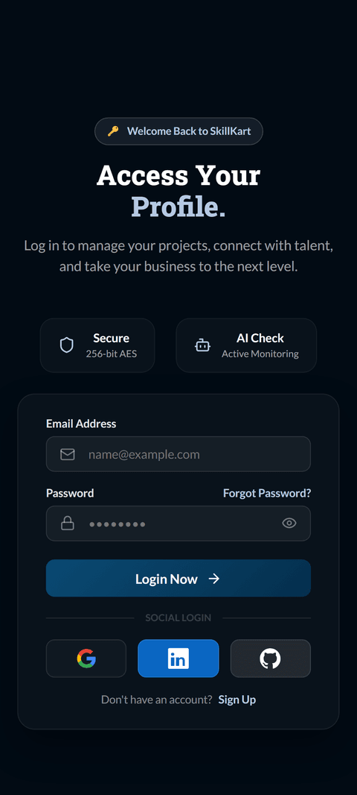
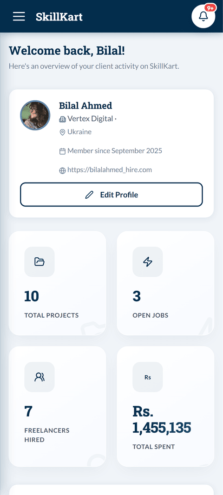
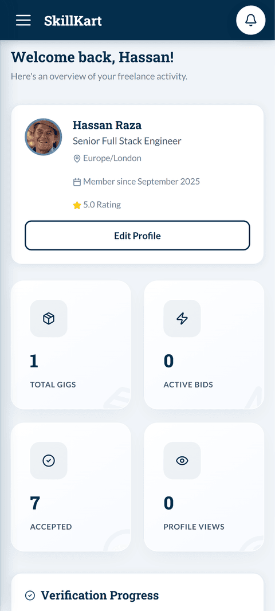
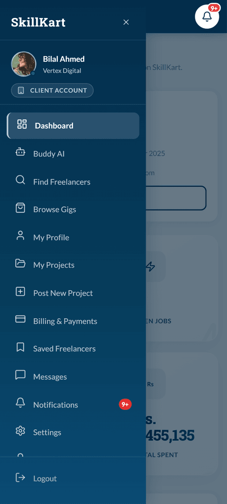
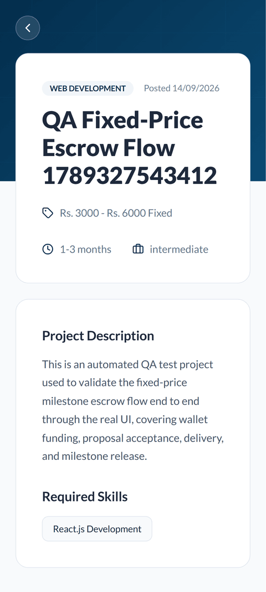
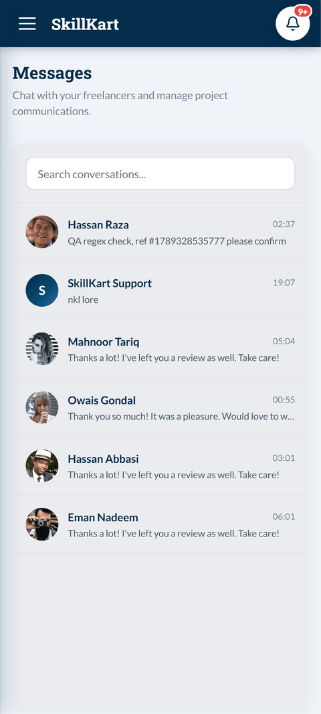

# SkillKart — Professor ko Explain Karne Wali Guide (Roman Urdu)

> Ye file specifically isliye banai gayi hai keh aap apne supervisor/professor ko poora project — flow, structure, technology, business logic, sab kuch — apne alfaz mein confidently explain kar sakein. Ye koi formal report nahi hai (wo `FYP_Final_Report.md` mein hai), ye ek **samjhaane wali guide** hai jo aap padh kar ya rehearse kar ke viva mein bol sakte hain.

---

## 1. Ye Project Kya Hai (One-Liner)

**SkillKart** ek **freelance marketplace** hai — bilkul Fiverr aur Upwork jaisa, lekin dono ka combination. Iska matlab ye hai keh is platform pe do tarah ka kaam ho sakta hai:

1. **Custom Jobs (Upwork-style):** Client ek job post karta hai (jaise "Mujhe ek website chahiye"), phir freelancers us job pe **proposal** submit karte hain (apna price aur pitch de kar), aur client kisi ek ko hire karta hai.
2. **Gigs (Fiverr-style):** Freelancer khud ek pre-packaged service banata hai (jaise "Main $50 mein logo design karunga"), aur client seedha wo gig **order** kar leta hai — proposal ka wait nahi karna.

Ye do alag business models hain jo **ek hi platform** pe chal rahe hain — ye khud ek interesting design decision hai jo professor ko batana chahiye.

**Business model:** Platform **commission** leta hai. Jab bhi koi payment freelancer ko release hoti hai, us mein se ek chhota percentage (platform fee) kaat liya jata hai. Ye bilkul Upwork/Fiverr ka model hai.

**University angle:** Ye humara **Final Year Project (FYP)** hai — MERN stack pe bana hua ek full-stack, production-grade web application, jis mein AI features, mobile app, aur admin panel bhi shamil hain.

---

## 2. Problem Statement (Ye Project Kyun Banaya)

Professor aksar poochte hain "is project ki zaroorat kyun thi?" — is liye ye clear hona chahiye:

- **Freelancer discovery mushkil hai:** Students/freelancers ko apne local market mein kaam dhoondna mushkil hota hai — existing platforms (Fiverr, Upwork) international hain aur local trust/currency ka masla hota hai.
- **AI assistance ki kami:** Zyada tar platforms pe freelancer ko khud hi decide karna parta hai keh kitna charge karna hai, proposal kaise likhna hai. Humne AI Buddy aur Cost Estimator bana kar ye asaan banaya.
- **Payment trust ka masla:** Client ko dar hota hai keh paisay pehle de kar freelancer kaam nahi karega, aur freelancer ko dar hota hai keh kaam kar ke paisay nahi milenge. Iska solution **escrow system** hai (neeche section 6 mein detail hai).
- **Skill verification nahi hoti:** Koi bhi khud ko "expert" keh sakta hai — humne isliye ek **skill test system** banaya jahan freelancer ko proctored (camera se monitor hone wala) test dena parta hai apni skill verify karwane ke liye.
- **Dispute resolution ka structure nahi hota:** Agar kaam mein masla ho, to koi neutral third-party (admin) honi chahiye jo faisla kare — humne is ke liye poora dispute + admin panel system banaya hai.

---

## 3. Tech Stack (Kaunsi Technologies Use Hui Hain)

Ye **MERN stack** hai:

| Layer | Technology | Kyun choose kiya |
|---|---|---|
| **M** — Database | **MongoDB** (Mongoose ORM) | Flexible schema — freelancer ke skills, portfolio, jaise unstructured/nested data ke liye SQL se zyada asaan hai. |
| **E** — Backend Framework | **Express.js** (Node.js pe) | Lightweight, fast, aur pura ecosystem JavaScript mein hai (frontend-backend dono JS). |
| **R** — Frontend Library | **React 19** (Vite build tool ke sath) | Component-based UI, fast development, industry-standard. |
| **N** — Runtime | **Node.js** | JavaScript ko server pe chalane deta hai. |

**Baaki important technologies:**
- **JWT (JSON Web Tokens):** Login/authentication ke liye — access token aur refresh token dono use hote hain.
- **Stripe:** Real payment processing ke liye (wallet top-up, aur ek legacy escrow flow sirf Gigs ke liye).
- **Supabase:** Sirf **social login** (Google se sign-in) ke liye — baaki sab kuch (email/OTP login) khud backend handle karta hai.
- **Cloudinary:** Images/files upload karne ke liye (profile pictures, portfolio, attachments).
- **AI Providers:** Gemini, DeepSeek, Qwen, Groq, Claude — multiple AI providers ek "fallback chain" mein lagaye hain (agar ek fail ho to dusra try hota hai — automatic).
- **Capacitor:** Android mobile app banane ke liye — **same React code** ko native app mein wrap kar diya, alag se app nahi likhi.

**Professor ko ye point zaroor batayein:** Humne koi bhi cheez **single point of failure** nahi banayi — AI fail ho, email fail ho, reCAPTCHA fail ho — system crash nahi hota, gracefully "fail open" hota hai (matlab feature disable ho jata hai lekin poora app kaam karta rehta hai).

---

## 4. System Architecture (Poora System Kaise Organize Hai)

```
┌─────────────────────┐        HTTPS / REST API        ┌─────────────────────┐
│   Frontend (React)   │  ─────────────────────────►    │  Backend (Express)  │
│   Vite SPA            │  ◄─────────────────────────    │  JWT + REST API     │
└─────────────────────┘                                 └──────────┬──────────┘
                                                                     │
                                    ┌────────────────────────────────┼───────────────────┐
                                    │                                │                   │
                              ┌─────▼─────┐                  ┌───────▼──────┐     ┌──────▼──────┐
                              │  MongoDB  │                  │   Supabase   │     │   Stripe    │
                              │ (asli data)│                 │ (sirf OAuth)  │     │ (payments)  │
                              └───────────┘                  └──────────────┘     └─────────────┘
```

**Zaroori baat:** MongoDB hi **poora asal data** rakhta hai (users, jobs, contracts, payments — sab kuch). Supabase sirf Google se login ke liye hai, wahan koi marketplace data nahi hai. Ye samajhna zaroori hai kyunke professor confuse ho sakte hain keh "do database kyun hain?"

**Monorepo structure** (ek hi repository mein do apps):
```
Backend/     → Express REST API (port 5000)
Front-end/   → React SPA (port 3001) + Front-end/android/ (mobile app) + Front-end/android-admin/ (alag admin-only app)
docs/        → Sari documentation
```

**Standard request flow (jab bhi koi API call hoti hai):**
```
Route → Middleware (auth check, validation) → Controller → Service (business logic) → Model (database)
```
Ye ek **layered architecture** hai — har layer ka apna kaam hai, isse code maintainable rehta hai aur professor ko "separation of concerns" wala concept dikh jata hai.

---

## 5. User Roles (Kaun Kaun Platform Use Kar Sakta Hai)

1. **Guest (bina login)** — public pages dekh sakta hai (jobs browse, freelancers browse).
2. **Freelancer** — jobs pe proposal deta hai, gigs banata hai, kaam deliver karta hai, paisay kamata hai.
3. **Client** — jobs post karta hai, freelancers hire karta hai, gigs order karta hai, payment karta hai.
4. **Admin** — platform monitor/moderate karta hai (isolated admin panel, alag login).
5. **SuperAdmin** — sab se upar, sab kuch access kar sakta hai, dusre admins bana sakta hai.

**RBAC (Role-Based Access Control):** Har role ke paas specific permissions hain jo `rbac.middleware.js` mein defined hain. Matlab ek freelancer client ka data nahi dekh sakta, aur admin panel ka access bilkul alag system hai (alag JWT secret, alag cookie) — normal marketplace login se koi connection nahi.

---

## 6. Business Logic — Escrow & Payment System (Sab Se Important Part)

Ye poore project ka **sab se complex aur sab se important** hissa hai — professor zaroor is pe questions karenge.

### 6.1 Concept: Escrow Kya Hai

Escrow ka matlab hai — client ka paisa **turant freelancer ko nahi jata**, balke ek "hold" mein rehta hai jab tak kaam accept na ho jaye. Isse dono taraf trust banta hai:
- Client ko yaqeen hota hai keh paisa waise hi wapis mil sakta hai agar kaam sahi na ho.
- Freelancer ko yaqeen hota hai keh paisa waqai maujood hai, sirf "promise" nahi hai.

### 6.2 Wallet System

Har user (client aur freelancer dono) ka ek **internal wallet balance** hota hai — bilkul jaise Easypaisa/JazzCash ka wallet. Client Stripe se apne wallet mein paisay daalta hai (top-up), aur phir **wallet se hi** escrow lock hota hai — direct Stripe checkout nahi hota har baar. Isse process fast aur reliable hota hai.

### 6.3 Do Alag Escrow Systems (Fixed-Price vs Hourly)

**A) Fixed-Price Jobs — Milestone-Based:**
- Job ko **milestones** (phases) mein divide kiya ja sakta hai — jaise "Design" milestone, "Development" milestone, "Testing" milestone.
- Jab client kisi freelancer ko **hire** karta hai, pehla milestone **turant** wallet se fund ho jata hai (auto-lock).
- Agle milestones sirf tab fund hote hain jab client khud "fund karo" bolta hai — matlab **sequential funding**, sara paisa pehle se lock nahi hota.
- Freelancer kaam deliver karta hai → client review karta hai → **approve** karne pe paisa freelancer ke wallet mein chala jata hai (platform fee kaat kar).
- **7-din auto-release:** Agar client 7 din tak review na kare, system khud milestone ko approve kar deta hai (taake freelancer hamesha wait na kare).
- **Dispute:** Agar masla ho, dispute uss **specific milestone** pe lagta hai, poore contract pe nahi — matlab agar 3 milestones hain aur ek pe dispute hai, baaki 2 normal chal sakte hain.

**B) Hourly Contracts — Wallet-Lock System:**
- Jab freelancer hire hota hai, system andaza lagata hai (hourly rate × estimated weekly hours) aur utna paisa **ek hafte ke liye** wallet se lock kar deta hai.
- Freelancer jab time track karta hai (ya manually hours likhta hai), har hour ka paisa **turant** us lock se freelancer ke wallet mein chala jata hai — client ki manual approval ki zaroorat nahi.
- Agar lock khatam ho jaye, freelancer ka kaam "pending" ho jata hai jab tak client top-up na kare.
- Contract khatam hone pe jo paisa bacha hota hai lock mein, wo **wapis client ko refund** ho jata hai — kyunke lock sirf ek "hold" tha, khud ek payment nahi.

**Professor ke liye key point:** Ye dono systems **alag hain** kyunke fixed-price aur hourly kaam ka nature hi alag hota hai — fixed-price mein "phases" hote hain, hourly mein "waqt" ki billing hoti hai. Isliye do alag logic likhni pari.

### 6.4 Gig Orders — Alag (Purana) System

Gigs abhi bhi **purane Stripe 50/50 deposit-final flow** pe hain (50% pehle, 50% kaam ke baad) — kyunke gigs choti, fixed-scope services hoti hain, unko milestone system ki zaroorat nahi. Ye ek **conscious design decision** hai, mistake nahi — professor agar poochein "sab kuch same system pe kyun nahi?" to yehi jawab dena hai.

---

## 7. Marketplace Lifecycle (Poora Flow, Shuru se Aakhir Tak)

### Client ka Safar:
1. Register/Login → Onboarding (company details, industry) → Dashboard
2. Job post karta hai (title, budget, skills required) — **wallet check nahi hoti is waqt**, $0 balance se bhi job post ho sakti hai
3. Freelancers proposals bhejte hain → Client review karta hai → Ek freelancer hire karta hai
4. Hire hote hi **wallet balance check hoti hai** — agar paisay kam hain, hire nahi ho sakta
5. Milestone/hourly escrow lock hota hai → Freelancer kaam karta hai → Deliver karta hai
6. Client review karta hai → Approve (payment release) ya Revision request
7. Contract complete → Dono taraf **review/rating** de sakte hain

### Freelancer ka Safar:
1. Register/Login → Onboarding (skills, portfolio, education) → Skill verification (optional test)
2. Jobs browse karta hai → Proposal submit karta hai (cover letter + price)
3. Hire hone ka wait, ya khud ek **Gig** publish kar sakta hai
4. Hire hone pe kaam start, escrow already locked hai (safe to work)
5. Kaam deliver karta hai → Payment release hone ka wait
6. Wallet se **withdrawal** request kar sakta hai

---

## 8. AI Features

Ye project mein AI koi "gimmick" nahi hai, balke **functional tools** hain:

- **AI Buddy** — Chatbot jo users ki madad karta hai (job kaise post karein, proposal kaise likhein, waghera).
- **Cost Estimator** — User apna project describe karta hai, AI andaza lagata hai keh iska fair price kya hoga.
- **AI Matchmaking** — **Ye asal mein AI call nahi hai** — ye ek deterministic, code-based scoring algorithm hai jo skills match karta hai. (Professor agar is pe sawal karein — ye important hai keh sab kuch "AI" naam ka nahi hota, kabhi simple logic zyada reliable hoti hai.)
- **CV Parsing** — Resume upload karne pe AI khud data nikal kar profile fill kar deta hai.

**AI Provider Router (important architecture point):** Humne ek hi AI provider pe depend nahi kiya. Multiple providers (Gemini, DeepSeek, Qwen, Groq, Claude, aur local Ollama) ek **priority chain** mein lagaye hain. Agar Gemini fail ho ya rate-limit ho jaye, system khud-ba-khud agle provider try karta hai. Agar **sab fail ho jayein**, system ek clean error deta hai ("AI abhi available nahi hai") — poora app crash nahi hota. Ye **resilience/fault-tolerance** ka acha example hai.

---

## 9. Security

- **JWT Authentication:** Access token (thora waqt ke liye) + Refresh token (lamba waqt) — dono milkar secure aur convenient login banate hain.
- **Password hashing:** Bcrypt se — kabhi bhi plain password database mein store nahi hota.
- **RBAC:** Har role ki apni permissions.
- **Rate Limiting:** Login attempts ki limit hai (brute-force attacks se bachne ke liye).
- **reCAPTCHA v3:** Bots se bachne ke liye — lekin agar reCAPTCHA fail ho jaye (Google down ho), system **users ko lock out nahi karta** — "fail open" design hai.
- **Skill Test Proctoring:** Camera se monitor hota hai (face detection, anti-cheat) taake koi doosra insan test na de.
- **Admin Panel Isolation:** Admin ka login system, normal user login se **bilkul alag** hai — alag cookie, alag secret key, alag database checks. Agar normal login ka koi bug ho, admin panel affect nahi hoga.

---

## 10. Admin Panel

Ek separate, poora isolated admin interface hai (`/admin-panel/login` pe) jahan se:
- Users manage/block kiye ja sakte hain
- Disputes resolve kiye ja sakte hain (release/refund/split faisla)
- Wallets, withdrawals, transactions monitor hoti hain
- Analytics dashboards hain
- Reviews moderate ki ja sakti hain (policy violate karne wali reviews hide ki ja sakti hain)

---

## 11. Mobile App (Android) — Poori Detail Mein

Ye ek **bonus/advanced feature** hai jo professor ko impress kar sakti hai: humne **same React code** ko **Capacitor** framework se wrap kar ke native Android apps bana di hain — alag se mobile app nahi likhi. Ye section thora lamba hai kyunke mobile app pe professor **follow-up questions** zaroor karte hain ("ye real native app hai ya bas ek website hai jo phone pe khulti hai?") — is section ke baad wo sawal aap confidently answer kar sakenge.

### 11.1 Ye Do Alag Apps Hain

1. **Main app** (`Front-end/android/`) — client, freelancer, aur admin-panel teeno ka experience isme hai.
2. **Admin app** (`Front-end/android-admin/`) — bilkul alag standalone app, sirf admin panel ke liye (apna alag `appId`: `com.skillkart.app` vs `com.skillkart.admin`, apna alag signing key/keystore).

Dono apps ka source code same hai (`Front-end/src/`), bas build-time pe ek environment flag (`VITE_APP_TARGET`) decide karta hai keh konsa version banna hai — web (`vite build`), mobile main app (`vite build --mode mobile`), ya admin app (`vite build --mode admin`).

**Q: Do alag apps kyun banayi, ek hi app mein role check laga kar admin panel bhi de dete?**
A: **Security aur "blast radius" ki wajah se.** Agar koi admin app ki APK reverse-engineer kar le (decompile kar ke code nikal le), to us mein sirf admin-panel ka code hoga — client/freelancer wala marketplace code us APK mein hai hi nahi (`AdminAppRoutes.jsx` sirf admin pages import karta hai, kuch aur nahi). Ulta bhi sach hai: main app ki APK mein admin-panel ka koi code nahi hota. Agar ek hi app hoti sab role ke liye, to ek aam user ke phone pe bhi admin-wala code/logic maujood hota (chahe wo use na kar paye) — jo attack surface barhata hai. Alag apps ka matlab alag signing keys bhi hai — agar kabhi ek app ki key compromise ho, dusri app bilkul safe rehti hai.

### 11.2 Capacitor Technically Kaam Kaise Karta Hai

Capacitor koi "magic" nahi hai — simple concept hai:

1. `npm run build:mobile` chalane pe, Vite **normal web build** hi karta hai (HTML/CSS/JS bundle) — bas is baar `VITE_APP_TARGET=mobile` set hota hai, jo React code ke andar `isMobileApp()` ko true bana deta hai.
2. `npx cap sync` ye poora built bundle (`dist/` folder) copy kar ke native Android project (`android/app/src/main/assets/public/`) ke andar rakh deta hai.
3. Android app ke andar sirf **ek WebView** hoti hai (poore screen jitni, koi browser address-bar nahi dikhta) jo is local bundle ko load karti hai — bilkul jaise Chrome koi website load karta hai, bas is baar files phone pe hi maujood hain, internet se nahi aa rahin (sirf API calls internet se hoti hain).
4. Jahan bhi native phone features chahiye hoti hain (camera, push notifications, back button, status bar), Capacitor ek **JavaScript bridge** deta hai — React code normal JS function call karta hai (jaise `PushNotifications.register()`), aur Capacitor ye call native Android/Kotlin code tak pahunchati hai, result wapis JS ko milta hai.

**Q: To ye "real" native app hai ya bas ek website jo WebView mein khul rahi hai?**
A: Dono baatein sach hain, aur yehi Capacitor jaisi frameworks ka poora point hai — UI **web technology** (React) se bani hai, lekin app **native binary** hai (`.apk` file, Play Store/sideload se install hoti hai, apna icon, apna process, phone ki settings mein "installed app" ki tarah dikhti hai), aur **real native features** use karti hai (push notifications, hardware back button, status bar, file system) jo sirf browser tab mein possible nahi hotay. Isko "hybrid app" kehte hain — pure-native (Kotlin/Java se poori app likhna) aur pure-web (bas browser mein khulti website) ke beech ka approach.

**Q: Capacitor hi kyun, React Native ya Flutter kyun nahi?**
A: React Native/Flutter mein poori UI **dobara** likhni parti — alag component system, alag styling, kayi cheezein jo web pe already kaam kar rahi thin unhe native ke liye phir se banana parta. Hamare paas FYP ka limited time tha aur ek poori working web app already ban chuki thi — Capacitor humein wahi code **reuse** karne deta hai, bas native wrapper ke sath. Trade-off ye hai keh Capacitor app ka performance/animations true-native se thora heavier ho sakta hai bade complex UI mein — lekin humare use-case (forms, lists, dashboards, chat) ke liye ye farq practically negligible hai.

### 11.3 Har Native Feature — Kya Aur Kaise

| Feature | Kya hota hai | Kaise implement hua |
|---|---|---|
| **Push Notifications** | Naya proposal, message, ya payment aane pe phone pe notification aati hai — chahe app band hi kyun na ho | Backend ka ek hi central function (`notification.service.js` ka `notify()`) har event pe call hota hai — pehle database mein in-app notification save karta hai (website ke bell icon ke liye), phir agar user ne mobile app install ki hai, wahi function **Firebase Cloud Messaging (FCM)** ko bhi call karta hai. FCM Google ke servers se us specific phone tak push bhejta hai — Android OS khud notification dikhata hai, app ka process chalna zaroori nahi. Tap karne pe app khulti hai aur seedha related screen pe le jati hai ("deep linking"). |
| **Hardware Back Button** | Android ka physical/gesture back button sahi kaam karta hai | Capacitor ka `App` plugin back-button event ko catch karta hai, React Router ka `navigate(-1)` call hota hai. Root screens (login, dono dashboards) pe back button app ko **minimize** karta hai (exit nahi) — kyunke wahan "peeche" jaane ke liye kuch nahi hota, aur exit karna bura UX hota. |
| **Offline Detection** | Internet na ho to ek proper "No Internet" screen dikhta hai, blank/crash nahi | Ek network-status listener continuously check karta hai; jaise hi connection jata hai ye screen dikhta hai, wapis aate hi automatically normal app wapis aa jata hai. |
| **Status Bar Theming** | Status bar (upar wali battery/time wali strip) app ke brand color se match karti hai | Capacitor ka `StatusBar` plugin. |
| **External Links** | Attachment/portfolio/website links tap karne pe app khud band nahi hoti | Capacitor ka `Browser` plugin ek **in-app Chrome tab** khol deta hai (Chrome Custom Tab) — link band karte hi wapis app pe aa jate hain, normal `window.open()` ki tarah poori app navigate nahi hoti. |
| **App Icon & Splash Screen** | Apna branded icon aur loading screen | `@capacitor/assets` tool se generate hote hain ek single source image se, sab Android density sizes (hdpi/xhdpi/etc.) ke liye automatically. |

### 11.4 Ek Technical Gotcha (Agar Professor Deep Poochein)

Dono apps ka WebView origin (jahan se request "aati hai" backend ko) fixed `https://localhost` hota hai (Capacitor ki setting) — koi real server wahan nahi chal raha, ye sirf ek identity string hai. Backend ke CORS (cross-origin) allow-list mein ye origin add karna parta hai, warna app ki koi bhi API call block ho jati. Aur Google ka reCAPTCHA (bot-protection) embedded WebView ke andar reliably kaam nahi karta, isliye backend specifically isi origin ke liye reCAPTCHA check skip karta hai (login/register waise bhi rate-limiting se protected hai).

### 11.5 Honest Limitations (Professor Ye Respect Karte Hain)

- **Play Store pe publish nahi hai** — FYP scope mein Google Play review/developer account shamil nahi tha. Iske bajaye signed release APKs directly `Apk/` folder mein maujood hain (repo root pe) — professor/examiner seedha sideload kar ke install/test kar sakte hain.
- **iOS nahi hai** — sirf Android. Capacitor same codebase se iOS build bhi kar sakta hai, lekin uske liye Mac + Apple Developer account chahiye tha jo scope mein nahi tha.
- **Mobile build automated/CI pipeline mein nahi hai** — build manually chalayi jati hai (`npm run build:mobile` → `cap sync` → Android Studio/Gradle se APK banana), automatic har-commit-pe-build nahi hoti.
- **Web aur mobile app ke sessions alag hote hain** — same account se dono jagah login ho sakta hai, lekin ek session dusri jagah automatically carry nahi hoti (dono apni JWT tokens alag store karte hain).

**Real screenshots** (agar viva mein dikhane hon, ye actual app se liye gaye hain):

<table>
<tr>
<td width="33%" align="center"><br><sub><i>Login screen</i></sub></td>
<td width="33%" align="center"><br><sub><i>Client dashboard</i></sub></td>
<td width="33%" align="center"><br><sub><i>Freelancer dashboard</i></sub></td>
</tr>
<tr>
<td width="33%" align="center"><br><sub><i>Native navigation drawer</i></sub></td>
<td width="33%" align="center"><br><sub><i>Job detail screen</i></sub></td>
<td width="33%" align="center"><br><sub><i>Messages screen</i></sub></td>
</tr>
</table>

---

## 12. Database Design (Key Models)

- **User** — sab users (client/freelancer/admin), role field se differentiate hote hain
- **Job** — posted jobs (fixed-price ya hourly)
- **Proposal** — freelancer ki bid kisi job pe
- **Gig** — freelancer ki pre-packaged service
- **Contract** — jab hire ho jaye, ek contract banta hai jo poora lifecycle track karta hai
- **Milestone** — fixed-price contract ke phases (alag collection, Contract ke andar embedded nahi — isliye kyunke ek contract ke multiple milestones ho sakte hain aur har ek ka apna status/dispute hota hai)
- **Payment** — har transaction ka record
- **Notification** — in-app notifications

**Design decision jo professor pooch sakte hain:** "MongoDB kyun, SQL kyun nahi?" — Jawab: Humara data (skills arrays, nested locations, portfolio items) unstructured/flexible hai, MongoDB isme SQL se behtar hai. Trade-off ye hai keh financial data (wallet balances) ke liye SQL ki ACID guarantees nahi milti, isliye humein controller-level pe **strict operation ordering** (pehle check, phir hi write) se correctness ensure karni pari — MongoDB transactions kahin bhi use nahi kiye.

---

## 13. Testing / Quality Assurance

- Automated backend/frontend test suite nahi hai (ye ek known limitation hai — agar professor pooche, honestly bata dein).
- Lekin extensive **manual + browser-automation testing** hui hai — Playwright se real user flows (registration, onboarding, hiring, payments) test kiye gaye, jis se kai real bugs (UI, logic, edge cases) mile aur fix kiye gaye.
- Backend health check (`/health`) aur Swagger API docs (`/api/v1/docs`) available hain manual verification ke liye.

---

## 14. Scope & Limitations (Honesty Important Hai)

**Kya nahi hai (out of scope, honestly batayein):**
- Real-time chat abhi **WebSockets** pe nahi hai — efficient polling (thore thore waqfe se check karna) use hoti hai. WebSocket upgrade future roadmap mein hai.
- iOS app nahi hai abhi — sirf Android (lekin same codebase se banana asaan hoga).
- Gig orders ka apna dispute system nahi hai abhi (sirf custom jobs/hourly contracts ke liye hai).

**Ye batana professor ko acha lagta hai** — kyunke ye dikhata hai keh aap ne apna scope soch samajh kar decide kiya hai, sab kuch "try" nahi kiya balke priority set ki hai.

---

## 15. Mumkin Professor Sawalat + Jawabat (Q&A Prep)

**Q: Escrow kaam kaise karta hai, seedha seedha batao?**
A: Client ka paisa wallet mein hota hai. Jab freelancer hire hota hai, us kaam ke paisay "lock" ho jate hain — na client wapis le sakta hai na freelancer turant nikal sakta hai. Jab kaam accept ho, tabhi freelancer ke wallet mein transfer hota hai.

**Q: Do escrow systems (milestone aur hourly) kyun banaye, ek kyun nahi?**
A: Fixed-price kaam "phases" mein hota hai (design, dev, testing), hourly kaam "waqt" pe based hota hai. Dono ka payment trigger alag hai — isliye alag logic zaroori thi.

**Q: MongoDB transactions use nahi kiye, to data consistency kaise ensure ki?**
A: Har operation ko is tarah order kiya gaya hai keh pehle **check** ho (jaise wallet balance kaafi hai ya nahi), phir hi **write** ho. Isse race conditions aur inconsistent states avoid hoti hain bina transactions ke.

**Q: AI fail ho jaye to kya hoga?**
A: System multiple AI providers try karta hai ek fallback chain mein. Agar sab fail ho jayein, ek clean error message user ko milta hai — poora app crash nahi hota.

**Q: Security kaise ensure ki?**
A: JWT tokens, bcrypt password hashing, role-based access control, rate limiting, aur skill test proctoring (camera monitoring) se.

**Q: Ye sirf ek web app hai ya mobile bhi?**
A: Web app (React) hai jo Vercel pe deployed hai, aur usi codebase se **do** native Android apps bhi banayi hain Capacitor se — ek main app (client/freelancer/admin-panel) aur ek alag standalone admin-only app — push notifications, offline detection, native back-button jaisi cheezein bhi implement ki hain.

**Q: Mobile app real native app hai ya bas website hai jo phone pe khulti hai?**
A: Dono — UI web technology (React) se bani hai, lekin final output ek real native `.apk` binary hai jo phone pe install hoti hai, apna icon/process rakhti hai, aur real native features (push notifications, hardware back button, status bar) use karti hai. Isko "hybrid app" kehte hain — Capacitor ek WebView ke andar humara built React bundle **locally** (phone pe hi maujood, internet se load nahi hota) chalata hai, sirf API calls internet se hoti hain.

**Q: Do alag Android apps (main + admin) kyun banayi, ek hi app mein role-based UI kyun nahi?**
A: Security/isolation ke liye — agar koi ek APK reverse-engineer bhi kar le, dusri app ka code us mein maujood hi nahi hota (`AdminAppRoutes.jsx` sirf admin code import karta hai, kuch aur nahi). Alag signing keys bhi hain, isliye ek app compromise hone se dusri bilkul affect nahi hoti.

**Q: Capacitor kyun, React Native/Flutter kyun nahi?**
A: Poori web app already React mein ban chuki thi — Capacitor wahi code reuse karne deta hai bina UI dobara likhe. React Native/Flutter mein poora alag component system se dobara banana parta, jo FYP ke limited time mein possible nahi tha.

**Q: Push notification app band hone pe bhi aati hai?**
A: Haan — Firebase Cloud Messaging OS-level pe kaam karta hai, app ka process chalna zaroori nahi. Backend ka `notify()` function event par FCM ko call karta hai, Android khud notification dikhata hai, tap karne pe app khul kar related screen pe le jati hai.

**Q: Mobile app Play Store pe hai?**
A: Nahi — FYP scope mein Play Store publish (jisme review + developer account fees lagti hain) shamil nahi tha. Signed release APKs directly repo ke `Apk/` folder mein maujood hain sideload/testing ke liye — ye ek honestly-stated limitation hai.

**Q: Commission model kaise kaam karta hai?**
A: Jab bhi escrow release hota hai freelancer ko, us mein se ek fixed percentage (platform fee) kaat kar baaki freelancer ke wallet mein jata hai.

**Q: Ye project doosre existing platforms (Fiverr/Upwork) se kaise different hai?**
A: Dono business models (jobs + gigs) ek hi platform pe hain, AI-assisted tools built-in hain, aur mobile app bhi same codebase se ban chuki hai — ye sab ek chhote FYP scope mein integrate karna khud ek challenge tha.

---

## 16. Aakhri Baat (Kaise Present Karein)

1. **Confidence se shuru karein:** "Sir, SkillKart ek dual-model freelance marketplace hai jo dono Upwork aur Fiverr ka concept combine karta hai."
2. **Demo dikhayein:** Live app pe job post karna, hire karna, escrow lock hona — ye sab dikhana sabse zyada impress karta hai.
3. **Architecture diagram dikhayein** (Section 4 mein hai) — professor visuals se jaldi samajh jate hain.
4. **Escrow logic explain karein confidently** — ye sabse zyada asked topic hoga.
5. **Limitations honestly batayein** — professors ye respect karte hain keh student ko apne project ki boundaries pata hain.

**Good luck! 🎓**
