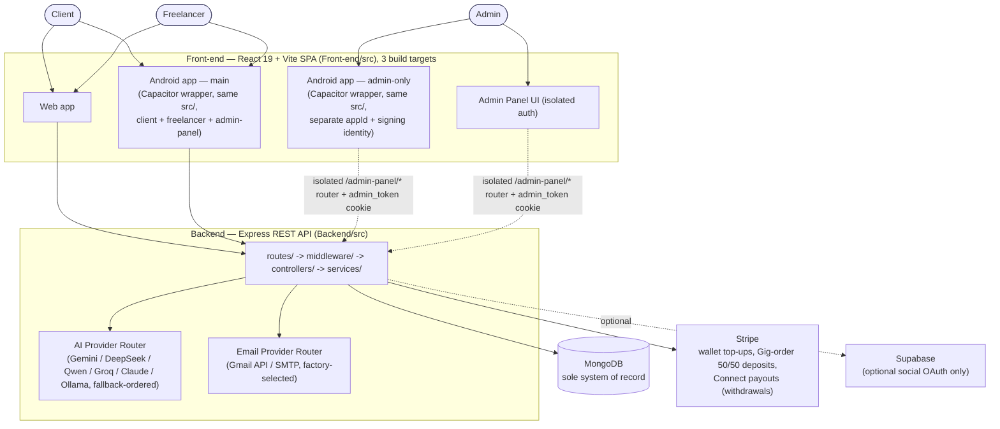
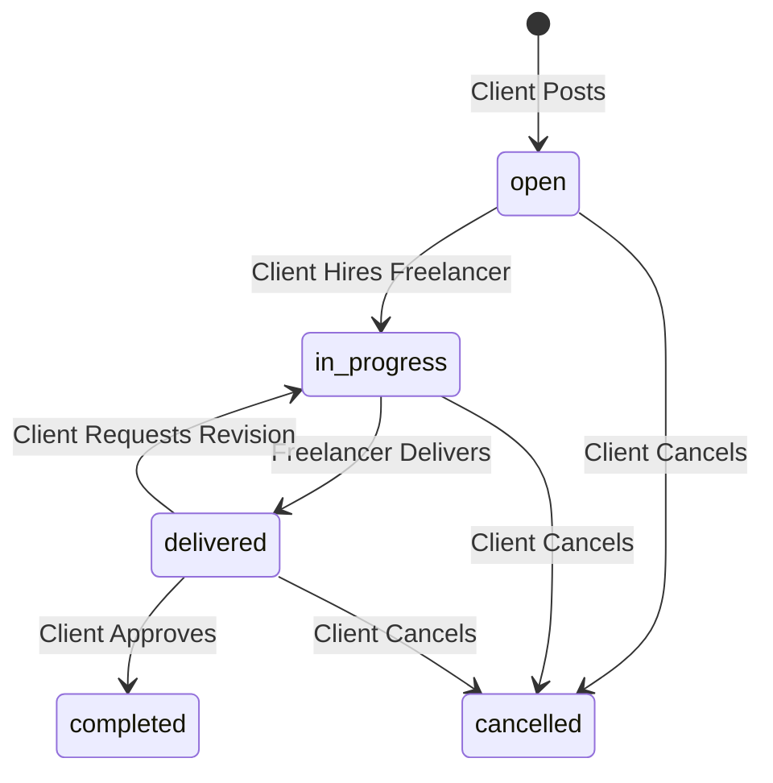
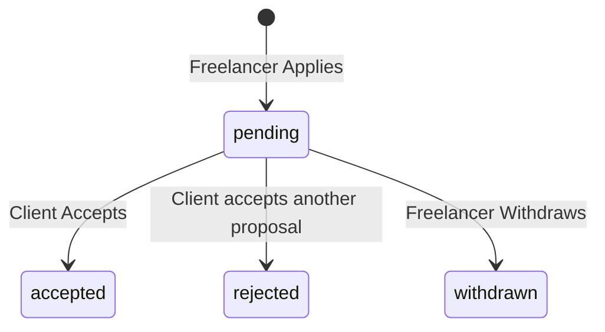
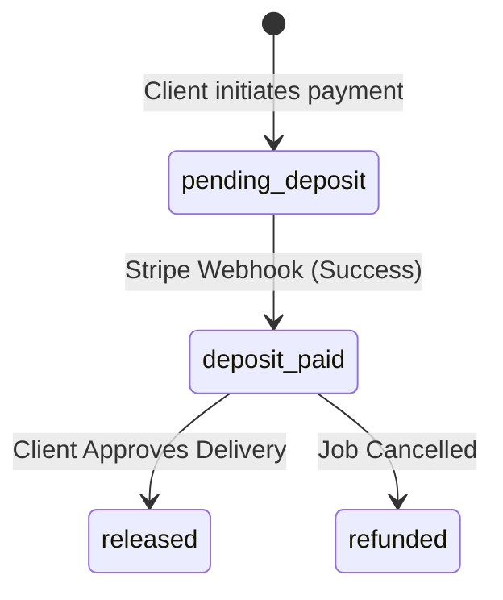
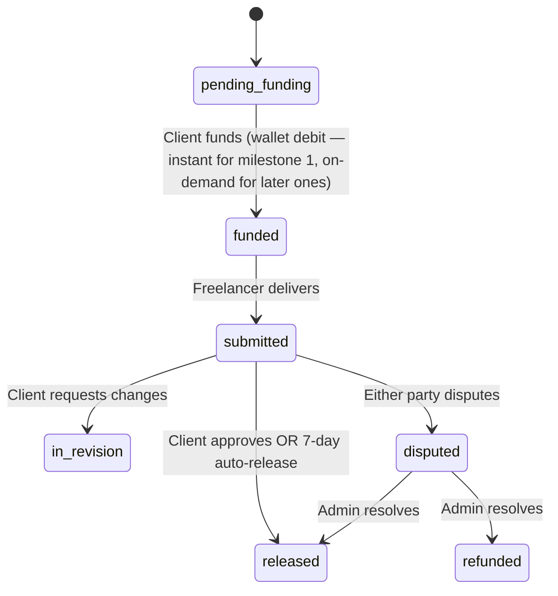
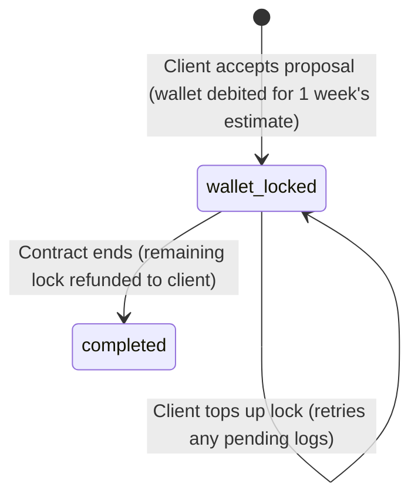
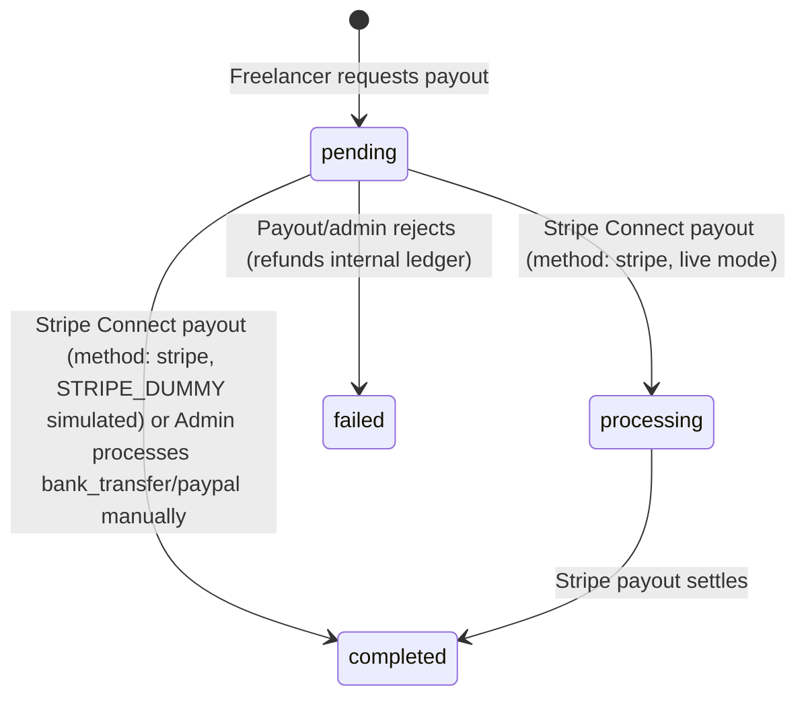
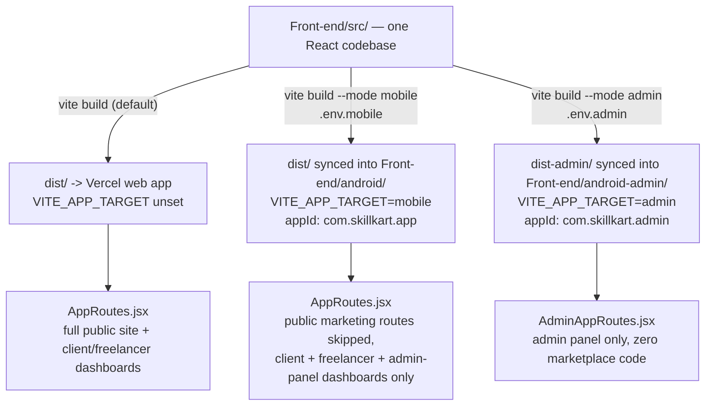

# SkillKart Project Guide

This document is a comprehensive guide to the SkillKart platform. It is designed for business owners, project managers, QA engineers, designers, and developers to understand the entire platform without needing to read the source code.

---

## 1. Project Overview

**What SkillKart is:**  
SkillKart is a dual-sided micro-freelancing marketplace built on the MERN stack (MongoDB, Express, React, Node.js). It serves as a digital bridge between individuals or businesses needing tasks completed (Clients) and skilled professionals offering their services (Freelancers).

**What problem it solves:**  
Finding reliable freelance talent and ensuring secure payments is traditionally fraught with risk. SkillKart solves this by providing a unified platform where jobs are posted, proposals are vetted, and funds are securely held in Escrow until both parties are satisfied with the delivered work.

**Target users:**  
- **Freelancers:** Independent professionals looking for gig work, long-term projects, or a platform to showcase their portfolios.
- **Clients:** Startups, SMEs, and individuals needing specialized talent on-demand without the overhead of full-time hiring.

**Business model:**  
SkillKart operates on a commission-based business model. A platform fee (currently configured as a percentage `FEE_RATE`) is deducted from the final payout when Escrow is released to the freelancer.

**Main objectives of the platform:**  
1. Provide a frictionless onboarding experience for both user types.
2. Ensure absolute financial security through wallet-native Escrow — fixed-price jobs use per-milestone wallet debits (`Milestone` model + `services/milestone.service.js`), hourly contracts use a wallet-lock (`services/hourlyEscrow.service.js`); Stripe itself is only used for wallet top-ups and (for the legacy Gig-order flow) checkout deposits, not as the escrow mechanism.
3. Foster transparent communication through in-app messaging and rigorous state-machine lifecycles.

**High-Level Architecture:**



---

## 2. User Types

The platform strictly segregates user permissions via Role-Based Access Control (RBAC).

**Guest:**
- **Can:** Browse public freelancer profiles, view public job postings, use the search functionality, and initiate the registration process.
- **Cannot:** Apply to jobs, post jobs, message users, or view private contract details.

**Freelancer:**
- **Can:** Create a professional profile, upload a CV and portfolio, browse open jobs, submit proposals (with custom rates/cover letters), message clients they are contracted with, deliver work, withdraw funds from their digital wallet, and leave reviews.
- **Cannot:** Post jobs, view other freelancers' private proposals, or arbitrarily message clients they have no active relationship with.

**Client:**
- **Can:** Create a company profile, post jobs, review incoming proposals, hire freelancers, fund Escrow (automatic wallet debit at hire for fixed-price/hourly custom Jobs; Stripe checkout deposit for Gig orders), request revisions on delivered work, approve work to release payments, and leave reviews.
- **Cannot:** Submit proposals, view other clients' private jobs, or withdraw funds (clients receive refunds, but not standard payouts).

---

## 3. Complete Business Flow

The platform operates on a linear, logical flow from discovery to payout:

1. **Guest** visits the platform.
2. **Registration:** User signs up and selects their role (Client or Freelancer).
3. **Email Verification:** A 6-digit OTP is sent via email. User inputs the OTP to verify their identity.
4. **Onboarding:** User completes mandatory profile setup (skills, company details, etc.).
5. **Searching:** Client searches for talent, or Freelancer searches for open jobs.
6. **Applying:** Freelancer submits a Proposal to an open job.
7. **Hiring:** Client reviews proposals and accepts one. The job becomes `in-progress`.
8. **Payments (Escrow):** For fixed-price jobs, 100% of the agreed price is locked from the client's wallet **automatically** the instant the proposal is accepted (optionally split into sequential milestones, funded one at a time). For hourly contracts, one week's estimated cost (rate × estimated weekly hours) is locked from the wallet at accept, then billed down automatically as hours are logged. Only Gig orders still use the original Stripe Checkout deposit. Either way, funds are securely held until release.
9. **Messaging:** Both parties communicate via the in-app chat to finalize requirements.
10. **Delivery:** Freelancer submits the final work (links/files).
11. **Approval:** Client reviews and approves the delivery. Escrow is released to the freelancer's wallet.
12. **Reviews:** Both parties submit a 1-5 star rating and written review.

---

## 4. Freelancer Journey

**Chronological Flow:**
1. **Registration:** Enters basic details and selects 'freelancer' role. Backend creates a base `User` record.
2. **Verification:** Inputs emailed OTP. Backend flags `isEmailVerified = true`.
3. **Onboarding:** Completes profile data. Backend creates a `FreelancerProfile` linked to the `User`.
4. **Creating Profile / Portfolio:** Adds skills, bio, and hourly rate.
5. **Uploading CV:** Uploads PDF. Backend processes it via Cloudinary and stores the URL.
6. **Browsing Jobs:** Views jobs with `status = 'open'`.
7. **Applying:** Submits a cover letter and rate. Backend creates a `Proposal` with `status = 'pending'`.
8. **Messaging:** If hired, the freelancer can chat with the client. Backend queries the `Message` collection.
9. **Working:** Waits for the `onDepositFunded` notification.
10. **Delivering:** Submits work. Backend updates `Job` status to `delivered` and attaches delivery payload.
11. **Receiving Payment:** Client approves. Backend increments `FreelancerProfile.walletBalance`.
12. **Withdrawal Requests:** Requests payout. Backend creates a `Withdrawal` request and deducts from `walletBalance`.
13. **Reviews:** Leaves a review for the client.

---

## 5. Client Journey

**Chronological Flow:**
1. **Registration:** Enters details, selects 'client' role.
2. **Company Profile:** Completes onboarding. Backend creates `ClientProfile`.
3. **Posting Jobs:** Fills out job form. Backend creates `Job` with `status = 'open'`.
4. **Editing Jobs:** Can edit jobs only if they are still `open`.
5. **Reviewing Proposals:** Views applications. Backend strictly enforces IDOR (clients can only view proposals for their own jobs).
6. **Hiring:** Clicks accept on a proposal. Backend updates `Proposal` to `accepted`, sets `Job.hiredFreelancer`, and marks all other proposals as `rejected`.
7. **Escrow Funding:** For a fixed-price hire, the backend debits the client's wallet for 100% of the price (or, if split into milestones, the first milestone's amount) the moment the proposal is accepted — no separate "pay deposit" click. Later milestones (if any) are funded on demand once the client clicks "Fund Milestone N". For an hourly hire, the backend locks one week's estimated cost from the client's wallet the moment the proposal is accepted, same as fixed-price — no Stripe involved. (Gig hires are the only ones that still generate a Stripe Session and update `Payment.status = deposit_paid` via webhook on success.) In every case, accepting a proposal requires the wallet to already cover the required amount — jobs can be posted with $0 balance, but hiring can't proceed until the wallet is funded.
8. **Messaging:** Chats with the hired freelancer.
9. **Reviewing Work:** Receives `delivered` status notification.
10. **Approving Work:** Clicks approve. For fixed-price/milestone jobs, `delivery.controller.js` calls `approveMilestone` (`Backend/src/services/milestone.service.js`), which releases that milestone's escrow into the freelancer's wallet and — if it was the last milestone — marks the `Contract`/`Job` as `completed` (otherwise the contract advances to the next milestone). Gig orders remain on the older `payment.controller.js` `startFinal` flow instead.
11. **Payment Release:** Funds physically move via internal ledger math.
12. **Leaving Reviews:** Submits feedback.

---

## 6. Marketplace Lifecycle

### Jobs


### Proposals


### Escrow / Payments (legacy — Gig orders only)


### Milestone Escrow (fixed-price custom Jobs)


### Hourly Wallet-Lock Escrow (hourly custom Jobs)


### Withdrawals


---

## 7. Payment System

SkillKart does not rely on direct peer-to-peer transfers. It utilizes an Escrow model.

- **Wallet:** An internal database ledger (`walletBalance`). It represents funds currently held by the platform on behalf of the user.
- **Stripe Checkout:** The external payment gateway. Used to top up a wallet, and for the legacy deposit/final flow — now used only by Gig orders (hourly contracts moved to wallet-lock escrow; see below).
- **No Wallet Gate at Posting:** A client can post a job (or publish a draft) with **any wallet balance, including $0** — there is no proof-of-funds check at posting time, for fixed-price or hourly. The wallet is only checked once the client actually accepts a proposal.
- **Fixed-Price Escrow (Milestones):** Accepting a proposal debits the client's **wallet** (not Stripe) for 100% of the agreed price — or, if the client splits it into sequential milestones, just the first one — and the accept is rejected up front if the wallet can't cover it. Later milestones are funded on demand, one at a time, once the client is ready to start that phase. A freelancer can only submit a delivery once the current milestone is `funded`.
- **Hourly Escrow (Wallet-Lock):** Accepting an hourly proposal locks one week's estimated cost (hourly rate × estimated weekly hours) from the client's wallet — again rejected up front if the wallet can't cover it. There's no separate client-approval step per hour: as the freelancer logs time, the backend automatically draws down from the lock straight into the freelancer's wallet (net of platform fee), as long as the lock has room. If logged work would exceed the remaining lock, further logging is blocked until the client tops up the lock (`POST /payments/contracts/:contractId/lock-hourly`), which then retries any work that was left pending. When the contract ends, whatever remains in the lock is refunded back to the client's wallet — a lock is a hold, not a spend.
- **Auto-Release:** If the client doesn't review a submitted milestone within a configurable window (default 7 days), it releases to the freelancer automatically.
- **Releases:** Client approves work (or auto-release fires) → Backend calculates platform fee → Net amount is added to the Freelancer's `walletBalance`. If it was the last milestone, the contract/job complete; otherwise the contract advances to the next milestone.
- **Milestone Disputes:** Either party can dispute the current milestone specifically (not the whole contract) while it's under review; an admin resolves it (release / refund / split / resume / reject) without freezing the rest of a multi-milestone project. Hourly contracts, by contrast, keep a single contract-level dispute (no per-milestone breakdown, since hourly work has none).
- **Refunds:** If a job is cancelled, the `Payment` is marked `refunded`, and the funds are added back to the Client's `walletBalance` (or refunded via Stripe if integrated).
- **Withdrawals:** Freelancer requests payout. The internal `walletBalance` is immediately deducted (atomically, to prevent double-spending), then `payment.controller.js`'s `withdrawFunds` executes a real, automated **Stripe Connect payout** (`createPayout()` in `Backend/src/services/stripe.service.js`) when `method === 'stripe'` — gated only by `STRIPE_DUMMY` (simulate vs. real payout), no admin step in between. The frontend (`FreelancerWallet.jsx`) hardcodes `withdrawMethod` to `'stripe'`, so this is the only method reachable from the UI today; `bank_transfer`/`paypal` remain valid API values that stay `Withdrawal`-record-only for manual Admin processing, but aren't exposed anywhere in the current UI.

---

## 8. Notification System

| Trigger | Recipient | Purpose |
| :--- | :--- | :--- |
| **Proposal Submitted** | Client | Alert client of new applicant. |
| **Proposal Accepted** | Freelancer | Alert freelancer they were hired. |
| **Proposal Rejected** | Freelancer | Notify freelancer they were not selected. |
| **Gig Ordered** | Freelancer | Alert freelancer of a pre-packaged purchase. |
| **Escrow Funded** | Freelancer | Signal that it is safe to begin working. |
| **Work Delivered** | Client | Prompt client to review submitted files. |
| **Revision Requested** | Freelancer | Alert freelancer that client wants changes. |
| **Payment Released** | Freelancer | Notify freelancer that funds hit their wallet. |
| **Project Completed** | Client & Freelancer | Mark the end of the contract lifecycle. |
| **Job Cancelled** | Freelancer | Alert freelancer that the contract was terminated. |
| **Escrow Refunded** | Client | Confirm funds returned to client wallet. |
| **Review Submitted** | Recipient | Alert user of new profile feedback. |
| **New Message** | Recipient | Alert user of chat activity. |
| **Withdrawal Requested** | Freelancer | Confirm payout request was received. |
| **Withdrawal Completed** | Freelancer | Confirm payout hit their bank/external account. |

### Email Delivery

The table above covers **in-app** notifications. Separately, the platform sends transactional **email**: OTP verification codes, login and password-change security alerts, and contact/newsletter relays.

Email goes through a provider abstraction selected by `EMAIL_PROVIDER`:

| Provider | Value | Transport | Use |
| :--- | :--- | :--- | :--- |
| **Google Gmail API** | `gmail` | HTTPS (OAuth2 refresh token) | Production. Required on Railway, which blocks outbound SMTP ports. |
| **SMTP** | `smtp` | SMTP (Nodemailer) | Local development; automatic fallback if Gmail credentials are missing or fail startup verification. |

Controllers never know which provider is active — they call `email.service.js` and a factory resolves the transport. Transient failures (network, timeout, 429, 5xx) retry with exponential backoff; permanent ones (bad credentials, invalid recipient) fail immediately rather than burning quota. Every attempt is written to `EmailLog` and surfaced in **Admin → Monitoring → Email**.

> The Gmail provider authenticates as a **dedicated platform mailbox** using its own refresh token. This is unrelated to Supabase's Google sign-in: that authenticates *users*, whereas transactional mail is sent *as the platform* to recipients who may never have signed in with Google.

---

## 9. Folder Structure

- **`Front-end/`**: Contains the React.js application.
  - `public/`: Served verbatim from the site root — `robots.txt`, `site.webmanifest`, favicons, and the Open Graph share image.
  - `src/pages/`: Page-level components organized by persona (`client`, `freelancer`, `public`).
  - `src/Components/`: Reusable UI elements (buttons, modals, headers).
  - `src/utils/`: Helper functions (API interceptors, file uploaders, reCAPTCHA token minting, environment-gated logger).
  - `android/`: The native Android project (Capacitor) — same `src/` build output, wrapped for the Android WebView. See [Front-end README → Mobile App](../Front-end/README.md#mobile-app-android--capacitor).
- **`Backend/`**: Contains the Express.js API.
  - `src/controllers/`: The brains of the operation. Contains all business logic and database queries.
  - `src/models/`: Mongoose schemas defining the structure of the database.
  - `src/routes/`: Express routers mapping URLs to controllers.
  - `src/middleware/`: Request interceptors (Auth checking, Rate Limiting, reCAPTCHA verification, File Upload constraints).
  - `src/services/`: Reusable backend logic (Stripe, Notifications, reCAPTCHA, sitemap generation).
    - `src/services/email/`: Pluggable email providers (Gmail API / SMTP), templates, retry, and metrics. Selected by `EMAIL_PROVIDER`; adding a provider means one new file plus one registry line.
  - `src/utils/`: Standardized error handlers and API response formatters.
  - `scripts/`: Operational tooling — demo seeding, SuperAdmin setup, and one-off data migrations.

---

## 10. Mobile App (Android)

SkillKart ships as **two separate native Android apps**, both built from the exact same `Front-end/src/` React codebase via [Capacitor](https://capacitorjs.com/) — neither is a separate rewrite or a fork of the source. A build-time flag decides which app comes out the other end:



- **Main app** (`Front-end/android/`) — covers the client and freelancer experience plus the admin-panel dashboards (auth flow + both dashboards), the same audience the web app serves minus public marketing.
- **Admin-only app** (`Front-end/android-admin/`) — a second, independent native project for admins who need marketplace moderation on the go. Own Gradle project, own `appId` (`com.skillkart.admin` vs. `com.skillkart.app`), own signing identity/keystore.

Both apps set `androidScheme: "https"` in their own Capacitor config, so each WebView's requests present a fixed origin of `https://localhost` — not a real host, purely a CORS identity. The two apps share that identical origin string despite being distinct native binaries, so a single `CORS_ORIGIN` entry on the backend covers both.

### Build-time differentiation

`VITE_APP_TARGET` (unset / `mobile` / `admin`) is read at build time and drives two runtime checks in `Front-end/src/utils/platform.js`:

- **`isMobileApp()`** — true when `VITE_APP_TARGET` is `mobile` **or** `admin` (or, as a runtime fallback, `Capacitor.isNativePlatform()`). Answers "am I inside *some* native Android WebView?" and gates everything that both native builds need identically: status bar styling, the hardware back button, the offline network gate, the boot screen, and native-only CSS fixes.
- **`isAdminApp()`** — true only when `VITE_APP_TARGET=admin`. Answers "which app is this, specifically?" and is the **only** thing that decides which route tree renders: `App.jsx` renders `AdminAppRoutes.jsx` when true, `AppRoutes.jsx` otherwise. This is the one place the two native builds actually diverge in behavior — everything else described in this section applies equally to both.

### What's scoped out of the mobile build (and why)

Inside the main app's `AppRoutes.jsx`, `isMobileApp()` skips registering every public-marketing route entirely — no landing page, no `/browse-projects`, no public profiles, no skills/category pages, just the auth flow plus the client/freelancer/admin-panel dashboards. The reasoning: a native app is only ever opened by someone who already has an account — there's no logged-out "browsing" use case on a phone the way there is on the open web, where a stranger can land on a job listing from a Google search. The excluded pages (`About`, `BrowseProjects`, `JobDetails`, `GigDetail`, the AI Tools pages, the Skills pages, both public profile pages, all four legal pages) are `React.lazy()`-loaded, so their code and assets (including a large hero image on `About`) are only ever fetched by a **web** visitor who actually navigates there — the mobile bundle never parses them at startup. Two links that point at now-excluded routes (client onboarding's "Service Agreement" checkbox, and the client dashboard's "Cost Estimator" link) detect `isMobileApp()` and open the live website in an external browser tab instead of 404ing against a route that was never registered.

The admin-only app is more extreme still: it never registers any part of `AppRoutes.jsx` at all. `AdminAppRoutes.jsx` deliberately imports **zero** client/freelancer/public code — only admin-panel pages, `AdminAuthProvider`, and `AdminProtectedRoute` — so its bundle can never pull in marketplace UI it has no use for.

### Native-platform integration

| Capability | Mechanism | Behavior |
| :--- | :--- | :--- |
| **Push notifications** | Firebase Cloud Messaging, via `src/hooks/usePushNotifications.js` (client) and `Backend/src/services/push.service.js` (server) | Wired into the exact same choke point as in-app notifications — `notification.service.js`'s `notify()` calls `Notification.create()` (in-app, unchanged) and then `push.service.js`'s `sendToUser()` (fire-and-forget). Every event in the §8 Notification System table (new proposal, message, payment released, dispute, etc.) therefore fires a push automatically, with no per-event-type push code to maintain. Tapping a push deep-links into the app via the same `link` field the in-app notification center uses. Gated behind `VITE_PUSH_NOTIFICATIONS_ENABLED` — enabling it before `google-services.json` exists is an uncaught native crash, not a caught JS error, so it's off by default. |
| **Hardware back button** | `src/hooks/useAndroidBackButton.js` + `@capacitor/app` | Wires Android's back button to React Router's `navigate(-1)` instead of the default (pop WebView history, or exit the process outright once history is empty — which would otherwise happen immediately after login lands on a dashboard with a fresh history stack). Minimizes the app instead of exiting on root screens (login, both dashboards, admin-panel dashboard). |
| **Offline detection** | `src/Components/common/NetworkGate/NetworkGate.jsx` + `@capacitor/network` | Shows a dedicated "No Internet Connection" screen, mobile only. Both listens for the native `networkStatusChange` event and polls every 5 seconds as a backstop (the native event doesn't fire reliably under aggressive OEM battery optimization). Requires 3 consecutive offline readings before showing, since at least one Android emulator image reported false negatives that caused visible flickering between the app and the offline screen. |
| **Status bar theming** | `@capacitor/status-bar`, set in `App.jsx` | Status bar styled to the brand navy with light icons — left at its default, icons meant for a light background are nearly invisible against the app's dark screens. |
| **External links** | `src/utils/externalLink.js`'s `openExternal(url)` (`@capacitor/browser`) | Opens a Chrome Custom Tab instead of a plain `<a target="_blank">`/`window.open()`, which inside a Capacitor WebView has no tab to open into — it just navigates the app itself away with no browser chrome and no way back. Falls back to normal `window.open` on web. Used for message/document attachments, portfolio/certificate links, and profile website links. |
| **Native-only styling** | `src/styles/native-app.css`, applied under `html.is-native-app` | Disables `backdrop-filter` app-wide (a severe, well-documented jank source on Android's WebView, used in ~40 files) and hides the desktop-style scrollbar (touch scrolling is unaffected). |
| **CORS / WebView origin** | Fixed `https://localhost` origin from `androidScheme: "https"` | Must be present in the backend's `CORS_ORIGIN`. Shared by both native apps, so one entry covers both — this string isn't unique to genuine app traffic, so it's not a security boundary on its own; normal auth and rate limiting still apply. |
| **reCAPTCHA** | Site key deliberately left unset in `.env.mobile`/`.env.admin` | Google's reCAPTCHA v3 is a browser-page product, unreliable inside an embedded WebView. `Backend/src/middleware/recaptcha.middleware.js` exempts requests whose `Origin` is `https://localhost` outright; rate limiting and account lockout remain the real anti-abuse gate on that origin. The admin app never even calls a `verifyRecaptcha`-gated endpoint (its isolated `/admin-panel/*` auth has its own rate limiting/lockout), so there's no gate to exempt there in the first place. |

### Admin app isolation

The admin panel's native app is kept fully independent of the main app on purpose — separate Gradle project (`Front-end/android-admin/`), separate `appId` (`com.skillkart.admin`), separate signing identity/keystore, separate build output (`dist-admin/` vs. `dist/`) — so that building, signing, or installing one can never touch the other, and so the admin binary can never accidentally ship marketplace code (or vice versa: the main app never bundles admin-panel-only logic beyond the dashboard it already exposes to authenticated admins on the web). Because Capacitor's CLI has no `--config` flag and always reads a single hardcoded `capacitor.config.json`, `Front-end/scripts/cap-admin.cjs` works around that for the `cap:admin:*` npm scripts: it backs up the real config, swaps in `capacitor.admin.config.json`, runs the real `cap` command, then restores the original from a `try`/`finally` — so even an interrupted run can't leave the main app's config permanently overwritten.

### Building it

```bash
npm run build:mobile   # vite build --mode mobile — loads .env.mobile
npm run cap:sync       # + npx cap sync → copies dist/ into android/
npm run cap:android    # + opens the project in Android Studio

npm run build:admin       # vite build --mode admin — loads .env.admin, outputs dist-admin/
npm run cap:admin:add     # first time only: adds the android-admin/ native project
npm run cap:admin         # build:admin + syncs dist-admin/ into android-admin/
npm run cap:admin:open    # opens android-admin/ in Android Studio
```

Both `.env.mobile` and `.env.admin` point at the **deployed** backend, never `localhost`. See [Front-end README → Mobile App](../Front-end/README.md#mobile-app-android--capacitor) for the full build walkthrough, including a JDK/Gradle version gotcha (Android Studio's bundled JDK can silently auto-update past what the pinned Gradle version supports) and Firebase/`google-services.json` setup for push.

---

## 11. Database Models

- **User:** The base identity. Stores email, hashed password, role, and 2FA settings.
- **ClientProfile / FreelancerProfile:** Extensions of the User model. Stores specific onboarding data (skills, company size, wallet balance). Linked 1:1 to User.
- **Job:** The core marketplace entity. Tracks title, budget, status, and the `hiredFreelancer`.
- **Proposal:** A freelancer's bid on a Job. Linked to `Job` and `User`.
- **Milestone:** (fixed-price Jobs) One funded phase of a project — order, title, amount, status (`pending_funding` → `funded` → `submitted` → `released`/`refunded`), review deadline for auto-release, and its own dispute record. A simple hire with no split still gets one implicit milestone.
- **Payment:** The Escrow record. Tracks deposit amounts, final amounts, Stripe Session IDs, and (for fixed-price jobs) a link to the specific `Milestone` it funds — one Payment per Milestone. Linked to `Job`.
- **Message:** Chat records. Linked to `sender` and `receiver`.
- **Review:** Feedback records. Linked to `jobId`, `reviewer`, and `reviewee`.
- **Withdrawal:** Payout request logs. Linked to `User`.

---

## 12. APIs

Major API Groups:
- **Auth API (`/api/v1/auth`):** Handles registration, login, OTP verification, password resets, and token refreshing.
- **Jobs API (`/api/v1/jobs`):** CRUD operations for postings. Handles state transitions (deliver, approve, cancel).
- **Proposals API (`/api/v1/proposals`):** Submission and review of bids.
- **Payments API (`/api/v1/payments`):** Stripe Checkout generation (Gig-order deposit/final), wallet deposits and withdrawal requests (automated Stripe Connect payout for `method: stripe`), plus the wallet-native custom-Job escrow endpoints — `POST /payments/milestones/:milestoneId/fund` (fund milestone 2+ on a fixed-price contract) and `POST /payments/contracts/:contractId/lock-hourly` (lock/top-up an hourly contract's wallet-lock escrow).
- **Messages API (`/api/v1/messages`):** Real-time chat endpoints.
- **Webhooks (`/webhooks`):** Unprotected endpoints utilized exclusively by Stripe/Supabase to asynchronously update backend state.

---

## 13. Security

SkillKart employs enterprise-grade security protocols:
- **Authentication:** Stateless JSON Web Tokens (JWT) with short-lived access tokens and long-lived refresh tokens.
- **Authorization & RBAC:** Custom middleware (`requireRole`) ensures clients cannot hit freelancer endpoints, and vice versa.
- **IDOR Protection:** Strict ownership checks at the database query level prevent users from scraping data they don't own (e.g. `query.clientId = req.user._id`).
- **Uploads:** Raw `multer` memory buffers are disabled. A centralized `upload.middleware.js` enforces a 10MB limit and RegEx MIME whitelisting to prevent XSS via `.html` or `.svg` payloads.
- **Payments:** Idempotency checks. The database strictly tracks `processedSessions` to prevent replay attacks where a user submits the same Stripe receipt multiple times to artificially inflate their wallet.
- **Webhooks:** Stripe signatures are cryptographically verified using `express.raw` bodies.
- **Rate Limiting:** Auth endpoints are aggressively throttled (5 requests per 15 minutes) to prevent brute-force and credential stuffing.
- **Bot Mitigation:** Google reCAPTCHA v3 (invisible, score-based) guards login, registration, and the public contact/newsletter forms. Each endpoint declares its own *action* name which the server verifies, so a token minted on the contact form can't be replayed against login. Configured via `RECAPTCHA_SECRET_KEY`; when unset, verification is skipped rather than blocking — a captcha outage must never take down login.

---

## 14. Current MVP Scope

**What IS implemented:**
- Full E2E Job and Escrow lifecycles: fixed-price jobs get **100% wallet escrow lock at hire**, optional **multi-milestone** splitting with sequential funding, and **7-day auto-release** on client inactivity; hourly jobs get **wallet-lock escrow** (one week's estimate locked at hire, billed down automatically per logged hour, top-up on demand, remainder refunded at contract end).
- An **accept-time wallet gate** — job posting has no funds check at all (a client can post with $0), but accepting a proposal is blocked until the wallet covers the required amount (milestone 1 for fixed-price, one week's estimate for hourly).
- **Fixed-price milestone disputes** — either party can freeze the current milestone specifically, and an admin resolves it (release/refund/split/resume/reject) without touching the rest of a multi-phase project. Hourly disputes are contract-level instead.
- Secure Stripe Checkout integration (wallet top-ups; legacy deposit/final flow now used only by Gig orders).
- **Automated Stripe Connect Withdrawals:** freelancer payouts via `method: 'stripe'` (the only method exposed in the UI) execute a real Connect payout automatically at request time — no admin step — gated only by `STRIPE_DUMMY` for local dev. `bank_transfer`/`paypal` remain valid but admin-processed-only, and aren't exposed in the current UI.
- Protected File Uploads via Cloudinary.
- Strict Rate Limiting and Payload Security.
- Robust OTP Email Verification, delivered via a pluggable provider (Gmail API in production, SMTP locally).
- Bot mitigation on login, registration, and public forms via Google reCAPTCHA v3.
- Search-engine discoverability: a database-driven dynamic sitemap, crawl policy, PWA manifest, and social share cards.
- Admin Panel UI with monitoring views (API, error, and email logs) and dispute resolution.
- **Two native Android apps** (§10 Mobile App), both Capacitor wrappers of the same React codebase: a main app covering client + freelancer + admin-panel, and a separate standalone admin-only app with its own `appId` and signing identity. Both include push notifications (Firebase Cloud Messaging), hardware back-button handling, offline detection, and native status bar theming.

**What intentionally does NOT exist yet:**
- **Automated `bank_transfer`/`paypal` Withdrawals:** Those two withdrawal methods remain admin-processed and aren't exposed in the current UI (only `stripe`, which is fully automated, is reachable from the frontend).
- **Gig Order Disputes:** Dispute resolution exists for custom Jobs (per-milestone for fixed-price, contract-level for hourly), but not yet for Gig orders.
- **Polling-based Messaging:** Chat relies on REST requests rather than true WebSockets (Socket.io).

---

## 15. Future Roadmap

**Phase 2:**
1. Build the Admin Dashboard UI (KYC, User Moderation, Analytics).
2. Upgrade Messaging to Socket.io for true real-time chat.
3. Expose `bank_transfer`/`paypal` as selectable withdrawal methods in the UI (Stripe Connect payouts are already live for the `stripe` method).

**Phase 3:**
1. Extend dispute resolution to Gig orders (currently custom Jobs only — per-milestone for fixed-price, contract-level for hourly).
2. Migrate MongoDB standard search to MongoDB Atlas Search (Lucene) for scalability.

**Enterprise / Nice-to-Have:**
1. iOS build of the mobile app (Android already ships via Capacitor as two native apps — see §10 Mobile App).
2. AI-Assisted Job Post Generation.
3. Automated Garbage Collection for orphaned Cloudinary files.

---

## 16. Development Notes

**Architectural Decisions & Trade-offs:**
- **MongoDB vs SQL:** MongoDB was chosen for flexibility in handling unstructured Profile data (Skills arrays, nested locations). Trade-off: Financial ledgers (wallet balances) lack native SQL ACID guarantees across multiple collections, requiring careful manual two-phase commit logic in controllers.
- **Stateless JWTs:** Chosen over server-side sessions to allow easy scaling and future mobile app integration. Trade-off: Harder to instantly invalidate a user without building a token blacklist.
- **Webhooks over Synchronous Processing:** Payment finalization relies heavily on Stripe Webhooks rather than trusting the user's browser to redirect successfully. This guarantees financial integrity even if the user closes their browser during payment processing.

---

## 17. Launch Checklist

Before deploying SkillKart to Production, the following must be verified:

- [ ] **Email Verified:** Confirm the startup log reads `✅ Email Provider: Gmail API` (or `SMTP`). If email fails, OTPs fail and registration freezes. **On Railway, SMTP ports (465/587) are blocked — `EMAIL_PROVIDER=gmail` is required there.** Gmail needs `GOOGLE_CLIENT_ID` / `GOOGLE_CLIENT_SECRET` / `GOOGLE_REFRESH_TOKEN` / `GOOGLE_EMAIL`; generate the refresh token once via [Google's OAuth Playground](https://developers.google.com/oauthplayground/) (see Backend/README.md → Email).
- [ ] **reCAPTCHA Configured:** Set `RECAPTCHA_SECRET_KEY` (backend) and `VITE_RECAPTCHA_SITE_KEY` (frontend). Add every live domain to the key in the [reCAPTCHA admin console](https://www.google.com/recaptcha/admin) — an unlisted domain is silently rejected. Without keys, bot protection is simply off.
- [ ] **Stripe Configured:** Swap from test keys to live keys. Update the `WEBHOOK_SECRET`.
- [ ] **Cloudinary Configured:** Verify upload limits and storage capacity.
- [ ] **Environment Variables:** Ensure all `.env` files contain production secrets (e.g., `NODE_ENV=production`).
- [ ] **Domain & SSL:** Ensure CORS origins (`FRONTEND_URL`) match the exact live HTTPS domain.
- [ ] **Deploy Order — Backend First:** The frontend proxies `/sitemap.xml` through to the backend, so deploying Vercel before Railway leaves that URL returning a 404 until the backend catches up. Harmless and self-correcting, but don't submit the sitemap to Google in that window.
- [ ] **SEO Canonical Domain:** Set `PUBLIC_SITE_URL` to the domain to be indexed — not `FRONTEND_URL`, which is a CSV of allowed CORS origins whose first entry may be the wrong host. Then verify `curl -sI https://<frontend>/sitemap.xml` returns **`application/xml`** — `text/html` means the SPA answered instead and the rewrite order in `vercel.json` is wrong. Submit to Google Search Console only after that check passes.
- [ ] **Admin Login on the Live Site:** Complete an OTP login and confirm you reach the dashboard rather than bouncing back to the login page. This exercises the cross-site `admin_token` cookie, which cannot fail locally (same-origin) and so is only ever provable in deployment.
- [ ] **Database Backups:** Configure daily automated snapshots in MongoDB Atlas.
- [ ] **Admin SOPs:** `stripe`-method withdrawals are already automated via Stripe Connect payouts (no admin step) — confirm connected freelancer accounts have payout capability enabled before launch. `bank_transfer`/`paypal` withdrawals (not currently reachable from the UI, but valid API values) still require manual Admin processing — have Standard Operating Procedures (SOPs) ready for those. Disputes (both hourly-contract and fixed-price-milestone) already have a full Admin Panel resolution UI (release/refund/split/resume/reject), so no manual DB work is needed for those.
- [ ] **Monitoring & Logging:** Hook up external error tracking (e.g., Sentry) to catch unhandled exceptions.
