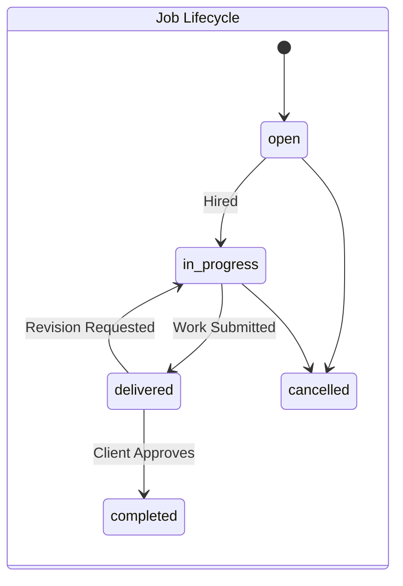
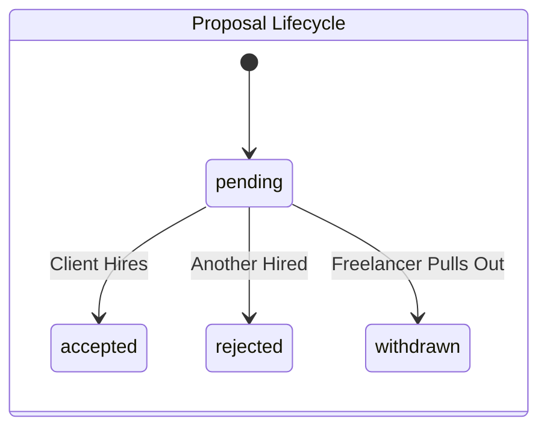
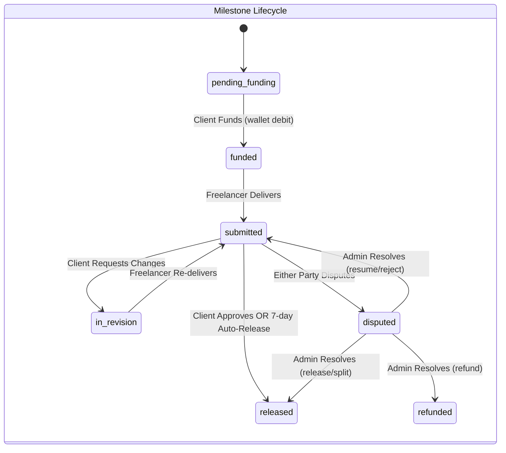

# Complete User Flows & Business Logic

This document serves as the master business blueprint for the SkillKart marketplace. It details the complete journey, logic, and state management for every type of user interacting with the platform. Every feature described here is currently fully functional in the backend and frontend.

---

## 1. Platform Overview

- **What SkillKart is:** A secure, dual-sided digital marketplace connecting skilled freelancers with clients seeking on-demand talent.
- **Marketplace Type:** B2B / B2C Service Marketplace. It operates on a hybrid model supporting both Custom Job Postings (Upwork model) and pre-packaged Gigs (Fiverr model).
- **Business Model:** Commission-based. The platform charges a variable percentage fee (default 10%) on all successfully completed contracts, deducted from the freelancer's final payout upon Escrow release.
- **Core Objectives:**
  - Facilitate trustworthy connections through skill verification.
  - Guarantee payment security via an Escrow funding model.
  - Streamline the negotiation, delivery, and approval lifecycle into rigid, predictable state machines.
- **Supported Workflows:** Custom Job Contracts, Pre-Packaged Gig Purchases, Wallet Funding & Withdrawals, Asynchronous Messaging, and 2FA Security.

---

## 2. User Personas

### Guest
- **Goals:** Understand the platform, assess available talent/jobs, and decide whether to register.
- **Permissions:** Can browse public freelancer profiles, view active Gigs, read open Job descriptions, and use the search engine.
- **Restrictions:** Cannot apply to jobs, purchase gigs, view private attachments, message users, or see contract history.
- **Typical Journey:** Lands on homepage → Views public listings → Uses search filters → Reaches Registration wall.

### Freelancer
- **Goals:** Find work, sell pre-packaged services, build a reputation, and earn money safely.
- **Permissions:** Can create a profile, upload a CV, post Gigs, submit Proposals to open jobs, save jobs to their profile, message contracted clients, change passwords, enable/disable 2FA, and request wallet withdrawals.
- **Restrictions:** Cannot post jobs, hire others, or message clients without an active proposal/contract (prevents spam). Must pass automated skill tests before posting Gigs matching those categories.
- **Typical Journey:** Registers → Verifies email → Completes onboarding → Passes skill tests → Creates Gigs / Saves & Browses Jobs → Submits Proposals → Negotiates via chat → Delivers work → Earns funds → Withdraws to external account.

### Client
- **Goals:** Hire vetted talent quickly, ensure funds are protected until work is satisfactory, and manage projects.
- **Permissions:** Can post jobs, review proposals, purchase Gigs, fund Escrow (automatically from wallet balance for custom Jobs — fixed-price or hourly — or via Stripe deposit for Gigs), request revisions, release payments, change passwords, and toggle 2FA.
- **Restrictions:** Cannot submit proposals, withdraw funds (can only receive refunds), or view other clients' private data.
- **Typical Journey:** Registers → Verifies email → Creates Company Profile → Posts a Job (even with $0 wallet balance) → Reviews incoming proposals → Accepts a proposal, which locks the required Escrow from their wallet → Communicates requirements → Reviews delivered work / logged hours → Approves work or lets hours bill automatically (releases funds).

---

## 3. Complete User Journey (Macro Level)

Guest 
↓ *Views Platform*
Registration (Selects Role)
↓ *Security Check*
Email OTP Verification
↓ *Data Collection*
Onboarding & Profile Setup
↓ *Discovery*
Client Posts Job / Freelancer Searches & Saves Jobs
↓ *Connection*
Freelancer Submits Proposal
↓ *Evaluation*
Client Reviews & Accepts Proposal
↓ *Commitment — wallet balance must already cover the required amount, checked before acceptance is allowed*
Escrow Locked Instantly from Client's Wallet (fixed-price: 100% of milestone 1, optionally split into sequential Milestones · hourly: one week's estimated cost, refilled via top-ups as work continues)
↓ *Execution*
Freelancer works & communicates via Messaging
↓ *Submission (fixed-price) / Time Logging (hourly)*
Freelancer Delivers Work (Links/Files) — or logs hours via timer/manual entry
↓ *Review*
Client Reviews Delivery (fixed-price) — hourly time logs bill automatically as they're logged, no per-entry approval
↓ *Alternative Flow: Client Requests Revision → Freelancer re-delivers (fixed-price only)*
Client Approves Work (fixed-price) / Time Auto-Bills From Lock (hourly)
↓ *Financial Transfer*
Escrow Released to Freelancer Wallet (fixed-price: on approval or 7-day auto-release · hourly: per logged hour, draining the lock; unused lock refunds to client when the contract ends)
↓ *Closure*
Both Parties Submit Reviews
↓ *Extraction*
Freelancer Requests Withdrawal

---

## 4. Freelancer Journey (Micro Level)

1. **Registration:** Inputs email/password or utilizes OAuth (via Supabase). DB creates `User` (`role: freelancer`).
2. **Email Verification:** System emails a 6-digit OTP. DB sets `isEmailVerified = true`.
3. **Onboarding:** User selects skills, languages, hourly rate, and location. DB creates `FreelancerProfile`.
4. **Profile Setup & Security:** 
   - **Avatar & CV Upload:** Uploads files. Proxied securely through Cloudinary middleware.
   - **Portfolio:** Adds past project links/images.
   - **Security:** Toggles Two-Factor Authentication (2FA) or updates password.
5. **Skill Verification:** Takes a multiple-choice quiz. If passed, the skill is flagged as `verified` on their profile.
6. **Browsing Jobs:** Uses filters (category, budget, experience level) to query `status: open` jobs. Can save jobs to their profile via the `/saved-jobs` endpoint.
7. **Applying:** Submits a cover letter and rate. Backend blocks duplicate applications to the same job. Proposal created as `pending`.
8. **Hiring Notification:** Client accepts. Proposal changes to `accepted`.
9. **Working:** For fixed-price contracts, the freelancer receives an `Escrow Funded` notification once the current milestone (or the whole price, if not split) is 100% locked; the backend enforces this — a delivery cannot be submitted while the current milestone is unfunded, so "safe to work" is a real guarantee, not just copy. For hourly contracts, the freelancer receives a `wallet_locked` notification once the client's wallet covers one week's estimate, then logs time (timer or manual entry) which auto-bills against that lock as it's recorded — no per-entry approval step. If the lock runs dry, new time logs are held `pending` ("needs top-up") until the client adds more funds.
10. **Messaging:** Chat channel opens via the active contract.
11. **Delivery:** Freelancer clicks "Deliver Work". Job state shifts to `delivered`.
12. **Revisions:** Client may reject the delivery. State shifts back to `in-progress`. Freelancer must re-deliver.
13. **Approval:** Client approves. Backend deducts platform fee, and adds net amount to `FreelancerProfile.walletBalance`.
14. **Withdrawal:** Freelancer requests payout. DB creates a `Withdrawal` request, and deducts the balance immediately.
15. **Reviews:** Leaves a 1-5 star rating for the client.

---

## 5. Client Journey (Micro Level)

1. **Registration & Verification:** Same base flow as Freelancer.
2. **Company Onboarding:** Inputs Company Name, Industry, and Size. DB creates `ClientProfile`.
3. **Security:** Toggles 2FA or changes password.
4. **Create Job:** Fills out title, budget, category. State published as `open`.
5. **Editing Jobs:** Can edit jobs only if they remain `open`.
6. **Reviewing Proposals:** Views applications. Strict IDOR protection ensures clients only see their own job proposals.
7. **Hiring:** Accepts proposal. Job `hiredFreelancer` is set, state shifts to `in-progress`. All competing proposals are automatically marked `rejected`.
8. **Escrow Funding:** Acceptance is blocked upfront if the wallet can't cover it — checked before any Contract/Milestone/Payment records are created. For **fixed-price jobs**, **100% of milestone 1's amount is debited from the client's wallet automatically** the instant the proposal is accepted — no separate checkout step. The client may optionally split the price into sequential **Milestones** at accept-time; only the first is funded upfront, and later milestones are funded on demand once the client is ready. For **hourly contracts**, one week's estimated cost (`hourly rate × estimated weekly hours`) is locked from the wallet at accept-time instead; the client tops up the lock later as work continues. (Gig orders are the only flow that still uses the original 50/50 Stripe-Checkout deposit/final flow.)
9. **Messaging:** Chats with hired freelancer.
10. **Delivery Review (fixed-price):** Job shifts to `delivered`. If the client doesn't act within a configurable window (default **7 days**), the milestone **auto-releases** to the freelancer. **Hourly contracts have no delivery-review step** — logged hours draw down from the wallet lock automatically as they're recorded, without client sign-off per entry.
11. **Approving Work (fixed-price):** Approves delivery, releasing that milestone's Escrow. If it was the last (or only) milestone, the Job state shifts to `completed`; otherwise the contract advances to the next milestone, which the client funds when ready. For **hourly contracts**, the client's only ongoing action is topping up the wallet lock when it runs low; ending the contract refunds whatever's left in the lock back to the client's wallet.
12. **Disputing:** For **fixed-price**, the client raises a **dispute** scoped to the specific current milestone — it locks only that milestone (not the whole multi-phase project) pending admin review. For **hourly**, disputes are raised at the contract level instead (there's no milestone to scope to).
13. **Reviews:** Rates the freelancer, influencing their aggregate profile score.

*(Note: Clients cannot arbitrarily cancel jobs that have already been `delivered` to prevent work-theft. Also note: there is no wallet-balance check when posting or publishing a job — a client can post a job with $0 in the wallet, for either budget type, and it goes live for freelancers to propose on. The wallet is only checked, and then locked, at the moment the client accepts a proposal.)*

---

## 6. Gig Marketplace Flow

Freelancer Creates Gig
↓ *Defines Basic, Standard, and Premium packages (price, delivery time, revisions)*
Skill Gating
↓ *Backend verifies the freelancer has passed tests for the gig's required skills. Blocks publication if unverified.*
Publish (State: `active`)
↓
Client Browses & Filters Gigs
↓ 
Orders Package
↓ *Selects Tier (e.g. "Standard for $50")*
Job Conversion
↓ *Backend instantly creates a `Job` (source = 'gig') locked to the Tier pricing. Skips the Proposal phase entirely.*
Escrow Funding
↓ *Client pays deposit via Stripe — Gig orders are the last flow still using the original 50/50 deposit/final Stripe-Checkout split. Custom Jobs use wallet-native escrow instead (Milestones for fixed-price, wallet-lock for hourly) — Gig orders were never migrated to either.*
Work & Delivery Lifecycle
↓ *Follows identical lifecycle to standard custom jobs.*

---

## 7. Authentication & Security Flow

- **Registration:** Passwords hashed via Bcrypt (12 rounds).
- **Bot Screening:** Login, registration, and the public contact/newsletter forms are screened by Google reCAPTCHA v3 before any handler runs. It is invisible — legitimate users see no challenge and no extra step in the flows above.
- **OTP Verification:** 6-digit codes stored temporarily, delivered by email (Gmail API in production, SMTP locally).
- **Login:** Returns stateless JWTs.
- **Two-Factor Authentication (2FA):** Optional. If enabled, Login requires a secondary OTP sent to the verified email.
- **Refresh Token Flow:** Access token expires (e.g., 15m). The frontend silently hits `/auth/refresh` with the stored refresh token to mint a new one. Marketplace tokens are held in browser storage and sent as `Authorization: Bearer` headers; the **admin panel** is separate, using an HTTP-only `admin_token` cookie (`SameSite=None; Secure` in production, since the SPA and API are on different domains).
- **Password Updates:** Fully supported via `changePassword` endpoints.
- **File Uploads:** Memory buffer whitelisting strictly prevents payload manipulation before syncing to Cloudinary.

---

## 8. Messaging Flow

- **Permissions:** Gated. You cannot message users without an active connection (e.g., pending proposal, active contract).
- **Delivery:** Currently relies on RESTful polling. The frontend fetches `/messages/conversation/:id` periodically.
- **Limitations:** No true real-time WebSockets. No read receipts.

---

## 9. Wallet & Payment Flow

- **Stripe Checkout:** Hosts the payment session for topping up a wallet, and for the legacy deposit/final flow still used by Gig orders. Injects custom metadata (`userId`, `jobId`).
- **Escrow Integrity (legacy/gig path):** Managed by async Webhooks (`stripe.webhook.js`).
- **Idempotency:** Replay attacks are blocked via the `processedSessions` array.
- **Refunds:** If an `in-progress` contract cancels, the Escrow is deposited into the Client's `walletBalance`.
- **Withdrawals:** Freelancer requests payout. The internal `walletBalance` is immediately deducted, queueing a `Withdrawal` database record for manual admin processing.

### 9a. Fixed-Price Milestone Escrow (custom Jobs)

Custom fixed-price jobs use a newer, wallet-native escrow model — no Stripe Checkout redirect at all for funding a milestone:

- **No Wallet Gate at Posting:** A client can post — and publish — a job with any wallet balance, including $0, for either budget type. There's no proof-of-funds check at posting time; the wallet is only checked (and locked) when a proposal is accepted.
- **100% Lock at Hire:** Accepting a proposal debits the client's wallet for the full agreed price (or, if split, the first milestone's amount) and creates the `Contract` + `Milestone`(s) + `Payment` record(s) atomically — checked *before* any writes, so an insufficient balance leaves nothing half-created.
- **Sequential Milestones:** A client may split the price into up to a few milestones at accept-time. Only milestone 1 auto-funds; milestone 2+ requires the client to explicitly click "Fund Milestone N" once ready (`POST /payments/milestones/:id/fund`) — capital isn't parked for work that hasn't started.
- **Submit Gate:** The freelancer can only submit a delivery once the current milestone's status is `funded` (or `in_revision`) — enforced server-side, not just in the UI.
- **7-Day Auto-Release:** An hourly cron job (`cron.service.js`) scans milestones stuck in `submitted` past their `reviewDeadline` (default 7 days, configurable via admin `SystemSettings`) and releases them automatically, notifying both parties. A milestone under an active dispute is excluded.
- **Milestone Disputes:** Either party can raise a dispute on the *current* milestone (must be `submitted`/`in_revision`); this locks that milestone and flips the contract to `under_review`, without touching any other milestone. Admins resolve via the same actions as hourly disputes (release / refund / split / resume / reject), scoped to that one milestone's own `Payment` record.

### 9b. Hourly Wallet-Lock Escrow (custom Jobs)

Hourly contracts moved off the legacy 50/50 Stripe deposit flow onto their own wallet-native lock, mirroring fixed-price escrow's "check before write" model but billing continuously instead of on a delivery/approval cycle:

- **No Wallet Gate at Posting:** Same as fixed-price — an hourly job can be posted with $0 in the wallet.
- **One-Week Lock at Hire:** Accepting a proposal computes one week's estimated cost (`hourlyRate × estimatedWeeklyHours`), validates the wallet covers it *before any writes*, then locks that amount from the client's wallet as part of accepting (`contract.paymentStatus` becomes `wallet_locked`).
- **Billing Is Automatic, Not Approval-Gated:** As the freelancer logs time (via a running timer or a manual entry), each logged chunk is drawn down from the locked balance straight into the freelancer's wallet (net of platform fee) the moment it's logged — there's no client sign-off step per hour. New time entries are blocked once unbilled work would exceed the remaining lock.
- **Top-Up on Low Balance:** If the lock can't cover a new log, that log is held as `pending` (`needsTopUp: true`) instead of failing outright. The client tops up the lock (`POST /payments/contracts/:id/lock-hourly`), which re-locks funds and retries any pending logs oldest-first.
- **Refund on Contract End:** Ending the contract settles any remaining pending logs, then refunds whatever's left in the lock back to the client's wallet — a lock is a hold against future work, not an irreversible spend.
- **Disputes Stay Contract-Level:** Unlike fixed-price, hourly has no milestone to scope a dispute to, so disputes are raised and resolved on the contract itself.

---

## 10. Marketplace State Machines

---

## 11. Feature Matrix

This matrix is the definitive source of truth for the platform's current capabilities.

### Fully Implemented
- **Registration & Login** (Email/Password, Supabase OAuth)
- **OTP Email Verification**
- **Two-Factor Authentication (2FA)**
- **Password Change / Reset**
- **Role-Based Profiles** (Client, Freelancer)
- **Skill Gating & Assessments**
- **Custom Job Postings**
- **Job Proposal Submission & Bidding**
- **Gig Creation with Tiered Packages** (Basic, Standard, Premium)
- **Gig Ordering (Direct Purchase)**
- **Saved Jobs** (Freelancers can bookmark jobs)
- **Secure File Uploads** (Cloudinary Integration)
- **Stripe Checkout Escrow Funding** (wallet top-ups, and the legacy 50/50 deposit/final flow for Gig orders only)
- **100% Escrow Lock at Hire** (fixed-price custom Jobs — wallet debit, no checkout redirect)
- **Hourly Wallet-Lock Escrow:** Accepting an hourly proposal locks one week's estimated cost from the client's wallet; logged hours auto-bill from that lock as they're recorded, with top-up and end-of-contract refund of any unused balance.
- **Multi-Milestone Contracts:** Fixed-price jobs can be split into sequential milestones, each funded only when the client is ready to start that phase.
- **7-Day Auto-Release:** Milestones the client hasn't reviewed in time (default 7 days, admin-configurable) release automatically to the freelancer.
- **No Wallet Gate at Job Posting:** A job (fixed-price or hourly) can be posted or published with any wallet balance, including $0 — the wallet is checked only at proposal-accept time.
- **Fixed-Price Milestone Disputes:** Either party can dispute the current milestone specifically; admins resolve via release / refund / split / resume / reject, scoped to that milestone only.
- **Idempotency Payment Protection**
- **Delivery & Revision Cycles**
- **Payment Release & Internal Wallet Ledgers**
- **Withdrawal Requests**
- **In-App Notifications**
- **Job & Freelancer Search / Filtering**
- **Mutual Review & Rating System**
- **Mobile Application (Android):** Capacitor-wrapped native app sharing the same codebase/API as the web client, freelancer, and admin-panel experiences.
- **Push Notifications:** Firebase Cloud Messaging delivers pushes for the same events as in-app notifications — no-ops safely until a Firebase service account is configured (see Backend README → Push Notifications).

### Partially Implemented
- **Messaging:** Functional, but relies on RESTful interval polling rather than true WebSockets.
- **Refunds:** If a job cancels, funds go to the client's internal `walletBalance` rather than automatically refunding to their credit card via Stripe API.
- **Dispute Mediation:** Fully implemented for hourly contracts and fixed-price milestones (raise → auto-freeze → admin resolves with release/refund/split/resume/reject) — the gap is only that Gig orders don't yet have their own dispute entry point.

### Planned (Future Enhancements)
- **Automated Payouts:** Using Stripe Connect to auto-route freelancer withdrawals to their bank without Admin intervention.
- **Real-Time WebSockets:** Upgrading chat to Socket.io.
- **Gig Order Disputes:** Extending milestone-style disputes to Gig orders (currently only custom Jobs and hourly contracts support disputing).

### Not Implemented (Missing Features)
- **Account Deletion:** Users cannot delete their accounts programmatically.
- **Identity Verification (KYC):** No passport/ID verification integration (e.g., Onfido).
- **Wishlists:** Clients cannot "save" freelancers or gigs for later.
- **Email Change Verification:** Changing email addresses is restricted.
