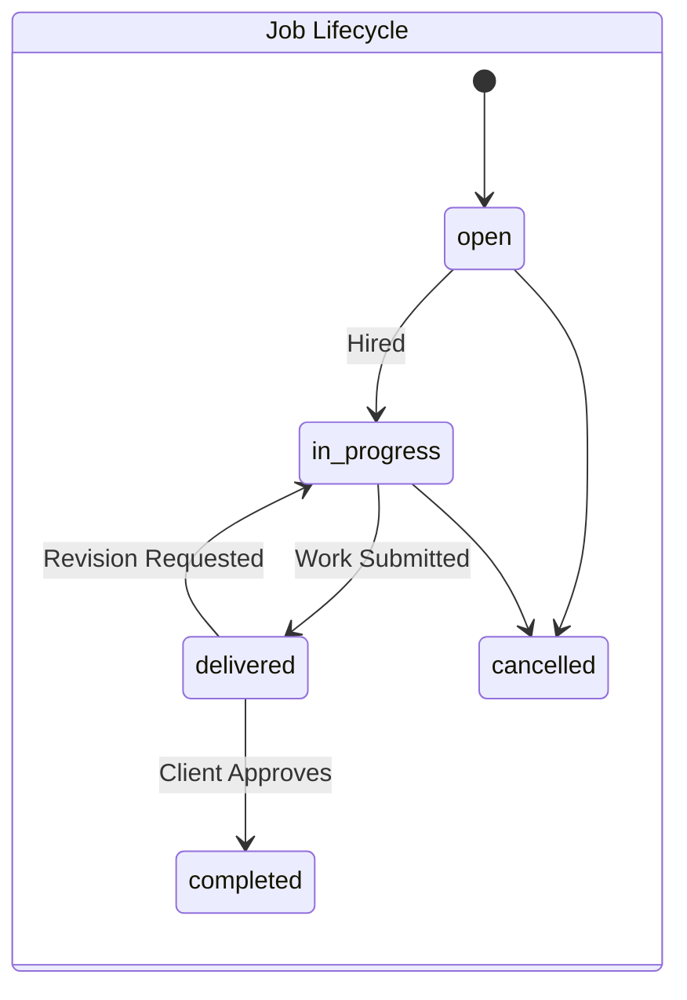
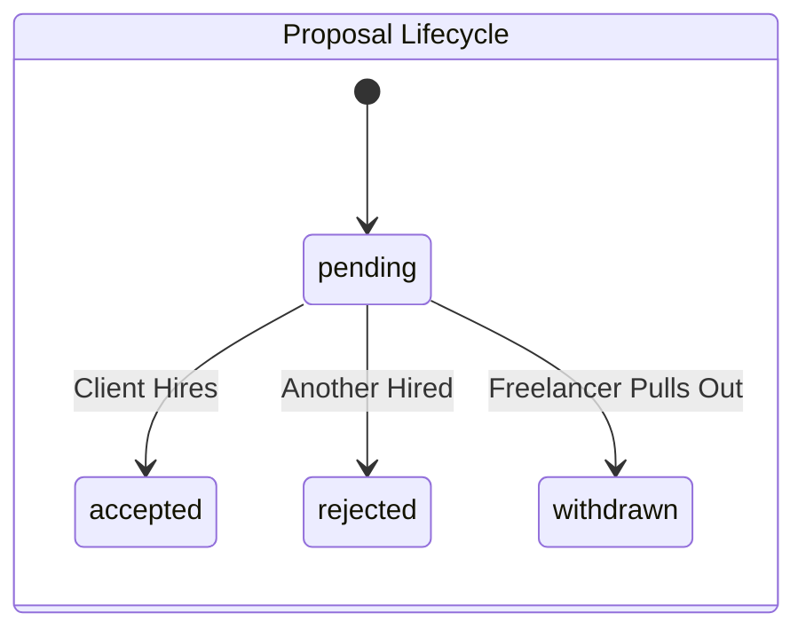
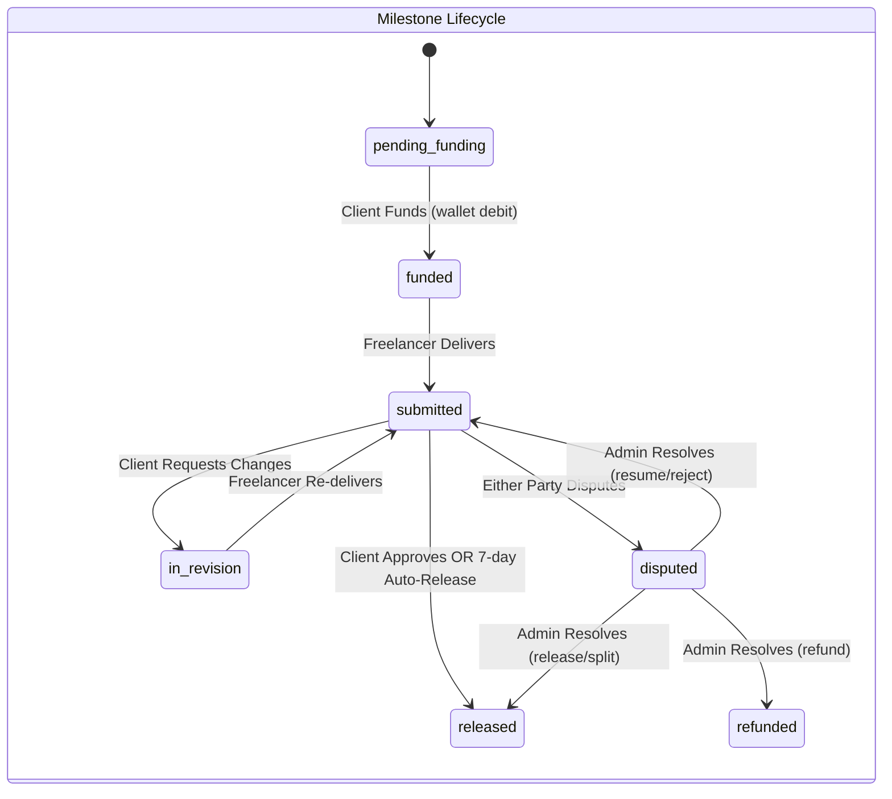

# Complete User Flows & Business Logic

This document serves as the master business blueprint for the SkillKart marketplace. It details the complete journey, logic, and state management for every type of user interacting with the platform. Every feature described here is currently fully functional in the backend and frontend.

---

## 1. Platform Overview

- **What SkillKart is:** A secure, dual-sided digital marketplace connecting skilled freelancers with clients seeking on-demand talent.
- **Marketplace Type:** B2B / B2C Service Marketplace. It operates on a hybrid model supporting both Custom Job Postings (Upwork model) and pre-packaged Gigs (Fiverr model).
- **Business Model:** Commission-based. The platform charges a variable percentage fee (default 10%) on all successfully completed contracts, deducted from the freelancer's final payout upon Escrow release.
- **Core Objectives:**
  - Facilitate trustworthy connections through skill verification.
  - Guarantee payment security via an Escrow funding model.
  - Streamline the negotiation, delivery, and approval lifecycle into rigid, predictable state machines.
- **Supported Workflows:** Custom Job Contracts, Pre-Packaged Gig Purchases, Wallet Funding & Withdrawals, Asynchronous Messaging, and 2FA Security.

---

## 2. User Personas

### Guest
- **Goals:** Understand the platform, assess available talent/jobs, and decide whether to register.
- **Permissions:** Can browse public freelancer profiles, view active Gigs, read open Job descriptions, and use the search engine.
- **Restrictions:** Cannot apply to jobs, purchase gigs, view private attachments, message users, or see contract history.
- **Typical Journey:** Lands on homepage → Views public listings → Uses search filters → Reaches Registration wall.

### Freelancer
- **Goals:** Find work, sell pre-packaged services, build a reputation, and earn money safely.
- **Permissions:** Can create a profile, upload a CV, post Gigs, submit Proposals to open jobs, save jobs to their profile, message contracted clients, change passwords, enable/disable 2FA, and request wallet withdrawals.
- **Restrictions:** Cannot post jobs, hire others, or message clients without an active proposal/contract (prevents spam). Must pass automated skill tests before posting Gigs matching those categories.
- **Typical Journey:** Registers → Verifies email → Completes onboarding → Passes skill tests → Creates Gigs / Saves & Browses Jobs → Submits Proposals → Negotiates via chat → Delivers work → Earns funds → Withdraws to external account.

### Client
- **Goals:** Hire vetted talent quickly, ensure funds are protected until work is satisfactory, and manage projects.
- **Permissions:** Can post jobs, review proposals, purchase Gigs, fund Escrow (automatically from wallet balance for custom Jobs — fixed-price or hourly — or via Stripe deposit for Gigs), request revisions, release payments, change passwords, and toggle 2FA.
- **Restrictions:** Cannot submit proposals, withdraw funds (can only receive refunds), or view other clients' private data.
- **Typical Journey:** Registers → Verifies email → Creates Company Profile → Posts a Job (even with $0 wallet balance) → Reviews incoming proposals → Accepts a proposal, which locks the required Escrow from their wallet → Communicates requirements → Reviews delivered work / logged hours → Approves work or lets hours bill automatically (releases funds).

---

## 3. Complete User Journey (Macro Level)

Guest 
↓ *Views Platform*
Registration (Selects Role)
↓ *Security Check*
Email OTP Verification
↓ *Data Collection*
Onboarding & Profile Setup
↓ *Discovery*
Client Posts Job / Freelancer Searches & Saves Jobs
↓ *Connection*
Freelancer Submits Proposal
↓ *Evaluation*
Client Reviews & Accepts Proposal
↓ *Commitment — wallet balance must already cover the required amount, checked before acceptance is allowed*
Escrow Locked Instantly from Client's Wallet (fixed-price: 100% of milestone 1, optionally split into sequential Milestones · hourly: one week's estimated cost, refilled via top-ups as work continues)
↓ *Execution*
Freelancer works & communicates via Messaging
↓ *Submission (fixed-price) / Time Logging (hourly)*
Freelancer Delivers Work (Links/Files) — or logs hours via timer/manual entry
↓ *Review*
Client Reviews Delivery (fixed-price) — hourly time logs bill automatically as they're logged, no per-entry approval
↓ *Alternative Flow: Client Requests Revision → Freelancer re-delivers (fixed-price only)*
Client Approves Work (fixed-price) / Time Auto-Bills From Lock (hourly)
↓ *Financial Transfer*
Escrow Released to Freelancer Wallet (fixed-price: on approval or 7-day auto-release · hourly: per logged hour, draining the lock; unused lock refunds to client when the contract ends)
↓ *Closure*
Both Parties Submit Reviews
↓ *Extraction*
Freelancer Requests Withdrawal

---

## 4. Freelancer Journey (Micro Level)

1. **Registration:** Inputs email/password or utilizes OAuth (via Supabase). DB creates `User` (`role: freelancer`).
2. **Email Verification:** System emails a 6-digit OTP. DB sets `isEmailVerified = true`.
3. **Onboarding:** User selects skills, languages, hourly rate, and location. DB creates `FreelancerProfile`.
4. **Profile Setup & Security:** 
   - **Avatar & CV Upload:** Uploads files. Proxied securely through Cloudinary middleware.
   - **Portfolio:** Adds past project links/images.
   - **Security:** Toggles Two-Factor Authentication (2FA) or updates password.
5. **Skill Verification:** Takes a multiple-choice quiz. If passed, the skill is flagged as `verified` on their profile.
6. **Browsing Jobs:** Uses filters (category, budget, experience level) to query `status: open` jobs. Can save jobs to their profile via the `/saved-jobs` endpoint.
7. **Applying:** Submits a cover letter and rate. Backend blocks duplicate applications to the same job. Proposal created as `pending`.
8. **Hiring Notification:** Client accepts. Proposal changes to `accepted`.
9. **Working:** For fixed-price contracts, the freelancer receives an `Escrow Funded` notification once the current milestone (or the whole price, if not split) is 100% locked; the backend enforces this — a delivery cannot be submitted while the current milestone is unfunded, so "safe to work" is a real guarantee, not just copy. For hourly contracts, the freelancer receives a `wallet_locked` notification once the client's wallet covers one week's estimate, then logs time (timer or manual entry) which auto-bills against that lock as it's recorded — no per-entry approval step. If the lock runs dry, new time logs are held `pending` ("needs top-up") until the client adds more funds.
10. **Messaging:** Chat channel opens via the active contract.
11. **Delivery:** Freelancer clicks "Deliver Work". Job state shifts to `delivered`.
12. **Revisions:** Client may reject the delivery. State shifts back to `in-progress`. Freelancer must re-deliver.
13. **Approval:** Client approves. Backend deducts platform fee, and adds net amount to `FreelancerProfile.walletBalance`.
14. **Withdrawal:** Freelancer requests payout. DB creates a `Withdrawal` request, and deducts the balance immediately.
15. **Reviews:** Leaves a 1-5 star rating for the client.

---

## 5. Client Journey (Micro Level)

1. **Registration & Verification:** Same base flow as Freelancer.
2. **Company Onboarding:** Inputs Company Name, Industry, and Size. DB creates `ClientProfile`.
3. **Security:** Toggles 2FA or changes password.
4. **Create Job:** Fills out title, budget, category. State published as `open`.
5. **Editing Jobs:** Can edit jobs only if they remain `open`.
6. **Reviewing Proposals:** Views applications. Strict IDOR protection ensures clients only see their own job proposals.
7. **Hiring:** Accepts proposal. Job `hiredFreelancer` is set, state shifts to `in-progress`. All competing proposals are automatically marked `rejected`.
8. **Escrow Funding:** Acceptance is blocked upfront if the wallet can't cover it — checked before any Contract/Milestone/Payment records are created. For **fixed-price jobs**, **100% of milestone 1's amount is debited from the client's wallet automatically** the instant the proposal is accepted — no separate checkout step. The client may optionally split the price into sequential **Milestones** at accept-time; only the first is funded upfront, and later milestones are funded on demand once the client is ready. For **hourly contracts**, one week's estimated cost (`hourly rate × estimated weekly hours`) is locked from the wallet at accept-time instead; the client tops up the lock later as work continues. (Gig orders are the only flow that still uses the original 50/50 Stripe-Checkout deposit/final flow.)
9. **Messaging:** Chats with hired freelancer.
10. **Delivery Review (fixed-price):** Job shifts to `delivered`. If the client doesn't act within a configurable window (default **7 days**), the milestone **auto-releases** to the freelancer. **Hourly contracts have no delivery-review step** — logged hours draw down from the wallet lock automatically as they're recorded, without client sign-off per entry.
11. **Approving Work (fixed-price):** Approves delivery, releasing that milestone's Escrow. If it was the last (or only) milestone, the Job state shifts to `completed`; otherwise the contract advances to the next milestone, which the client funds when ready. For **hourly contracts**, the client's only ongoing action is topping up the wallet lock when it runs low; ending the contract refunds whatever's left in the lock back to the client's wallet.
12. **Disputing:** For **fixed-price**, the client raises a **dispute** scoped to the specific current milestone — it locks only that milestone (not the whole multi-phase project) pending admin review. For **hourly**, disputes are raised at the contract level instead (there's no milestone to scope to).
13. **Reviews:** Rates the freelancer, influencing their aggregate profile score.

*(Note: Clients cannot arbitrarily cancel jobs that have already been `delivered` to prevent work-theft. Also note: there is no wallet-balance check when posting or publishing a job — a client can post a job with $0 in the wallet, for either budget type, and it goes live for freelancers to propose on. The wallet is only checked, and then locked, at the moment the client accepts a proposal.)*

---

## 6. Gig Marketplace Flow

Freelancer Creates Gig
↓ *Defines Basic, Standard, and Premium packages (price, delivery time, revisions)*
Skill Gating
↓ *Backend verifies the freelancer has passed tests for the gig's required skills. Blocks publication if unverified.*
Publish (State: `active`)
↓
Client Browses & Filters Gigs
↓ 
Orders Package
↓ *Selects Tier (e.g. "Standard for $50")*
Job Conversion
↓ *Backend instantly creates a `Job` (source = 'gig') locked to the Tier pricing. Skips the Proposal phase entirely.*
Escrow Funding
↓ *Client pays deposit via Stripe — Gig orders are the last flow still using the original 50/50 deposit/final Stripe-Checkout split. Custom Jobs use wallet-native escrow instead (Milestones for fixed-price, wallet-lock for hourly) — Gig orders were never migrated to either.*
Work & Delivery Lifecycle
↓ *Follows identical lifecycle to standard custom jobs.*

---

## 7. Authentication & Security Flow

- **Registration:** Passwords hashed via Bcrypt (12 rounds).
- **Bot Screening:** Login, registration, and the public contact/newsletter forms are screened by Google reCAPTCHA v3 before any handler runs. It is invisible — legitimate users see no challenge and no extra step in the flows above.
- **OTP Verification:** 6-digit codes stored temporarily, delivered by email (Gmail API in production, SMTP locally).
- **Login:** Returns stateless JWTs.
- **Two-Factor Authentication (2FA):** Optional. If enabled, Login requires a secondary OTP sent to the verified email.
- **Refresh Token Flow:** Access token expires (e.g., 15m). The frontend silently hits `/auth/refresh` with the stored refresh token to mint a new one. Marketplace tokens are held in browser storage and sent as `Authorization: Bearer` headers; the **admin panel** is separate, using an HTTP-only `admin_token` cookie (`SameSite=None; Secure` in production, since the SPA and API are on different domains).
- **Password Updates:** Fully supported via `changePassword` endpoints.
- **File Uploads:** Memory buffer whitelisting strictly prevents payload manipulation before syncing to Cloudinary.

---

## 8. Messaging Flow

- **Permissions:** Gated. You cannot message users without an active connection (e.g., pending proposal, active contract).
- **Delivery:** Currently relies on RESTful polling. The frontend fetches `/messages/conversation/:id` periodically.
- **Limitations:** No true real-time WebSockets. No read receipts.

---

## 9. Wallet & Payment Flow

- **Stripe Checkout:** Hosts the payment session for topping up a wallet, and for the legacy deposit/final flow still used by Gig orders. Injects custom metadata (`userId`, `jobId`).
- **Escrow Integrity (legacy/gig path):** Managed by async Webhooks (`stripe.webhook.js`).
- **Idempotency:** Replay attacks are blocked via the `processedSessions` array.
- **Refunds:** If an `in-progress` contract cancels, the Escrow is deposited into the Client's `walletBalance`.
- **Withdrawals:** Freelancer requests payout. The internal `walletBalance` is immediately deducted (atomic reservation, before any external call). For `method: 'stripe'` — the only method the UI exposes — `payment.controller.js`'s `withdrawFunds` then executes a real, automated **Stripe Connect payout** (`createPayout()`, `Backend/src/services/stripe.service.js`), gated only by `STRIPE_DUMMY` (simulate vs. real); there's no admin step. `bank_transfer`/`paypal` are still valid API values but remain `Withdrawal`-record-only for manual Admin processing, and aren't exposed in the current UI.

### 9a. Fixed-Price Milestone Escrow (custom Jobs)

Custom fixed-price jobs use a newer, wallet-native escrow model — no Stripe Checkout redirect at all for funding a milestone:

- **No Wallet Gate at Posting:** A client can post — and publish — a job with any wallet balance, including $0, for either budget type. There's no proof-of-funds check at posting time; the wallet is only checked (and locked) when a proposal is accepted.
- **100% Lock at Hire:** Accepting a proposal debits the client's wallet for the full agreed price (or, if split, the first milestone's amount) and creates the `Contract` + `Milestone`(s) + `Payment` record(s) atomically — checked *before* any writes, so an insufficient balance leaves nothing half-created.
- **Sequential Milestones:** A client may split the price into up to a few milestones at accept-time. Only milestone 1 auto-funds; milestone 2+ requires the client to explicitly click "Fund Milestone N" once ready (`POST /payments/milestones/:id/fund`) — capital isn't parked for work that hasn't started.
- **Submit Gate:** The freelancer can only submit a delivery once the current milestone's status is `funded` (or `in_revision`) — enforced server-side, not just in the UI.
- **7-Day Auto-Release:** An hourly cron job (`cron.service.js`) scans milestones stuck in `submitted` past their `reviewDeadline` (default 7 days, configurable via admin `SystemSettings`) and releases them automatically, notifying both parties. A milestone under an active dispute is excluded.
- **Milestone Disputes:** Either party can raise a dispute on the *current* milestone (must be `submitted`/`in_revision`); this locks that milestone and flips the contract to `under_review`, without touching any other milestone. Admins resolve via the same actions as hourly disputes (release / refund / split / resume / reject), scoped to that one milestone's own `Payment` record.

### 9b. Hourly Wallet-Lock Escrow (custom Jobs)

Hourly contracts moved off the legacy 50/50 Stripe deposit flow onto their own wallet-native lock, mirroring fixed-price escrow's "check before write" model but billing continuously instead of on a delivery/approval cycle:

- **No Wallet Gate at Posting:** Same as fixed-price — an hourly job can be posted with $0 in the wallet.
- **One-Week Lock at Hire:** Accepting a proposal computes one week's estimated cost (`hourlyRate × estimatedWeeklyHours`), validates the wallet covers it *before any writes*, then locks that amount from the client's wallet as part of accepting (`contract.paymentStatus` becomes `wallet_locked`).
- **Billing Is Automatic, Not Approval-Gated:** As the freelancer logs time (via a running timer or a manual entry), each logged chunk is drawn down from the locked balance straight into the freelancer's wallet (net of platform fee) the moment it's logged — there's no client sign-off step per hour. New time entries are blocked once unbilled work would exceed the remaining lock.
- **Top-Up on Low Balance:** If the lock can't cover a new log, that log is held as `pending` (`needsTopUp: true`) instead of failing outright. The client tops up the lock (`POST /payments/contracts/:id/lock-hourly`), which re-locks funds and retries any pending logs oldest-first.
- **Refund on Contract End:** Ending the contract settles any remaining pending logs, then refunds whatever's left in the lock back to the client's wallet — a lock is a hold against future work, not an irreversible spend.
- **Disputes Stay Contract-Level:** Unlike fixed-price, hourly has no milestone to scope a dispute to, so disputes are raised and resolved on the contract itself.

### 9c. Payment Sequence Diagrams

The three diagrams below trace the actual step-by-step mechanics of each money flow, matching `Backend/src/services/milestone.service.js`, `Backend/src/services/hourlyEscrow.service.js`, and `Backend/src/controllers/payment.controller.js`.

**Fixed-price (milestone) escrow:**

```mermaid
sequenceDiagram
    autonumber
    actor Client
    actor Freelancer
    participant API as Backend API
    participant CW as Client Wallet
    participant M as Milestone + Payment
    participant FW as Freelancer Wallet

    Client->>API: POST /jobs (post job)
    Note over API: No wallet-balance check at posting — job goes live even with a $0 wallet
    Freelancer->>API: POST /proposals (submit proposal)
    Client->>API: POST /proposals/:id/accept
    API->>CW: Check balance covers Milestone 1's amount
    alt Insufficient balance
        API-->>Client: 400 — rejected before any Contract/Milestone/Payment is created
    else Sufficient balance
        API->>CW: Debit Milestone 1 amount (fundMilestoneFromWallet)
        API->>M: Create Contract + Milestone(s) + Payment; Milestone 1 -> funded
        API-->>Freelancer: Notify "Escrow Funded" (safe to work)
    end
    Freelancer->>API: POST /deliveries (submitDelivery)
    Note over API: Blocked unless the current milestone is funded/in_revision
    API->>M: Milestone -> submitted
    API-->>Client: Notify "Work Delivered"
    alt Client reviews in time
        Client->>API: Approve delivery
    else 7 days pass, no review
        Note over API: cron.service.js auto-release (SystemSettings.escrow_release_days)
    end
    API->>M: approveMilestone() -> releaseMilestone()
    M->>FW: Credit net payout (minus platform fee)
    alt Milestone was the last one
        API->>API: Contract & Job -> completed
    else More milestones remain
        API->>API: Contract advances to next milestone
        Client->>API: POST /payments/milestones/:milestoneId/fund (when ready)
    end
```

**Hourly wallet-lock escrow:**

```mermaid
sequenceDiagram
    autonumber
    actor Client
    actor Freelancer
    participant API as Backend API
    participant CW as Client Wallet
    participant L as Contract.hourlyEscrow (Lock)
    participant FW as Freelancer Wallet

    Client->>API: POST /proposals/:id/accept
    API->>CW: Check balance covers 1 week's estimate (hourlyRate x estimatedWeeklyHours)
    alt Insufficient balance
        API-->>Client: 400 — rejected before any Contract/Payment is created
    else Sufficient balance
        API->>CW: Debit the estimate (lockHourlyEscrow)
        API->>L: lockedBalance += amount; contract.paymentStatus = wallet_locked
        API-->>Freelancer: Notify wallet_locked (safe to start)
    end
    Freelancer->>API: startTimer / addManualLog
    API->>API: assertEscrowHasRoom (unbilled work must fit remaining lock)
    alt Lock has room
        API->>L: drawDownForTimeLog debits lockedBalance
        L->>FW: Credit net payout (minus platform fee) immediately
        Note over API: TimeLog marked billed — no client approval per entry
    else Lock exhausted
        Note over API: TimeLog stays pending, needsTopUp: true
        Client->>API: POST /payments/contracts/:contractId/lock-hourly (top up)
        API->>CW: Debit top-up amount
        API->>L: lockedBalance += amount
        API->>L: Retry pending TimeLogs oldest-first -> drawDownForTimeLog
        L->>FW: Credit net payout for each retried log
    end
    Client->>API: End contract
    API->>L: Settle any remaining pending logs (drawDownForTimeLog)
    API->>CW: refundRemainingHourlyEscrow refunds leftover lock back to client
```

**Gig order (legacy 50/50 Stripe deposit/final):**

```mermaid
sequenceDiagram
    autonumber
    actor Buyer as Client (Buyer)
    actor Freelancer
    participant API as Backend API
    participant CW as Client Wallet
    participant Stripe
    participant P as Payment (job_escrow)
    participant FW as Freelancer Wallet

    Buyer->>API: Order a Gig package (createGigOrder)
    API->>API: Create Job (source: gig) locked to tier pricing — skips the Proposal phase
    Buyer->>API: POST /payments/jobs/:jobId/deposit (startDeposit)
    alt Wallet covers the 50% deposit
        API->>CW: Debit deposit amount directly
    else Insufficient wallet balance
        API->>Stripe: createCheckoutSession (deposit phase)
        Stripe-->>Buyer: Hosted Checkout page
        Buyer->>Stripe: Pays 50% deposit
        Stripe-->>API: confirmPayment / webhook verifies the session
    end
    API->>P: status = deposit_paid
    API-->>Freelancer: Notify "Escrow Funded"
    Freelancer->>API: Deliver work
    Buyer->>API: POST /payments/jobs/:jobId/final (startFinal)
    alt Wallet covers the remaining 50%
        API->>CW: Debit final amount directly
    else Insufficient wallet balance
        API->>Stripe: createCheckoutSession (final phase)
        Stripe-->>Buyer: Hosted Checkout page
        Buyer->>Stripe: Pays remaining 50%
        Stripe-->>API: confirmPayment / webhook verifies the session
    end
    API->>P: status = released; platformFee/freelancerPayout computed
    P->>FW: Credit freelancerPayout
    API->>API: Job -> completed
```

---

## 10. Marketplace State Machines







---

## 11. Feature Matrix

This matrix is the definitive source of truth for the platform's current capabilities.

### Fully Implemented
- **Registration & Login** (Email/Password, Supabase OAuth)
- **OTP Email Verification**
- **Two-Factor Authentication (2FA)**
- **Password Change / Reset**
- **Role-Based Profiles** (Client, Freelancer)
- **Skill Gating & Assessments**
- **Custom Job Postings**
- **Job Proposal Submission & Bidding**
- **Gig Creation with Tiered Packages** (Basic, Standard, Premium)
- **Gig Ordering (Direct Purchase)**
- **Saved Jobs** (Freelancers can bookmark jobs)
- **Secure File Uploads** (Cloudinary Integration)
- **Stripe Checkout Escrow Funding** (wallet top-ups, and the legacy 50/50 deposit/final flow for Gig orders only)
- **100% Escrow Lock at Hire** (fixed-price custom Jobs — wallet debit, no checkout redirect)
- **Hourly Wallet-Lock Escrow:** Accepting an hourly proposal locks one week's estimated cost from the client's wallet; logged hours auto-bill from that lock as they're recorded, with top-up and end-of-contract refund of any unused balance.
- **Multi-Milestone Contracts:** Fixed-price jobs can be split into sequential milestones, each funded only when the client is ready to start that phase.
- **7-Day Auto-Release:** Milestones the client hasn't reviewed in time (default 7 days, admin-configurable) release automatically to the freelancer.
- **No Wallet Gate at Job Posting:** A job (fixed-price or hourly) can be posted or published with any wallet balance, including $0 — the wallet is checked only at proposal-accept time.
- **Fixed-Price Milestone Disputes:** Either party can dispute the current milestone specifically; admins resolve via release / refund / split / resume / reject, scoped to that milestone only.
- **Idempotency Payment Protection**
- **Delivery & Revision Cycles**
- **Payment Release & Internal Wallet Ledgers**
- **Withdrawal Requests, Automated for Stripe:** Freelancer payouts via `method: 'stripe'` (the only method exposed in the UI) trigger a real, automated Stripe Connect payout at request time — no admin step, gated only by `STRIPE_DUMMY` for local dev. `bank_transfer`/`paypal` remain admin-processed-only and aren't exposed in the current UI.
- **In-App Notifications**
- **Job & Freelancer Search / Filtering**
- **Mutual Review & Rating System**
- **Mobile Application (Android):** Capacitor-wrapped native app sharing the same codebase/API as the web client, freelancer, and admin-panel experiences.
- **Push Notifications:** Firebase Cloud Messaging delivers pushes for the same events as in-app notifications — no-ops safely until a Firebase service account is configured (see Backend README → Push Notifications).

### Partially Implemented
- **Messaging:** Functional, but relies on RESTful interval polling rather than true WebSockets.
- **Refunds:** If a job cancels, funds go to the client's internal `walletBalance` rather than automatically refunding to their credit card via Stripe API.
- **Dispute Mediation:** Fully implemented for hourly contracts and fixed-price milestones (raise → auto-freeze → admin resolves with release/refund/split/resume/reject) — the gap is only that Gig orders don't yet have their own dispute entry point.

### Planned (Future Enhancements)
- **`bank_transfer`/`paypal` Withdrawal UI:** Exposing the two still-admin-processed withdrawal methods as selectable options in the frontend (Stripe Connect payouts are already live and automated for the `stripe` method today).
- **Real-Time WebSockets:** Upgrading chat to Socket.io.
- **Gig Order Disputes:** Extending milestone-style disputes to Gig orders (currently only custom Jobs and hourly contracts support disputing).

### Not Implemented (Missing Features)
- **Account Deletion:** Users cannot delete their accounts programmatically.
- **Identity Verification (KYC):** No passport/ID verification integration (e.g., Onfido).
- **Wishlists:** Clients cannot "save" freelancers or gigs for later.
- **Email Change Verification:** Changing email addresses is restricted.

---

## 12. Mobile Application Flow (Android)

The marketplace also ships as two separate native Android apps built from this exact same `Front-end/src/` codebase via Capacitor — not a rewrite, not a fork. The client/freelancer app (`Front-end/android/`) is what this section covers; the isolated admin app (`Front-end/android-admin/`) gets its own short note in **12c**. Every business rule described in Sections 3–9 above — escrow locking at hire, sequential milestone funding, hourly wallet-lock billing, per-milestone vs. per-contract dispute scoping — is identical on mobile; none of it is re-implemented or simplified for the native build. What actually changes is *scope* (which screens exist at all) and *how a user arrives at a screen* (drawer navigation and a cold start vs. a tapped push notification).

### 12a. What's Actually Different From the Web App

- **No logged-out browsing, no landing page.** `AppRoutes.jsx` skips registering every public-marketing route entirely when `isMobileApp()` is true — no homepage, no `/browse-projects`, no public gig/job/freelancer-profile pages, no About/Skills/AI-tools pages. There is no Guest persona on mobile in the sense Section 2 describes for web: an unauthenticated user is shown the Login screen and nothing else. Registering or logging in isn't a step you can defer after "looking around" — it's the only screen available.

  
  *Mobile login screen — the first and only thing an unauthenticated user sees, with no landing page or public browsing beforehand.*

- **Native navigation instead of a persistent sidebar.** The web app's sidebar/topbar is replaced by a slide-out navigation drawer, and the Android hardware back button is wired deliberately rather than left to Android's default (which either pops WebView history or kills the process outright the instant there's nothing to pop). `useAndroidBackButton.js` intercepts the back button globally: on most screens it performs a React Router `navigate(-1)`, but on a fixed set of root screens (`/login`, the client dashboard, the freelancer dashboard) it calls `App.minimizeApp()` instead — standard Android convention, so backing out of the dashboard backgrounds the app rather than exiting the process and dropping the session.

  
  *The client-side navigation drawer — the mobile equivalent of the web app's sidebar.*

- **Push notifications drive re-engagement instead of an open browser tab.** Every event `notification.service.js` already raises for the web notification bell — a new proposal, an accepted proposal, escrow funded, work delivered, a payment released, a new message, a dispute raised, a milestone auto-released, and more — also fires a Firebase Cloud Messaging push through `push.service.js`, which hangs off the exact same `notify()` choke point (it no-ops safely if Firebase isn't configured). A web user only learns about these the next time they have a tab open; a mobile user gets a system notification even with the app fully closed, and tapping it deep-links straight into the relevant screen — `usePushNotifications.js`'s `pushNotificationActionPerformed` listener reads the notification's `link` field (the same field the web `NotificationBell` uses) and calls `navigate(link)` directly, skipping the dashboard and drawer entirely.

- **Offline detection with a dedicated screen.** `NetworkGate.jsx` shows a mobile-only "No Internet Connection" screen (via `@capacitor/network`) the moment connectivity drops, rather than leaving the user staring at a stale screen while API calls silently fail the way they might on the web app.

- **External links open in a Chrome Custom Tab, not in-app.** Message/document attachments, portfolio and certificate links, and profile website links all route through `openExternal()` (`src/utils/externalLink.js`), which opens a Chrome Custom Tab (`@capacitor/browser`) on mobile instead of navigating the WebView itself away — a plain `target="_blank"` link inside a Capacitor WebView has no tab to open and would just strand the user outside the app with no way back in.

### 12b. The Same Flows, On a Phone

The underlying business logic for the flows in Sections 4, 5, and 8 doesn't change on mobile — only the path to each screen, and how the user finds out something happened, does.

**1. Client hiring flow.** A client opens the app cold; with no landing page, an unauthenticated client lands directly on the Login screen. Once logged in, they land on the mobile Client Dashboard (the drawer's home entry) and post a job the same way as on web. When a freelancer submits a proposal, `onProposalReceived` fires a push — the client doesn't need a tab open, or even to remember to check a bell; the notification arrives as a system banner while they're doing something else entirely. Tapping it deep-links directly to that job's detail screen, surfacing the received proposals for review and skipping the dashboard/drawer navigation a web user would otherwise click through.

  
  *The screen a push notification tap deep-links straight into: a job's brief and its received proposals.*

  The client reviews and accepts a proposal exactly as on web — same wallet-balance check before any writes, same escrow lock at accept-time. The freelancer's side of that same moment is push-driven too: accepting a fixed-price proposal fires an "Escrow Funded" notification the instant milestone 1 is funded, and accepting an hourly one fires the `wallet_locked` notification instead — either way, the freelancer can tap straight into their Active Work screen and start work without first opening the app and hunting through a contract list.

  
  *Where a freelancer lands after tapping an "Escrow Funded" / "wallet locked" push — active contracts and milestones in progress.*

**2. Fixed-price milestone flow.** Once the freelancer delivers, `onWorkDelivered` pushes the client; once the client approves — or the 7-day auto-release cron fires overnight while the client's phone is asleep and the app is fully closed — `onPaymentReleased` pushes the freelancer. This is exactly the scenario push notifications exist for on mobile: a web client with no tab open when the freelancer delivers, or when the auto-release cron runs at 3am, only finds out on their next visit; a mobile client gets a system notification the moment it happens, with the same event also sitting in the in-app Notifications feed for anyone who opens the app directly instead of tapping the push.

  
  *The in-app Notifications screen — the same feed the push banners summarize, for anyone who opens the app directly rather than tapping a notification.*

**3. Messaging flow.** Messaging is still the same RESTful-polling inbox described in Section 8 — mobile doesn't get WebSockets either. What changes is discoverability while the app isn't in the foreground: `onNewMessage` fires a push for every new chat message, so a freelancer or client who has closed the app entirely still gets alerted the moment the other party writes something, and tapping the notification deep-links directly into that conversation thread rather than requiring a trip through the dashboard and drawer to find it.

  
  *The mobile messages inbox a "new message" push deep-links into.*

### 12c. The Separate Admin App

Everything above describes `Front-end/android/`, the client/freelancer app. The admin panel ships as a **completely separate native Android binary** — its own Capacitor project (`Front-end/android-admin/`), its own `appId` (`com.skillkart.admin`), its own signing identity, built from `.env.admin` against `AdminAppRoutes.jsx` instead of `AppRoutes.jsx`. An admin using this app never sees any marketplace UI at all: no client/freelancer dashboards, no job/gig/proposal screens are even present in the bundle, since `AdminAppRoutes.jsx` deliberately imports zero marketplace code, only admin-panel pages, `AdminAuthProvider`, and `AdminProtectedRoute`. They authenticate through the same isolated admin-panel auth described in Section 7 (separate `admin_token`, separate JWT secret) and see only the admin-panel moderation flows for the rest of the session. Everything else in this section — the hardware back button, the offline gate, push notifications, Chrome Custom Tab external links — still applies identically to this app, since all of it is gated on `isMobileApp()`, which is true for both native builds.
