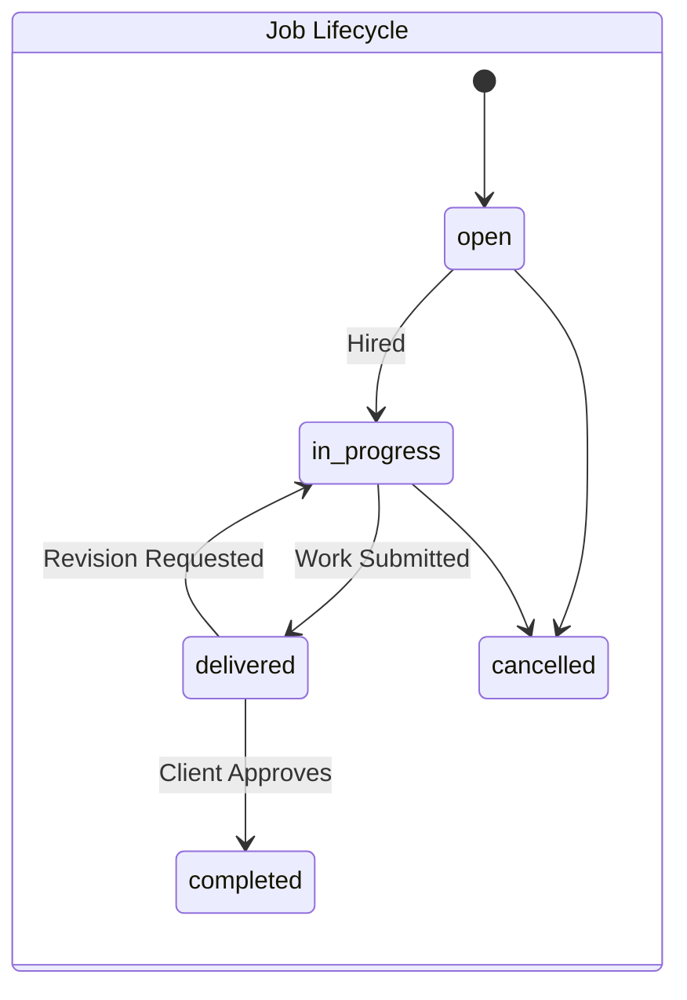
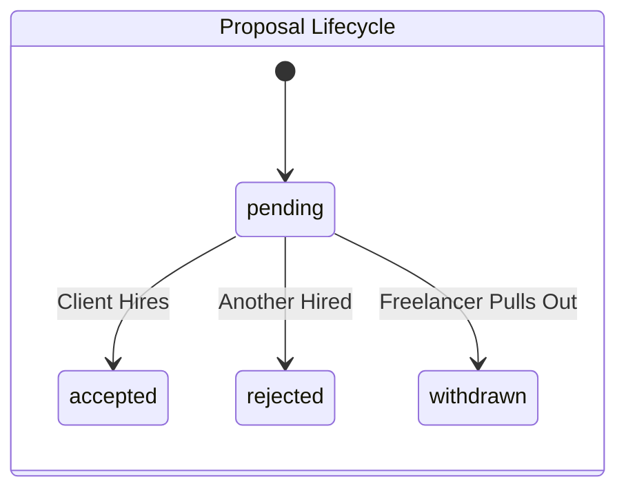

# Complete User Flows & Business Logic

This document serves as the master business blueprint for the SkillKart marketplace. It details the complete journey, logic, and state management for every type of user interacting with the platform. Every feature described here is currently fully functional in the backend and frontend.

---

## 1. Platform Overview

- **What SkillKart is:** A secure, dual-sided digital marketplace connecting skilled freelancers with clients seeking on-demand talent.
- **Marketplace Type:** B2B / B2C Service Marketplace. It operates on a hybrid model supporting both Custom Job Postings (Upwork model) and pre-packaged Gigs (Fiverr model).
- **Business Model:** Commission-based. The platform charges a variable percentage fee (default 10%) on all successfully completed contracts, deducted from the freelancer's final payout upon Escrow release.
- **Core Objectives:**
  - Facilitate trustworthy connections through skill verification.
  - Guarantee payment security via an Escrow funding model.
  - Streamline the negotiation, delivery, and approval lifecycle into rigid, predictable state machines.
- **Supported Workflows:** Custom Job Contracts, Pre-Packaged Gig Purchases, Wallet Funding & Withdrawals, Asynchronous Messaging, and 2FA Security.

---

## 2. User Personas

### Guest
- **Goals:** Understand the platform, assess available talent/jobs, and decide whether to register.
- **Permissions:** Can browse public freelancer profiles, view active Gigs, read open Job descriptions, and use the search engine.
- **Restrictions:** Cannot apply to jobs, purchase gigs, view private attachments, message users, or see contract history.
- **Typical Journey:** Lands on homepage → Views public listings → Uses search filters → Reaches Registration wall.

### Freelancer
- **Goals:** Find work, sell pre-packaged services, build a reputation, and earn money safely.
- **Permissions:** Can create a profile, upload a CV, post Gigs, submit Proposals to open jobs, save jobs to their profile, message contracted clients, change passwords, enable/disable 2FA, and request wallet withdrawals.
- **Restrictions:** Cannot post jobs, hire others, or message clients without an active proposal/contract (prevents spam). Must pass automated skill tests before posting Gigs matching those categories.
- **Typical Journey:** Registers → Verifies email → Completes onboarding → Passes skill tests → Creates Gigs / Saves & Browses Jobs → Submits Proposals → Negotiates via chat → Delivers work → Earns funds → Withdraws to external account.

### Client
- **Goals:** Hire vetted talent quickly, ensure funds are protected until work is satisfactory, and manage projects.
- **Permissions:** Can post jobs, review proposals, purchase Gigs, fund Escrow via Stripe, request revisions, release payments, change passwords, and toggle 2FA.
- **Restrictions:** Cannot submit proposals, withdraw funds (can only receive refunds), or view other clients' private data.
- **Typical Journey:** Registers → Verifies email → Creates Company Profile → Posts a Job → Reviews incoming proposals → Hires a freelancer → Pays Escrow deposit → Communicates requirements → Reviews delivered work → Approves work (releases funds).

---

## 3. Complete User Journey (Macro Level)

Guest 
↓ *Views Platform*
Registration (Selects Role)
↓ *Security Check*
Email OTP Verification
↓ *Data Collection*
Onboarding & Profile Setup
↓ *Discovery*
Client Posts Job / Freelancer Searches & Saves Jobs
↓ *Connection*
Freelancer Submits Proposal
↓ *Evaluation*
Client Reviews & Accepts Proposal
↓ *Commitment*
Client Funds Escrow (Stripe Checkout)
↓ *Execution*
Freelancer works & communicates via Messaging
↓ *Submission*
Freelancer Delivers Work (Links/Files)
↓ *Review*
Client Reviews Delivery
↓ *Alternative Flow: Client Requests Revision → Freelancer re-delivers*
Client Approves Work
↓ *Financial Transfer*
Escrow Released to Freelancer Wallet
↓ *Closure*
Both Parties Submit Reviews
↓ *Extraction*
Freelancer Requests Withdrawal

---

## 4. Freelancer Journey (Micro Level)

1. **Registration:** Inputs email/password or utilizes OAuth (via Supabase). DB creates `User` (`role: freelancer`).
2. **Email Verification:** System emails a 6-digit OTP. DB sets `isEmailVerified = true`.
3. **Onboarding:** User selects skills, languages, hourly rate, and location. DB creates `FreelancerProfile`.
4. **Profile Setup & Security:** 
   - **Avatar & CV Upload:** Uploads files. Proxied securely through Cloudinary middleware.
   - **Portfolio:** Adds past project links/images.
   - **Security:** Toggles Two-Factor Authentication (2FA) or updates password.
5. **Skill Verification:** Takes a multiple-choice quiz. If passed, the skill is flagged as `verified` on their profile.
6. **Browsing Jobs:** Uses filters (category, budget, experience level) to query `status: open` jobs. Can save jobs to their profile via the `/saved-jobs` endpoint.
7. **Applying:** Submits a cover letter and rate. Backend blocks duplicate applications to the same job. Proposal created as `pending`.
8. **Hiring Notification:** Client accepts. Proposal changes to `accepted`.
9. **Working:** Freelancer receives `Escrow Funded` notification. It is now safe to begin work.
10. **Messaging:** Chat channel opens via the active contract.
11. **Delivery:** Freelancer clicks "Deliver Work". Job state shifts to `delivered`.
12. **Revisions:** Client may reject the delivery. State shifts back to `in-progress`. Freelancer must re-deliver.
13. **Approval:** Client approves. Backend deducts platform fee, and adds net amount to `FreelancerProfile.walletBalance`.
14. **Withdrawal:** Freelancer requests payout. DB creates a `Withdrawal` request, and deducts the balance immediately.
15. **Reviews:** Leaves a 1-5 star rating for the client.

---

## 5. Client Journey (Micro Level)

1. **Registration & Verification:** Same base flow as Freelancer.
2. **Company Onboarding:** Inputs Company Name, Industry, and Size. DB creates `ClientProfile`.
3. **Security:** Toggles 2FA or changes password.
4. **Create Job:** Fills out title, budget, category. State published as `open`.
5. **Editing Jobs:** Can edit jobs only if they remain `open`.
6. **Reviewing Proposals:** Views applications. Strict IDOR protection ensures clients only see their own job proposals.
7. **Hiring:** Accepts proposal. Job `hiredFreelancer` is set, state shifts to `in-progress`. All competing proposals are automatically marked `rejected`.
8. **Escrow Funding:** Redirected to Stripe Checkout. Webhook updates `Payment.status = deposit_paid`.
9. **Messaging:** Chats with hired freelancer.
10. **Delivery Review:** Job shifts to `delivered`.
11. **Approving Work:** Approves delivery, releasing Escrow. Job state shifts to `completed`.
12. **Reviews:** Rates the freelancer, influencing their aggregate profile score.

*(Note: Clients cannot arbitrarily cancel jobs that have already been `delivered` to prevent work-theft).*

---

## 6. Gig Marketplace Flow

Freelancer Creates Gig
↓ *Defines Basic, Standard, and Premium packages (price, delivery time, revisions)*
Skill Gating
↓ *Backend verifies the freelancer has passed tests for the gig's required skills. Blocks publication if unverified.*
Publish (State: `active`)
↓
Client Browses & Filters Gigs
↓ 
Orders Package
↓ *Selects Tier (e.g. "Standard for $50")*
Job Conversion
↓ *Backend instantly creates a `Job` (source = 'gig') locked to the Tier pricing. Skips the Proposal phase entirely.*
Escrow Funding
↓ *Client pays deposit via Stripe.*
Work & Delivery Lifecycle
↓ *Follows identical lifecycle to standard custom jobs.*

---

## 7. Authentication & Security Flow

- **Registration:** Passwords hashed via Bcrypt (12 rounds).
- **Bot Screening:** Login, registration, and the public contact/newsletter forms are screened by Google reCAPTCHA v3 before any handler runs. It is invisible — legitimate users see no challenge and no extra step in the flows above.
- **OTP Verification:** 6-digit codes stored temporarily, delivered by email (Gmail API in production, SMTP locally).
- **Login:** Returns stateless JWTs.
- **Two-Factor Authentication (2FA):** Optional. If enabled, Login requires a secondary OTP sent to the verified email.
- **Refresh Token Flow:** Access token expires (e.g., 15m). The frontend silently hits `/auth/refresh` with the stored refresh token to mint a new one. Marketplace tokens are held in browser storage and sent as `Authorization: Bearer` headers; the **admin panel** is separate, using an HTTP-only `admin_token` cookie (`SameSite=None; Secure` in production, since the SPA and API are on different domains).
- **Password Updates:** Fully supported via `changePassword` endpoints.
- **File Uploads:** Memory buffer whitelisting strictly prevents payload manipulation before syncing to Cloudinary.

---

## 8. Messaging Flow

- **Permissions:** Gated. You cannot message users without an active connection (e.g., pending proposal, active contract).
- **Delivery:** Currently relies on RESTful polling. The frontend fetches `/messages/conversation/:id` periodically.
- **Limitations:** No true real-time WebSockets. No read receipts.

---

## 9. Wallet & Payment Flow

- **Stripe Checkout:** Hosts the payment session. Injects custom metadata (`userId`, `jobId`).
- **Escrow Integrity:** Managed entirely by async Webhooks (`stripe.webhook.js`).
- **Idempotency:** Replay attacks are blocked via the `processedSessions` array. 
- **Refunds:** If an `in-progress` contract cancels, the Escrow is deposited into the Client's `walletBalance`.
- **Withdrawals:** Freelancer requests payout. The internal `walletBalance` is immediately deducted, queueing a `Withdrawal` database record for manual admin processing.

---

## 10. Marketplace State Machines

---

## 11. Feature Matrix

This matrix is the definitive source of truth for the platform's current capabilities.

### Fully Implemented
- **Registration & Login** (Email/Password, Supabase OAuth)
- **OTP Email Verification**
- **Two-Factor Authentication (2FA)**
- **Password Change / Reset**
- **Role-Based Profiles** (Client, Freelancer)
- **Skill Gating & Assessments**
- **Custom Job Postings**
- **Job Proposal Submission & Bidding**
- **Gig Creation with Tiered Packages** (Basic, Standard, Premium)
- **Gig Ordering (Direct Purchase)**
- **Saved Jobs** (Freelancers can bookmark jobs)
- **Secure File Uploads** (Cloudinary Integration)
- **Stripe Checkout Escrow Funding**
- **Idempotency Payment Protection**
- **Delivery & Revision Cycles**
- **Payment Release & Internal Wallet Ledgers**
- **Withdrawal Requests**
- **In-App Notifications**
- **Job & Freelancer Search / Filtering**
- **Mutual Review & Rating System**

### Partially Implemented
- **Messaging:** Functional, but relies on RESTful interval polling rather than true WebSockets.
- **Refunds:** If a job cancels, funds go to the client's internal `walletBalance` rather than automatically refunding to their credit card via Stripe API.

### Planned (Future Enhancements)
- **Automated Payouts:** Using Stripe Connect to auto-route freelancer withdrawals to their bank without Admin intervention.
- **Admin Dashboard UI:** For processing manual withdrawals, resolving disputes, and moderating users.
- **Real-Time WebSockets:** Upgrading chat to Socket.io.
- **Multi-Milestone Contracts:** Breaking single jobs into phased payments.

### Not Implemented (Missing Features)
- **Account Deletion:** Users cannot delete their accounts programmatically.
- **Identity Verification (KYC):** No passport/ID verification integration (e.g., Onfido).
- **Automated Dispute Mediation Center:** Clients/freelancers cannot automatically freeze contracts to summon a mediator.
- **Wishlists:** Clients cannot "save" freelancers or gigs for later.
- **Email Change Verification:** Changing email addresses is restricted.
