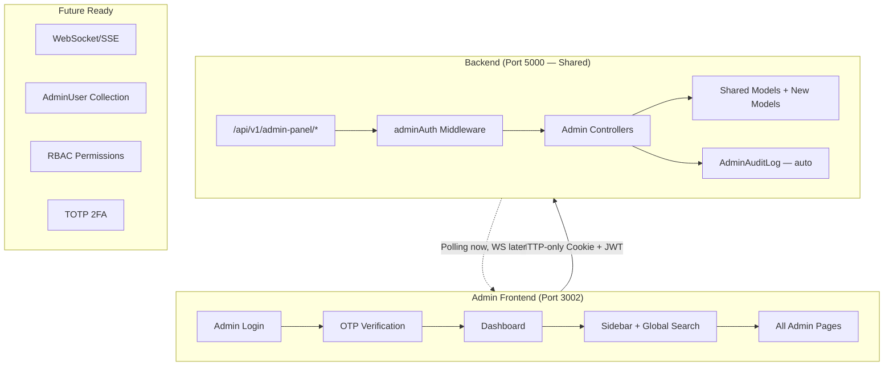

# SkillKart Admin Panel — Complete Implementation Plan (v2)

> **Scope**: A production-ready, enterprise-grade Admin Panel that is fully separate from the Client/Freelancer UIs, with its own authentication, layout, routing, permissions, and backend APIs.

---

## Decisions (Based on Your Answers)

| Question | Answer |
|----------|--------|
| Password storage | Bcrypt hash stored directly in `.env`; backend compares with `bcrypt.compare()` |
| Multi-admin | Single-admin now via `.env`; architecture designed for easy migration to `AdminUser` DB collection later |
| Chart library | `Chart.js` via `react-chartjs-2` |
| Admin Panel port | `localhost:3002` |

---

## Architecture Overview



### Key Architectural Decisions

| Decision | Choice | Rationale |
|----------|--------|-----------|
| Frontend | **Separate Vite app** at `Admin-Panel/` on port 3002 | Complete isolation; independent builds; no risk to marketplace |
| Backend | **Shared Express server**, new prefix `/api/v1/admin-panel/` | Reuses DB, models, services; no infra duplication |
| Auth | **Separate JWT** (own secret, issuer `skillkart-admin`, audience `admin-panel`) | Token cross-use prevention |
| Auth delivery | **HTTP-only secure cookie** + Bearer token support | XSS-resistant; cookies for browser, Bearer for API tools |
| Admin credentials | **`.env` bcrypt hash** | No DB user row; easy to rotate; future: migrate to `AdminUser` collection |
| OTP | **Reuse existing `otp.service.js`** | Already handles generation, hashing, expiry, email |
| Charts | **Chart.js** via `react-chartjs-2` | Lightweight, well-documented, meets all chart needs |
| State mgmt | **React Context** | Consistent with existing codebase |
| Styling | **Vanilla CSS** dark theme | Matches project conventions; premium admin aesthetic |
| Audit logging | **Automatic via helper** | Every controller action calls `auditLog()` before responding |
| Soft deletes | **`deletedAt` field** on all destructible entities | Business data is never permanently lost |
| Real-time | **Polling (30s)** now; architecture allows WebSocket/SSE later | Pragmatic for V1; event emitter pattern ready for upgrade |
| Exports | **CSV + Excel + PDF** via `json2csv`, `exceljs`, `pdfkit` | Server-side generation; streamed to client |

---

## Phase 1 — Database Changes

### 1.1 New Models

#### [NEW] `Backend/src/models/AdminSession.js`

```js
{
  email:         String (required, indexed),
  tokenHash:     String (required),              // SHA-256 of the JWT
  ipAddress:     String,
  userAgent:     String,
  loginAt:       Date (default: now),
  expiresAt:     Date (required, indexed),
  isActive:      Boolean (default: true, indexed),
  logoutAt:      Date,
  logoutReason:  String                          // 'manual', 'expired', 'forced'
}
// TTL index on expiresAt to auto-cleanup expired sessions
```

#### [NEW] `Backend/src/models/AdminAuditLog.js`

```js
{
  adminEmail:    String (required, indexed),
  action:        String (required, indexed),      // e.g. 'user.suspend', 'dispute.resolve'
  category:      String (enum: ['auth','user','job','contract','dispute','payment',
                   'wallet','withdrawal','review','report','notification','settings',
                   'chat','analytics'], indexed),
  resource:      String (required),               // e.g. 'User', 'Contract', 'Payment'
  resourceId:    ObjectId,
  previousValue: Mixed,
  newValue:      Mixed,
  ipAddress:     String,
  userAgent:     String,
  notes:         String,
  severity:      String (enum: ['info','warning','critical'], default: 'info'),
  timestamps:    true
}
// Compound index: { adminEmail: 1, createdAt: -1 }
// Compound index: { category: 1, createdAt: -1 }
```

#### [NEW] `Backend/src/models/Report.js`

```js
{
  reportedBy:    ObjectId (ref: User, required, indexed),
  reportedUser:  ObjectId (ref: User, indexed),
  reportedItem:  {
    type: String (enum: ['review','message','job','gig','profile','other']),
    id: ObjectId
  },
  category:      String (enum: ['spam','abuse','fraud','harassment','inappropriate','other']),
  description:   String (required),
  evidence:      [String],                        // URLs to screenshots/files
  priority:      String (enum: ['low','medium','high','critical'], default: 'medium'),
  status:        String (enum: ['pending','investigating','resolved','dismissed'], default: 'pending'),
  assignedTo:    String,                          // Admin email
  resolution:    String,
  resolvedBy:    String,                          // Admin email
  resolvedAt:    Date,
  timestamps:    true
}
```

#### [NEW] `Backend/src/models/SystemSettings.js`

```js
{
  key:           String (unique, required, indexed),
  value:         Mixed (required),
  category:      String (enum: ['fees','security','email','features','general','maintenance']),
  description:   String,
  valueType:     String (enum: ['string','number','boolean','json']),
  lastUpdatedBy: String,                          // Admin email
  timestamps:    true
}
// Seeded with defaults on first admin login:
// { key: 'platform_fee_rate', value: 0.005, category: 'fees' }
// { key: 'maintenance_mode', value: false, category: 'maintenance' }
// { key: 'max_login_attempts', value: 5, category: 'security' }
// { key: 'otp_expiry_minutes', value: 10, category: 'security' }
// { key: 'enable_email_notifications', value: true, category: 'features' }
// { key: 'enable_ai_features', value: true, category: 'features' }
```

### 1.2 Schema Modifications to Existing Models

#### [MODIFY] `Backend/src/models/User.js`
```diff
+ suspendedAt:      Date,
+ suspendedReason:  String,
+ suspendedBy:      String,                       // Admin email
+ deletedAt:        Date,                         // Soft delete
+ deletedBy:        String,                       // Admin email
```

#### [MODIFY] `Backend/src/models/Review.js`
```diff
+ isHidden:         { type: Boolean, default: false },
+ hiddenBy:         String,                       // Admin email
+ hiddenAt:         Date,
+ hiddenReason:     String,
```

#### [MODIFY] `Backend/src/models/FreelancerProfile.js`
```diff
+ isFrozenWallet:   { type: Boolean, default: false },
+ walletFrozenBy:   String,                       // Admin email
+ walletFrozenAt:   Date,
+ walletFrozenReason: String,
```

#### [MODIFY] `Backend/src/models/ClientProfile.js`
```diff
+ isFrozenWallet:   { type: Boolean, default: false },
+ walletFrozenBy:   String,
+ walletFrozenAt:   Date,
+ walletFrozenReason: String,
```

---

## Phase 2 — Backend Architecture

### 2.1 Environment Variables

#### [MODIFY] `Backend/.env`
```env
# =======================
# Admin Panel Configuration
# =======================
ADMIN_EMAIL=hassansiddiqui2k4@gmail.com
ADMIN_PASSWORD_HASH=$2a$12$xxxxxxxxxxxxxxxxxxxxxxxxxxxxxxxxxxxxxxxxxxxxxxxxxxxxxxxx
ADMIN_SESSION_TIMEOUT=30m
ADMIN_OTP_EXPIRY=10m
ADMIN_JWT_SECRET=a_completely_separate_64_char_secret_key_not_shared_with_marketplace
ADMIN_PANEL_URL=http://localhost:3002
```

#### [MODIFY] `Backend/src/config/index.js`
```diff
+ adminPanel: {
+   email: process.env.ADMIN_EMAIL,
+   passwordHash: process.env.ADMIN_PASSWORD_HASH,
+   sessionTimeout: process.env.ADMIN_SESSION_TIMEOUT || '30m',
+   otpExpiry: process.env.ADMIN_OTP_EXPIRY || '10m',
+   jwtSecret: process.env.ADMIN_JWT_SECRET,
+   panelUrl: process.env.ADMIN_PANEL_URL || 'http://localhost:3002'
+ }
```

#### [MODIFY] `Backend/src/app.js`
```diff
  // CORS — add admin panel origin
  const allowedOrigins = [
    config.cors.origin,
    config.frontend.url,
    'http://localhost:3000',
    'http://localhost:3001',
+   config.adminPanel.panelUrl || 'http://localhost:3002'
  ];

  // Mount admin panel routes
+ const adminPanelRoutes = require('./routes/adminPanel.routes');
+ app.use(`${API_PREFIX}/admin-panel`, adminPanelRoutes);
```

### 2.2 Admin Auth Middleware

#### [NEW] `Backend/src/middleware/adminAuth.middleware.js`

Completely separate from marketplace auth. Uses its own JWT secret, issuer, and audience.

```
authenticateAdmin(req, res, next)
  → Extracts token from HTTP-only cookie OR Authorization header
  → Verifies with ADMIN_JWT_SECRET (issuer: 'skillkart-admin', audience: 'admin-panel')
  → Looks up AdminSession by tokenHash — confirms isActive + not expired
  → Attaches req.admin = { email, sessionId, ipAddress }
  → Rejects if session expired → 401 with code 'SESSION_EXPIRED'
```

#### [NEW] `Backend/src/middleware/adminRateLimit.middleware.js`

```
adminLoginLimiter:   5 attempts / 15 minutes / IP
adminOtpLimiter:     3 OTP requests / 10 minutes / IP
adminApiLimiter:     100 requests / 1 minute / session (generous but bounded)
```

### 2.3 Audit Log Helper

#### [NEW] `Backend/src/utils/adminAudit.js`

A utility function called by every admin controller action:

```js
const auditLog = async (req, { action, category, resource, resourceId, previousValue, newValue, notes, severity }) => {
  await AdminAuditLog.create({
    adminEmail: req.admin.email,
    action,
    category,
    resource,
    resourceId,
    previousValue,
    newValue,
    ipAddress: req.ip,
    userAgent: req.get('User-Agent'),
    notes,
    severity: severity || 'info'
  });
};
```

### 2.4 Export Helper

#### [NEW] `Backend/src/utils/exportHelper.js`

Server-side export generation:

```
exportToCSV(data, columns)    → Returns CSV buffer (using json2csv)
exportToExcel(data, columns)  → Returns XLSX buffer (using exceljs)
exportToPDF(data, columns)    → Returns PDF buffer (using pdfkit + pdfkit-table)
```

### 2.5 Admin Controllers

All controllers live under `Backend/src/controllers/adminPanel/` to avoid collision with existing `admin.controller.js`.

#### [NEW] `adminPanel/auth.controller.js`

| Endpoint | Method | Description |
|----------|--------|-------------|
| `/login` | POST | Validates email + `bcrypt.compare(password, ADMIN_PASSWORD_HASH)` → sends OTP |
| `/verify-otp` | POST | Verifies OTP → creates AdminSession → returns JWT in HTTP-only cookie |
| `/logout` | POST | Invalidates AdminSession, clears cookie |
| `/session` | GET | Returns current session info (email, loginAt, expiresAt) |

#### [NEW] `adminPanel/dashboard.controller.js`

| Endpoint | Method | Description |
|----------|--------|-------------|
| `/stats` | GET | Full platform stats (see widget list below) |
| `/today` | GET | Today's quick-overview widgets |
| `/recent-activity` | GET | Last 50 audit log entries |
| `/growth` | GET | Daily/Weekly/Monthly growth data for charts |
| `/health` | GET | Platform health (DB status, Redis status, uptime, memory) |

**Dashboard Quick-Overview Widgets:**

| Widget | Data Source |
|--------|------------|
| Online Users | `User.countDocuments({ lastActive: { $gte: 5min_ago } })` |
| Users Registered Today | `User.countDocuments({ createdAt: { $gte: today_start } })` |
| Jobs Posted Today | `Job.countDocuments({ createdAt: { $gte: today_start } })` |
| Contracts Started Today | `Contract.countDocuments({ startedAt: { $gte: today_start } })` |
| Contracts Completed Today | `Contract.countDocuments({ completedAt: { $gte: today_start } })` |
| Payments Processed Today | `Payment.countDocuments({ updatedAt: { $gte: today_start }, status: 'released' })` |
| Withdrawals Requested Today | `Withdrawal.countDocuments({ createdAt: { $gte: today_start } })` |
| Active Disputes | `Contract.countDocuments({ 'dispute.status': 'pending' })` |
| Pending Approvals | Pending withdrawals + pending end requests + pending reports |
| Platform Health | DB connected, Redis connected, uptime, memory usage |

**Dashboard Summary Cards:**

| Card | Aggregation |
|------|-------------|
| Total Users | `User.countDocuments({ deletedAt: null })` |
| Total Clients | `User.countDocuments({ role: 'client', deletedAt: null })` |
| Total Freelancers | `User.countDocuments({ role: 'freelancer', deletedAt: null })` |
| Active Contracts | `Contract.countDocuments({ status: 'active' })` |
| Completed Contracts | `Contract.countDocuments({ status: 'completed' })` |
| Cancelled Contracts | `Contract.countDocuments({ status: 'cancelled' })` |
| Under Review | `Contract.countDocuments({ status: 'under_review' })` |
| Total Jobs | `Job.countDocuments()` |
| Active Jobs | `Job.countDocuments({ status: { $in: ['open', 'in-progress'] } })` |
| Closed Jobs | `Job.countDocuments({ status: { $in: ['completed', 'closed', 'cancelled'] } })` |
| Total Payments | `Payment.countDocuments()` |
| Total Escrow Balance | `Payment.aggregate([{ $match: { status: { $in: ['deposit_paid', 'escrow_funded'] } } }, { $group: { _id: null, total: { $sum: '$depositAmount' } } }])` |
| Platform Revenue | `Payment.aggregate([{ $group: { _id: null, total: { $sum: '$platformFee' } } }])` |
| Pending Withdrawals | `Withdrawal.countDocuments({ status: 'pending' })` |
| Completed Withdrawals | `Withdrawal.countDocuments({ status: 'completed' })` |
| Failed Payments | `Payment.countDocuments({ status: 'refunded' })` |
| Open Disputes | `Contract.countDocuments({ 'dispute.status': 'pending' })` |
| Resolved Disputes | `Contract.countDocuments({ 'dispute.status': 'resolved' })` |
| Total Messages | `Message.countDocuments()` |

#### [NEW] `adminPanel/search.controller.js`

| Endpoint | Method | Description |
|----------|--------|-------------|
| `/global` | GET | Global search across Users, Jobs, Contracts, Payments, Transactions, Wallets, Disputes, Reviews, Reports |

Query parameter: `?q=searchterm&types=users,jobs,contracts`

Returns max 5 results per entity type with:
- Entity type label
- Primary identifier (name, title, ID)
- Link to admin detail page
- Status badge

#### [NEW] `adminPanel/users.controller.js`

| Endpoint | Method | Description |
|----------|--------|-------------|
| `/` | GET | Paginated users with advanced filters + export |
| `/:id` | GET | Full user detail (profile, contracts, jobs, payments, wallet, disputes, reports, activity) |
| `/:id` | PATCH | Edit user fields |
| `/:id/suspend` | PATCH | Suspend user (sets `isBlocked`, `suspendedAt`, `suspendedReason`) + audit log |
| `/:id/unsuspend` | PATCH | Unsuspend user + audit log |
| `/:id/delete` | DELETE | Soft-delete user (sets `deletedAt`) + audit log |
| `/:id/reset-password` | POST | Force password reset + audit log |
| `/:id/login-history` | GET | Login timestamps from metadata |
| `/:id/contracts` | GET | User's contracts |
| `/:id/jobs` | GET | User's jobs |
| `/:id/payments` | GET | User's payments |
| `/:id/wallet` | GET | User's wallet details |
| `/:id/disputes` | GET | User's disputes |
| `/:id/reports` | GET | Reports filed by/against user |
| `/:id/activity` | GET | Audit log entries related to user |
| `/export` | GET | Export filtered user list (CSV/Excel/PDF) |

**Advanced Filters**: `?search=&role=&status=&isBlocked=&dateFrom=&dateTo=&sortBy=&order=&page=&limit=`

#### [NEW] `adminPanel/jobs.controller.js`

| Endpoint | Method | Description |
|----------|--------|-------------|
| `/` | GET | All jobs with advanced filters + export |
| `/:id` | GET | Job detail with applicants, hired freelancer, contract |
| `/:id` | PATCH | Edit job (title, description, status) + audit log |
| `/:id` | DELETE | Soft-delete job + audit log |
| `/:id/close` | PATCH | Close job + audit log |
| `/:id/reopen` | PATCH | Reopen job + audit log |
| `/export` | GET | Export filtered jobs list |

**Advanced Filters**: `?search=&status=&type=&category=&clientId=&dateFrom=&dateTo=&budgetMin=&budgetMax=&page=&limit=`

#### [NEW] `adminPanel/contracts.controller.js`

| Endpoint | Method | Description |
|----------|--------|-------------|
| `/` | GET | All contracts with advanced filters + export |
| `/:id` | GET | Contract detail with history, time logs, payments, end requests, disputes |
| `/:id/notes` | POST | Add admin notes (stored in ContractHistory) + audit log |
| `/export` | GET | Export filtered contracts list |

**Advanced Filters**: `?search=&status=&type=&clientId=&freelancerId=&dateFrom=&dateTo=&page=&limit=`

#### [NEW] `adminPanel/disputes.controller.js`

| Endpoint | Method | Description |
|----------|--------|-------------|
| `/` | GET | All disputes with filters (pending, under_review, resolved) |
| `/:contractId` | GET | Dispute detail with evidence, messages, work logs, payment history |
| `/:contractId/resolve` | POST | Resolve dispute + audit log |

Resolve actions:
| Action | Effect |
|--------|--------|
| `release_freelancer` | Release full escrow to freelancer |
| `refund_client` | Refund full amount to client |
| `split` | Split payment (custom percentages) |
| `resume` | Resume contract, mark dispute as resolved |
| `reject` | Reject dispute, keep current state |

> [!CAUTION]
> Every dispute resolution creates an `AdminAuditLog` with severity `critical`, recording admin email, timestamp, action, previous/new payment values, and admin notes.

#### [NEW] `adminPanel/payments.controller.js`

| Endpoint | Method | Description |
|----------|--------|-------------|
| `/` | GET | All payments with advanced filters + export |
| `/:id` | GET | Payment detail (Stripe info, user, contract, amount, fees, timeline) |
| `/summary` | GET | Platform revenue, total escrow, total released, total refunded |
| `/export` | GET | Export filtered payments list |

**Advanced Filters**: `?status=&type=&clientId=&freelancerId=&amountMin=&amountMax=&dateFrom=&dateTo=&page=&limit=`

#### [NEW] `adminPanel/wallets.controller.js`

| Endpoint | Method | Description |
|----------|--------|-------------|
| `/` | GET | All wallets (freelancer + client profiles with balance > 0) |
| `/:userId` | GET | Wallet detail (current balance, pending, deposit history, withdrawal history) |
| `/:userId/adjust` | POST | Adjust balance (mandatory `reason` + `notes`) + audit log (severity: critical) |
| `/:userId/freeze` | PATCH | Freeze wallet + audit log |
| `/:userId/unfreeze` | PATCH | Unfreeze wallet + audit log |

#### [NEW] `adminPanel/withdrawals.controller.js`

| Endpoint | Method | Description |
|----------|--------|-------------|
| `/` | GET | All withdrawals with advanced filters + export |
| `/:id/approve` | PATCH | Approve + audit log |
| `/:id/reject` | PATCH | Reject (with reason) + audit log |
| `/:id/processing` | PATCH | Mark processing + audit log |
| `/:id/complete` | PATCH | Mark completed + audit log |
| `/export` | GET | Export filtered withdrawals |

#### [NEW] `adminPanel/transactions.controller.js`

| Endpoint | Method | Description |
|----------|--------|-------------|
| `/` | GET | Unified view: payments + withdrawals + wallet adjustments |
| `/export` | GET | Export (CSV/Excel/PDF) |

**Advanced Filters**: `?type=&userId=&amountMin=&amountMax=&dateFrom=&dateTo=&status=&page=&limit=`

#### [NEW] `adminPanel/chat.controller.js`

| Endpoint | Method | Description |
|----------|--------|-------------|
| `/conversations` | GET | All conversations with search (participant name) |
| `/conversations/:id` | GET | Conversation detail (participants, message count, last activity) |
| `/conversations/:id/messages` | GET | Paginated messages (read-only, with attachments) |

> [!CAUTION]
> Admin can only VIEW chats for moderation. No impersonation, no sending messages as users.

#### [NEW] `adminPanel/reviews.controller.js`

| Endpoint | Method | Description |
|----------|--------|-------------|
| `/` | GET | All reviews with filters + export |
| `/:id/hide` | PATCH | Hide abusive review + audit log |
| `/:id/restore` | PATCH | Restore hidden review + audit log |
| `/:id` | DELETE | Soft-delete review (set `isHidden` permanently) + audit log |
| `/reported` | GET | Reviews that have associated reports |

#### [NEW] `adminPanel/notifications.controller.js`

| Endpoint | Method | Description |
|----------|--------|-------------|
| `/broadcast` | POST | Send system notification to all users / specific role / specific user |
| `/history` | GET | Broadcast notification history |

#### [NEW] `adminPanel/reports.controller.js`

| Endpoint | Method | Description |
|----------|--------|-------------|
| `/` | GET | All reports with advanced filters |
| `/:id` | GET | Report detail |
| `/:id/assign` | PATCH | Assign to admin + audit log |
| `/:id/investigate` | PATCH | Mark as investigating + audit log |
| `/:id/resolve` | PATCH | Resolve report (with resolution notes) + audit log |
| `/:id/dismiss` | PATCH | Dismiss report (with reason) + audit log |
| `/export` | GET | Export filtered reports |

#### [NEW] `adminPanel/auditLogs.controller.js`

| Endpoint | Method | Description |
|----------|--------|-------------|
| `/` | GET | Paginated audit logs with advanced filters |
| `/export` | GET | Export (CSV/Excel/PDF) |

**Advanced Filters**: `?adminEmail=&action=&category=&severity=&resourceId=&dateFrom=&dateTo=&page=&limit=`

#### [NEW] `adminPanel/settings.controller.js`

| Endpoint | Method | Description |
|----------|--------|-------------|
| `/` | GET | All system settings grouped by category |
| `/:key` | PUT | Update a setting + audit log |
| `/maintenance` | POST | Toggle maintenance mode + audit log (severity: critical) |
| `/seed` | POST | Seed default settings if not present |

#### [NEW] `adminPanel/analytics.controller.js`

| Endpoint | Method | Description |
|----------|--------|-------------|
| `/revenue` | GET | Revenue over time (daily/weekly/monthly) |
| `/users` | GET | User registration growth |
| `/jobs` | GET | Jobs posted over time |
| `/contracts` | GET | Contract lifecycle analytics |
| `/payments` | GET | Payment volume & status distribution |
| `/withdrawals` | GET | Withdrawal trends |
| `/geographic` | GET | User distribution by country/city |
| `/freelancer-earnings` | GET | Top freelancer earnings |
| `/client-spending` | GET | Top client spending |
| `/platform-growth` | GET | Combined growth metrics |

Query params: `?period=daily|weekly|monthly&dateFrom=&dateTo=`

### 2.6 Route File

#### [NEW] `Backend/src/routes/adminPanel.routes.js`

```
Auth (public — no admin JWT required):
  POST   /auth/login
  POST   /auth/verify-otp

Auth (protected):
  POST   /auth/logout
  GET    /auth/session

All routes below require authenticateAdmin middleware:

Dashboard:
  GET    /dashboard/stats
  GET    /dashboard/today
  GET    /dashboard/recent-activity
  GET    /dashboard/growth
  GET    /dashboard/health

Global Search:
  GET    /search/global?q=&types=

Users:
  GET    /users
  GET    /users/export
  GET    /users/:id
  PATCH  /users/:id
  PATCH  /users/:id/suspend
  PATCH  /users/:id/unsuspend
  DELETE /users/:id/delete
  POST   /users/:id/reset-password
  GET    /users/:id/login-history
  GET    /users/:id/contracts
  GET    /users/:id/jobs
  GET    /users/:id/payments
  GET    /users/:id/wallet
  GET    /users/:id/disputes
  GET    /users/:id/reports
  GET    /users/:id/activity

Jobs:
  GET    /jobs
  GET    /jobs/export
  GET    /jobs/:id
  PATCH  /jobs/:id
  DELETE /jobs/:id
  PATCH  /jobs/:id/close
  PATCH  /jobs/:id/reopen

Contracts:
  GET    /contracts
  GET    /contracts/export
  GET    /contracts/:id
  POST   /contracts/:id/notes

Disputes:
  GET    /disputes
  GET    /disputes/:contractId
  POST   /disputes/:contractId/resolve

Payments:
  GET    /payments
  GET    /payments/export
  GET    /payments/:id
  GET    /payments/summary

Wallets:
  GET    /wallets
  GET    /wallets/:userId
  POST   /wallets/:userId/adjust
  PATCH  /wallets/:userId/freeze
  PATCH  /wallets/:userId/unfreeze

Withdrawals:
  GET    /withdrawals
  GET    /withdrawals/export
  PATCH  /withdrawals/:id/approve
  PATCH  /withdrawals/:id/reject
  PATCH  /withdrawals/:id/processing
  PATCH  /withdrawals/:id/complete

Transactions:
  GET    /transactions
  GET    /transactions/export

Chat:
  GET    /chat/conversations
  GET    /chat/conversations/:id
  GET    /chat/conversations/:id/messages

Reviews:
  GET    /reviews
  GET    /reviews/reported
  PATCH  /reviews/:id/hide
  PATCH  /reviews/:id/restore
  DELETE /reviews/:id

Notifications:
  POST   /notifications/broadcast
  GET    /notifications/history

Reports:
  GET    /reports
  GET    /reports/export
  GET    /reports/:id
  PATCH  /reports/:id/assign
  PATCH  /reports/:id/investigate
  PATCH  /reports/:id/resolve
  PATCH  /reports/:id/dismiss

Audit Logs:
  GET    /audit-logs
  GET    /audit-logs/export

Settings:
  GET    /settings
  PUT    /settings/:key
  POST   /settings/maintenance
  POST   /settings/seed

Analytics:
  GET    /analytics/revenue
  GET    /analytics/users
  GET    /analytics/jobs
  GET    /analytics/contracts
  GET    /analytics/payments
  GET    /analytics/withdrawals
  GET    /analytics/geographic
  GET    /analytics/freelancer-earnings
  GET    /analytics/client-spending
  GET    /analytics/platform-growth
```

---

## Phase 3 — Admin Panel Frontend

### 3.1 Project Setup

#### [NEW] `Admin-Panel/` — Separate Vite + React app (port 3002)

```
Admin-Panel/
├── index.html
├── package.json                      # react, react-router-dom, axios, chart.js,
│                                     #   react-chartjs-2, lucide-react, react-toastify
├── vite.config.js
├── src/
│   ├── main.jsx
│   ├── App.jsx
│   ├── api/
│   │   └── adminApi.js               # Axios instance (withCredentials: true for cookies)
│   ├── context/
│   │   └── AdminAuthContext.jsx       # Auth state, login, OTP verify, logout, session check
│   ├── hooks/
│   │   ├── useAdminAuth.js
│   │   ├── usePolling.js             # Generic polling hook (30s interval)
│   │   └── AdminProtectedRoute.jsx
│   ├── layouts/
│   │   ├── AdminLayout.jsx            # Sidebar + Header + Outlet
│   │   └── AdminLayout.css
│   ├── components/
│   │   ├── Sidebar/
│   │   │   ├── Sidebar.jsx
│   │   │   └── Sidebar.css
│   │   ├── Header/
│   │   │   ├── Header.jsx             # Includes GlobalSearch component
│   │   │   └── Header.css
│   │   ├── GlobalSearch/
│   │   │   ├── GlobalSearch.jsx       # Debounced search, categorized results dropdown
│   │   │   └── GlobalSearch.css
│   │   ├── StatCard/
│   │   │   ├── StatCard.jsx           # Animated counter, icon, trend indicator
│   │   │   └── StatCard.css
│   │   ├── QuickWidget/
│   │   │   ├── QuickWidget.jsx        # Small "today" stat with pulse dot
│   │   │   └── QuickWidget.css
│   │   ├── DataTable/
│   │   │   ├── DataTable.jsx          # Reusable: search, filters, pagination, row actions, export buttons
│   │   │   └── DataTable.css
│   │   ├── AdvancedFilters/
│   │   │   ├── AdvancedFilters.jsx    # Date range, status, user, amount, type, keyword
│   │   │   └── AdvancedFilters.css
│   │   ├── ExportButtons/
│   │   │   ├── ExportButtons.jsx      # CSV, Excel, PDF download triggers
│   │   │   └── ExportButtons.css
│   │   ├── Modal/
│   │   │   ├── Modal.jsx
│   │   │   └── Modal.css
│   │   ├── ConfirmDialog/
│   │   │   ├── ConfirmDialog.jsx      # "Are you sure?" with danger/warning variants
│   │   │   └── ConfirmDialog.css
│   │   ├── Chart/
│   │   │   ├── BarChart.jsx
│   │   │   ├── LineChart.jsx
│   │   │   ├── PieChart.jsx
│   │   │   ├── DoughnutChart.jsx
│   │   │   ├── AreaChart.jsx
│   │   │   └── Chart.css
│   │   └── common/
│   │       ├── Badge.jsx              # Status badges with color coding
│   │       ├── Loader.jsx             # Full-page + inline loader
│   │       ├── EmptyState.jsx
│   │       ├── UserAvatar.jsx
│   │       ├── StatusBadge.jsx
│   │       └── Timeline.jsx           # Audit log / activity timeline
│   ├── pages/
│   │   ├── Login/
│   │   │   ├── AdminLogin.jsx         # Email + Password → OTP → Dashboard
│   │   │   └── AdminLogin.css
│   │   ├── Dashboard/
│   │   │   ├── Dashboard.jsx          # Quick widgets + stat cards + charts + activity feed
│   │   │   └── Dashboard.css
│   │   ├── Users/
│   │   │   ├── UsersList.jsx          # DataTable + filters + export
│   │   │   ├── UserDetail.jsx         # Tabbed detail (profile, contracts, jobs, payments, wallet, disputes, reports, activity)
│   │   │   └── Users.css
│   │   ├── Freelancers/
│   │   │   ├── FreelancersList.jsx    # Filtered to role=freelancer with extra columns (skills, rating, earnings)
│   │   │   ├── FreelancerDetail.jsx
│   │   │   └── Freelancers.css
│   │   ├── Clients/
│   │   │   ├── ClientsList.jsx        # Filtered to role=client with extra columns (company, spending)
│   │   │   ├── ClientDetail.jsx
│   │   │   └── Clients.css
│   │   ├── Jobs/
│   │   │   ├── JobsList.jsx
│   │   │   ├── JobDetail.jsx
│   │   │   └── Jobs.css
│   │   ├── Contracts/
│   │   │   ├── ContractsList.jsx
│   │   │   ├── ContractDetail.jsx     # Tabs: details, history, time logs, payments, end requests, disputes
│   │   │   └── Contracts.css
│   │   ├── Disputes/
│   │   │   ├── DisputesList.jsx
│   │   │   ├── DisputeDetail.jsx      # Evidence viewer, message thread, resolve actions
│   │   │   └── Disputes.css
│   │   ├── Payments/
│   │   │   ├── PaymentsList.jsx
│   │   │   ├── PaymentDetail.jsx      # Stripe info, timeline, linked contract
│   │   │   └── Payments.css
│   │   ├── Wallets/
│   │   │   ├── WalletsList.jsx
│   │   │   ├── WalletDetail.jsx       # Balance, adjust modal, freeze toggle, history
│   │   │   └── Wallets.css
│   │   ├── Withdrawals/
│   │   │   ├── WithdrawalsList.jsx    # Action buttons: approve, reject, processing, complete
│   │   │   └── Withdrawals.css
│   │   ├── Transactions/
│   │   │   ├── TransactionsList.jsx   # Unified view with export
│   │   │   └── Transactions.css
│   │   ├── Chat/
│   │   │   ├── ChatModeration.jsx     # Conversation list
│   │   │   ├── ConversationView.jsx   # Read-only message thread with attachments
│   │   │   └── Chat.css
│   │   ├── Reviews/
│   │   │   ├── ReviewsList.jsx        # Hide/Restore/Delete actions
│   │   │   └── Reviews.css
│   │   ├── Notifications/
│   │   │   ├── BroadcastNotification.jsx  # Form: target (all, role, user), title, message
│   │   │   └── Notifications.css
│   │   ├── Reports/
│   │   │   ├── ReportsList.jsx
│   │   │   ├── ReportDetail.jsx       # Evidence, assign, investigate, resolve, dismiss
│   │   │   └── Reports.css
│   │   ├── AuditLogs/
│   │   │   ├── AuditLogsList.jsx      # Timeline view with filters + export
│   │   │   └── AuditLogs.css
│   │   ├── Settings/
│   │   │   ├── SystemSettings.jsx     # Grouped settings editor + maintenance toggle
│   │   │   └── Settings.css
│   │   └── Analytics/
│   │       ├── AnalyticsDashboard.jsx # Revenue, users, jobs, contracts, geographic charts
│   │       └── Analytics.css
│   ├── routes/
│   │   └── AdminRoutes.jsx
│   └── styles/
│       ├── admin-variables.css
│       └── admin-global.css
```

### 3.2 Sidebar Navigation

```
📊  Dashboard
━━━━━━━━━━━━━━━━
👥  User Management
    ├── All Users
    ├── Freelancers
    └── Clients
━━━━━━━━━━━━━━━━
💼  Marketplace
    ├── Jobs
    ├── Contracts
    └── Disputes
━━━━━━━━━━━━━━━━
💰  Finance
    ├── Payments
    ├── Wallets
    ├── Withdrawals
    └── Transactions
━━━━━━━━━━━━━━━━
💬  Communication
    ├── Chat Moderation
    ├── Reviews
    └── Notifications
━━━━━━━━━━━━━━━━
🛡️  Moderation
    ├── Reports
    └── Audit Logs
━━━━━━━━━━━━━━━━
📈  Analytics
━━━━━━━━━━━━━━━━
⚙️  Settings
━━━━━━━━━━━━━━━━
🔓  Logout
```

### 3.3 Design System (Dark Theme)

```css
:root {
  /* Admin Dark Theme */
  --admin-bg:             #0f172a;
  --admin-bg-card:        #1e293b;
  --admin-bg-sidebar:     #0c1524;
  --admin-bg-input:       #1e293b;
  --admin-bg-hover:       #334155;
  --admin-bg-selected:    rgba(59, 130, 246, 0.1);
  --admin-border:         #334155;
  --admin-border-focus:   #3b82f6;
  --admin-text:           #f1f5f9;
  --admin-text-secondary: #cbd5e1;
  --admin-text-muted:     #94a3b8;
  --admin-text-disabled:  #475569;

  /* Status Colors */
  --admin-primary:        #3b82f6;
  --admin-primary-hover:  #2563eb;
  --admin-primary-bg:     rgba(59, 130, 246, 0.1);
  --admin-success:        #22c55e;
  --admin-success-bg:     rgba(34, 197, 94, 0.1);
  --admin-warning:        #f59e0b;
  --admin-warning-bg:     rgba(245, 158, 11, 0.1);
  --admin-danger:         #ef4444;
  --admin-danger-bg:      rgba(239, 68, 68, 0.1);
  --admin-info:           #06b6d4;
  --admin-info-bg:        rgba(6, 182, 212, 0.1);

  /* Typography */
  --admin-font:           'Inter', -apple-system, BlinkMacSystemFont, sans-serif;
  --admin-font-mono:      'JetBrains Mono', 'Fira Code', monospace;

  /* Layout */
  --admin-sidebar-width:  260px;
  --admin-header-height:  64px;
  --admin-radius:         12px;
  --admin-radius-sm:      8px;
  --admin-shadow:         0 4px 24px rgba(0, 0, 0, 0.3);
  --admin-shadow-sm:      0 2px 8px rgba(0, 0, 0, 0.2);

  /* Transitions */
  --admin-transition:     all 0.2s ease;
}
```

### 3.4 Real-Time Updates (Polling → Future WebSocket)

```jsx
// usePolling.js — Generic polling hook
const usePolling = (fetchFn, intervalMs = 30000) => {
  const [data, setData] = useState(null);
  useEffect(() => {
    fetchFn().then(setData);
    const id = setInterval(() => fetchFn().then(setData), intervalMs);
    return () => clearInterval(id);
  }, []);
  return data;
};

// Usage in Dashboard:
const todayStats = usePolling(() => adminApi.get('/dashboard/today'), 30000);
```

**Future WebSocket upgrade path:**
- Backend already has Socket.IO for chat (`server.js`)
- Add admin namespace: `io.of('/admin')` with admin JWT verification
- Emit events: `new_user`, `new_job`, `new_payment`, `new_dispute`, `new_withdrawal`
- Frontend replaces `usePolling` with `useAdminSocket` hook — zero page changes needed

---

## Phase 4 — Security Architecture

| Layer | Implementation |
|-------|---------------|
| **CSRF** | `csurf` middleware on admin panel routes (cookie-based tokens) |
| **Helmet** | Already in `app.js`; admin routes inherit security headers |
| **Strict CORS** | Only `ADMIN_PANEL_URL` origin allowed for admin endpoints |
| **HTTP-only cookies** | Admin JWT stored in `httpOnly`, `secure`, `sameSite: 'strict'` cookie |
| **Rate limiting** | Login: 5/15min, OTP: 3/10min, API: 100/min per session |
| **Input validation** | `express-validator` on all admin endpoints |
| **XSS protection** | Helmet's `xssFilter()` + `mongoSanitize` (already in app.js) |
| **Request logging** | Every admin API request logged to `AdminAuditLog` (auth category) |
| **Token isolation** | Separate `ADMIN_JWT_SECRET`, issuer `skillkart-admin`, audience `admin-panel` |
| **Session management** | `AdminSession` model with expiry, active tracking, forced logout |
| **Soft deletes** | `deletedAt` on User, Job; `isHidden` on Review; financial records never deleted |
| **Password** | Bcrypt hash in `.env`, never logged, never exposed in responses |
| **OTP** | Single-use, hashed in DB, configurable expiry, rate-limited |

---

## Phase 5 — Monorepo Integration

#### [MODIFY] Root `package.json`

```json
{
  "scripts": {
    "start": "concurrently \"npm run dev --prefix Backend\" \"npm run dev --prefix Front-end\" \"npm run dev --prefix Admin-Panel\"",
    "dev": "npm start",
    "dev:admin": "npm run dev --prefix Admin-Panel",
    "dev:marketplace": "concurrently \"npm run dev --prefix Backend\" \"npm run dev --prefix Front-end\"",
    "install:all": "npm install && npm install --prefix Backend && npm install --prefix Front-end && npm install --prefix Admin-Panel"
  }
}
```

---

## Phase 6 — Future Scalability Architecture

The following are NOT implemented now but the architecture is designed to support them with minimal refactoring:

| Future Feature | How Architecture Supports It |
|----------------|------------------------------|
| **Multiple admin accounts** | Move credentials from `.env` to `AdminUser` MongoDB collection; `authenticateAdmin` already resolves by email — just change the lookup source |
| **Role-based permissions (RBAC)** | Add `role` + `permissions[]` fields to `AdminUser`; add `requireAdminPermission()` middleware |
| **TOTP 2FA** | Replace OTP email with `speakeasy` TOTP verification; same auth flow, different verification method |
| **System monitoring** | `/dashboard/health` already returns uptime, memory, DB status; extend with process metrics |
| **Queue monitoring** | Add Bull/BullMQ queue dashboard route |
| **Email logs** | Add `EmailLog` model; wrap `sendEmail()` to log every outgoing email |
| **Payment reconciliation** | `/analytics/payments` already aggregates; add Stripe webhook reconciliation |
| **Feature flags** | `SystemSettings` model with category `features` already supports this |
| **CMS management** | Existing `CMSContent` model + `cms.controller.js` can be surfaced in admin panel |
| **Announcement management** | Extend `notifications/broadcast` with scheduling and persistence |
| **WebSocket real-time** | Event emitter pattern in controllers; admin Socket.IO namespace ready |

---

## Verification Plan

### Automated Tests
```bash
# Backend: Ensure no regressions on existing marketplace
node Backend/src/test_integration.js

# Admin auth flow (manual/Postman)
POST /api/v1/admin-panel/auth/login       → 200 + OTP sent
POST /api/v1/admin-panel/auth/verify-otp  → 200 + JWT cookie set
GET  /api/v1/admin-panel/dashboard/stats  → 200 + stats object
POST /api/v1/admin-panel/auth/logout      → 200 + cookie cleared
GET  /api/v1/admin-panel/dashboard/stats  → 401 (session expired)
```

### Manual Verification
1. **Auth flow**: Login → OTP email → Verify → Dashboard → Wait 30min → Session expired → Re-login
2. **Dashboard**: All stat cards and widgets show accurate DB counts
3. **Global search**: Search "hassan" → results across users, jobs, contracts
4. **User management**: Suspend user → Verify user blocked → Unsuspend → Verify restored → Check audit log
5. **Dispute resolution**: Resolve dispute → Verify payment transferred correctly → Verify audit log (severity: critical)
6. **Wallet management**: Adjust balance → Verify new balance → Check audit log → Freeze wallet → Verify withdrawal blocked
7. **Export**: Export users to CSV → Verify file downloads → Repeat for Excel and PDF
8. **CORS isolation**: Open marketplace frontend (3001) → Try to call admin API → Should fail
9. **Token isolation**: Use marketplace JWT on admin endpoint → Should get 401
10. **Soft delete**: Delete user → Verify `deletedAt` set → Verify user data preserved → Verify user can't login

---

## Implementation Order (Execution Phases)

| # | Phase | Files | Dependencies |
|---|-------|-------|-------------|
| 1 | New DB Models (`AdminSession`, `AdminAuditLog`, `Report`, `SystemSettings`) | 4 | None |
| 2 | Modify existing models (User, Review, FreelancerProfile, ClientProfile) | 4 | None |
| 3 | `.env` + `config/index.js` + `app.js` (CORS, route mount) | 3 | Phase 1 |
| 4 | Admin Auth middleware + rate limiter + audit helper + export helper | 4 | Phase 3 |
| 5 | Auth controller + routes (login, OTP, logout, session) | 2 | Phase 4 |
| 6 | Dashboard + Search controllers | 2 | Phase 5 |
| 7 | User/Freelancer/Client management controllers | 1 | Phase 5 |
| 8 | Jobs/Contracts/Disputes controllers | 3 | Phase 5 |
| 9 | Payments/Wallets/Withdrawals/Transactions controllers | 4 | Phase 5 |
| 10 | Chat/Reviews/Notifications/Reports controllers | 4 | Phase 5 |
| 11 | AuditLogs/Settings/Analytics controllers | 3 | Phase 5 |
| 12 | Admin Panel route file (single file mounting all controllers) | 1 | Phases 6–11 |
| 13 | Admin Frontend: Vite project setup + auth + layout + components | ~20 | Phase 5 |
| 14 | Admin Frontend: Dashboard + User Management pages | ~10 | Phases 6–7, 13 |
| 15 | Admin Frontend: Marketplace + Finance + Communication pages | ~18 | Phases 8–10, 13 |
| 16 | Admin Frontend: Analytics + Settings + Audit Logs pages | ~8 | Phase 11, 13 |
| 17 | Integration testing + Polish + Root package.json | ~3 | All |

**Total estimated new/modified files: ~95+ files**

---

> [!NOTE]
> This plan is designed so each phase can be built and tested independently. The backend phases (1–12) can be completed and verified via Postman/curl before any frontend work begins. The frontend phases (13–16) build incrementally on the reusable component library (DataTable, StatCard, Charts, etc.) so pages are fast to assemble once the foundation is in place.
