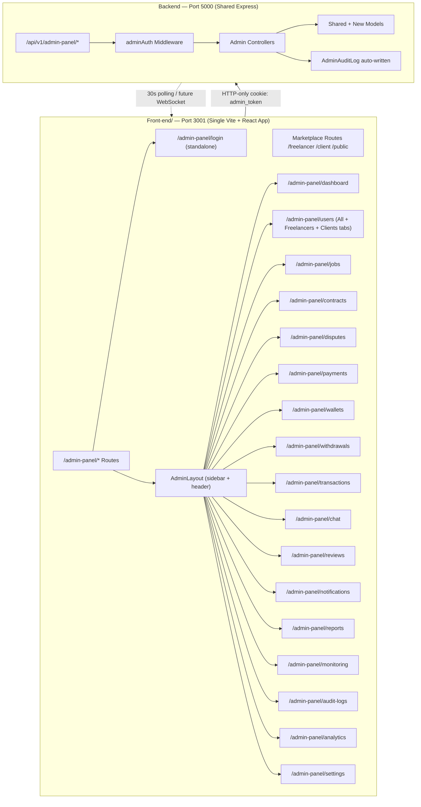

# SkillKart Admin Panel — Implementation Plan (v4)

> **Scope**: A production-ready, enterprise-grade Admin Panel integrated into the **existing Vite + React frontend** (`Front-end/`) and **existing Express backend** (`Backend/`). One app, one port, one database. Admin panel routes live at `/admin-panel/*`. Authentication is completely isolated. Architecture is RBAC-ready for future multi-admin support.

---

## Golden Rules (Non-Negotiable)

| Rule | Detail |
|------|--------|
| ONE React app | Admin panel lives inside `Front-end/` — no separate Vite project |
| ONE port | Everything on `localhost:3001` — no port 3002 |
| ONE backend | Same Express server, new `/api/v1/admin-panel/` prefix |
| ONE database | Same MongoDB — admin models added alongside marketplace models |
| Isolated auth | `admin_token` cookie + separate JWT secret — marketplace JWT never touches admin APIs |
| No style leakage | All admin CSS scoped to `.admin-layout` — marketplace UI untouched |
| Single Users module | One Users page with All/Freelancers/Clients filter tabs — no duplicate pages |
| RBAC-ready | Architecture supports future roles (Super Admin, Finance Admin, etc.) without refactoring |

---

## Architecture Overview



### Key Architectural Decisions

| Decision | Choice | Rationale |
|----------|--------|-----------|
| Frontend | Same `Front-end/` Vite app, `/admin-panel/*` routes | No extra process, no extra port, no extra package.json |
| Backend | Shared Express, `/api/v1/admin-panel/` prefix | Reuses DB, models, services — no infra duplication |
| Auth token | Separate JWT — `ADMIN_JWT_SECRET`, issuer `skillkart-admin`, audience `admin-panel` | Marketplace JWTs can never access admin APIs |
| Cookie | HTTP-only `admin_token` — separate from marketplace `token` | Same-origin safe; zero cookie conflict |
| Admin credentials | Bcrypt hash in `.env` today; RBAC-ready `AdminUser` collection architecture | Easy to migrate to multi-admin later |
| OTP | Reuse existing `otp.service.js` + add failure tracking | Rate-limited, hashed, single-use, logged |
| Session | 30-min inactivity timeout, last-activity update on every request | Enterprise-grade session lifecycle |
| Users module | Single page with All/Freelancers/Clients filter tabs | DRY — no duplicate pages |
| Monitoring | System Logs, Email Logs, API Logs, Error Logs pages | Production observability |
| RBAC | `permissions[]` on AdminUser model, `requirePermission()` middleware stubbed | Zero refactor to enable later |
| Charts | `chart.js` + `react-chartjs-2` added to existing `Front-end/package.json` | Already available in ecosystem |
| Styling | Vanilla CSS dark theme, all vars under `.admin-layout` class | Zero leakage into marketplace |
| Audit logging | `auditLog()` helper called in every controller action | Immutable action trail |
| Soft deletes | `deletedAt` on destructible entities | Financial & user data never lost |
| Exports | CSV + Excel + PDF via `json2csv`, `exceljs`, `pdfkit` | Server-side streaming |
| Real-time | 30s polling now, `useAdminSocket` swap later | Pragmatic V1 |

---

## Phase 0 — New Dependencies

Add to **existing** `Front-end/package.json` (no new package.json created):

```bash
cd Front-end
npm install chart.js react-chartjs-2
```

All other deps (`lucide-react`, `axios`, `react-router-dom`, `react-toastify`) are already installed.

---

## Phase 1 — Database: New Models

### 1.1 `Backend/src/models/AdminSession.js` [NEW]

```js
{
  email:          String (required, indexed),
  tokenHash:      String (required),           // SHA-256 of the JWT
  ipAddress:      String,
  userAgent:      String,
  loginAt:        Date (default: now),
  lastActivityAt: Date (default: now),         // updated on every authenticated request
  expiresAt:      Date (required, indexed),
  isActive:       Boolean (default: true, indexed),
  logoutAt:       Date,
  logoutReason:   String,                      // 'manual' | 'expired' | 'inactivity' | 'forced'
  adminRole:      String (default: 'super_admin'),  // RBAC-ready
  permissions:    [String]                     // RBAC-ready: ['users.read', 'payments.write', ...]
}
// TTL index on expiresAt for auto-cleanup
// Index: { email: 1, isActive: 1 }
```

### 1.2 `Backend/src/models/AdminAuditLog.js` [NEW]

```js
{
  adminEmail:    String (required, indexed),
  adminRole:     String,                       // RBAC-ready
  action:        String (required, indexed),   // e.g. 'user.suspend', 'otp.failed', 'csv.export'
  category:      String (enum: [
                   'auth', 'user', 'job', 'contract', 'dispute', 'payment',
                   'wallet', 'withdrawal', 'review', 'report', 'notification',
                   'settings', 'chat', 'analytics', 'monitoring', 'export'
                 ], indexed),
  resource:      String (required),
  resourceId:    ObjectId,
  previousValue: Mixed,
  newValue:      Mixed,
  ipAddress:     String,
  userAgent:     String,
  notes:         String,
  severity:      String (enum: ['info', 'warning', 'critical'], default: 'info'),
  timestamps:    true
}
// Compound index: { adminEmail: 1, createdAt: -1 }
// Compound index: { category: 1, createdAt: -1 }
// Compound index: { severity: 1, createdAt: -1 }
```

### 1.3 `Backend/src/models/Report.js` [NEW]

```js
{
  reportedBy:   ObjectId (ref: User, required, indexed),
  reportedUser: ObjectId (ref: User, indexed),
  reportedItem: { type: String (enum: ['review','message','job','gig','profile','other']), id: ObjectId },
  category:     String (enum: ['spam','abuse','fraud','harassment','inappropriate','other']),
  description:  String (required),
  evidence:     [String],
  priority:     String (enum: ['low','medium','high','critical'], default: 'medium'),
  status:       String (enum: ['pending','investigating','resolved','dismissed'], default: 'pending'),
  assignedTo:   String,
  resolution:   String,
  resolvedBy:   String,
  resolvedAt:   Date,
  timestamps:   true
}
```

### 1.4 `Backend/src/models/SystemSettings.js` [NEW]

```js
{
  key:           String (unique, required, indexed),
  value:         Mixed (required),
  category:      String (enum: ['fees','security','email','features','general','maintenance']),
  description:   String,
  valueType:     String (enum: ['string','number','boolean','json']),
  lastUpdatedBy: String,
  timestamps:    true
}
// Seeded defaults:
// platform_fee_rate=0.005, maintenance_mode=false, max_login_attempts=5,
// otp_expiry_minutes=10, enable_email_notifications=true, enable_ai_features=true
```

### 1.5 `Backend/src/models/AdminUser.js` [NEW — RBAC-ready, unused today]

```js
// Not used for auth today (credentials stay in .env).
// Schema exists so RBAC can be enabled by flipping one flag in adminAuth.middleware.js.
{
  email:        String (unique, required, indexed),
  passwordHash: String (required),
  role:         String (enum: ['super_admin','finance_admin','support_admin','moderator','analytics_viewer'], default: 'super_admin'),
  permissions:  [String],         // granular: ['users.read', 'payments.write', ...]
  isActive:     Boolean (default: true),
  lastLoginAt:  Date,
  createdBy:    String,
  timestamps:   true
}
```

---

## Phase 2 — Database: Modify Existing Models

#### [MODIFY] `Backend/src/models/User.js`
```diff
+ suspendedAt:     Date,
+ suspendedReason: String,
+ suspendedBy:     String,    // Admin email
+ deletedAt:       Date,      // Soft delete
+ deletedBy:       String,    // Admin email
```

#### [MODIFY] `Backend/src/models/Review.js`
```diff
+ isHidden:    { type: Boolean, default: false },
+ hiddenBy:    String,
+ hiddenAt:    Date,
+ hiddenReason: String,
```

#### [MODIFY] `Backend/src/models/FreelancerProfile.js`
```diff
+ isFrozenWallet:    { type: Boolean, default: false },
+ walletFrozenBy:    String,
+ walletFrozenAt:    Date,
+ walletFrozenReason: String,
```

#### [MODIFY] `Backend/src/models/ClientProfile.js`
```diff
+ isFrozenWallet:    { type: Boolean, default: false },
+ walletFrozenBy:    String,
+ walletFrozenAt:    Date,
+ walletFrozenReason: String,
```

---

## Phase 3 — Backend: Environment & Config

#### [MODIFY] `Backend/.env`
```env
ADMIN_EMAIL=hassansiddiqui2k4@gmail.com
ADMIN_PASSWORD_HASH=$2a$12$xxxxxxxxxxxxxxxxxxxxxxxxxxxxxxxxxxxxxxxxxxxxxxxxxxxxxxxx
ADMIN_SESSION_TIMEOUT=30m
ADMIN_OTP_EXPIRY=10m
ADMIN_MAX_OTP_ATTEMPTS=5
ADMIN_JWT_SECRET=completely_separate_64_char_secret_never_shared_with_marketplace
ADMIN_PANEL_URL=http://localhost:3001
```

#### [MODIFY] `Backend/src/config/index.js`
```diff
+ adminPanel: {
+   email:           process.env.ADMIN_EMAIL,
+   passwordHash:    process.env.ADMIN_PASSWORD_HASH,
+   sessionTimeout:  process.env.ADMIN_SESSION_TIMEOUT  || '30m',
+   otpExpiry:       process.env.ADMIN_OTP_EXPIRY        || '10m',
+   maxOtpAttempts:  parseInt(process.env.ADMIN_MAX_OTP_ATTEMPTS || '5'),
+   jwtSecret:       process.env.ADMIN_JWT_SECRET,
+   panelUrl:        process.env.ADMIN_PANEL_URL          || 'http://localhost:3001',
+   useRBAC:         false    // flip to true when AdminUser collection is ready
+ }
```

#### [MODIFY] `Backend/src/app.js`
```diff
  // http://localhost:3001 is already in allowedOrigins — no CORS change needed.
+ const adminPanelRoutes = require('./routes/adminPanel.routes');
+ app.use(`${API_PREFIX}/admin-panel`, adminPanelRoutes);
```


---

## Phase 4 — Backend: Middleware

### 4.1 `Backend/src/middleware/adminAuth.middleware.js` [NEW]

```
authenticateAdmin(req, res, next)
  1. Extract token from HTTP-only cookie 'admin_token' OR Authorization header
  2. If no token -> 401 MISSING_TOKEN
  3. Verify JWT with ADMIN_JWT_SECRET
     issuer:   'skillkart-admin'
     audience: 'admin-panel'
  4. If verification fails -> 401 INVALID_TOKEN
  5. Compute SHA-256 hash of token
  6. Look up AdminSession by tokenHash where isActive=true
  7. If not found -> 401 SESSION_NOT_FOUND
  8. If expiresAt < now -> mark inactive, logoutReason='expired' -> 401 SESSION_EXPIRED
  9. Check inactivity: if now - lastActivityAt > 30min -> mark inactive, logoutReason='inactivity' -> 401 SESSION_INACTIVITY
 10. Update lastActivityAt = now (non-blocking)
 11. Attach req.admin = { email, sessionId, role, permissions, ipAddress }
 12. Call next()
```

RBAC-ready helper (stubbed):
```js
// requirePermission('payments.write') — returns 403 if admin lacks the permission
// Today with single admin it always passes; flip config.adminPanel.useRBAC to enable
const requirePermission = (permission) => (req, res, next) => {
  if (!config.adminPanel.useRBAC) return next();
  if (req.admin.permissions.includes(permission)) return next();
  return res.status(403).json({ success: false, message: 'Insufficient permissions' });
};
```

### 4.2 `Backend/src/middleware/adminRateLimit.middleware.js` [NEW]

```
adminLoginLimiter   — 5 attempts / 15 min / IP
adminOtpLimiter     — 3 requests / 10 min / IP
adminApiLimiter     — 100 requests / 1 min / session
```

### 4.3 `Backend/src/middleware/adminValidator.middleware.js` [NEW]

```
express-validator schemas for all admin endpoints:
- loginSchema       (email, password)
- verifyOtpSchema   (otp — 6-digit string)
- suspendSchema     (reason — required string)
- adjustWalletSchema (amount, reason, notes)
- resolveDisputeSchema (action, notes, splitPercentage?)
- broadcastSchema   (target, title, message)
- settingSchema     (value — validated against valueType)
```

---

## Phase 5 — Backend: Helpers

### 5.1 `Backend/src/utils/adminAudit.js` [NEW]

```js
// Called at the end of every admin controller action (non-blocking)
const auditLog = async (req, {
  action, category, resource, resourceId,
  previousValue, newValue, notes, severity
}) => {
  await AdminAuditLog.create({
    adminEmail:    req.admin.email,
    adminRole:     req.admin.role,
    action,        // e.g. 'user.suspend', 'otp.failed', 'csv.export'
    category,
    resource,
    resourceId,
    previousValue,
    newValue,
    ipAddress:     req.ip,
    userAgent:     req.get('User-Agent'),
    notes,
    severity:      severity || 'info'
  });
};

// Complete list of audited actions:
// Auth:        login, logout, otp.sent, otp.verified, otp.failed, login.failed, password.reset.forced
// Users:       user.edit, user.suspend, user.unsuspend, user.delete, user.restore
// Jobs:        job.edit, job.close, job.reopen, job.delete
// Contracts:   contract.note.added
// Disputes:    dispute.resolved (severity: critical)
// Payments:    payment.approved
// Wallets:     wallet.adjusted (severity: critical), wallet.frozen, wallet.unfrozen
// Withdrawals: withdrawal.approved, withdrawal.rejected, withdrawal.completed
// Reviews:     review.hidden, review.restored, review.deleted
// Reports:     report.assigned, report.resolved, report.dismissed
// Notifications: notification.broadcast
// Settings:    setting.updated, maintenance.toggled (severity: critical)
// Exports:     export.csv, export.excel, export.pdf
```

### 5.2 `Backend/src/utils/exportHelper.js` [NEW]

```
exportToCSV(data, columns)    -> Buffer (json2csv)
exportToExcel(data, columns)  -> Buffer (exceljs)
exportToPDF(data, columns)    -> Buffer (pdfkit + pdfkit-table)
```

---

## Phase 6 — Backend: Controllers

All controllers in `Backend/src/controllers/adminPanel/`.

### 6.1 `auth.controller.js` [NEW]

**Login flow:**
```
POST /auth/login
  1. Validate email + password (express-validator)
  2. Compare email with ADMIN_EMAIL from config
  3. bcrypt.compare(password, ADMIN_PASSWORD_HASH)
  4. If fail -> auditLog(action:'login.failed') -> 401
  5. Generate 6-digit OTP via otp.service.js (hashed, 10min TTL)
  6. Send OTP to admin email
  7. auditLog(action:'otp.sent')
  8. Return 200 { message: 'OTP sent' }

POST /auth/verify-otp
  1. Validate OTP field (express-validator)
  2. Look up pending OTP by email
  3. Check attempt count — if >= 5: auditLog(action:'otp.failed', severity:'warning') -> 429
  4. If OTP expired -> 401 OTP_EXPIRED
  5. bcrypt.compare(otp, storedHash)
  6. If mismatch -> increment attempts, auditLog(action:'otp.failed') -> 401 OTP_INVALID
  7. Mark OTP used
  8. Create AdminSession (set loginAt, lastActivityAt, expiresAt, ipAddress, userAgent, role, permissions)
  9. Sign JWT (ADMIN_JWT_SECRET, issuer:'skillkart-admin', audience:'admin-panel', expiresIn:30m)
 10. Store SHA-256(token) in AdminSession.tokenHash
 11. Set HTTP-only cookie 'admin_token' (secure, sameSite:'strict')
 12. Seed SystemSettings defaults if not already present
 13. auditLog(action:'login', category:'auth')
 14. Return 200 { message: 'Authenticated', adminEmail }

POST /auth/logout (authenticateAdmin required)
  1. Set AdminSession.isActive=false, logoutAt=now, logoutReason='manual'
  2. Clear 'admin_token' cookie
  3. auditLog(action:'logout')
  4. Return 200

GET /auth/session (authenticateAdmin required)
  1. Return { email, role, permissions, loginAt, lastActivityAt, expiresAt }
```

### 6.2 `dashboard.controller.js` [NEW]

| Endpoint | Method | Description |
|----------|--------|-------------|
| `/stats` | GET | Full summary card data |
| `/today` | GET | Today quick-overview widgets |
| `/recent-activity` | GET | Last 50 audit log entries |
| `/growth` | GET | Daily/Weekly/Monthly growth for charts |
| `/health` | GET | DB status, uptime, memory, system info |

**Dashboard Widgets (all returned by `/stats`):**

| Widget | Source |
|--------|--------|
| Total Users | `User.countDocuments({ deletedAt: null })` |
| Active Users (5min) | `User.countDocuments({ lastActive: { $gte: 5min_ago } })` |
| New Users Today | `User.countDocuments({ createdAt: { $gte: today_start } })` |
| Total Jobs | `Job.countDocuments()` |
| Active Contracts | `Contract.countDocuments({ status: 'active' })` |
| Pending Contracts | `Contract.countDocuments({ status: { $in: ['pending','under_review'] } })` |
| Completed Contracts | `Contract.countDocuments({ status: 'completed' })` |
| Open Disputes | `Contract.countDocuments({ 'dispute.status': 'pending' })` |
| Pending Withdrawals | `Withdrawal.countDocuments({ status: 'pending' })` |
| Pending Reports | `Report.countDocuments({ status: 'pending' })` |
| Platform Revenue | Sum of all `Payment.platformFee` |
| Escrow Balance | Sum of `Payment.depositAmount` where status in deposit_paid/escrow_funded |
| Platform Fees Today | Sum of `Payment.platformFee` where updatedAt >= today_start |
| Wallet Balance (all) | Sum of all FreelancerProfile + ClientProfile wallet balances |
| Failed Payments | `Payment.countDocuments({ status: 'refunded' })` |
| Total Messages | `Message.countDocuments()` |
| System Health | CPU, memory, uptime via `process` |
| Database Status | Mongoose connection state |
| Recent Activity | Last 20 AdminAuditLog entries |

### 6.3 `search.controller.js` [NEW]

| Endpoint | Method | Description |
|----------|--------|-------------|
| `/global` | GET | Search Users, Jobs, Contracts, Payments, Withdrawals, Reports, Reviews, Chats |

Query: `?q=searchterm&types=users,jobs` — max 5 results per type, categorized response.

### 6.4 `users.controller.js` [NEW]

**Single Users module — filter by role in query params, not separate pages.**

| Endpoint | Method | Description |
|----------|--------|-------------|
| `/` | GET | Paginated users — `?role=all\|freelancer\|client&search=&isBlocked=&dateFrom=&dateTo=&page=&limit=` |
| `/:id` | GET | Full user detail with profile, stats, wallet, contracts, jobs, payments, disputes, reports |
| `/:id` | PATCH | Edit user fields + auditLog |
| `/:id/suspend` | PATCH | Suspend (sets `isBlocked`, `suspendedAt`, `suspendedReason`) + auditLog |
| `/:id/unsuspend` | PATCH | Unsuspend + auditLog |
| `/:id/delete` | DELETE | Soft-delete (sets `deletedAt`) + auditLog |
| `/:id/reset-password` | POST | Force password reset + auditLog |
| `/:id/contracts` | GET | User contracts |
| `/:id/jobs` | GET | User jobs |
| `/:id/payments` | GET | User payments |
| `/:id/wallet` | GET | Wallet details |
| `/:id/disputes` | GET | User disputes |
| `/:id/reports` | GET | Reports by/against user |
| `/:id/activity` | GET | AdminAuditLog entries for this user |
| `/export` | GET | Export filtered list (CSV/Excel/PDF) + auditLog(export.csv/excel/pdf) |

### 6.5 `jobs.controller.js` [NEW]

| Endpoint | Method | Description |
|----------|--------|-------------|
| `/` | GET | Paginated jobs + filters + export |
| `/:id` | GET | Job detail |
| `/:id` | PATCH | Edit + auditLog |
| `/:id` | DELETE | Soft-delete + auditLog |
| `/:id/close` | PATCH | Close + auditLog |
| `/:id/reopen` | PATCH | Reopen + auditLog |
| `/export` | GET | Export + auditLog |

### 6.6 `contracts.controller.js` [NEW]

| Endpoint | Method | Description |
|----------|--------|-------------|
| `/` | GET | Paginated contracts + filters + export |
| `/:id` | GET | Detail: history, time logs, payments, end requests, disputes |
| `/:id/notes` | POST | Add admin notes + auditLog |
| `/export` | GET | Export + auditLog |

### 6.7 `disputes.controller.js` [NEW]

| Endpoint | Method | Description |
|----------|--------|-------------|
| `/` | GET | All disputes with filters |
| `/:contractId` | GET | Dispute detail: evidence, messages, work logs, payment history |
| `/:contractId/resolve` | POST | Resolve + auditLog (severity: critical) |

Resolve actions: `release_freelancer`, `refund_client`, `split`, `resume`, `reject`

### 6.8 `payments.controller.js` [NEW]

| Endpoint | Method | Description |
|----------|--------|-------------|
| `/` | GET | All payments + filters + export |
| `/:id` | GET | Payment detail (Stripe info, contract, timeline) |
| `/summary` | GET | Revenue, escrow, released, refunded totals |
| `/export` | GET | Export + auditLog |

### 6.9 `wallets.controller.js` [NEW]

| Endpoint | Method | Description |
|----------|--------|-------------|
| `/` | GET | All wallets |
| `/:userId` | GET | Wallet detail + history |
| `/:userId/adjust` | POST | Adjust balance + auditLog (severity: critical) |
| `/:userId/freeze` | PATCH | Freeze + auditLog |
| `/:userId/unfreeze` | PATCH | Unfreeze + auditLog |

### 6.10 `withdrawals.controller.js` [NEW]

| Endpoint | Method | Description |
|----------|--------|-------------|
| `/` | GET | All withdrawals + filters + export |
| `/:id/approve` | PATCH | Approve + auditLog |
| `/:id/reject` | PATCH | Reject + auditLog |
| `/:id/processing` | PATCH | Mark processing + auditLog |
| `/:id/complete` | PATCH | Mark completed + auditLog |
| `/export` | GET | Export + auditLog |

### 6.11 `transactions.controller.js` [NEW]

| Endpoint | Method | Description |
|----------|--------|-------------|
| `/` | GET | Unified: payments + withdrawals + wallet adjustments |
| `/export` | GET | Export + auditLog |

### 6.12 `chat.controller.js` [NEW]

| Endpoint | Method | Description |
|----------|--------|-------------|
| `/conversations` | GET | All conversations + search |
| `/conversations/:id` | GET | Conversation detail |
| `/conversations/:id/messages` | GET | Read-only paginated messages |

> Admin can only VIEW chats for moderation. No impersonation, no sending messages.

### 6.13 `reviews.controller.js` [NEW]

| Endpoint | Method | Description |
|----------|--------|-------------|
| `/` | GET | All reviews + filters + export |
| `/reported` | GET | Reviews with associated reports |
| `/:id/hide` | PATCH | Hide + auditLog |
| `/:id/restore` | PATCH | Restore + auditLog |
| `/:id` | DELETE | Soft-delete + auditLog |

### 6.14 `notifications.controller.js` [NEW]

| Endpoint | Method | Description |
|----------|--------|-------------|
| `/broadcast` | POST | Send to all / role / specific user + auditLog |
| `/history` | GET | Broadcast history |

### 6.15 `reports.controller.js` [NEW]

| Endpoint | Method | Description |
|----------|--------|-------------|
| `/` | GET | All reports + filters |
| `/:id` | GET | Report detail |
| `/:id/assign` | PATCH | Assign + auditLog |
| `/:id/investigate` | PATCH | Mark investigating + auditLog |
| `/:id/resolve` | PATCH | Resolve + auditLog |
| `/:id/dismiss` | PATCH | Dismiss + auditLog |
| `/export` | GET | Export + auditLog |

### 6.16 `monitoring.controller.js` [NEW]

| Endpoint | Method | Description |
|----------|--------|-------------|
| `/system-logs` | GET | Server-side log tail (last N lines, filterable by level) |
| `/email-logs` | GET | Outgoing email records (from EmailLog model) |
| `/api-logs` | GET | Incoming HTTP request logs (from ApiLog model) |
| `/error-logs` | GET | Application error records (from ErrorLog model) |

Supporting models (add to Backend):
- `EmailLog.js` — logged by wrapping `sendEmail()`: to, subject, template, status, sentAt
- `ApiLog.js`   — logged by express middleware: method, path, statusCode, duration, ip, timestamp
- `ErrorLog.js` — logged by global error handler: message, stack, route, userId, timestamp

### 6.17 `auditLogs.controller.js` [NEW]

| Endpoint | Method | Description |
|----------|--------|-------------|
| `/` | GET | Paginated audit logs — `?adminEmail=&action=&category=&severity=&dateFrom=&dateTo=&page=&limit=` |
| `/export` | GET | Export + auditLog |

### 6.18 `settings.controller.js` [NEW]

| Endpoint | Method | Description |
|----------|--------|-------------|
| `/` | GET | All settings grouped by category |
| `/:key` | PUT | Update setting + auditLog |
| `/maintenance` | POST | Toggle maintenance mode + auditLog (severity: critical) |
| `/seed` | POST | Seed defaults if absent |

### 6.19 `analytics.controller.js` [NEW]

| Endpoint | Method | Description |
|----------|--------|-------------|
| `/revenue` | GET | Revenue over time |
| `/users` | GET | User registration growth |
| `/jobs` | GET | Jobs posted over time |
| `/contracts` | GET | Contract lifecycle |
| `/payments` | GET | Payment volume & status distribution |
| `/withdrawals` | GET | Withdrawal trends |
| `/geographic` | GET | User distribution by country/city |
| `/freelancer-earnings` | GET | Top earners |
| `/client-spending` | GET | Top spenders |
| `/platform-growth` | GET | Combined metrics |

Query params: `?period=daily|weekly|monthly&dateFrom=&dateTo=`


---

## Phase 7 — Backend: Routes

### `Backend/src/routes/adminPanel.routes.js` [NEW]

```
Public (no adminAuth required):
  POST   /auth/login
  POST   /auth/verify-otp

Protected — all require authenticateAdmin:

  POST   /auth/logout
  GET    /auth/session

  GET    /dashboard/stats
  GET    /dashboard/today
  GET    /dashboard/recent-activity
  GET    /dashboard/growth
  GET    /dashboard/health

  GET    /search/global

  GET    /users                       ?role=all|freelancer|client&...filters
  GET    /users/export
  GET    /users/:id
  PATCH  /users/:id
  PATCH  /users/:id/suspend
  PATCH  /users/:id/unsuspend
  DELETE /users/:id/delete
  POST   /users/:id/reset-password
  GET    /users/:id/contracts
  GET    /users/:id/jobs
  GET    /users/:id/payments
  GET    /users/:id/wallet
  GET    /users/:id/disputes
  GET    /users/:id/reports
  GET    /users/:id/activity

  GET    /jobs
  GET    /jobs/export
  GET    /jobs/:id
  PATCH  /jobs/:id
  DELETE /jobs/:id
  PATCH  /jobs/:id/close
  PATCH  /jobs/:id/reopen

  GET    /contracts
  GET    /contracts/export
  GET    /contracts/:id
  POST   /contracts/:id/notes

  GET    /disputes
  GET    /disputes/:contractId
  POST   /disputes/:contractId/resolve

  GET    /payments
  GET    /payments/export
  GET    /payments/summary
  GET    /payments/:id

  GET    /wallets
  GET    /wallets/:userId
  POST   /wallets/:userId/adjust
  PATCH  /wallets/:userId/freeze
  PATCH  /wallets/:userId/unfreeze

  GET    /withdrawals
  GET    /withdrawals/export
  PATCH  /withdrawals/:id/approve
  PATCH  /withdrawals/:id/reject
  PATCH  /withdrawals/:id/processing
  PATCH  /withdrawals/:id/complete

  GET    /transactions
  GET    /transactions/export

  GET    /chat/conversations
  GET    /chat/conversations/:id
  GET    /chat/conversations/:id/messages

  GET    /reviews
  GET    /reviews/reported
  GET    /reviews/export
  PATCH  /reviews/:id/hide
  PATCH  /reviews/:id/restore
  DELETE /reviews/:id

  POST   /notifications/broadcast
  GET    /notifications/history

  GET    /reports
  GET    /reports/export
  GET    /reports/:id
  PATCH  /reports/:id/assign
  PATCH  /reports/:id/investigate
  PATCH  /reports/:id/resolve
  PATCH  /reports/:id/dismiss

  GET    /monitoring/system-logs
  GET    /monitoring/email-logs
  GET    /monitoring/api-logs
  GET    /monitoring/error-logs

  GET    /audit-logs
  GET    /audit-logs/export

  GET    /settings
  PUT    /settings/:key
  POST   /settings/maintenance
  POST   /settings/seed

  GET    /analytics/revenue
  GET    /analytics/users
  GET    /analytics/jobs
  GET    /analytics/contracts
  GET    /analytics/payments
  GET    /analytics/withdrawals
  GET    /analytics/geographic
  GET    /analytics/freelancer-earnings
  GET    /analytics/client-spending
  GET    /analytics/platform-growth
```

---

## Phase 8 — Frontend: New Files Inside `Front-end/src/`

### 8.1 API Module

#### [NEW] `Front-end/src/api/adminPanel.js`

```js
import axios from 'axios';

const adminPanelApi = axios.create({
  baseURL: import.meta.env.VITE_API_URL + '/api/v1/admin-panel',
  withCredentials: true,          // sends admin_token cookie automatically
  headers: { 'Content-Type': 'application/json' }
});

// On 401 -> clear state and redirect to /admin-panel/login
adminPanelApi.interceptors.response.use(
  (res) => res,
  (err) => {
    if (err.response?.status === 401) {
      window.location.href = '/admin-panel/login';
    }
    return Promise.reject(err);
  }
);

export default adminPanelApi;
```

### 8.2 Context

#### [NEW] `Front-end/src/context/AdminAuthContext.jsx`

```jsx
// Completely isolated from marketplace AuthContext.
// State:   { adminUser, isAdminAuthenticated, isLoading }
// Actions: adminLogin(email, password)
//          adminVerifyOtp(otp)
//          adminLogout()
// On mount: calls /auth/session to restore session from admin_token cookie
//           Sets adminUser = { email, role, permissions, loginAt } or null
```

### 8.3 Hooks

#### [NEW] `Front-end/src/hooks/useAdminAuth.js`
```jsx
// Simple hook: return useContext(AdminAuthContext)
```

#### [NEW] `Front-end/src/hooks/AdminProtectedRoute.jsx`
```jsx
// Checks isAdminAuthenticated from AdminAuthContext
// isLoading         -> <AdminLoader /> full-page spinner
// not authenticated -> <Navigate to="/admin-panel/login" replace />
// authenticated     -> render children
```

#### [NEW] `Front-end/src/hooks/useAdminPolling.js`
```jsx
// Generic polling hook for admin dashboard real-time widgets
const useAdminPolling = (fetchFn, intervalMs = 30000) => {
  const [data, setData] = useState(null);
  const [loading, setLoading] = useState(true);
  useEffect(() => {
    fetchFn().then(setData).finally(() => setLoading(false));
    const id = setInterval(() => fetchFn().then(setData), intervalMs);
    return () => clearInterval(id);
  }, []);
  return { data, loading };
};
// Future: swap for useAdminSocket without changing any page components
```

### 8.4 Layout

#### [REPLACE] `Front-end/src/layouts/AdminLayout.jsx`

The current file is a minimal 16-line stub. Replace with:

```jsx
// Full admin layout:
// - Wraps all /admin-panel/* pages except /admin-panel/login
// - Renders AdminSidebar + AdminHeader + <Outlet />
// - Applies className="admin-layout" on root div (all CSS vars scoped here)
// - Sidebar collapse state persisted in localStorage
// - Session expiry detected via 401 interceptor -> auto-logout
```

#### [NEW] `Front-end/src/layouts/AdminLayout.css`

```css
/* All admin CSS vars scoped under .admin-layout — zero marketplace leakage */
.admin-layout {
  --admin-bg:             #0f172a;
  --admin-bg-card:        #1e293b;
  --admin-bg-sidebar:     #0c1524;
  --admin-bg-input:       #1e293b;
  --admin-bg-hover:       #334155;
  --admin-bg-selected:    rgba(59,130,246,0.1);
  --admin-border:         #334155;
  --admin-border-focus:   #3b82f6;
  --admin-text:           #f1f5f9;
  --admin-text-secondary: #cbd5e1;
  --admin-text-muted:     #94a3b8;
  --admin-text-disabled:  #475569;
  --admin-primary:        #3b82f6;
  --admin-primary-hover:  #2563eb;
  --admin-primary-bg:     rgba(59,130,246,0.1);
  --admin-success:        #22c55e;
  --admin-success-bg:     rgba(34,197,94,0.1);
  --admin-warning:        #f59e0b;
  --admin-warning-bg:     rgba(245,158,11,0.1);
  --admin-danger:         #ef4444;
  --admin-danger-bg:      rgba(239,68,68,0.1);
  --admin-info:           #06b6d4;
  --admin-info-bg:        rgba(6,182,212,0.1);
  --admin-font:           'Inter', -apple-system, BlinkMacSystemFont, sans-serif;
  --admin-font-mono:      'JetBrains Mono', 'Fira Code', monospace;
  --admin-sidebar-width:  260px;
  --admin-header-height:  64px;
  --admin-radius:         12px;
  --admin-radius-sm:      8px;
  --admin-shadow:         0 4px 24px rgba(0,0,0,0.3);
  --admin-transition:     all 0.2s ease;
}
```

### 8.5 Pages — Inside `Front-end/src/pages/admin/`

> [!NOTE]
> Freelancers and Clients are NOT separate pages. The single **Users** page provides role filter tabs: All / Freelancers / Clients. This avoids all code duplication.

```
pages/admin/
|-- Login/
|   |-- AdminLogin.jsx          3-step: Email+Password -> OTP -> Dashboard
|   +-- AdminLogin.css
|-- Dashboard/
|   |-- Dashboard.jsx           Quick widgets + Summary cards + Charts + Activity feed
|   +-- Dashboard.css
|-- Users/
|   |-- UsersList.jsx           Single page, role tabs: All | Freelancers | Clients
|   |-- UserDetail.jsx          Tabbed: Profile, Contracts, Jobs, Payments, Wallet, Disputes, Reports, Activity
|   +-- Users.css
|-- Jobs/
|   |-- JobsList.jsx
|   |-- JobDetail.jsx
|   +-- Jobs.css
|-- Contracts/
|   |-- ContractsList.jsx
|   |-- ContractDetail.jsx      Tabs: Details, History, Time Logs, Payments, End Requests, Disputes
|   +-- Contracts.css
|-- Disputes/
|   |-- DisputesList.jsx
|   |-- DisputeDetail.jsx       Evidence viewer, message thread, resolve action panel
|   +-- Disputes.css
|-- Payments/
|   |-- PaymentsList.jsx
|   |-- PaymentDetail.jsx       Stripe info, timeline, linked contract
|   +-- Payments.css
|-- Wallets/
|   |-- WalletsList.jsx
|   |-- WalletDetail.jsx        Balance, adjust modal, freeze toggle, transaction history
|   +-- Wallets.css
|-- Withdrawals/
|   |-- WithdrawalsList.jsx     Approve / Reject / Processing / Complete actions
|   +-- Withdrawals.css
|-- Transactions/
|   |-- TransactionsList.jsx    Unified view with export
|   +-- Transactions.css
|-- Chat/
|   |-- ChatModeration.jsx      Conversation list with search
|   |-- ConversationView.jsx    Read-only message thread + attachments
|   +-- Chat.css
|-- Reviews/
|   |-- ReviewsList.jsx         Hide / Restore / Delete actions
|   +-- Reviews.css
|-- Notifications/
|   |-- BroadcastNotification.jsx   Target: All | By Role | Specific User
|   +-- Notifications.css
|-- Reports/
|   |-- ReportsList.jsx
|   |-- ReportDetail.jsx        Evidence, assign, investigate, resolve, dismiss
|   +-- Reports.css
|-- Monitoring/
|   |-- MonitoringDashboard.jsx Tabs: System Logs | Email Logs | API Logs | Error Logs
|   +-- Monitoring.css
|-- AuditLogs/
|   |-- AuditLogsList.jsx       Timeline view with filters + export
|   +-- AuditLogs.css
|-- Analytics/
|   |-- AnalyticsDashboard.jsx  Revenue, Users, Jobs, Contracts, Geographic charts
|   +-- Analytics.css
+-- Settings/
    |-- SystemSettings.jsx      Grouped settings editor + maintenance mode toggle
    +-- Settings.css
```

### 8.6 Components — `Front-end/src/Components/adminPanel/`

```
Components/adminPanel/
|-- Sidebar/
|   |-- AdminSidebar.jsx        Collapsible, dark, nav groups
|   +-- AdminSidebar.css
|-- Header/
|   |-- AdminHeader.jsx         GlobalSearch + session badge + logout
|   +-- AdminHeader.css
|-- GlobalSearch/
|   |-- GlobalSearch.jsx        Debounced, categorized dropdown results
|   +-- GlobalSearch.css
|-- StatCard/
|   |-- StatCard.jsx            Animated counter, icon, trend arrow
|   +-- StatCard.css
|-- QuickWidget/
|   |-- QuickWidget.jsx         "Today" stat with pulse dot
|   +-- QuickWidget.css
|-- DataTable/
|   |-- DataTable.jsx           Search, filters, sort, pagination, row actions, export buttons
|   +-- DataTable.css
|-- AdvancedFilters/
|   |-- AdvancedFilters.jsx     Date range, status, role, amount, keyword panels
|   +-- AdvancedFilters.css
|-- ExportButtons/
|   |-- ExportButtons.jsx       CSV | Excel | PDF triggers + loading state
|   +-- ExportButtons.css
|-- AdminModal/
|   |-- AdminModal.jsx          Accessible modal with danger/warning/info variants
|   +-- AdminModal.css
|-- ConfirmDialog/
|   |-- ConfirmDialog.jsx       "Are you sure?" with consequences listed
|   +-- ConfirmDialog.css
|-- Charts/
|   |-- BarChart.jsx
|   |-- LineChart.jsx
|   |-- PieChart.jsx
|   |-- DoughnutChart.jsx
|   |-- AreaChart.jsx
|   +-- Charts.css
+-- common/
    |-- AdminBadge.jsx          Status badges (active, suspended, pending, critical...)
    |-- AdminLoader.jsx         Full-page + inline + skeleton variants
    |-- AdminEmptyState.jsx
    |-- AdminUserAvatar.jsx
    +-- AdminTimeline.jsx       Audit log + activity timeline component
```

### 8.7 Routing — Modify Existing `AppRoutes.jsx`

#### [MODIFY] `Front-end/src/routes/AppRoutes.jsx`

```diff
  // Add imports:
+ import { AdminAuthProvider } from '../context/AdminAuthContext';
+ import AdminProtectedRoute from '../hooks/AdminProtectedRoute';
+ import AdminLogin from '../pages/admin/Login/AdminLogin';
+ import AdminDashboard from '../pages/admin/Dashboard/Dashboard';
+ import UsersList from '../pages/admin/Users/UsersList';
+ import UserDetail from '../pages/admin/Users/UserDetail';
+ import JobsList from '../pages/admin/Jobs/JobsList';
+ import JobDetail from '../pages/admin/Jobs/JobDetail';
+ import ContractsList from '../pages/admin/Contracts/ContractsList';
+ import ContractDetail from '../pages/admin/Contracts/ContractDetail';
+ import DisputesList from '../pages/admin/Disputes/DisputesList';
+ import DisputeDetail from '../pages/admin/Disputes/DisputeDetail';
+ import PaymentsList from '../pages/admin/Payments/PaymentsList';
+ import PaymentDetail from '../pages/admin/Payments/PaymentDetail';
+ import WalletsList from '../pages/admin/Wallets/WalletsList';
+ import WalletDetail from '../pages/admin/Wallets/WalletDetail';
+ import WithdrawalsList from '../pages/admin/Withdrawals/WithdrawalsList';
+ import TransactionsList from '../pages/admin/Transactions/TransactionsList';
+ import ChatModeration from '../pages/admin/Chat/ChatModeration';
+ import ConversationView from '../pages/admin/Chat/ConversationView';
+ import ReviewsList from '../pages/admin/Reviews/ReviewsList';
+ import BroadcastNotification from '../pages/admin/Notifications/BroadcastNotification';
+ import ReportsList from '../pages/admin/Reports/ReportsList';
+ import ReportDetail from '../pages/admin/Reports/ReportDetail';
+ import MonitoringDashboard from '../pages/admin/Monitoring/MonitoringDashboard';
+ import AuditLogsList from '../pages/admin/AuditLogs/AuditLogsList';
+ import AnalyticsDashboard from '../pages/admin/Analytics/AnalyticsDashboard';
+ import SystemSettings from '../pages/admin/Settings/SystemSettings';

  // Wrap the existing <Routes> tree:
+ <AdminAuthProvider>
    <Routes>
      {/* ... all existing marketplace routes UNCHANGED ... */}

+     {/* Admin Panel — standalone login (no AdminLayout) */}
+     <Route path="/admin-panel/login" element={<AdminLogin />} />

+     {/* Admin Panel — protected routes under AdminLayout */}
+     <Route
+       path="/admin-panel"
+       element={
+         <AdminProtectedRoute>
+           <AdminLayout />
+         </AdminProtectedRoute>
+       }
+     >
+       <Route index element={<Navigate to="/admin-panel/dashboard" replace />} />
+       <Route path="dashboard"          element={<AdminDashboard />} />
+       <Route path="users"              element={<UsersList />} />
+       <Route path="users/:id"          element={<UserDetail />} />
+       <Route path="jobs"               element={<JobsList />} />
+       <Route path="jobs/:id"           element={<JobDetail />} />
+       <Route path="contracts"          element={<ContractsList />} />
+       <Route path="contracts/:id"      element={<ContractDetail />} />
+       <Route path="disputes"           element={<DisputesList />} />
+       <Route path="disputes/:id"       element={<DisputeDetail />} />
+       <Route path="payments"           element={<PaymentsList />} />
+       <Route path="payments/:id"       element={<PaymentDetail />} />
+       <Route path="wallets"            element={<WalletsList />} />
+       <Route path="wallets/:userId"    element={<WalletDetail />} />
+       <Route path="withdrawals"        element={<WithdrawalsList />} />
+       <Route path="transactions"       element={<TransactionsList />} />
+       <Route path="chat"               element={<ChatModeration />} />
+       <Route path="chat/:id"           element={<ConversationView />} />
+       <Route path="reviews"            element={<ReviewsList />} />
+       <Route path="notifications"      element={<BroadcastNotification />} />
+       <Route path="reports"            element={<ReportsList />} />
+       <Route path="reports/:id"        element={<ReportDetail />} />
+       <Route path="monitoring"         element={<MonitoringDashboard />} />
+       <Route path="audit-logs"         element={<AuditLogsList />} />
+       <Route path="analytics"          element={<AnalyticsDashboard />} />
+       <Route path="settings"           element={<SystemSettings />} />
+       <Route path="taxonomy"           element={<TaxonomyAdmin />} />  {/* existing */}
+     </Route>
    </Routes>
+ </AdminAuthProvider>
```

> [!IMPORTANT]
> The existing `/admin/taxonomy` route continues to work unchanged. The new admin panel is at `/admin-panel/*` — no path collision.

---

## Phase 9 — Sidebar Navigation

```
Dashboard              /admin-panel/dashboard
================================
User Management
  Users (All/FL/Client) /admin-panel/users
================================
Marketplace
  Jobs                  /admin-panel/jobs
  Contracts             /admin-panel/contracts
  Disputes              /admin-panel/disputes
================================
Finance
  Payments              /admin-panel/payments
  Wallets               /admin-panel/wallets
  Withdrawals           /admin-panel/withdrawals
  Transactions          /admin-panel/transactions
================================
Communication
  Chat Moderation       /admin-panel/chat
  Reviews               /admin-panel/reviews
  Notifications         /admin-panel/notifications
================================
Moderation
  Reports               /admin-panel/reports
================================
Monitoring
  System Logs           /admin-panel/monitoring (tab: system)
  Email Logs            /admin-panel/monitoring (tab: email)
  API Logs              /admin-panel/monitoring (tab: api)
  Error Logs            /admin-panel/monitoring (tab: error)
================================
Analytics               /admin-panel/analytics
================================
Audit Logs              /admin-panel/audit-logs
================================
Settings                /admin-panel/settings
================================
Logout
```

---

## Phase 10 — Security Architecture

| Layer | Implementation |
|-------|---------------|
| **Auth isolation** | `admin_token` cookie + `ADMIN_JWT_SECRET` — marketplace JWT rejected with 401 |
| **CSRF** | `csurf` middleware on all admin panel routes |
| **Helmet** | Already in `app.js`; all routes inherit security headers |
| **Same-origin** | Admin on port 3001 — no new CORS entry needed |
| **HTTP-only cookies** | `admin_token`: `httpOnly: true`, `secure: true`, `sameSite: 'strict'` |
| **Rate limiting** | Login: 5/15min, OTP: 3/10min, API: 100/min per session |
| **Input validation** | `express-validator` schemas on all admin write endpoints |
| **XSS protection** | Helmet `xssFilter()` + `mongoSanitize` (already in app.js) |
| **Audit trail** | Every write action logged to `AdminAuditLog` — immutable |
| **Session inactivity** | 30-min timeout checked on every request by `adminAuth` middleware |
| **Session history** | All sessions stored in `AdminSession` — queryable by admin |
| **Force logout** | Admin can invalidate any session via `AdminSession.isActive=false` |
| **Soft deletes** | `deletedAt` on Users, Jobs; `isHidden` on Reviews — data never lost |
| **OTP failure tracking** | Max 5 invalid attempts before lockout; each failure logged |
| **Token isolation** | JWT issuer `skillkart-admin`, audience `admin-panel` — server rejects marketplace tokens |
| **RBAC-ready** | `requirePermission()` middleware stubbed; `useRBAC=false` config flag |

---

## Phase 11 — RBAC Architecture (Ready Now, Enabled Later)

The architecture is designed so RBAC can be activated by:
1. Setting `config.adminPanel.useRBAC = true`
2. Populating `AdminUser` collection with role + permissions
3. Switching `adminAuth.middleware.js` to look up `AdminUser` instead of `.env`

Future roles:

| Role | Permissions |
|------|-------------|
| `super_admin` | All permissions |
| `finance_admin` | `payments.*`, `wallets.*`, `withdrawals.*`, `transactions.*` |
| `support_admin` | `users.read`, `users.suspend`, `disputes.*`, `reports.*` |
| `moderator` | `reviews.*`, `reports.*`, `chat.read` |
| `analytics_viewer` | `analytics.*`, `dashboard.read` |

No page-level code changes are needed when RBAC is enabled — only middleware and API calls are affected.

---

## Phase 12 — Monorepo Scripts (No Changes)

Existing root `package.json` scripts are **unchanged**:

```json
{
  "scripts": {
    "start": "concurrently \"npm run dev --prefix Backend\" \"npm run dev --prefix Front-end\"",
    "dev": "npm start",
    "install:all": "npm install && npm install --prefix Backend && npm install --prefix Front-end"
  }
}
```

Admin panel accessible at `http://localhost:3001/admin-panel/login` — just run `npm start`.

---

## Verification Plan

### Backend API Tests (Postman / curl)

```bash
# Auth
POST /api/v1/admin-panel/auth/login        -> 200 + "OTP sent"
POST /api/v1/admin-panel/auth/login        -> 401 (wrong password) + audit log entry
POST /api/v1/admin-panel/auth/verify-otp   -> 200 + admin_token cookie set
POST /api/v1/admin-panel/auth/verify-otp   -> 401 (wrong OTP) + failure count incremented
POST /api/v1/admin-panel/auth/verify-otp   -> 429 (5th failed attempt)

# Session
GET  /api/v1/admin-panel/auth/session      -> 200 + session info
GET  /api/v1/admin-panel/dashboard/stats   -> 200 + all widget data

# Token isolation
GET  /api/v1/admin-panel/dashboard/stats  (with marketplace token) -> 401
GET  /api/v1/admin-panel/dashboard/stats  (no cookie)              -> 401

# Inactivity
-- Wait 31 minutes --
GET  /api/v1/admin-panel/dashboard/stats   -> 401 SESSION_INACTIVITY

# Logout
POST /api/v1/admin-panel/auth/logout       -> 200 + cookie cleared
GET  /api/v1/admin-panel/dashboard/stats   -> 401 SESSION_NOT_FOUND

# Integration smoke test
node Backend/src/test_integration.js       -> all existing marketplace tests green
```

### Manual Frontend Verification

1. `http://localhost:3001/admin-panel/login` -> full 3-step login flow
2. Marketplace user visits `/admin-panel/dashboard` -> redirected to admin login
3. Marketplace pages load normally while admin session is active (no interference)
4. Dashboard all stat cards show accurate DB counts
5. Users page: All tab shows everyone; Freelancers/Clients tabs filter correctly
6. Suspend user -> verify `isBlocked=true` -> check audit log entry
7. Resolve dispute -> verify payment transferred -> audit log severity=critical
8. Wallet adjust -> audit log severity=critical
9. Export users CSV -> file downloads; audit log records `export.csv`
10. Monitoring page -> System Logs, Email Logs, API Logs, Error Logs all load
11. Settings -> update platform_fee_rate -> audit log entry
12. Toggle maintenance mode -> audit log severity=critical

---

## Implementation Order

| # | Phase | What | Files | Location |
|---|-------|------|-------|----------|
| 1 | DB New Models | AdminSession, AdminAuditLog, Report, SystemSettings, AdminUser, EmailLog, ApiLog, ErrorLog | 8 | `Backend/src/models/` |
| 2 | DB Schema Mods | User, Review, FreelancerProfile, ClientProfile | 4 | `Backend/src/models/` |
| 3 | Config | `.env` + `config/index.js` + `app.js` | 3 | `Backend/` |
| 4 | Middleware | adminAuth + adminRateLimit + adminValidator | 3 | `Backend/src/middleware/` |
| 5 | Helpers | adminAudit.js + exportHelper.js | 2 | `Backend/src/utils/` |
| 6 | Auth Controller | login, verify-otp, logout, session | 1 | `Backend/src/controllers/adminPanel/` |
| 7 | Dashboard + Search | stats, today, growth, health, global search | 2 | `Backend/src/controllers/adminPanel/` |
| 8 | Users Controller | full CRUD + sub-resources | 1 | `Backend/src/controllers/adminPanel/` |
| 9 | Jobs + Contracts + Disputes | 3 controllers | 3 | `Backend/src/controllers/adminPanel/` |
| 10 | Finance | Payments, Wallets, Withdrawals, Transactions | 4 | `Backend/src/controllers/adminPanel/` |
| 11 | Communication | Chat, Reviews, Notifications | 3 | `Backend/src/controllers/adminPanel/` |
| 12 | Moderation + Monitoring | Reports, EmailLog, ApiLog, ErrorLog | 2 | `Backend/src/controllers/adminPanel/` |
| 13 | Analytics + AuditLogs + Settings | 3 controllers | 3 | `Backend/src/controllers/adminPanel/` |
| 14 | Route file | All routes wired | 1 | `Backend/src/routes/adminPanel.routes.js` |
| 15 | FE: API + Context + Hooks | adminPanel.js, AdminAuthContext, AdminProtectedRoute, useAdminPolling | 4 | `Front-end/src/api/` + `context/` + `hooks/` |
| 16 | FE: Layout | Replace AdminLayout.jsx + AdminLayout.css | 2 | `Front-end/src/layouts/` |
| 17 | FE: Shared Components | Sidebar, Header, GlobalSearch, StatCard, QuickWidget, DataTable, Charts, common | ~20 | `Front-end/src/Components/adminPanel/` |
| 18 | FE: Login Page | 3-step AdminLogin | 2 | `Front-end/src/pages/admin/Login/` |
| 19 | FE: Dashboard Page | Widgets + Charts + Activity | 2 | `Front-end/src/pages/admin/Dashboard/` |
| 20 | FE: Users Page (with tabs) | UsersList + UserDetail | 3 | `Front-end/src/pages/admin/Users/` |
| 21 | FE: Marketplace Pages | Jobs, Contracts, Disputes | 6 | `Front-end/src/pages/admin/` |
| 22 | FE: Finance Pages | Payments, Wallets, Withdrawals, Transactions | 8 | `Front-end/src/pages/admin/` |
| 23 | FE: Communication Pages | Chat, Reviews, Notifications | 5 | `Front-end/src/pages/admin/` |
| 24 | FE: Moderation + Monitoring | Reports, MonitoringDashboard | 4 | `Front-end/src/pages/admin/` |
| 25 | FE: Admin Tools | AuditLogs, Analytics, Settings | 6 | `Front-end/src/pages/admin/` |
| 26 | FE: AppRoutes.jsx | Add /admin-panel/* route block | 1 | `Front-end/src/routes/` |
| 27 | FE: package.json | Add chart.js + react-chartjs-2 | 1 | `Front-end/` |
| 28 | Integration Testing + Polish | End-to-end verification | -- | -- |

**Total estimated files: ~110+ new/modified** — all within existing `Front-end/` and `Backend/` directories.

---

> [!NOTE]
> Backend phases (1-14) are fully testable via Postman before any frontend work starts.
> Frontend phases (15-27) build incrementally — shared components first, then pages.
> The admin panel runs at `http://localhost:3001/admin-panel/` — no extra port, no extra terminal, no extra directory.
> RBAC can be enabled for future multi-admin support by flipping one config flag and populating the `AdminUser` collection.
